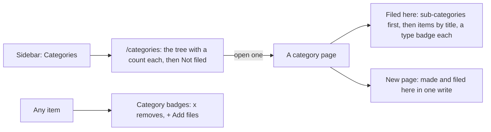

# 115 — Categories to browse: the tree, a category's contents, and a new page filed where it is made

> Dated implementation record. Tests use temporary folders and synthetic data. The owner's live `life.db` is never
> opened by a test.

## Status

- **Date / baseline:** 2026-10-15, `7083b88` (master).
- **Priority:** P2. **Effort:** M, in two steps. **Risk:** LOW: the browser, one new read, and one optional field
  on `create-page`. No schema change, no new data rule, no action name changes.
- **Status:** IN PROGRESS.
- **Resolves:** no issue, no RFC. The owner's request (2026-10-15): "organize some of my pages into notebooks or
  categories or something and to be able to navigate them." An interview followed; its answers are the rules below.

## Why

A category exists ([D26](../decisions/D26-metric-categories.md)): a plain page, and anything is filed in it by a
`part-of` link. A page shows its categories as badges ([plan 114](114-one-way-to-do-a-thing.md)), and `/metrics`
draws the category tree for metrics. The pages have no such view: the sidebar has no entry for categories, a
category page lists what is filed in it only as backlinks in its margin, and no view says which pages are filed
nowhere. The owner cannot browse the pages by category.

The interview settled the shape. A notebook is a category: the same page, the same link, the word "category"
everywhere. A thing can be in several categories. A category shows everything filed in it, whatever its type. The
order is the title's. Manual order, exclusive membership and a body syntax that files a page were rejected: the
first two need schema and an incident, the third is two ways to say one thing (D26).

## The rules

1. **The Categories view.** `/categories` is a sidebar entry of the record group. It draws the category tree, the
   way `/metrics` draws it: a category under its first parent by title, by path. Beside each is the count of what is
   filed directly in it. At the end, Not filed lists every live plain page that is in no category and is not a
   category itself, by title. A day page is not a plain page here: a day is never filed. A category with nothing
   filed in it does not exist: it is a page like any other.
2. **A category page shows what is filed in it.** One section, Filed here, in the sheet after the body: the
   sub-categories first, then the rest by title, each with its type as a badge when it is not a page. The margin's
   Backlinks no longer lists the `part-of` edges: an item is listed once. Conversations is a category like any
   other: its page lists the daily transcripts.
3. **A new page is filed where it is made.** `create-page` takes an optional `category` (a title): the page is
   made and filed in that category in one write, and a missing category is made, as `file-pages` makes it. A
   category page offers New page with its own title filled. The one action serves every surface: the CLI's
   `do create-page category=Travel`, the MCP tool and the browser's form. A category that cannot hold a page (a
   day) is refused by `links_endpoint_types`, and nothing is written.
4. **Nothing else moves.** `/metrics` stays the metrics' grouped view. The badges stay as plan 114 left them.

## The steps

Each step is one commit, with its tests, and can ship alone.

| step | rules | where |
|---|---|---|
| 1. The Categories view | 1 | `core/categories.go` (counts, `Unfiled`); `api/categories.go` (`/categories`); `html.go` (`navItems`, `viewOf`); `assets.go` (an icon); `days.go` (Home's link); a template |
| 2. Filed here, and New page here | 2, 3 | `siren.go` (`category` on `create-page`); `core/write.go` (`CreatePage`); `api/pages.go`; `page.html`; `app.css` |

## Tests

- Step 1: the tree in path order with the counts; a sub-category under its parent; Not filed holds the unfiled
  plain pages and not a category, a day page or a filed page; the sidebar entry is current on `/categories`; the
  JSON carries the same.
- Step 2: a category page lists its sub-categories before its items, by title, with a type badge on a file; the
  margin's Backlinks has no `part-of` group; `create-page` with `category` makes the page and the `part-of` link in
  one write, and makes a missing category; with a day as the category, nothing is written (no page, no link); the
  page view offers `create-page` with `category` filled; the catalog and the MCP tool carry the field.
- Every step: `go generate ./... && go vet ./... && go test ./...`, a shuffled run of api and core, and a look in a
  browser on synthetic data (desktop and phone, light and dark).

## Result

- To be written when the steps are done.
