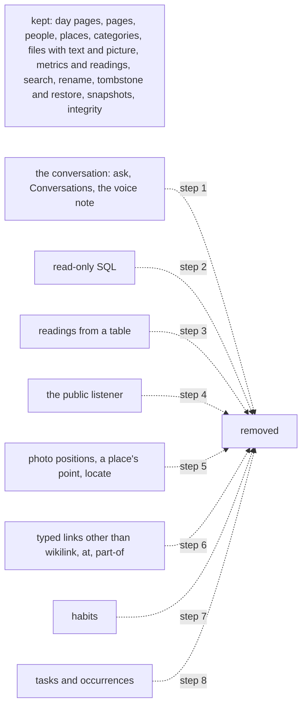

# 116 — Strip to the core: remove the features the owner does not use

> Dated implementation record. Tests use temporary folders and synthetic data. The owner's live `life.db` is never
> opened by a test.

## Status

- **Date / baseline:** 2026-10-15, `518c3bb` (master).
- **Priority:** P1. **Effort:** XL, in eight steps. **Risk:** MEDIUM: four steps change the schema, which is
  possible only before the freeze ([D13](../decisions/D13-migrations-and-freeze.md)); each of those rewrites the
  owner's rows as text before its table goes, so no word is lost.
- **Status:** IN PROGRESS: step 4 waits for the owner's word, and the live file waits for the program run.
- **Resolves:** the owner's decision (2026-10-15): "I am looking to strip all the unwanted or complex features in
  order to have a simpler more reliable software." The owner chose every candidate of the inventory below. Each
  schema step has its own issue and RFC, as [RFC 0013](../rfcs/0013-no-sessions.md) and
  [RFC 0014](../rfcs/0014-no-periods.md) had.

## Why

`life.db` is a life log and its backup. Around that core the writer grew features that cost more than they give:
each is a table, a contract page, a set of actions on every surface, its suites and its mutants, and at the freeze
whatever is still in the schema stays for good. The owner reviewed the inventory and kept the core only.

## The rules

1. **A removal is complete.** The actions leave the catalog, so the CLI, the MCP tools and the browser lose them
   together; the routes, the views, the Go, the docs pages, the suites and the mutants go in the same commit; the
   counts in `tests/README.md` stay true. No feature flag, no deprecated path.
2. **The docs say the current truth.** A decision that described the feature is rewritten in place to say that
   the thing is not kept and what holds its content instead (as [D22](../decisions/D22-events.md) does for spans).
   The issue and the RFC are the dated record.
3. **No word of the owner's is lost.** Before a table goes, its rows are written as text into the page they
   belong to: a place's point into the place page, a typed link as a wikilink line in the page's body, a habit's
   periods into the metric page, a task into a page of tasks. The program that does it is prepared and tested on a
   synthetic file, and the owner runs it on `life.db` (service stopped, snapshot first, integrity check after).
4. **Each step ships alone.** One commit per step, baseline green, pushed and deployed. A step that changes the
   schema deploys its binary before the owner's file changes: the writer opens a file by `user_version` only, so a
   table the new binary does not know is left alone until the owner's program drops it.

## The steps

| step | removes | record |
|---|---|---|
| 1 | `ask`, `/conversations`, the Conversations pages, the voice note (`capture` audio, the transcriber), the chat, agentic and speech packages, the model configuration | issue 0075, RFC 0015; the non-goals row on AI generation rewritten; README |
| 2 | `query` (`POST /query`), `core/query.go`, the CLI `query` | README (an application decision) |
| 3 | `readings-from-table` (`POST /measurements/from-table`), `core/tables.go` | README |
| 4 | `serve --public` and the token: `serve` is local-only | README |
| 5 | the `places` table (point, radius, link_days), `locate`, the map link, the photo's position and its place matching, the folder import of photos; a photo keeps its own day | issue 0076, RFC 0016; D21 and D16 rewritten; cookbook place-of-a-photo removed |
| 6 | `link_kinds` rows `about`, `located-in`, `parent-of`, `friend`, `family`, `related`; `link` and `unlink` keep `at` only | issue 0077, RFC 0017; D8 and D16 rewritten; cookbook inside-a-place removed |
| 7 | the `habit_periods` table, `start-habit`, `stop-habit`, `check-in`, `/habits` | issue 0078, RFC 0018; D24 rewritten: a habit is a metric with a daily reading |
| 8 | the `tasks` and `task_occurrences` tables, `lifelog_meta.planning`, the planning contract, the eleven task actions, `/tasks`, `/deadlines` | issue 0079, RFC 0019; D23 and D15 rewritten: planning is text in a page |

## Tests

- Each step: `go generate ./... && go vet ./... && go test ./...` green; the catalog test lists no removed action;
  the reference test keeps `API.md` equal to the code; the shell test's sidebar matches.
- Steps 5 to 8: the owning suite and its mutants go with the rule; `tests/README.md` counts change in the same
  commit and the commit message says so. The one-off program for `life.db` is tested on a synthetic file made by
  the writer: the rows become text, the table goes, the schema equals a fresh file from `schema.sql`, and the four
  integrity checks pass.

## Result

- **Step 1 (the conversation).** Removed: `ask`, `/conversations`, the chat page, the chat sidebar and its
  styles, the portraits, `capture`'s `audio` field and the CLI's `--audio`, the packages `internal/chat` and
  `internal/speech`, the Chat entry of the sidebar, the share target's file. `New` no longer takes an asker or a
  transcriber. Record: issue 0075, RFC 0015, a non-goals row; issues 0071 and 0072 closed the other way; the README
  bullets of plans 102, 103, 106 and 109 replaced by one. Checks: `go generate ./... && go vet ./... && go test ./...`
  green. The service unit still sets `LIFELOG_MODEL_URL` and `LIFELOG_MODEL`: they are read by nothing now.
- **Step 2 (read-only SQL).** Removed: `query` (`POST /query`), the CLI `query`, `core/query.go` with its statement
  allow-list and `Result`, and the ad hoc reader of `internal/db`. The tests that used `query` as a probe of what a
  surface wrote read the row from the file instead (`freshStore`, `scalar`). Record: README; API.md's `result`
  class is the dry run's shape alone. Checks: `go generate ./... && go vet ./... && go test ./...` green.
- **Step 3 (readings from a table).** Removed: `readings-from-table` (`POST /measurements/from-table`), the CLI
  `readings` and `--column`, `core/tables.go` with the source `import:table`, the agentic skill
  `lifelog-readings-from-table`. A reading is recorded one at a time with `record`. Record: README, API.md.
  Checks: `go generate ./... && go vet ./... && go test ./...` green.
- **Step 4 (the public listener).** Not done: the service unit runs `serve --public --token-file … --allow-origin
  https://balaur.ojos-sargas.ts.net`, and `tailscale serve` proxies the tailnet to it. Without `--public` the
  tailnet access would carry no credential and the local Host guard would refuse the proxied host. The owner
  decides whether to keep it as it is.
- **Step 5 (photo positions).** Removed: the `places` table and its three triggers, the `places` suite and 19
  mutants, the cookbook recipe place-of-a-photo, `locate`, the map of the places with the world outline and
  `tools/worldmap`, `add-file`'s `at` and `radius` and the position in its answer, the folder import of the CLI's
  `file`, the position in `internal/photo`. A photo keeps its own day. Record: issue 0076, RFC 0016; D21
  rewritten, D16, D09, D20, D03 and the non-goals edited; the 2075 table lost its question on a place's point.
  Checks: `go generate ./... && go vet ./... && go test ./...` green. The live file still holds `places` until the
  owner runs the one-off program (after step 8, one program for the four schema steps).
- **Step 6 (typed links).** Removed: the registry rows `about`, `located-in`, `parent-of`, `friend`, `family` and
  `related`; `link_kinds.symmetric`, `link_kinds_mirror_valid` and the three mirror triggers; the symmetric query of
  the integrity checks and its `invalid_symmetric_links`; the cookbook recipe inside-a-place; 20 mutants. `link` and
  `unlink` keep `at` and `part-of`. The link map draws three arrows. Record: issue 0077, RFC 0017; D8 rewritten,
  D11, D16, D20, D26, the cookbook recipes everything-about and days-that-name, the integrity contract and the
  schema README edited; README and API.md say the current truth. Checks: `go generate ./... && go vet ./... &&
  go test ./...` green.
- **Step 7 (habits).** Removed: the `habit_periods` table and its seven triggers, `measurements_habit_binary`,
  the two habit queries of the integrity checks, `start-habit`, `stop-habit`, `check-in` and `register-metric`'s
  `habit_from`, `/habits` and the Habits lens of Metrics, the habits of Home, of a day and of a week with their
  strips, the Habits group, the CLI's `habits`, `done` and `skip`, the cookbook recipe habits, the `habits` suite
  and 40 mutants. A habit is a unitless metric with a reading of 1 or 0 a day. Record: issue 0078, RFC 0018; D24
  rewritten, D06, D07, D12, D15, D26, D27, the day view and metrics-by-category recipes, the integrity contract, the
  entity model, the 2075 table (one question fewer) and the schema README edited; README and API.md say the current
  truth. Checks: `go generate ./... && go vet ./... && go test ./...` green.
- **Step 8 (tasks).** Removed: the `tasks` and `task_occurrences` tables with their indexes and fourteen
  triggers, `lifelog_meta.planning` and the task clauses of three other rows, the task clause of `ghost_pages`, the
  planning contract, the cookbook recipe tasks, the three task queries of the integrity checks, the eleven task
  actions, `/tasks` and `/deadlines`, the due lists of Home, of a day, of a month and of a week, the Due count of
  the sidebar, the CLI's `tasks` and `due`, `page.task_project`, the `planning` suites and 83 mutants. A plan is
  words in a page. Record: issue 0079, RFC 0019; D23 and D15 rewritten; D10, D11, D12, D22, the goals, the
  non-goals, the product concepts, the imports and integrity contracts, the 2075 table (three questions fewer),
  the entity model, the ghost-pages recipe, the schema README, the writer guide and AGENTS.md edited; README and
  API.md say the current truth. Checks: `go generate ./... && go vet ./... && go test ./...` green.
- **The live file.** A one-off program, `dropcore` (kept at `~/.local/share/lifelog-ui/dropcore-bin` with its
  source beside it), brings `life.db` from the schema before RFC 0016 to the current `schema.sql` in one
  transaction: a place's point, a link of a removed kind (with a wikilink in its place), a habit's periods and every
  task with its occurrences become text in their pages (the tasks in a page `Tasks`); the four tables go;
  `link_kinds` is made again without `symmetric`; every other rule, table text and `lifelog_meta` row is made equal
  to a fresh file, and the program refuses to commit on any difference. Tested on 2026-10-15 on a synthetic file
  made by the binary of `498cbb8`: 2 points, 7 links, 2 periods and 2 tasks became text, 9 entities kept, the four
  checks pass, and the binary of this plan reads the result. The owner runs it with the service stopped, after a
  snapshot, then the integrity check, then starts the service.
