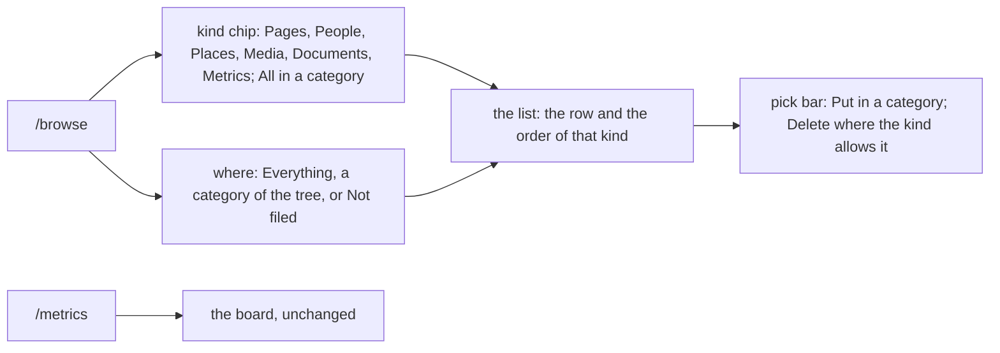

# 117 — One Browse view: the kinds and the categories in one place

> Dated implementation record. Tests use temporary folders and synthetic data. The owner's live `life.db` is never
> opened by a test.

## Status

- **Date / baseline:** 2026-10-15, `d7194c8` (master).
- **Priority:** P2. **Effort:** L, in four steps. **Risk:** MEDIUM: the browser's navigation changes, six GET
  routes become redirects, and three actions take one more optional field. No schema change, no new data rule.
- **Status:** IN PROGRESS.
- **Resolves:** no issue, no RFC. The owner's request (2026-10-15): the sidebar listed Categories, People, Places,
  Media, Files, Metrics and Ghost pages side by side, and "I can think of People as categories, or places as
  categories or even media and files or metrics." The owner chose one Browse view, with three answers: Metrics
  keeps its own board; Ghost pages may be deleted several at once; the meaning of Not filed was left to the
  plan (rule 4).

## Why

The sidebar put three different things in one list:

- a **kind**: what a thing is (`entities.entity_type`): a page, a person, a place, a metric, a file. One kind for
  each thing. It is fixed when the thing is made.
- a **category**: where the owner put it, by a `part-of` link ([D26](../decisions/D26-metric-categories.md)). A
  thing can be in many categories. The owner makes them.
- a **state**: Ghost pages and Not filed are lists of work, not things.

The plain pages had no list of their own, so Categories was both the category tree and the list of pages. A
person then looked like one more category. One view with two filters shows the difference: the kind is a chip,
the category is a branch of the tree.

## The rules

1. **One resource, `GET /browse`, and one catalog action, `browse`.** The action is a GET, as `search` is, so the
   CLI's `do browse`, the MCP tool and the browser carry it with no adapter code. Its fields, all optional:

   | field | values | default | meaning |
   |---|---|---|---|
   | `kind` | `page`, `person`, `place`, `media`, `document`, `metric`, `all` | `all` with `in`, else `page` | the kind of the rows |
   | `in` | a page title | none | the category: only what is filed directly in it |
   | `unfiled` | `0`, `1` | `0` | only what is in no category |
   | `ghosts` | `0`, `1` | `0` | only the rows of the `ghost_pages` view |
   | `media` | `image`, `video`, `audio` | none | one media kind |
   | `limit`, `offset` | as every list | 200, 0 | the page of rows |

   A combination with no meaning is refused (422): `all` without `in`; `in` with `unfiled`; `ghosts` with a kind
   other than `page`, or with `in` or `unfiled`; `media` with a kind other than `media`. A title that names no
   page is a 404. A title of a page with nothing filed in it gives an empty list.
2. **Each kind keeps its row and its order.** The order is fixed in Go. There is no sort field.

   | kind | the row | order | New on the list |
   |---|---|---|---|
   | `page` | the title; a badge when the page is a category | title | `create-page` |
   | `person` | the face, the title, the mentions and the last day | title | `create-person` |
   | `place` | the title, the mentions and the last day | title | `create-place` |
   | `media` | a tile: the picture, the title, the kind and the day | newest day first | `add-file`, `original` accepts media |
   | `document` | the title, the type and the day | newest day first | `add-file` |
   | `metric` | the title and the unit; the board has the values | title | none: New metric is on `/metrics` |
   | `all` | the title and a kind badge; the sub-categories first | title | none |
   | `ghosts` | the title | oldest first | none |

   A page is a plain page: a day page is never in Browse (the Calendar has the days). Media and documents are the
   files, split by the first part of `files.mime`, as `/media` and `/files` split them before.
3. **The category tree is beside the list.** It is drawn as `/categories` drew it (by path, a count each of
   everything filed directly in it), with Everything at the top and Not filed at the end. The current branch is
   marked, and the title says where the list is: "In Family › Cousins". A branch link keeps the kind when the URL
   names one; without one, it opens All in that category. On a phone the tree is a closed disclosure above the
   chips, and the chips are one row that scrolls.
4. **Not filed follows the chosen kind.** With Pages, it is the list `/categories` showed: the plain pages in no
   category that are not categories themselves. With People, the people in no category, and so on. Each chip shows
   its count in the current scope (Everything, the category, or Not filed), so a large backlog of one kind does not
   hide the others. The reason: one rule ("in no category") for every kind, and Pages, the default, keeps today's
   meaning.
5. **One pick bar.** Every list except `all` offers `file-pages` (Put in a category, with Move). `page` (ghosts
   too), `media` and `document` also offer `tombstone-pages`. People, places and metrics are deleted from their
   own page, as before. The ghost list now offers Delete: the owner's word (2026-10-15).
6. **A new thing is filed where it is made.** `create-person`, `create-place` and `add-file` take the optional
   field `category`, as `create-page` and `register-metric` do: the thing and its `part-of` link in one write, a
   missing category made as `file-pages` makes it, and a day as the category refused by `links_endpoint_types`
   with nothing written. Browse inside a category fills `category` in the New form. When `add-file` finds a file
   that exists, it files that file.
7. **The sidebar has two record entries.** Today, Calendar, Metrics and Browse are the sections of every day; on a
   phone they are the bottom bar with More. The record group goes. The New menu opens each kind on its Browse list
   (`/browse?kind=person&new=create-person`); New page opens `/browse?kind=page&new=create-page`; New file opens the
   media list. Metric and Reading stay on `/metrics`.
8. **The old addresses answer 308.** `GET /people` → `/browse?kind=person`, `/places` → `kind=place`, `/media` →
   `kind=media` (its `kind=` becomes `media=`), `/files` → `kind=document`, `/ghosts` → `kind=page&ghosts=1`,
   `/categories` → `/browse`; `limit` and `offset` are kept. The POST routes of those paths do not change. Home
   keeps its link rels with the new hrefs and adds `browse`. A category page keeps Filed here and links to
   `/browse?in=<title>`.
9. **Nothing else moves.** `/metrics` and its board, `/metrics/{name}`, search, the Calendar and the badges stay as
   they are.

### Rules of earlier plans that this plan reverses

- [Plan 114](114-one-way-to-do-a-thing.md): "a page has no list: Home has New page" — a page now has a list, and
  New page opens it.
- [Plan 115](115-categories-to-browse.md), rule 1: `/categories` as its own sidebar entry, with Not filed for pages
  only — the tree is in Browse, and Not filed follows the kind (rule 4).
- The ghost list without Delete (`tombstones_test.go`) — the ghost list offers Delete (rule 5).

## The steps

Each step is one commit, with its tests, and can ship alone.

| step | rules | where |
|---|---|---|
| 0. Defects found in the study | — | `root.html` (links to `/deadlines` and `/tasks`, the `query` form), `day.html` (`/metrics?show=habits`), `siren.go` (`habit_from` in a description), `categories.go` (`file-pages` self link) |
| 1. `/browse` and the action `browse`, beside the old lists | 1–5 | `core/browse.go` (the scoped reads and the counts); `api/browse.go`; `siren.go`; `html/browse.html`; `app.css`; `html.go` (`viewOf`); API.md |
| 2. A new thing filed where it is made | 6 | `siren.go`; `core/write.go` and the file write; `api/pages.go`, `api/files.go` |
| 3. The navigation, the redirects, and the old lists deleted | 7, 8 | `html.go` (`navItems`, `newKinds`); `layout.html`; `days.go`; `serve.go`; the old handlers, templates and reads; the tests that named them; API.md; README |

## Tests

- Step 0: Home has no link to a route that is not served, and no form of an action the entity does not offer; a
  day page links to no `/metrics?show=`; the description of each catalog action names only its fields.
- Step 1: for each kind, the rows, their order and their row fields, against hand-checked synthetic data; `in`
  gives only what is filed directly in the category; `unfiled` for each kind, and for pages the same rows as
  `Store.Unfiled`; the counts of each chip in each scope; `ghosts` gives the `ghost_pages` rows, oldest first, with
  Delete; each refused combination is a 422 and a title of nothing a 404; paging links keep the filters; the pick
  bar offers what rule 5 says and no more; the same rows through HTTP, the CLI's `do browse` and the MCP tool; an
  agent gets the action.
- Step 2: each of the three actions with `category` writes the thing and the link in one write; a missing category
  is made; a day as the category writes nothing; an existing file is filed; the Browse New form in a category has
  `category` filled.
- Step 3: the sidebar entries and their current marks; the phone bar; each old GET path answers 308 to its new
  address with its query; the POST routes still work; Home's links; the New menu hrefs.
- Every step: `go generate ./... && go vet ./... && go test ./...`, a shuffled run of `api` and `core`, and a look in
  a browser on synthetic data (desktop and phone, light and dark).

## Result

(Filled when the plan is done.)
