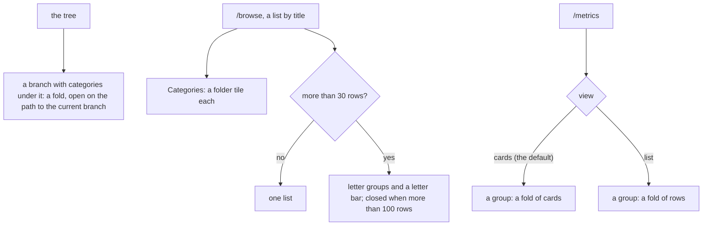

# 118 — Fold and find: the tree, the Browse list and the Metrics board fold

> Dated implementation record. Tests use temporary folders and synthetic data. The owner's live `life.db` is never
> opened by a test.

## Status

- **Date / baseline:** 2026-10-15, `0f85dda` (master).
- **Priority:** P2. **Effort:** M, in three steps. **Risk:** LOW: the HTML of two views changes. The API, the catalog,
  the CLI and the MCP tools do not change. No schema change, no new data rule.
- **Status:** DONE.
- **Resolves:** no issue, no RFC. The owner's request (2026-10-15): "in browse mode and in metric to be able to
  collapse the pages or the metrics, or find a better way to display them … heavily improve the UI and the UX in
  terms of navigation". The owner chose three answers: Browse shows the categories as folders, then the pages in
  letter groups; the Metrics board folds each group and has a Cards and List switch; the tree folds and is open on
  the path to the current branch.

## Why

A study on synthetic data (20 categories, 8 of them under another, 160 pages, 30 metrics) found three defects of
navigation:

- **Browse, Pages, Everything** is one list of every page, by title, with the categories mixed in. It was 7,300 px
  tall in a desktop window and 7,500 px on a phone. Nothing folds, and nothing jumps to a part of it.
- **The category tree** draws every branch open, a row of 43 px each. A branch does not fold.
- **The Metrics board** draws every group open, and a metric with no reading has a full card. A group with no metric
  of its own ("Health 6") is followed by the group under it ("Bloodwork 6"), and the two counts look like one.

## The rules

All folds are `
`: there is no script ([README](../../README.md), "No script").

1. **The tree folds.** A category with categories under it is a row with a fold beside it, and the categories under
   it are in that fold. A fold is open when the current branch is that category or is under it; the others are
   closed. A row is the link to the category, as before; the fold is a separate control, so a reader of the screen
   hears a link and a button. The rows are shorter.
2. **Categories are folders.** On Pages in Everything, the top categories come first, as folder tiles: a folder
   icon, the title and the count of what is filed directly in it. The tile opens the category in Browse, as its branch
   of the tree does. The categories are then not repeated in the list of pages. Inside a category, on All and on
   Pages, the categories under it are the folders. The folders are in a fold of their own, open. With Select, a
   folder has a box, as a row has.
3. **Letter groups.** A list in title order (pages, people, places, metrics, All) with more than 30 rows is in
   groups by the first letter of the title, upper case; a title that does not start with a letter is in `#`. A
   letter bar above the groups links each group. Each group is a fold with its count. The groups are open, and closed
   when the list has more than 100 rows. A link of the bar targets the first row of the group, so a browser that
   opens a fold on a fragment (Chromium) opens it. The media and documents lists (newest first) and the ghost list
   (oldest first) are not grouped.
4. **The Metrics board folds.** A group is a fold, open, whose line says its title, its count and the day of its
   newest reading. A category under it is a fold inside it. "+ New metric here" and the link to the category's page
   are in the open fold. The jump bar stays.
5. **Cards or List.** `/metrics?view=list` draws each metric as one row: the box of Select, the name, the latest value
   with its unit, its day, its line and + Add. `/metrics` (no `view`) draws the cards. The switch is two links at the
   top. `view` is a word of the page, as `new` is ([plan 114](114-one-way-to-do-a-thing.md)): the JSON of `/metrics`
   does not change, and a form of the page returns to the same view (`back` is the page's own address).
6. **Nothing else moves.** The catalog, the rows of `browse`, paging, the pick bar and its actions, the kinds and
   their order stay as they are.

## The steps

| step | rules | where |
|---|---|---|
| 1. The tree folds | 1 | `browse_view.go` (`BrowseTree`), `browse.html`, `app.css` |
| 2. Folders and letter groups | 2, 3 | `browse_view.go` (`BrowseList`), `browse.html`, `app.css` |
| 3. The board folds; Cards or List | 4, 5 | `metric_view.go`, `metrics.html`, `app.css`, README |

## Tests

- Step 1: the tree is nested by path; the fold of the current branch and of each category above it is open, the
  others closed; a leaf has no fold; the empty tree is Everything and Not filed.
- Step 2: the folders of Everything are the top categories with their counts and hrefs, and the list holds no
  category; inside a category the folders are the categories under it; groups by letter at 31 rows and not at 30; a
  title that starts with a digit is in `#`; groups closed at 101 rows; the letter bar links each group; media and
  ghosts are not grouped; a folder has a box with Select.
- Step 3: each group and each category under it is a fold; the line has the count and the newest day; `?view=list`
  draws rows with the same metrics and values as the cards; a form of the list view returns to `?view=list`.
- Every step: `go generate ./... && go vet ./... && go test ./...`, a shuffled run of `api`, and a look in a browser
  on synthetic data (desktop and phone, light and dark).

## Result

- **Step 1, the tree folds.** `BrowseTree` (`browse_view.go`) builds the branches from the paths of the tree's
  categories; `tree-branches` (`browse.html`) draws a row a category, and a category with categories under it has a
  fold (`li.branch`) whose chevron sits at the start of the row. The rows are 34 px, not 43 px.
- **Step 2, folders and letter groups.** `BrowseList` gives the folders and the rows, alone or in letter groups;
  `browse-row` is the row of every list that is not tiles. On synthetic data (20 categories, 160 pages) Browse in
  Everything is about 1,000 px tall in a desktop window, not 7,300 px. A link of the letter bar opens a closed group
  in Chromium (checked on a phone with Playwright).
- **Step 3, the board folds; Cards or List.** `MetricSections` gives each group and each category under it the day of
  its newest reading (`Latest`). `metric-board` draws `metric-cards` or `metric-rows`; the pick bar and each + Add
  return to `Here`. A row of the list is one line in a wide column and two lines in a narrow one, without the line
  of the readings. "Check the cards" of the pick bar is now "Check the metrics", which says both views. New metric
  still returns to `/metrics`, the cards.
- **Tests.** New: `TestTheTreeFoldsOpenOnThePath`, `TestTheTopCategoriesAreFolders`, `TestALongListIsInLetterGroups`
  (`browse_view_internal_test.go`, on props written by hand), `TestALongBrowseListHasALetterBar`,
  `TestTheMetricsBoardFoldsAndHasAList`. Changed with the markup, the same behaviour asserted:
  `TestTheBrowsePageDrawsTheTreeTheChipsAndTheRows` (the nested tree, Cousins and Family as folders, the open fold on
  the path), `TestBrowseDrawsTheTreeAndTheUnfiledPages` (Travel in the closed fold of Life),
  `TestTheMetricsPageDrawsCards` and `TestMetricsAreGroupedByCategory` (the heading of a category under a group is
  now the line of its fold, and the link to its page is Open Iron in the fold). The switch marks its current link
  with `aria-current="true"`, since the sidebar marks the page (`TestEveryPageIsSemanticHTML`).
- **Checks run (Linux):** `gofmt -l` clean; `go generate ./... && go vet ./... && go test ./...` green;
  `go test -count=1 -shuffle=on ./internal/api` green; screenshots on synthetic data, desktop and phone, light and
  dark, with Playwright and Chromium. Not run: `staticcheck`, `govulncheck`, the race check, Windows, Firefox and
  Safari (a browser that does not open a fold on a fragment scrolls to the closed group).
