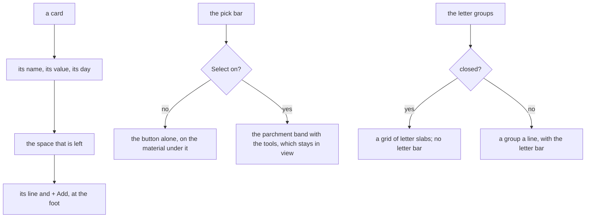

# 119 — The finish: the cards, the pick bar, the letter index and the folders look finished

> Dated implementation record. Tests use temporary folders and synthetic data. The owner's live `life.db` is never
> opened by a test.

## Status

- **Date / baseline:** 2026-10-16, `c8c7baa` (master).
- **Priority:** P3. **Effort:** M. **Risk:** LOW: the sheets and the markup of a few views change. The API, the
  catalog, the CLI and the MCP tools do not change. No schema change, no new data rule.
- **Status:** DONE.
- **Resolves:** no issue, no RFC. The owner's request (2026-10-16): "from a functional point it works … but it does
  not look that great, I want it to look pretty". The look stays the Almanac bound in Hearthwood
  ([plan 096](096-bound-in-hearthwood.md)): no new colour, no radius, no blur. This plan finishes what is drawn with it.

## Why

Screenshots on synthetic data (desktop and phone, light and dark) found these defects of finish:

- **The cards are ragged.** A metric card and a reading tile of the day are as tall as the tallest card of their row,
  but + Add sits under the last line of each card, so the buttons of one row are at different heights. The line
  "2 days ago · Wed 14 Oct · 21 readings" wraps onto three lines in a phone's card.
- **The pick bar is a band with one button.** Before Select, the bar is a full band of parchment with a bevel, over
  every list of Browse and the Metrics board. Inside the sheet of Browse it covers the sheet's edge.
- **The head of a metric group has an empty line.** "Open Body" and "+ New metric here" are a row of their own,
  between the heading and the cards, at the far end.
- **The closed letter groups are a column of near-empty lines,** one letter a line across the full sheet, with a bar
  of the same letters above it.
- **The folder tiles are flat.** They are the only slab of the app with a 1 px edge and no drop.
- **The header tools wrap on a phone.** Home's three buttons take two rows of 40 px.
- **The lists of the margin are loose.** A backlink row is 47 px, with a dark rule between the rows.
- **A part of app.css is outside its layers.** The rules of plans 115 and 118 were appended after the utilities
  layer, so they beat every layer, the utilities too. The sheets say that a rule is in a layer.

## The rules

1. **A card has a foot.** A metric card and a reading tile are a column. The free space is above the line of readings,
   so the line and + Add are at the foot of every card in a row. The day of the reading and the count of readings
   are two lines.
2. **The pick bar is quiet until Select.** Before Select it is the button alone, with no band. With Select on it is
   the parchment band, as before, and stays in view while the list scrolls.
3. **A group's tools are its foot.** The link to the category's page and + New metric here are after the cards of the
   group, at the start of the line. The line of a fold has a stitch between the title and the day of its newest
   reading, as the heading of a panel has.
4. **Closed letters are an index of slabs.** When the letter groups are closed (more than 100 rows), each group is a
   slab of a grid: the letter in the display face, the count under it. An open group takes the full width. The
   letter bar is drawn only when the groups are open: closed, the slabs are the index.
5. **A folder is a slab.** The folder tile has the 2 px edge, the bevel and the hard drop of a button, and it sinks
   when it is pressed.
6. **The tools of a head are small in a narrow column.** Under 608 px of column, a button of the page head is the
   small one, so Home's three fit on one line.
7. **A list of the margin is compact.** A row has 8 px above and below, with the soft rule.
8. **Every rule is in a layer.** The rules of plans 115 and 118 move into the components layer, at its end. A test
   holds that nothing of app.css is outside its two layers.

## Tests

- Rule 8: `TestTheSheetsAreLayered` fails on the sheet of `c8c7baa` (a rule after the utilities layer), then passes.
- Rule 1: the card's markup has the day and the count as two lines (`TestTheMetricsPageDrawsCards`).
- Rule 3: the tools of a group come after its cards (`TestTheMetricsBoardFoldsAndHasAList`).
- Rule 4: a list of 101 rows has no letter bar and its groups are closed; a list of 31 rows has the bar
  (`TestALongBrowseListHasALetterBar`).
- Every rule: `go generate ./... && go vet ./... && go test ./...`, and a look in a browser on synthetic data
  (desktop and phone, light and dark).

## Result

- **Rule 8, the layers.** `TestTheSheetsAreLayered` reads the blocks at the top of app.css; on `c8c7baa` it reported
  19 rules outside the layers. They are now at the end of the components layer. The rules of plan 115 for
  `.tree>li.depth-N` matched nothing since the tree nests (plan 118) and are deleted. A row of the metric list is
  `ul.metric-rows>li.metric-row`, so it still beats `ul.plain>li` inside the layer.
- **Rules 1 to 7.** A tile's line and + Add are at its foot (`.reading-tile`). A metric card with no reading has a
  dash and its unit where the value goes, then "No reading yet". The day of the reading and the count are two lines.
  The pick bar has no band until Select. A group's tools follow its cards. The heading of a fold has a stitch, except
  in a column under 488 px. The closed letter groups are `.letter-groups.closed`, a grid of slabs, and the page draws no
  letter bar for them. The folder tiles are slabs. The head's buttons are small under 608 px of column. A row of a
  margin list is 8 px above and below with the soft rule.
- **Tests.** Changed with the markup, with the same behaviour asserted: `TestTheMetricsPageDrawsCards` (the two
  lines of a card, the dash of an empty card). Added: the order of the tools in `TestTheMetricsBoardFoldsAndHasAList`,
  the closed index with no bar in `TestALongBrowseListHasALetterBar`, and the layer check in `TestTheSheetsAreLayered`.
- **Checks run (Linux):** `gofmt -l` clean; `go generate ./... && go vet ./... && go test ./...` green;
  `go test -count=1 -shuffle=on ./internal/api` green; screenshots on synthetic data, desktop and phone, light and
  dark, with Playwright and Chromium, also with Select on and with one letter open. Not run: `staticcheck`,
  `govulncheck`, the race check, Windows, Firefox and Safari.
