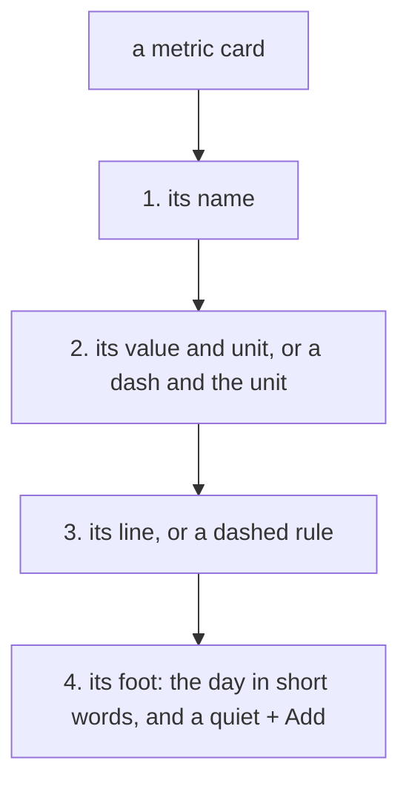

# 120 — A tidy board: every metric card has the same four lines, and the repeated buttons are quiet

> Dated implementation record. Tests use temporary folders and synthetic data. The owner's live `life.db` is never
> opened by a test.

## Status

- **Date / baseline:** 2026-10-16, `4e0219e` (master).
- **Priority:** P3. **Effort:** S. **Risk:** LOW: the markup of the Metrics board and the sheet change. The API, the
  catalog, the CLI and the MCP tools do not change. No schema change.
- **Status:** DONE.
- **Resolves:** no issue, no RFC. The owner's word after [plan 119](119-the-finish.md) (2026-10-16): "the metrics page
  still looks messy a bit".

## Why

A full-page screenshot of `/metrics` on synthetic data (30 metrics in 8 groups) found three causes:

- **About 40 slab buttons.** Each card had a + Add slab, and each group a "+ New metric here" slab. The design
  system shows one loud button a screen; here every card looked like a control panel.
- **Cards of different shapes.** One card had the day on two lines and the count on a third, the next had one line
  and no line of readings. A row was as tall as its tallest card, so most cards had an empty middle.
- **Three lines of controls.** The view switch and the jump bar, then Select on its own line.

## The rules

1. **Four lines a card.** Every card has the name, the value, the line and the foot, in that order, so the cards of a
   board are of one height. With no reading the value is a dash and the unit, the line is a dashed rule and the
   foot says "No reading".
2. **The day in short words.** The foot says the first words of the day ("2 days ago", "today", "Thu 1 Oct"). The
   whole day and the count of readings are the title of its `time` element.
3. **The repeated buttons are quiet.** + Add of a card, of a row of the list and of a day's reading tile is a link
   drawn as a quiet button: no slab, a border on hover. "+ New metric here" is a link beside "Open Body".
4. **One line of controls.** Select is at the end of the line of the switch and the jump bar. With Select on, its
   band opens under that line, full width.

## Tests

- `TestTheMetricsPageDrawsCards`: the foot of a card is the short day in a `time` element with the whole day and the
  count in its title; a card with no reading has the dash, the unit, the dashed rule and "No reading".
- Every rule: `go generate ./... && go vet ./... && go test ./...`, and a look in a browser on synthetic data
  (desktop and phone, light and dark).

## Result

- `metricCard.Short` (`metric_view.go`) is the words of `When` before " · ". `metric-cards` (`metrics.html`) draws
  the four lines, the foot in `.card-foot`. `new-here` is a link. The board's pick list is a grid
  (`.pick-list.board`): the switch and the jump bar in the first cell, Select in the second, every group full width;
  with Select on, the band is the second row.
- **Checks run (Linux):** `gofmt -l` clean; `go generate ./... && go vet ./... && go test ./...` green;
  `go test -count=1 -shuffle=on ./internal/api` green; screenshots on synthetic data, desktop and phone, light and
  dark, with Playwright and Chromium, also with Select on. Not run: `staticcheck`, `govulncheck`, the race check,
  Windows, Firefox and Safari.
