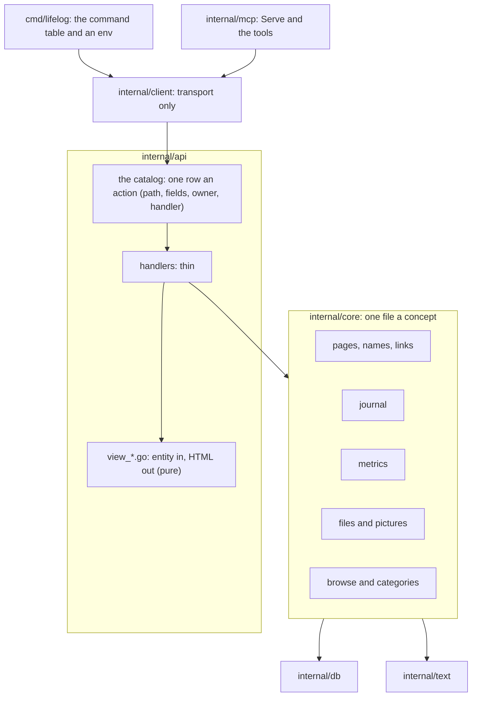
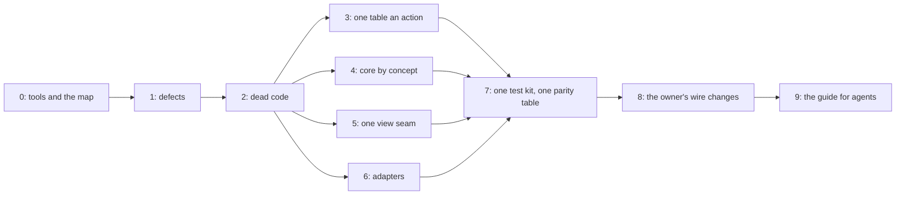

# 121 — Deep modules for agents: one place a concept, fewer lines, every part testable

> Dated implementation record. Tests use temporary folders and synthetic data only. The owner's live `life.db` is
> never opened. Nothing in the schema or the contract of `docs/` changes; the parts that change an answer on the wire
> wait for the owner's word (Part 8).

## Status

- **Date / baseline:** 2026-10-16, `fd4d82a` (master).
- **Priority:** P2. **Effort:** XL in total; each part is S or M and is one or more commits. **Risk:** MEDIUM: many
  files move and many tests merge. A move is a move; a merged test keeps every assertion (the rules below).
- **Status:** IN PROGRESS on the branch `plan-121-deep-modules`. One commit for the records, then one or more
  commits a part, then the closing commit.
- **Resolves:** no issue, no RFC. The owner's request (2026-10-16): organise the code for agentic development, remove
  the lines that can go, and make every part of the code testable.

## Why

An agent works well when one concept is in one place, when a small interface hides much behaviour, and when a test
can attach at that interface. The words of this plan:

| word | meaning | source |
|---|---|---|
| module | anything with an interface and an implementation: a function, a file, a package | Pocock, `codebase-design` |
| interface | what a caller must know: the signature, the invariants, the errors, the order of calls | Ousterhout, ch. 4 |
| deep | a small interface over much behaviour; shallow is the opposite | Ousterhout, ch. 4 |
| seam | the place where a module's interface lives, and where its tests attach | Feathers; Pocock |
| locality | a change to one concept touches one place | Pocock |
| the deletion test | delete the module: if the complexity goes, it was shallow; if it moves to the callers, it earns its place | Pocock, `improve-codebase-architecture` |

The rules this plan takes from them:

- **The interface is the test surface.** A test that must change when the implementation changes tests past the
  interface. When a module is made deeper, the old tests of its shallow parts go, after each of their assertions has
  a home at the new seam (Pocock: "replace, don't layer").
- **One adapter is a hypothetical seam; two adapters are a real one.** No interface for a mock. This agrees with
  AGENTS.md ("concrete types by default") and Go Code Review Comments.
- **Fewer, larger packages** (Cheney); split a package only when the compiler then holds a real rule.
- **Structure is checked by a test, not by prose** (Böckeler on harness engineering): where two lists must agree,
  one list goes, or a test holds them equal.

Sources: [mattpocock/skills](https://github.com/mattpocock/skills) (`improve-codebase-architecture`,
`codebase-design`, `tdd`); [Ousterhout, CS190 notes](https://web.stanford.edu/~ouster/cgi-bin/cs190-winter18/lecture.php?topic=modularDesign);
[Go Code Review Comments](https://go.dev/wiki/CodeReviewComments);
[Cheney, Practical Go](https://dave.cheney.net/practical-go/presentations/qcon-china.html);
[Claude Code best practices](https://code.claude.com/docs/en/best-practices);
[Böckeler, harness engineering](https://www.martinfowler.com/articles/exploring-gen-ai/harness-engineering-memo.html);
[deadcode](https://go.dev/blog/deadcode); [coverage of a binary](https://go.dev/doc/build-cover).

## What the audit found (2026-10-16, `fd4d82a`)

- **Size.** 12,849 production lines and 26,621 test lines of Go; 1,961 lines of templates and CSS. `internal/api` is
  5,830 production lines in 60 files; `internal/core` is 3,088.
- **Checks.** `go test -count=1 ./...` passes: 386 top-level tests in 51 s. The slowest are
  `TestRequestBufferLimits` (7.5 s) and `TestMultipartAggregateLimits` (3.3 s), both in `internal/api`.
- **Coverage map** (`-short`, `-coverpkg` over `internal/...` and `cmd/...`, blocks merged): 87.2 % of statements.
  A subprocess test adds nothing to it, so `cmd/lifelog/output.go` shows 26 % and `agentic.go` 0 %.
- **Not run:** `deadcode`, `staticcheck` and `govulncheck` are not installed, and their modules are not all in the
  module cache (Part 0).
- **Hidden state is already rare.** No `os.Getenv`, `os.Args` or `os.Stdout` outside `cmd/lifelog`; three clocks in
  production code (Part 4).
- **Plan 098 did a first pass** (dead code, one write style, the command table, `handler.go` split). This plan does
  not repeat it; it finds what came back and what plan 098 left shallow.

The module map, with the deletion test applied:

| module | interface → what it hides | verdict | the change |
|---|---|---|---|
| `internal/db` | `Init`, `Open`, `Copy` → pragmas, the version floor, `BEGIN IMMEDIATE` | deep | none |
| `internal/text` | 8 functions → the title predicate, keys, wikilinks, tags | deep | one Markdown walk (Part 4) |
| `internal/core` | about 133 exported names → every write and read | deep as a whole, wide at the top; one concept is in 3 or 4 files | split by concept; a smaller surface (Part 4) |
| `internal/api`: catalog and dispatch | `GET /actions`, `serve`, errors → Siren, prefill, redirect, refusal | deep, but the catalog and the route table must agree by string | one table (Part 3) |
| `internal/api`: views | 38 template functions and 23 view methods | the forms are deep; the render seam is shallow and the words are scattered | one view seam (Part 5) |
| `internal/client` | `Get`, `Do`, `DoFiles`, `Catalog` → in-process or remote, multipart, numbers | deep | `tools.go` leaves (Part 6) |
| `internal/mcp` | `Serve` (81 lines, 854 test lines) | shallow: its logic is in `client/tools.go` | takes `tools.go` (Part 6) |
| `cmd/lifelog` | the command table | good; tested only by subprocess where it touches stdout, the environment or the executable | an `env` (Part 6) |
| `internal/photo`, `internal/preview`, `internal/agentic`, `internal/scaletest` | 1 to 3 functions each | deep | keep; small fixes |

The target:

## The rules for every part

- **Reproducer first** for a defect: the test fails at the baseline, then the fix makes it pass.
- **A move is a move.** A commit that moves code changes no line inside a function; `git diff --color-moved` shows it.
  The set of top-level declarations is the same before and after.
- **Replace, do not layer.** A test is deleted only when each of its assertions has a home, and the commit message
  lists that mapping. The test count may go down; no behaviour loses its assertion.
- **A template change keeps the output byte for byte**, unless the part says otherwise: render every page of the
  `TestEveryViewRenders` fixture before and after and compare the files (a throwaway script, not committed).
- **The baseline after every part:** `go generate ./... && go vet ./... && go test ./...`; `gofmt` on changed files;
  the tools of Part 0 when the owner allows them. `go test -count=1 -shuffle=on ./...` after Parts 6 and 7.
- **The docs say the truth.** README, API.md and `tests/README.md` change in the commit that changes what they name.
- Simplified Technical English in every comment and commit message.

Parts 3 to 6 touch different files and can go in parallel worktrees.

## Part 0 — The tools and the map

| what | proof |
|---|---|
| With the owner's word: pinned tools, outside `go.mod`. `deadcode` v0.52.0 (`golang.org/x/tools`), `staticcheck` 2026.2.2 (v0.8.2), `govulncheck` v1.9.0. Record each version in the closing commit. | each one runs on the baseline; its findings go into Part 2 or get a written disposition |
| `deadcode -test ./...` for `GOOS=linux` and `GOOS=windows`; only a name that both runs report is dead. | the list in the commit of Part 2 |
| The coverage map includes the subprocess tests: build the test binary with `go build -cover`, set `GOCOVERDIR`, merge with `go tool covdata textfmt`. Write the commands in `tests/README.md` (a command, not CI configuration). | `cmd/lifelog/output.go` and `agentic.go` show their real coverage |

## Part 1 — Defects (reproducer first)

| defect | where | the fix |
|---|---|---|
| Keeping a photo with a day scans every row of `entities`: `preflightEmbed` reads `WHERE preferred_name_key = ?`, and no index starts with that column. | `core/files.go` `preflightEmbed` | `WHERE id = (SELECT entity_id FROM entity_names WHERE name_key = ?)`; a work-count probe in the style of `reading_query_plan_test.go` |
| The catalog tells MCP agents what is not true: `add-file` says a photo's position is read and an `at` link made (plan 116 removed it); `open-day` says "what was due" (D23). | `api/siren.go`; the comment of `core/files.go` `placeAndDay` | the true text; `API.md` lines that say "import workspace" |
| The style page draws `step` with a `day` key, and the template reads `label` and `text`: the link has no accessible name. | `html/styleguide.html` | Part 5 makes the style page run the real templates |
| A metric's 14-day line labels the last reading "today" on a past day: `trendLine` builds `clock{today: day}`. A guess until the reproducer fails. | `api/today.go` | the words come from the view's clock |
| `Store.SetPictureOf` returns the `Sync` of a write that rolled back. | `core/picture.go` | the generic wrapper of Part 4 zeroes it |
| `snapshot` answers 422 `snapshot_refused` for every error, a timeout and an internal error too. | `api/maintenance.go` | only core's refusals are `snapshot_refused`; a timeout is 504 |
| A template error's text goes to the client; `io.Copy` and `jsonShape` drop their errors. | `api/html.go` | log it, answer 500 with no detail |
| `phototest` ignores the error of `jpeg.Encode`; `db.Close` ignores `PRAGMA optimize` and the rollback. | `photo/phototest`, `db/db.go` | check them |

## Part 2 — Dead code out

Each name has no caller outside its own declaration (grep, and the 0 % functions of the coverage map), unless the
row says otherwise.

| what | where |
|---|---|
| `boolField`, `optionalID`; the `kind` parameter and switch of `tombstoneMany` (only `"pages"` is passed) | `api/request.go`, `api/tombstones.go` |
| `view.ActionFor`; the template function `depth`; the `formOf` options `primary` and `choices:`; the `due` icon; `calWords.Class` and the three `{{with $w.Class}}` branches; `isDayText` (it equals `core.IsDay`) | `api/html.go`, `api/assets.go`, `api/calendar.go`, `api/metric_view.go`, `html/month.html` |
| Dead CSS: `ul.suggest`, `.margin .habit`, `.editor .preview`, `.count`, `.tag.done`, `.tag.notdone`, `svg.place-map`, `.done`, `.notdone`, `.group.depth-N`, the calendar's `.item.open` and `.item.done`, `.editor`, `.pick-main`, `.muted`; the tokens `--teal` and `--text-accent` (set, never read). Each selector is grepped in the templates and the Go first. | `html/app.css`, `html/base.css` |
| `data-pages` and `data-action`: no script reads them since plan 108; only tests read them. | `html/layout.html`, the tests that read them |
| `captureStdout`; `temporalCalendarKeys`; the `due` case of the flag table; `TestCommandInterruptPolicy`'s removed `import` commands; the `/import` and `approve` checks; the `"import, …"` exception of `reference_test.go` | `cmd/lifelog`, `tests/`, `api` tests |
| `core.Snapshot` (only cmd tests call it: fold into `TakeSnapshot`); `Store.RegisterMetric` (tests only; `CreateMetric` does the same); `ReadingsCount` (the week sums `ReadingsByDay`); `SeriesHistory` (`Series` with an empty `from`, which also removes `"0000-01-01"` from `trends.go`) | `internal/core`, `api/weeks.go`, `api/trends.go` |
| `rangeUnit`'s `lo` and `hi`: only a test reads them. It becomes `isScale(unit) bool`; the comment that says the writer holds the range goes (`measurements_scale_range` holds it). | `core/habits.go`, `core/write.go` |
| Joins that select nothing: `metricID` and `PreviewByTitle` join `entity_names` for no column. `reading_query_plan_test.go` keeps a copy of the SQL; it reads one shared constant. | `internal/core` |
| Stale words: "due", "overdue", "habit strip", "approves", "the command list" in comments and test comments; `tests/README.md` names `FuzzTaskCalendarWindow` and deadlines; the plans index says the next number is 119. | everywhere grep finds them |

Estimate: about 350 lines.

## Part 3 — One table an action

Today a capability is written in six places: the catalog row, a route whose path string must equal the row's, a
handler with its own list of required fields, the entity builders that offer it, `results.go`, and `API.md` with
the shapes of `reference_test.go`. The owner-only guard finds its row by comparing the path strings: a typed path
that differs loses the guard, and no test sees it. The required fields already disagree: `save-body` marks `body`
required and the handler checks `version` only; `promote` marks `to` and the handler checks nothing.

| what | where |
|---|---|
| `NewOn` holds one map from the action's name to its handler and mounts every route from the catalog: method, path, the owner guard from `spec.Owner`. A catalog row with no handler, or a handler with no row, panics at start. `ownerPath`, `ownerOnlyGet` and the two wrapping closures go. Routes that are not actions (assets, previews, `/styleguide`, `oldLists`) stay in a short list. | `api/serve.go`, `api/siren.go` |
| One `h.fields(r, spec)` reads the form and refuses a missing required field that is not a path parameter; the handlers' own `required(v, …)` lists go. What `save-body` does with an empty body is the owner's decision (Part 8); until then the catalog row is changed to say what the handler does. | `api/pages.go`, `api/measurements.go`, `api/files.go`, `api/categories.go` |
| One `writeError(w, r, err)`; one constant for the cross-origin refusal; `PublicAddress` uses `loopbackAuthority`'s parse; `api.Public(store, opts)` builds its handler, so the origins are given once. | `api/public.go`, `api/authority.go`, `api/editing.go`, `api/files.go`, `cmd/lifelog/serve.go` |
| `fileForm` → `readFileForm` → `parseFileForm` becomes one function; the unknown-capture-day rule is computed once, in core's `keep`. | `api/files.go`, `core/files.go` |
| Locality: `oldLists` and `toBrowse` to `browse.go`; `named.go` and `media.go` into the browse view; `MimeOf` unexported and its map named `extTypes`; `pageOf` serves `/titles` too; one prune loop in `feedback.go`. | `internal/api` |
| A test loops every catalog row: it has a route, the route's guard matches `Owner`, and a POST without each required field is refused 422. `TestOwnerOnlyActionsPolicy` loops every `Owner` row, not three names. | `api` tests |

After Part 3, a new capability is one catalog row and one handler, plus the builders that offer it.

Estimate: about 120 lines.

## Part 4 — Core by concept

An agent who changes measurements reads about 1,700 lines today (read.go, write.go, habits.go, browse.go); after
this part it reads about 450. One package stays: sub-packages would export `pageRef`, `insertPage` and
`syncWikilinks` for no rule the compiler holds.

| what | where |
|---|---|
| **Moves only, one commit:** `core.go` (with `check.go`), `tx.go` (`Tx`, `Do`, savepoints), `pages.go`, `links.go` (wikilink sync, `Link`, `Unlink`, `LinkKindsFrom`), `journal.go`, `metrics.go` (replaces `habits.go`, which holds no habits), `files.go` with `picture.go`, `browse.go` with `categories.go`, `integrity.go`, `snapshot.go`. | `internal/core` |
| **One clock.** `Store` gets `Clock func() time.Time` and `Zone *time.Location` (nil is `time.Now` and `time.Local`): `Store.Now` is the instant in the zone, `Store.Today` its day. A `Today func() string` alone cannot give a snapshot and a feedback receipt their instant, so the store holds the instant and the zone. `Tx.CreatePage` and `keep` read the store's day; the api reads the same clock, so `NewOn` goes (a test gives `New` a store with a fixed clock), and `feedbackStore` and `snapshot` get `now` from it, not from `time.Now`. The tests that bracket `Today()` before and after a call use a fixed clock. | `core/core.go`, `core/tx.go`, `core/pages.go`, `core/files.go`, `api/serve.go`, `api/shell.go`, `api/feedback.go`, `api/maintenance.go` |
| **One row scan.** `list[T](rows, func(*T) []any)` and `each(rows, func() error)`: every `Scan`, `Close` and `Err` branch is in one place, and one fault test covers it. 27 `for rows.Next()` loops; the three `GROUP BY` counts become one. | `internal/core` |
| **One wrapper.** `alone[T](s, ctx, src, func(*Tx) (T, error))` for the about 19 `Store` one-liners; it zeroes the result on error. | `internal/core` |
| **One live-page check** for the four copies of the 404/409 rule (`livePage`, `Rename`, `FilePages`, `pageByID` users), with one message each. | `internal/core` |
| **A smaller surface.** Unexport the 12 `Tx` methods that only core calls, and `Tx.Source`; move `IsInstant`, `IsOwner`, `Forbidden` to the api, the only user. `checkTitle` runs once in `createNamed`; `PageForTitle` folds into `FilePages`. The `MediaKinds` list is written once. `Metrics()` reads the `part-of` links once (`categories()` read them). | `internal/core`, `api/siren.go` |
| **One day parse.** `core.ParseDay(s) (time.Time, bool)` replaces the api's `IsDay`-then-`time.Parse` pairs (`words.go`, `metric_view.go`, `measurements.go`); `months.go`, `weeks.go` and `shell.go` share one "days with a written flag" helper. | `internal/core`, `internal/api` |
| **Pure parts out of SQL.** The category path drawing (its cycle guard) and `pageActions(p, kinds, cats)` (the actions a page offers) become pure functions with table tests. | `core/categories.go`, `api/pages.go` |
| **One Markdown walk.** `renderedTextRuns` uses `textRuns`; every vector of [titles and wikilinks](../contract/titles-and-wikilinks.md) passes. | `internal/text` |

Estimate: about 350 lines.

## Part 5 — One view seam

The view code stays in `package api` for now, with a `view_` prefix on its files: most of the locality, little risk.
A package of its own (`internal/api/view`) comes after this part, if the owner wants the compiler to keep the store
out of the templates (Part 8).

| what | where |
|---|---|
| **The seam.** A pure `pageOf(entity, facts, refusal) *view` and a `render(w, view, status)`; the refusal is passed, not read from a context key; `refused`, `noFocus` and `asked` leave the wire type `Action` for the view. One render entry point in place of four (`renderHTML`, `writeEntity`, `h.write`, `h.inShell`). | `api/html.go`, `api/shell.go`, `api/serve.go`, `api/siren.go` |
| **Files by concept:** `view_lines.go` (`trendLine`, `sparkLine` and `chart` as one drawer with a placement function), `view_daywords.go` (from `calendar.go`, with `weeks()`), `view_markdown.go` (with `mark` and `plainSnippet`). `categories.go` splits: `Filed` to the page view, `groupMetrics` and `metricOf` to the metrics resource. The template set is named `templates`, not `pages`. | `internal/api` |
| **Logic out of the templates:** a `DayParts()` method for the five scans of `day.html` with flag variables; `view.Today`; one pluralising `count` in the function map for the `{{if eq (num .) "1"}}` idioms, `yearsWords`, `MediaCount` and `Mentions`. | `html/*.html`, `internal/api` |
| **One fragment each:** the body editor fold (three copies, and their help texts already differ), the rejected-names alert, the typed-links list, the pick box, the reading link. | `html/day.html`, `page.html`, `metrics.html`, `layout.html` |
| **No view decides by a name:** `Preview()` tests `Type == "textarea"` only; the Today access key is a field of the nav item. The hand-drawn `categories`, `pick-bar` and New metric forms are the owner's decision (Part 8). | `api/html.go`, `html/layout.html` |
| **The style page runs the real templates** (`leaf`, `step`, `form` on synthetic actions, `monthbox`, `onthisday`, `readings`, `metric-cards`) on synthetic data, so it cannot drift; its task-era specimens go. Its test renders it, not a grep of class names. | `html/styleguide.html`, `shell_test.go` |
| **Table tests for the pure parts** that only HTTP and a database reach today: `MetricSections`, `MetricReadings`, `ReadingTiles`, `CalItem`, the line labels, `yearSummary`, `sinceLastWeek`, `groupMetrics`, `chart`'s low and high. | `internal/api` |

Estimate: about 250 lines of Go and templates, and about 60 of CSS (Part 2's).

## Part 6 — The adapters

| what | where |
|---|---|
| `client/tools.go` and its test move into `internal/mcp`, unexported; the `keep` parameter (always `!a.Owner`) goes. `client` is transport only. The README layout row of `mcp` changes. | `internal/client`, `internal/mcp` |
| `cmd/lifelog` gets an `env`: `stdout`, `stderr`, `getenv`, `executable`. `main()` passes the real ones in about 8 lines. Then `agentic_process_test`, `names_revision_process_test` and `TestPublicServeProcess` run in-process; only the drain-on-interrupt test stays a subprocess (AGENTS.md asks a process for that claim), and `TestMain` builds its binary once. The three copies of the startup-line parse and the two of `os.Executable` go. `--human` output is tested through a buffer. | `cmd/lifelog` |
| The snapshot tests that call `core` and `db` and never the CLI move to `internal/core/snapshot_test.go`; one CLI case stays (`snapshot --to` inside a git work tree is refused before any write). `TestSnapshotRefusesAGitWorkTree` goes: `db.TestSnapshotDestinationErrors` covers it. | `cmd/lifelog`, `internal/core` |
| **The agents' texts are tested against the catalog:** each MCP config of `agentic-init` parses to `mcp`, `agent:NAME` and the file; each backticked tool name in `templates/AGENTS.md` is a tool, and each owner-only name is an owner action. Today a rename breaks the agents' instructions and no test fails. | `internal/agentic`, `cmd/lifelog` tests |
| One `phototest.HEIF(locations…)`, `WithExif` and `JPEG` for the three HEIF builders and the inline JPEGs of four test files. One JSON encoder with `SetEscapeHTML(false)` for the four copies. | `internal/photo`, `internal/preview`, tests |

Estimate: about 250 lines.

## Part 7 — One test kit, one parity table

| what | where |
|---|---|
| **`internal/db/dbtest.New(t)`** for the 29 inline Init-Open-Cleanup blocks and the 5 named copies (`core.fresh`, `api.freshStore`, `api.freshOn`, `mcp.mcpTestClient`, `cmd.commandClient`). It needs only `db`, so the in-package `core` tests use it too. | every package's tests |
| **`internal/api/apitest`:** `Fresh(t, source)`, `Clients(t, h, source)` (in-process and remote), `Must` (a `t.Fatal`, not a panic), `Action`, `Href`, `Status(err)`. It replaces the 12 copies of the remote switch and the three `find`/`actionByName`/`cmdAction`, `must`, `href` copies. The 13 internal test files of `package api` cannot import it (a cycle) and use `dbtest`. | `internal/api`, `internal/mcp`, `cmd/lifelog` tests |
| **One parity table** in `cmd/lifelog/parity_test.go`, the one package that sees the CLI, the client and MCP: surfaces `http`, `remote`, `cli`, `mcp`, each `(action, args) → (*api.Entity, error)`; rows for find, open-day, browse, create-place with a category, file-pages (accepted; refused for a day page, nothing written), rename alias, stale `save-body` (409), `save-body` with a 2^63−1 version, and `register-metric` refused to `agent:*` and absent from the MCP tools. The per-feature copies on each surface go: `api/names_parity_test.go`, `mcp/names_test.go`, `api/revision_parity_test.go`, `mcp/revision_test.go`, the `filed_where_made` and browse copies in `mcp` and `cmd`. Each surface keeps only what is its own: MCP schema, hints, arguments and cancellation; CLI flags, streaming and `snapshot --to`; the client's transport. | `cmd/lifelog`, `internal/api`, `internal/mcp` |
| **One client conformance test:** in-process and remote give equal answers, with multipart, error entities and exact numbers. Then the feature tests of `api` run in-process only. | `internal/client` |
| **Pure functions get table tests and the database tests shrink:** `backOf` (the open-redirect guard; a fuzz target), `browseQueryOf`, `browseActions`, `idsOf`, `toBrowse`, `errorEntity`, `paged`. `TestMultipartUnknownNameProjection` calls `parseFileForm`, not a copy of its loop. | `internal/api` |
| **Test files named by subject:** `hygiene_test.go` → `errors_test.go` and `paging_test.go`; `browser_regression_test.go`, `old_lists_test.go`, `cli_regression_test.go`, `registration_policy_test.go` (→ `owner_test.go`), `filed_where_made_test.go` (three packages), `causes_test.go`, `judgment_test.go`, `counts_test.go`, `new_forms_test.go`, `new_metric_test.go` merge into their subjects; the CSS lint of `browser_view_test.go` and `tokens_test.go` become `sheets_test.go`; core's five integrity files and five `names_*` files become one each. The small suite files of `tests/` join their suites (`tests/README.md` changes with them). | every package's tests |
| **Faster feedback:** find why `TestRequestBufferLimits` takes 7.5 s and `TestMultipartAggregateLimits` 3.3 s; a smaller limit given to the handler in the test keeps the same boundary cases. | `internal/api` |
| Repeated helpers inside `tests/`: `contains`, `eq`, `sorted` become `slices`. `tests/` keeps its own kit: it runs against mutated DDL, not the writer. | `tests/kit_test.go` |

Estimate: about 1,000 test lines, most from the parity table (about 650 net) and the kit (about 280).

## Part 8 — The owner's wire changes

Each row changes an answer that a client sees, so each waits for the owner's word. The plan works without any of them.

| change | why | cost |
|---|---|---|
| Go checks that repeat a DDL rule go: a day page renamed, a date as a new title, a day page promoted, a `redirect` link. The refusal becomes the DDL's 422 (AGENTS.md: a Go copy of a CHECK is a defect). | issue 0068's rule | 409 → 422 in three answers; `names_storage_test`, `scales_test` change |
| `save-body` with an empty body: refused (the catalog's `required`) or accepted (the handler today). | the two lists disagree | one answer changes |
| `/titles` goes: not in the catalog, no entity links it, and `/search` returns `titles`. | the `[[` completion that used it is gone | about 30 lines; an `API.md` section |
| The `kind` property of `tombstone-pages`' answer goes (always `pages`). | dead switch | one property in `API.md` |
| Entity import keys go from `CreatePage`, `CreatePerson`, `CreatePlace` and `byImportKey`: production always passes "" since plan 089; only `scaletest` uses them. `Reading.ImportKey` stays. | dead parameter | about 35 lines; `scaletest` changes |
| `open-day` with no day opens today; MCP `get_day` and the CLI `day` then wrap it. | three ways to one thing | one action field becomes optional |
| `pages` fields drawn as an input with a `<datalist>`, so the `categories`, `pick-bar` and New metric forms use `form` and no view names a field. | README: no view decides by a field's name | the markup of three forms |
| `internal/api/view` as its own package after Part 5. | the compiler keeps the store out of the templates | about 2,100 lines move; Siren types to a leaf package |

## Part 9 — The guide for agents

| what | where |
|---|---|
| The README layout table gets a column "test it at": the seam where a test of that module attaches (`core.Store` on `dbtest.New`; `api.New` on a store with a fixed clock; the parity table for a surface; the pure view functions). | `README.md` |
| `cmd/lifelog` gets a package comment, as every other package has one. | `cmd/lifelog/main.go` |
| With the owner's word: AGENTS.md keeps what an agent needs on every edit, and links the rest (the personas, the performance evidence, the engineering references, the conventions checklist that `docs/` already holds). An agent reads AGENTS.md in every session: 375 lines today. | `AGENTS.md`, `tests/README.md` |

## What this plan does not do

- No interface for a mock, no repository or service layer, no sub-packages of `core` (one adapter is not a seam).
- `client` and `mcp` do not merge: `client` is deep and cmd and 15 api test files use it.
- `photo` and `preview` do not merge: each is deep and does one job.
- No depth score by line ratio; no global coverage target (AGENTS.md: coverage is a map).
- No new dependency. `x/net/html` for semantic HTML assertions is not proposed: a template change keeps its output
  byte for byte instead.

## Done criteria

1. The baseline is green after every part, on Linux and on Windows (the manual workflow); `gofmt` is clean;
   `go test -count=1 -shuffle=on ./...` at the end.
2. With Part 0's tools: `deadcode -test ./...` names nothing on Linux and Windows; `staticcheck ./...` is clean or
   each finding has a written disposition; `govulncheck ./...` exits 0.
3. Every function at 0 % in the coverage map, subprocess runs included, is deleted or named in the closing record
   with the reason no test reaches it.
4. A test holds the catalog and the routes equal (Part 3) and the agents' texts equal to the catalog (Part 6).
5. `TestAPIReferenceMatchesTheCode` passes; the `document` suite finds every page; the parity table passes for every
   surface, and the owner-only actions stay refused to an agent on each.
6. The closing record gives the line counts before and after, per package, production and test.

## The owner's decisions (2026-10-16)

1. Part 0: yes. Installed: `deadcode` v0.52.0, `staticcheck` 2026.2.2 (v0.8.2), `govulncheck` v1.9.0.
2. Part 8: every row. The `save-body` row is a choice, not a change: an empty or missing body is **refused**, as the
   catalog and API.md already say, so an agent that leaves out `body` cannot empty a page. (The browser does not
   mark the body `required` yet: its field template draws `required` for an input only. Part 5 draws it for a
   required text area too.)
3. Part 7: yes, the parity table replaces the per-surface copies, each removed assertion mapped to a row.
4. Part 9: yes.

## Part 0 results (2026-10-16, `fd4d82a`)

- `govulncheck ./...`: no vulnerabilities found.
- `deadcode -test ./...`, the same seven names on `GOOS=linux` and `GOOS=windows`: `captureStdout`, `boolField`,
  `optionalID`, `postForms`, `formFor`, `actionsNamed`, `temporalCalendarKeys`. Without `-test` it adds
  `Store.RegisterMetric` and the `phototest` builders (a test-only package).
- `staticcheck ./...`: U1000 only, the same names plus `htmlForm` and `buttonRE` of `browser_forms_test.go`.
- `view.ActionFor` is reported by neither: a method that a template can call through reflection stays live for
  `deadcode`. A grep of the templates shows no call.

## Parts 1 and 2 results (2026-10-16, `bbb1cf5`..`c15797a`)

Nineteen commits, each one reviewed by two read-only reviewers; no review asked for a fix round.

- After the parts: the baseline passes, `staticcheck ./...` finds nothing, and `deadcode -test ./...` names nothing on
  `GOOS=linux` and `GOOS=windows`.
- Production lines: `internal/api` 5830 → 5801, `internal/core` 3088 → 3063, `internal/db` 442 → 464 (the errors it
  now reports). The test lines grew by the reproducers. Most of the lines go in Parts 3 to 7.
- Two answers on the wire changed outside Part 8, each one a defect fixed reproducer first:
  - a metric's trend of a day in the first two weeks of year 0000 now counts a reading of 0000-01-01 (`2be71a4`);
  - `Series` refuses a `from` that is not empty and not a day with "from is empty or a YYYY-MM-DD day, and to is a
    YYYY-MM-DD day", where it said "from and to are YYYY-MM-DD days". The status stays 422.
- `preflightEmbed` finds the day page through `entity_names` with a join that also asks
  `e.preferred_name_key = n.name_key`. The row above names a bare subquery; the join keeps the old meaning exactly,
  because a subquery would also match an alias.
- `db.Close` keeps the signature `Close() error`: it runs at shutdown, often after a signal cancelled the
  operation's context, and `busy_timeout` limits its wait. A `Close(ctx)` is an owner decision, not this plan.

The rest the reviewers found goes to a later part:

| finding | part |
|---|---|
| `core.refused` and `dryRun` lose a failed rollback that `db.Write` now joins; `Store.Capture`, `Store.CreatePage`, `Tx.SetPicture` and `Tx.SetPictureOf` return the result of a write that rolled back | 4 (`alone[T]`) |
| `cmd/lifelog` and `core/snapshot.go` discard the error of `db.Close` | 6 (the cmd env), 4 |
| `writeEntity` drops the error of `Encode`; `refusedOnItsPage` drops the error of `Write` (`renderHTML` logged the URL path: Part 3 fixed it) | 5 (one render entry point) |
| `errorEntity` sends the text of every 500 to the client | 3 (one `writeError`) |
| `/weeks/0000-W01` answers 422 when a metric has a reading that week | 4 (`core.ParseDay`) |
| the agents' texts still name a photo's place and an `--at` flag that does not exist | 6 (the agents' texts against the catalog) |
| the style page's task-era classes, `due-group`, README's "overdue", the tokens `--indigo`, `--done-ink` and `--done-soft`, `--text-accent` of `site/` | 5 (the style page) |
| `jsonShape` refuses a NaN or an infinite mean with a 500 | 8 |

## Part 3 results (2026-10-16)

- One answer on the wire changed outside Part 8, a defect fixed reproducer first: a fault of the server (an error
  that core did not type, and a cancelled request too) answers 500 `internal` with the message "internal error", not
  the text of the cause. The server's log has the cause one time, with the pattern of the route and not its path; a
  cancelled request is not logged. A typed error and a 504 keep their text. The log lines of a page that cannot be
  drawn also name the pattern, not the path.
- `--public --addr` is stricter: the public listener now uses the parse of the loopback listener. It refuses an IPv4
  address or `localhost` in brackets (`[192.0.2.1]:7777`, `[0.0.0.0]:7777`, `[localhost]:7777`), a look-alike of
  `localhost` (`localhoſt:7777`) and `::1:7777`; a port that is not decimal digits gets the general message. The
  owner's service uses `--addr 127.0.0.1:7777`, which the parse accepts.
- `save-body` refuses an empty or missing `body`, and `promote` a missing `to` (422), from the catalog's required
  fields. `search` is the one exception: `GET /search` with no `q` is the search page. Two messages are less exact:
  `correct` with no value says "missing field value" (the hint "to remove a reading, retract it" went), and
  `open-day` with no day says "missing field day" until Part 8 opens today.
- `FileIn.UnknownCaptureDay` stays: `SetPicture` sets it for a picture of any type, which the rule (an `image/*` with
  no day and no EXIF date) does not give. Part 4 makes it core's own.

## Part 4 results (2026-10-16, `2738f7a`..`4297a56`)

- The layout: `core.go`, `tx.go`, `pages.go`, `names.go`, `links.go`, `journal.go`, `metrics.go`, `files.go`,
  `picture.go`, `browse.go`, `categories.go`, `calendar.go`, `integrity.go`, `snapshot.go`. `names.go` is new: it holds
  `Rename` and the name lookups, because `pages.go` with them had 569 lines. `calendar.go` stays: it holds the reads of
  a month's window. The largest file has 371 lines; `read.go` had 787 and `write.go` 738.
- The clock: `Store.Clock` and `Store.Zone`. `Store.Now` is the instant with its monotonic reading (the feedback
  receipts use it); `Store.Local` is the same instant in the zone (the words, a snapshot's name); `Store.Today` is its
  day. The instants that a write stores in a row (`created_at`, `updated_at`, `deleted_at`) stay SQLite's.
- The surface: exported `Tx` methods 21 → 9 (the other 9 are called by `internal/scaletest` and `tests/`); `IsOwner`
  and `Forbidden` moved to the api; `IsInstant` stays (`tests/` calls it).
- Production lines of `internal/core`: 3067 → 2851.
- Answers that changed, each a defect fixed reproducer first or a message made one:
  - the 409 of a tombstoned page names its title, in one message for every write;
  - `/weeks/0000-W01` answers 200 when a metric has a reading that week (it answered 422);
  - a snapshot folder that the process cannot reach (a permission error) is a fault (500), not the refusal
    "no folder";
  - a failed rollback is a fault (500), not a 422 or a clean dry run;
  - a scan fault of a search is a 500, not a 422; a page with no preferred-name row is a 404.

Left for a later step:

| finding | where | done |
|---|---|---|
| `syncWikilinks` counts a savepoint whose rollback failed as a skipped target, so the write commits | Part 5, first step | yes, `a7e8165` |
| the previous link of the first week, month and year, and the next link of the last ones, lead to a 422; `/weeks/9999-W52` answers 422 | Part 5, first step | yes, `5d54817` |
| the lookups by title read a body that most callers do not use | Part 5, first step | yes, `d212a8d` |
| `core.MediaKinds` is a mutable slice that the catalog shares | Part 5, first step | yes, `21d4bde` |

## Part 5 results (2026-10-16, `a7e8165`..`798a601`)

The commits after `5f042f8`, in five steps: the left-overs of Part 4, the view files by concept and one drawer of
the lines, one count and the logic out of the templates, one fragment each, and the style page with the table tests.

- The view files. The view code of `internal/api` is in ten files with the prefix `view_` (lines at the end of the
  part): `view_page.go` (428: the embedded files, the template set `templates`, `view`, `pageView`, `htmlOf`, the
  methods of a page), `view_forms.go` (232), `view_shell.go` (162: the sidebar, `Nav`, `InMore`, the icons),
  `view_lines.go` (186: `plot`, `trendLine`, `sparkLine`, `chart`), `view_metrics.go` (290: the folds of a series,
  the cards of `/metrics`, the tiles of a day), `view_markdown.go` (185), `view_daywords.go` (193: the calendar in
  words, `weekPage`, `AgendaDays`), `view_words.go` (252: `clock`, `count`), `view_results.go` (177) and
  `view_browse.go` (215). `html.go`, `today.go`, `shell.go`, `calendar.go`, `words.go`, `results.go`,
  `browse_view.go`, `metric_view.go` and `markdown.go` went (`a33516c`). `groupMetrics` and `metricOf` are in
  `measurements.go`; the style page's synthetic entity is in `assets.go`, next to its handler.
- Lines of `internal/api`, at `5f042f8` and at `798a601`: production 5854 → 6071, tests 10277 → 11458, templates
  896 → 872, style sheets 1027 → 1016. The production lines grew by the methods that took the logic out of the
  templates and by the synthetic entity of the style page.
- The templates hold no flag variable that a range sets: `DayParts`, `AgendaDays`, `Categories`, `Backlinks` and
  `InMore` give those facts, each with a table test. A template compares a day with today through `view.Today`;
  `MetricSections`, `ReadingTiles` and `Nav` read the view's clock. The pure parts of the views have table tests
  with values checked by hand (the folds, the cards, the tiles, the calendar's items, the words of the lines,
  `yearSummary`, `sinceLastWeek`, `groupMetrics`, the range of a chart).
- The style page runs the real templates on a synthetic entity that reads nothing; its test finds a call of each
  template, the mark of each component, and no class that no sheet defines.

Answers and markup that changed, each a defect fixed reproducer first or a change the step asked for:

| step | what changed |
|---|---|
| `a7e8165` | a link target whose savepoint does not roll back fails the save (500); before, the save went on and committed |
| `5d54817` | the first and the last week, month and year link only to pages; `/weeks/9999-W52` answers 200, through 9999-12-31, with five days |
| `440498f` | a line draws only the readings with a day and a number; a chart with no reading to draw is "" |
| `5441e04` | "1 more reading of 2026" and "1 reading from …" on the page of a metric, where they said "readings" |
| `72eaa34` | the editor of the day's body has the one help text of a page and a metric |
| `0e4d9b5` | a required text area (the body of `save-body`) is marked `required` |
| `f36ed84` | the groups of the search have the class `result-group` |
| `878b2b6` | the first and the last day link only to pages: no prev step and no week link on 0000-01-01, no week link on 0000-01-02, no next step on 9999-12-31; an absent step leaves no empty line in the tools of a day, a week, a month and a year; a day page loses its doubled empty lines |
| `d598e90` | the chart writes the values of its axis and of its points with `num`: 1000000, not 1e+06 |
| `4844d4b` | the rule `&.pick{padding:0}` of `.result-group` went from the style sheet of every page |
| `798a601` | the style page runs the real templates; its task-era specimens, the CSS that only they used and the tokens `--indigo`, `--done-ink` and `--done-soft` went |

Left for later, as no later part of this plan takes them:

| finding | why it waits |
|---|---|
| an error of the `SAVEPOINT` statement, or of the `RELEASE` after a target that succeeded, is counted as a skipped target (`savepoint` in `core/tx.go`) | a defect; its reproducer needs a fault of SQLite on these two statements |
| an error in steps 1 to 3 that is not a refusal is a skipped target, as the contract says ([save a body](../cookbook/save-a-body.md), D19) | a change of the contract needs the owner |
| `enhanceText` keeps its own decode of the joined run | `1595b26` gives the reason: a decode of each node shows a backslash that CommonMark does not show |
| a metric titled "day page", "page", "page (edited)" or "at" would show its reading as a part of the day | the day-view query of the cookbook names the parts by these words; a change needs the process |
| `tombstones.go` writes "Deleted N page(s)." with its own words, not with `count` | the same words, written a second time |
| the order of "Pages written this day" is not defined for two pages written in one millisecond | the day-view query of the cookbook does not break the tie; a change needs the process |
| Preview has no `formnovalidate`, so an empty required text area blocks Preview | harmless: there is nothing to preview |
| the template `step` picks its access key by `.rel` | a name decides, but `rel` is the template's own parameter |
| the titles of the embedded reading links of a day and of a series use `%g` ("weight 1e+06") | an answer on the wire: the owner decides |
| the summary of a year writes a scale's unit as it is: "6 readings · 1 to 5 1-5" | the words need the owner |
| the templates draw the classes `num`, `agenda` and `readings-all`, which no sheet styles | a markup change of real pages |
| the catalog writes the kinds of `browse` by hand, beside `core.BrowseKinds()` | a second copy of one list |
| README says that "a series shows its next 5 later slots on its own page" | words of the tasks (D23) |
| the tools of a day start with an empty line, after `
` | with both steps, the tools of a day are byte for byte the same as before Part 5 (`878b2b6`) |
| the template `readings` takes an argument `s` that it does not read | a change of a fragment and its three callers, which no step asked for |
| the + Add fold of the style page sends its POST to `/styleguide`, which answers 405 | the style page writes nothing; its comment says so |

## Part 6 results (2026-10-16, `6bec68b`..`7cc4d6d`)

The commits after `9849043`, in three steps: the tools, the test builders and one JSON writer; the env of the CLI
and its tests in-process; the agents' texts against the program, with the left-overs of Part 5. Three review fixes
of this part came after its record, in the range of Part 7: `3093a6f` (the test of the texts checks the owner's names
and the short forms of a command line), `a97b95f` and `9ca5bab` (in the table below).

- What moved:
  - The tool list of the MCP server (`client/tools.go` and its test) is in `internal/mcp`, unexported (`6bec68b`,
    `0af89a6`). `client` is transport only. `tools` leaves out the owner's actions itself, so the parameter `keep`
    went.
  - The photo builders of the tests: `phototest` has one of each kind, `JPEG`, `WithExif` and `HEIF(m, Layout)`. They
    replace `HEIC`, `HEICLocationVersion`, `HEICOverflowingLocation` and the inline builders of the tests of core,
    cmd, api, preview and `tests/` (`531792b`).
  - The encoder: `api.WriteJSON` is the one JSON writer of the API, the CLI and the MCP server (`b935fd7`). Its output
    is the same, byte for byte.
  - The CLI tests run in-process. The CLI reads its process through `env` (`stdin`, `stdout`, `stderr`, `getenv`,
    `executable`, the clock), and `runArgs` is what `main` runs (`e8fa58c`). Three subprocess tests run the command
    lines in-process; only `TestExecutableServeDrainsActiveRequest` is a process, built with `-cover` (`e913a5b`).
    One parse of the startup line, `servedAt`. `tests/README.md` gives the commands of the coverage map.
  - The snapshot tests that call only core and db are in `internal/core/snapshot_test.go` (`5a5a22f`). One CLI case
    stays: `snapshot --to` in a git work tree is refused before anything opens (`79426e5`). The table of
    `LoopbackAddress` is beside its parse (`eb3a079`).
  - Two tests in `cmd/lifelog` hold the agents' texts true to the program (`dd65bcf`). Each MCP config of
    `agentic-init` starts this program with `mcp --agent NAME --db FILE`, and the program serves its tools on that
    line. In AGENTS.md and the skills, each backticked tool name is a tool of `lifelog mcp`; the names that AGENTS.md
    calls the owner's only are all the owner's actions, and no one is a tool; each command line and each flag is one
    that the CLI takes. A rename of a tool in a text fails the test.
- `go test -count=1 -shuffle=on ./...` passes, and with the seed 1792181223 too.

Lines of Go, at `9849043` and at `7cc4d6d`:

| package | production | tests |
|---|---|---|
| `cmd/lifelog` | 782 → 838 | 1597 → 1667 |
| `internal/client` | 428 → 267 | 410 → 322 |
| `internal/mcp` | 81 → 243 | 854 → 940 |
| `internal/agentic` | 193 → 195 | 197 → 157 |
| `internal/photo` | 388 → 388 | 246 → 247 |
| `internal/photo/phototest` | 236 → 227 | 31 → 90 |
| `internal/preview` | 181 → 181 | 213 → 197 |

The production lines of `cmd/lifelog` grew by the env, `runArgs` with its usage error, and `errWriter`. The tests of
`internal/core` grew by the snapshot tests that moved in: 5747 → 6125.

Answers and texts that changed, each a defect fixed reproducer first or a change the step asked for:

| step | what changed |
|---|---|
| `938cdbe` | an error of the Close of the file (its `PRAGMA optimize`) is joined to the error of the command: `main` writes it and exits 1, where it exited 0 |
| `dd65bcf` | the skills say what keeping a photo does: lifelog does not read where a photo was taken; a photo with no EXIF date gets no day, and `--day` gives one (`--at PLACE` went); one `file` command keeps one file. Importing notes: no link kind `about`; a plain page is promoted, a place is linked `at`, and a day page links a person only by a `[[link]]` in its text |
| `e699655` | the description of `correct` ends "To remove a reading, retract it.", on the wire, in the form of `/actions` and in API.md |
| `1e312eb` | `init`, `agentic-init`, `actions --human` and an answer with `--human` return the error of a failed write of their output, so `main` exits 1, where it exited 0 |
| `ffac569` | `site/README.md` names the three tokens of the site that base.css does not have: `--text-accent`, `--wide` and `--gutter` |
| `7cc4d6d` | AGENTS.md: the tools are the actions that are not the owner's, and two reads, `get_day` and `get` |
| `a97b95f` | the AGENTS.md that `agentic-init` writes: MCP gives every action that is not the owner's; `lifelog agentic-init --force` writes a file anew; a link is the one row that is deleted; a tool's name is the action's name with `_` for `-` |
| `9ca5bab` | the skills: a day page shows a photo when it has a picture, and a HEIC needs `--preview PICTURE`; the owner registers a new metric (`lifelog do register-metric`) before an agent records it |

Left for later:

| finding | why it waits |
|---|---|
| `jsonFile` of `internal/agentic` keeps its own encoder | `agentic` imports no package of lifelog; an import of `api` would add the store and SQLite to it |
| the tests of `internal/preview` keep `encodeJPEG` and `halves` | the rotation and scale tests look at a red half and a blue half, which the gradient of `phototest.JPEG` cannot show |
| `heifWithLocations` of the tests of `internal/photo` stays | it builds `iloc` boxes that `phototest.HEIF` cannot |
| no `TestMain` in `cmd/lifelog` | one subprocess test is left, and it builds its binary one time |
| no test of the error of Close that `runContext` joins | a test of the CLI cannot make `PRAGMA optimize` fail on demand; `db.TestCloseReportsAFailedOptimize` holds Close |
| an unknown command exits 1 with "unknown command", not with the usage and 2 | the behaviour before this part; `TestAnUnknownCommandIsAnErrorAndNotTheUsage` holds it |
| the comment of `TestSnapshot`, now in `internal/core`, says "TestSnapshot is `lifelog snapshot`" | a move changes no line; the test calls `Store.TakeSnapshot` |
| the test of the texts knows seven words that look like a tool and are not one (`lifelog`, `actions`, `day`, `text`, `created`, `skipped`, `at`); it does not check what each one is | a check of each would need the fields, the answers and the link kinds of the program in the test |
| the test of the texts does not count the arguments of a command line: `file PHOTO1 PHOTO2` passed the parse, and a read found it | the usage gives the count in words only |
| the startup line of `serve` and the lines of `main` to stderr drop the error of their write | a line of the log at the edge of the process; no data is lost |
| when a write fails and the action failed too, `show` returns the error of the write; `human` returns the error of `json.Marshal` even after a failed write | either way `main` exits 1 with a true error |

## Part 7 results (2026-10-17, `5a8c118`..`08910c8`)

The commits after `ef004ad`, in six steps, and this record:

| step | commits | what |
|---|---|---|
| C1 | `5a8c118`..`2dc0b4c` | `dbtest` |
| C2 | `01c849b`..`6d7f139` | a review fix of C1, then `apitest` |
| C3 | `417b90b`..`d04a045`; review fixes `f292065`, `7e536a7` | the parity table |
| C4 | `a75fd4e`..`98021b6`; review fixes `461d68e`..`27e8af9` | the conformance test of the client; the table tests of the pure functions |
| C5 | `61480b2`..`5ede95e` | the test files by subject |
| C6 | `04bd2cf`..`08910c8` | faster feedback; the kit of `tests/` and the small files of its suites |

`3093a6f`, `a97b95f` and `9ca5bab` are in the range, but they are review fixes of Part 6: its record names them.

A commit is not amended. These messages say what is not true:

| commit | the message says | the truth |
|---|---|---|
| `53c2e79` | `TestRevisionTokenTransportParity`; eleven blocks did not read the error of the Close; the internal tests of package `api` have no Init block | `TestRevisionTokenParity`; ten (`2dc0b4c` says both); `reference_test.go` is of package `api` and had one |
| `2dc0b4c` | `TestTLSListenerServesThePublicAPI` | `TestTLSListener` |
| `932575b` | the check `a.Name == ""` went from `TestTheMetricPageIsThePageOfTheMetric` and `TestHomeOffersItsForms`; 11257 lines | `TestAMetricIsOnePage` and `TestEveryActionFormSendsToItsAction`; 11261 (`6d7f139` says both) |
| `16998bc`, `d04a045` | a row holds the status of a refusal on http, remote and cli (a stale save, `browse` with `kind=all`) | a row held only the status of the error entity; since `f292065` it holds the status of the error too |
| `ebdcbdb` | the remote columns hold the transport of the MCP server | no column ran the MCP server over a socket before `7e536a7` (the column `mcp-remote`) |
| `fcf188c` | `TestTheTwoTransportsGiveEqualAnswers` is a home of the remote half of the browse test | the row "browse" of the parity table is |
| `4dbe32d` | the in-process half of the test of `Clients` has its homes in the parity table and the conformance test | that the client in process uses no socket had no home before `75ad5bd` |
| `c3daa49` | GET `/days?limit=0` → the request `/browse?limit=0` of `TestListsPage` | another route: `461d68e` asks `/days?limit=0` |
| `bc1c7c0` | `media=document` → the row `media=pdf`; the plain list of places → the row "places" | another input, and the row of the unfiled places: `c707ad7` and `8888672` add the two rows |
| `074241e` | "a day that is not today marks Calendar" → `TestNavMarksThePageTheBrowserIsOn` and `TestTheSidebarHasMetricsAndBrowse` | these check the function `Nav` and a month; the check on a drawn day is `TestTheSidebarMarksTodayOnTodaysDay`. Browse marked on `/browse?kind=person` is in `TestTheSidebarHasMetricsAndBrowse`, as it says, and in `TestThePhoneHasABottomBarAndASheet` |

The row of `apitest` in Part 7 above names `Clients(t, h, source)`; the kit has `Remote(t, h, source)` (`4dbe32d`).

- **The kit.** `internal/db/dbtest`: `New(t)` is a fresh `life.db` in the temporary folder of the test, from the
  embedded DDL, opened with the settings of the program; its cleanup closes it, and a failed Close fails the test.
  `File(t)` is the path of such a file with no connection open, for a command line or a process that opens it. 40
  blocks of Init, Open and cleanup went (core and client 5, api 18, mcp and cmd 17); in `api`, ten of them did not
  read the error of the Close. `core.fresh` is `dbtest.New` in a `Store`. `internal/api/apitest`: `Fresh(t, source)`
  (the client in process, the handler and the store), `FreshOn(t, source, day)`, `Remote(t, h, source)` (the client
  over an httptest server), `Must(t)(e, err)` (a `t.Fatal`, not a panic; Go gives the two values of a call only to a
  function of exactly two parameters), `Action`, `Href` and `Status`. They replace `fresh`, `freshStore`, `freshOn`,
  `must`, `mustEntity`, `find`, `actionByName`, `cmdAction`, `href`, `hrefOf`, `cmdHref`, `clientStatus` and the
  remote switches; `mcpTestClient` builds on `Fresh`, and `commandClient` went with the copies of the CLI. The 24
  internal test files of package `api` cannot import `apitest` (a cycle): they use `dbtest` and one `drawForm`.
- **The parity table.** `cmd/lifelog/parity_test.go`, `TestParityOfTheSurfaces`: 14 rows on 8 columns, 112 cases in
  parallel, about 2 s. A column is a surface and a writer: `http` as `api` and as `agent:parity`, `remote` as `ui` and
  as `agent:parity`, `cli` as `cli` and as `agent:parity`, and `mcp` and `mcp-remote` (the MCP server over the client
  in process and over a socket) as `agent:parity`. A row runs on a fresh file, and holds the answer and the state of
  the file after it, read back through the API. The rows: find; open-day; browse; create-place in a category;
  file-pages; file-pages with a day page; rename a page, a person, a place, a metric and a file; a stale save-body;
  save-body at the version 2^63−1; register-metric (the owner's: a 403 to an agent, and no MCP tool). A refusal holds
  its status in the error entity, and on http, remote and cli in the error too. The table replaced, with each
  assertion mapped in `ebdcbdb`, `16998bc`, `d04a045` and `fcf188c`: in `api`, `TestStableNameTransportParity`,
  `TestRevisionTokenParity`, `TestFilingWhereMadeTransportParity`, `TestFilingTransportParity`, the remote halves of
  `TestBrowseTransportParity` and `TestADayPageIsNeverFiled`, and the MCP half of `TestOwnerOnlyActionsPolicy`; in
  `mcp`, `TestMCPStableNames`, `TestMCPRevisionTokenRoundTripAndStaleRefusal`,
  `TestAnAgentFilesANewPlaceWhereItIsMade`, `TestAnAgentBrowsesThroughMCP`, `TestAnAgentFilesMetricsThroughMCP`,
  `TestAnAgentCannotFileADayPageThroughMCP` and the calls find and open_day of `TestFindTools`; in `cmd`,
  `TestStableNamesAndExactRevisionThroughTheCLI`, `TestDoBrowse`, `TestDoDispatchesPageFind` and
  `TestDoOpensADayAndGetsAMonth`. Each surface keeps what is its own: the tool list, the schema, the hints and the
  cancellation of MCP (`TestFindTools` is `TestTheToolsAreTheActionsThatAreNotTheOwners`); the flags, the output and
  `snapshot --to` of the CLI; the forms of the browser in `api`.
- **The conformance test.** `internal/client/conformance_test.go`: `TestTheTwoTransportsGiveEqualAnswers` sends the
  same steps in process and over a socket, each transport on its own file from one fixed clock. It holds the status
  and the JSON of the two answers equal byte for byte (the instants masked), and equal to values checked by hand: a
  read, a write, a file sent as multipart, a 404, a 409 `exists`, a 422 `invalid`, and the exact numbers 2^53+1,
  0.30000000000000004 and 2^63−1. `TestOnlyTheRemoteClientUsesASocket` holds that the two transports differ. The
  feature tests of `api` then run in process only.
- **The pure functions.** Table tests with values checked by hand: `TestBackOf` (18 values) and `FuzzBackOf` (the
  open-redirect guard, read as a browser reads a URL), `TestErrorEntity` (15 errors), `TestBrowseQueryOf` (21
  queries), `TestBrowseActions` (12 lists), `TestToBrowse` (13 old lists), `TestIdsOf` (18 values) and `TestPaged` (7
  pages and an entity with no properties). The database tests that made the same assertions lost those cases, each
  mapped in `c3daa49`, `bc1c7c0` and `018f2af`. `TestMultipartUnknownNameProjection` calls `parseFileForm`, not a copy
  of its loop.
- **The names.** A test of `internal/api`, `cmd/lifelog` and `internal/core` is in the file of the production file or
  of the subject that it tests (`61480b2`, `d5b11da`, `bebcdf9`, `0114b8f`, `5ede95e`): no file that the row of Part 7
  names keeps its name, and the five `names_*` files and the five integrity files of core are one each.
  `TestEveryPageIsSemanticHTML` joined `TestEveryViewRenders` (one table of paths),
  `TestIntegrityCheckIsRefusedToAnAgent` joined `TestOwnerOnlyActionsPolicy`, and `TestReadingsByDay` joined
  `TestReadingsByDayCountsTheCurrentReadingsOfAWindow`; `TestKeepingAPhotoFindsTheDayPageByAnIndex` is
  `TestTheDayPageBodyQueryFindsTheDayPageByAnIndex`. In `tests/`, four functions that a suite of another file calls
  are in the file of their suite (`08910c8`); the kit uses `slices` and `maps` in place of `contains`, `eq` and
  `sorted` (`f97dfd4`); and `tests/README.md` names the four packages of the writer that the suites import, and why.
- **Faster feedback.** The two limit tests were slow in the save, not in the limit: `text.Candidates` builds a map
  with one entry for each byte of a run of text, and the cases at the limit saved a body of 20 MiB and of 16 MiB. They
  now reach the real limits with a small page, and the handler gets no option (`04bd2cf`): `TestRequestBufferLimits`
  6.7 s → 0.18 s, `TestMultipartAggregateLimits` 2.9 s → 0.23 s. `TestPublicServe` took 5.8 to 6.3 s in 8 of 20 runs:
  its client kept a connection with no request, and the shutdown of serve waits 5 s for one. It now closes its idle
  connections (`ea683ee`): 0.01 s in 20 of 20. `serveInProcess` read only the first line of the stderr of serve, so a
  second line would block serve until the cleanup (`4351ba0`, a defect fixed reproducer first).
- **The checks at the end.** `go test -count=1 -shuffle=on ./...` passes (each package prints its seed; `cmd/lifelog`
  had 1792190459246980868), and so does `-shuffle=1792190459` for every package. The commands of the coverage map in
  `tests/README.md` work after Parts 6 and 7: `cmd/lifelog/output.go` has `listActions`, `show`, `Write`, `human` and
  `indent` at 100.0 %, and `cmd/lifelog/agentic.go` has `agenticInit` at 72.7 %. `main` is at 40.0 %, and only the
  process of `TestExecutableServeDrainsActiveRequest` runs it: the map counts the process. That test builds the
  program with `-cover` itself; `cmd/lifelog` has no `TestMain`.
- No answer on the wire changed. The one production change is in `cmd/lifelog`: `usageError.Unwrap`, which had no
  caller, went (`23c82e1`).

Times of `go test -count=1`, at `ef004ad` and at `08910c8`, on the same machine, two runs each:

| run | before | after |
|---|---|---|
| `./...`, the wall time | 31.0 to 32.6 s | 31.1 to 32.2 s |
| `-short ./...`, the wall time | 16.4 to 16.6 s | 12.8 s |
| `internal/api`, in `./...` | 16.6 s | 6.8 to 7.1 s |
| `cmd/lifelog`, in `./...` | 1.3 to 1.4 s | 3.8 to 3.9 s |

The suites of `tests/` with their mutants (about 26 s) set the wall time of `./...`. `cmd/lifelog` is slower by
the parity table.

Lines of Go, at `ef004ad` and at `08910c8` (`wc -l` of the `.go` files of each folder; production is every file that
is not a `_test.go`):

| package | production | tests |
|---|---|---|
| `cmd/lifelog` | 838 → 836 | 1667 → 2141 |
| `internal/api` | 6079 → 6079 | 11496 → 11068 |
| `internal/api/apitest` | 0 → 98 | 0 → 117 |
| `internal/client` | 267 → 267 | 322 → 500 |
| `internal/core` | 2868 → 2868 | 6125 → 5988 |
| `internal/db/dbtest` | 0 → 38 | 0 → 94 |
| `internal/mcp` | 243 → 243 | 940 → 431 |
| `internal/photo/phototest` | 227 → 227 | 90 → 101 |
| `tests` | 0 → 0 | 7335 → 7306 |
| the other packages | 2426 → 2426 | 2231 → 2231 |
| total | 12948 → 13082 | 30206 → 29977 |

The tests of `cmd/lifelog` include 40 lines of the review fixes of Part 6. Without them, Part 7 has 269 lines of
tests less, and the kit adds 136 lines that are not tests. The plan estimated about 1,000 lines less: C1 to C3 (the
kit and the parity table) removed 510 lines of tests, and C4 added 399 (the conformance test, the table tests and
the fuzz target).

Left for later:

| finding | why it waits |
|---|---|
| `text.Candidates` builds a map with one entry for each byte of a run of text (`runeIndex`), and `runeToByte` walks a run from its start for each `#tag`: a save of a body of 16 to 20 MiB in one run takes about 3 s, 86 to 88 % of it in the map. With the map made only for a run that has a wikilink, the old limit tests took 0.95 s and 0.45 s (a trial, not committed) | a change of the writer's extraction, not of a test; a defect fix needs its reproducer first (a count of work, as in Part 1) |
| no test saves a body of 16 to 20 MiB now (`04bd2cf`) | the save costs seconds until the row above is fixed |
| `schema_adversarial_test.go`, `id_guards_test.go` and `name_grammar_test.go` (each a suite of the runner), `connection_fixture_test.go`, `identity_fixture_test.go` and `render_test.go` (each a Go test of its own), and `schema_bounds_test.go` (ten functions) keep their files | none is a small part of a suite of another file; to put two suites in one file is a choice of the grouping |
| `usageError.Error` (`cmd/lifelog/main.go`), `redirect.Error` and `caught.WriteHeader` (`internal/api/serve.go`) are at 0 % in the coverage map | each one satisfies an interface (`error`, `http.ResponseWriter`) and no path calls it; for the closing record (done criterion 3) |
| `agenticInit` is at 72.7 %: its error branches and its line "a kept file has another text" have no test of the CLI | `internal/agentic` tests the kept file (`TestASecondRunKeepsTheOwnersEdits`); the line is one `Fprintln` |
| the table of `TestNavMarksThePageTheBrowserIsOn` has the path `/import/prepared`, of the import process that plan 089 removed | the row asks that no link is marked, which holds for any path; no step of this part asked |
