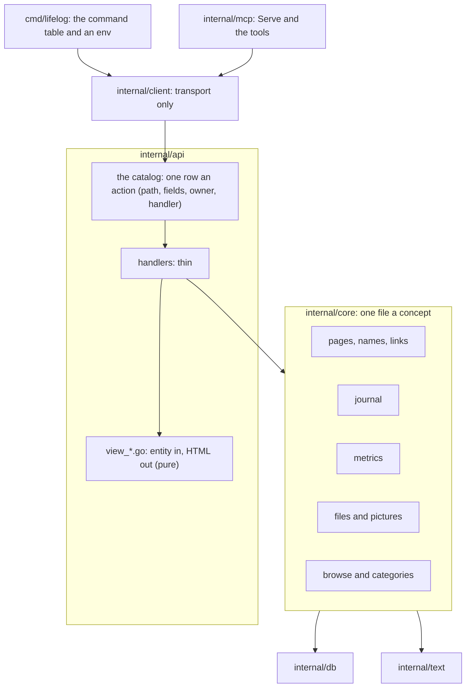
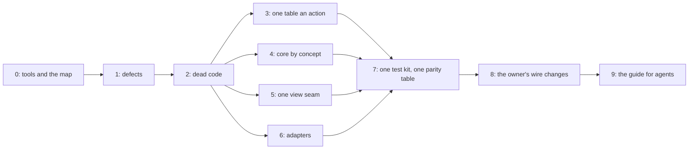

# 121 — Deep modules for agents: one place a concept, fewer lines, every part testable

> Dated implementation record. Tests use temporary folders and synthetic data only. The owner's live `life.db` is
> never opened. Nothing in the schema or the contract of `docs/` changes; the parts that change an answer on the wire
> wait for the owner's word (Part 8).

## Status

- **Date / baseline:** 2026-10-16, `fd4d82a` (master).
- **Priority:** P2. **Effort:** XL in total; each part is S or M and is one or more commits. **Risk:** MEDIUM: many
  files move and many tests merge. A move is a move; a merged test keeps every assertion (the rules below).
- **Status:** IN PROGRESS on the branch `plan-121-deep-modules`. One commit for the records, then one or more
  commits a part, then the closing commit.
- **Resolves:** no issue, no RFC. The owner's request (2026-10-16): organise the code for agentic development, remove
  the lines that can go, and make every part of the code testable.

## Why

An agent works well when one concept is in one place, when a small interface hides much behaviour, and when a test
can attach at that interface. The words of this plan:

| word | meaning | source |
|---|---|---|
| module | anything with an interface and an implementation: a function, a file, a package | Pocock, `codebase-design` |
| interface | what a caller must know: the signature, the invariants, the errors, the order of calls | Ousterhout, ch. 4 |
| deep | a small interface over much behaviour; shallow is the opposite | Ousterhout, ch. 4 |
| seam | the place where a module's interface lives, and where its tests attach | Feathers; Pocock |
| locality | a change to one concept touches one place | Pocock |
| the deletion test | delete the module: if the complexity goes, it was shallow; if it moves to the callers, it earns its place | Pocock, `improve-codebase-architecture` |

The rules this plan takes from them:

- **The interface is the test surface.** A test that must change when the implementation changes tests past the
  interface. When a module is made deeper, the old tests of its shallow parts go, after each of their assertions has
  a home at the new seam (Pocock: "replace, don't layer").
- **One adapter is a hypothetical seam; two adapters are a real one.** No interface for a mock. This agrees with
  AGENTS.md ("concrete types by default") and Go Code Review Comments.
- **Fewer, larger packages** (Cheney); split a package only when the compiler then holds a real rule.
- **Structure is checked by a test, not by prose** (Böckeler on harness engineering): where two lists must agree,
  one list goes, or a test holds them equal.

Sources: [mattpocock/skills](https://github.com/mattpocock/skills) (`improve-codebase-architecture`,
`codebase-design`, `tdd`); [Ousterhout, CS190 notes](https://web.stanford.edu/~ouster/cgi-bin/cs190-winter18/lecture.php?topic=modularDesign);
[Go Code Review Comments](https://go.dev/wiki/CodeReviewComments);
[Cheney, Practical Go](https://dave.cheney.net/practical-go/presentations/qcon-china.html);
[Claude Code best practices](https://code.claude.com/docs/en/best-practices);
[Böckeler, harness engineering](https://www.martinfowler.com/articles/exploring-gen-ai/harness-engineering-memo.html);
[deadcode](https://go.dev/blog/deadcode); [coverage of a binary](https://go.dev/doc/build-cover).

## What the audit found (2026-10-16, `fd4d82a`)

- **Size.** 12,849 production lines and 26,621 test lines of Go; 1,961 lines of templates and CSS. `internal/api` is
  5,830 production lines in 60 files; `internal/core` is 3,088.
- **Checks.** `go test -count=1 ./...` passes: 386 top-level tests in 51 s. The slowest are
  `TestRequestBufferLimits` (7.5 s) and `TestMultipartAggregateLimits` (3.3 s), both in `internal/api`.
- **Coverage map** (`-short`, `-coverpkg` over `internal/...` and `cmd/...`, blocks merged): 87.2 % of statements.
  A subprocess test adds nothing to it, so `cmd/lifelog/output.go` shows 26 % and `agentic.go` 0 %.
- **Not run:** `deadcode`, `staticcheck` and `govulncheck` are not installed, and their modules are not all in the
  module cache (Part 0).
- **Hidden state is already rare.** No `os.Getenv`, `os.Args` or `os.Stdout` outside `cmd/lifelog`; three clocks in
  production code (Part 4).
- **Plan 098 did a first pass** (dead code, one write style, the command table, `handler.go` split). This plan does
  not repeat it; it finds what came back and what plan 098 left shallow.

The module map, with the deletion test applied:

| module | interface → what it hides | verdict | the change |
|---|---|---|---|
| `internal/db` | `Init`, `Open`, `Copy` → pragmas, the version floor, `BEGIN IMMEDIATE` | deep | none |
| `internal/text` | 8 functions → the title predicate, keys, wikilinks, tags | deep | one Markdown walk (Part 4) |
| `internal/core` | about 133 exported names → every write and read | deep as a whole, wide at the top; one concept is in 3 or 4 files | split by concept; a smaller surface (Part 4) |
| `internal/api`: catalog and dispatch | `GET /actions`, `serve`, errors → Siren, prefill, redirect, refusal | deep, but the catalog and the route table must agree by string | one table (Part 3) |
| `internal/api`: views | 38 template functions and 23 view methods | the forms are deep; the render seam is shallow and the words are scattered | one view seam (Part 5) |
| `internal/client` | `Get`, `Do`, `DoFiles`, `Catalog` → in-process or remote, multipart, numbers | deep | `tools.go` leaves (Part 6) |
| `internal/mcp` | `Serve` (81 lines, 854 test lines) | shallow: its logic is in `client/tools.go` | takes `tools.go` (Part 6) |
| `cmd/lifelog` | the command table | good; tested only by subprocess where it touches stdout, the environment or the executable | an `env` (Part 6) |
| `internal/photo`, `internal/preview`, `internal/agentic`, `internal/scaletest` | 1 to 3 functions each | deep | keep; small fixes |

The target:

## The rules for every part

- **Reproducer first** for a defect: the test fails at the baseline, then the fix makes it pass.
- **A move is a move.** A commit that moves code changes no line inside a function; `git diff --color-moved` shows it.
  The set of top-level declarations is the same before and after.
- **Replace, do not layer.** A test is deleted only when each of its assertions has a home, and the commit message
  lists that mapping. The test count may go down; no behaviour loses its assertion.
- **A template change keeps the output byte for byte**, unless the part says otherwise: render every page of the
  `TestEveryViewRenders` fixture before and after and compare the files (a throwaway script, not committed).
- **The baseline after every part:** `go generate ./... && go vet ./... && go test ./...`; `gofmt` on changed files;
  the tools of Part 0 when the owner allows them. `go test -count=1 -shuffle=on ./...` after Parts 6 and 7.
- **The docs say the truth.** README, API.md and `tests/README.md` change in the commit that changes what they name.
- Simplified Technical English in every comment and commit message.

Parts 3 to 6 touch different files and can go in parallel worktrees.

## Part 0 — The tools and the map

| what | proof |
|---|---|
| With the owner's word: pinned tools, outside `go.mod`. `deadcode` v0.52.0 (`golang.org/x/tools`), `staticcheck` 2026.2.2 (v0.8.2), `govulncheck` v1.9.0. Record each version in the closing commit. | each one runs on the baseline; its findings go into Part 2 or get a written disposition |
| `deadcode -test ./...` for `GOOS=linux` and `GOOS=windows`; only a name that both runs report is dead. | the list in the commit of Part 2 |
| The coverage map includes the subprocess tests: build the test binary with `go build -cover`, set `GOCOVERDIR`, merge with `go tool covdata textfmt`. Write the commands in `tests/README.md` (a command, not CI configuration). | `cmd/lifelog/output.go` and `agentic.go` show their real coverage |

## Part 1 — Defects (reproducer first)

| defect | where | the fix |
|---|---|---|
| Keeping a photo with a day scans every row of `entities`: `preflightEmbed` reads `WHERE preferred_name_key = ?`, and no index starts with that column. | `core/files.go` `preflightEmbed` | `WHERE id = (SELECT entity_id FROM entity_names WHERE name_key = ?)`; a work-count probe in the style of `reading_query_plan_test.go` |
| The catalog tells MCP agents what is not true: `add-file` says a photo's position is read and an `at` link made (plan 116 removed it); `open-day` says "what was due" (D23). | `api/siren.go`; the comment of `core/files.go` `placeAndDay` | the true text; `API.md` lines that say "import workspace" |
| The style page draws `step` with a `day` key, and the template reads `label` and `text`: the link has no accessible name. | `html/styleguide.html` | Part 5 makes the style page run the real templates |
| A metric's 14-day line labels the last reading "today" on a past day: `trendLine` builds `clock{today: day}`. A guess until the reproducer fails. | `api/today.go` | the words come from the view's clock |
| `Store.SetPictureOf` returns the `Sync` of a write that rolled back. | `core/picture.go` | the generic wrapper of Part 4 zeroes it |
| `snapshot` answers 422 `snapshot_refused` for every error, a timeout and an internal error too. | `api/maintenance.go` | only core's refusals are `snapshot_refused`; a timeout is 504 |
| A template error's text goes to the client; `io.Copy` and `jsonShape` drop their errors. | `api/html.go` | log it, answer 500 with no detail |
| `phototest` ignores the error of `jpeg.Encode`; `db.Close` ignores `PRAGMA optimize` and the rollback. | `photo/phototest`, `db/db.go` | check them |

## Part 2 — Dead code out

Each name has no caller outside its own declaration (grep, and the 0 % functions of the coverage map), unless the
row says otherwise.

| what | where |
|---|---|
| `boolField`, `optionalID`; the `kind` parameter and switch of `tombstoneMany` (only `"pages"` is passed) | `api/request.go`, `api/tombstones.go` |
| `view.ActionFor`; the template function `depth`; the `formOf` options `primary` and `choices:`; the `due` icon; `calWords.Class` and the three `{{with $w.Class}}` branches; `isDayText` (it equals `core.IsDay`) | `api/html.go`, `api/assets.go`, `api/calendar.go`, `api/metric_view.go`, `html/month.html` |
| Dead CSS: `ul.suggest`, `.margin .habit`, `.editor .preview`, `.count`, `.tag.done`, `.tag.notdone`, `svg.place-map`, `.done`, `.notdone`, `.group.depth-N`, the calendar's `.item.open` and `.item.done`, `.editor`, `.pick-main`, `.muted`; the tokens `--teal` and `--text-accent` (set, never read). Each selector is grepped in the templates and the Go first. | `html/app.css`, `html/base.css` |
| `data-pages` and `data-action`: no script reads them since plan 108; only tests read them. | `html/layout.html`, the tests that read them |
| `captureStdout`; `temporalCalendarKeys`; the `due` case of the flag table; `TestCommandInterruptPolicy`'s removed `import` commands; the `/import` and `approve` checks; the `"import, …"` exception of `reference_test.go` | `cmd/lifelog`, `tests/`, `api` tests |
| `core.Snapshot` (only cmd tests call it: fold into `TakeSnapshot`); `Store.RegisterMetric` (tests only; `CreateMetric` does the same); `ReadingsCount` (the week sums `ReadingsByDay`); `SeriesHistory` (`Series` with an empty `from`, which also removes `"0000-01-01"` from `trends.go`) | `internal/core`, `api/weeks.go`, `api/trends.go` |
| `rangeUnit`'s `lo` and `hi`: only a test reads them. It becomes `isScale(unit) bool`; the comment that says the writer holds the range goes (`measurements_scale_range` holds it). | `core/habits.go`, `core/write.go` |
| Joins that select nothing: `metricID` and `PreviewByTitle` join `entity_names` for no column. `reading_query_plan_test.go` keeps a copy of the SQL; it reads one shared constant. | `internal/core` |
| Stale words: "due", "overdue", "habit strip", "approves", "the command list" in comments and test comments; `tests/README.md` names `FuzzTaskCalendarWindow` and deadlines; the plans index says the next number is 119. | everywhere grep finds them |

Estimate: about 350 lines.

## Part 3 — One table an action

Today a capability is written in six places: the catalog row, a route whose path string must equal the row's, a
handler with its own list of required fields, the entity builders that offer it, `results.go`, and `API.md` with
the shapes of `reference_test.go`. The owner-only guard finds its row by comparing the path strings: a typed path
that differs loses the guard, and no test sees it. The required fields already disagree: `save-body` marks `body`
required and the handler checks `version` only; `promote` marks `to` and the handler checks nothing.

| what | where |
|---|---|
| `NewOn` holds one map from the action's name to its handler and mounts every route from the catalog: method, path, the owner guard from `spec.Owner`. A catalog row with no handler, or a handler with no row, panics at start. `ownerPath`, `ownerOnlyGet` and the two wrapping closures go. Routes that are not actions (assets, previews, `/styleguide`, `oldLists`) stay in a short list. | `api/serve.go`, `api/siren.go` |
| One `h.fields(r, spec)` reads the form and refuses a missing required field that is not a path parameter; the handlers' own `required(v, …)` lists go. What `save-body` does with an empty body is the owner's decision (Part 8); until then the catalog row is changed to say what the handler does. | `api/pages.go`, `api/measurements.go`, `api/files.go`, `api/categories.go` |
| One `writeError(w, r, err)`; one constant for the cross-origin refusal; `PublicAddress` uses `loopbackAuthority`'s parse; `api.Public(store, opts)` builds its handler, so the origins are given once. | `api/public.go`, `api/authority.go`, `api/editing.go`, `api/files.go`, `cmd/lifelog/serve.go` |
| `fileForm` → `readFileForm` → `parseFileForm` becomes one function; the unknown-capture-day rule is computed once, in core's `keep`. | `api/files.go`, `core/files.go` |
| Locality: `oldLists` and `toBrowse` to `browse.go`; `named.go` and `media.go` into the browse view; `MimeOf` unexported and its map named `extTypes`; `pageOf` serves `/titles` too; one prune loop in `feedback.go`. | `internal/api` |
| A test loops every catalog row: it has a route, the route's guard matches `Owner`, and a POST without each required field is refused 422. `TestOwnerOnlyActionsPolicy` loops every `Owner` row, not three names. | `api` tests |

After Part 3, a new capability is one catalog row and one handler, plus the builders that offer it.

Estimate: about 120 lines.

## Part 4 — Core by concept

An agent who changes measurements reads about 1,700 lines today (read.go, write.go, habits.go, browse.go); after
this part it reads about 450. One package stays: sub-packages would export `pageRef`, `insertPage` and
`syncWikilinks` for no rule the compiler holds.

| what | where |
|---|---|
| **Moves only, one commit:** `core.go` (with `check.go`), `tx.go` (`Tx`, `Do`, savepoints), `pages.go`, `links.go` (wikilink sync, `Link`, `Unlink`, `LinkKindsFrom`), `journal.go`, `metrics.go` (replaces `habits.go`, which holds no habits), `files.go` with `picture.go`, `browse.go` with `categories.go`, `integrity.go`, `snapshot.go`. | `internal/core` |
| **One clock.** `Store` gets `Today func() string` (nil is the local clock). `Tx.CreatePage` and `keep` read it; the api's `NewOn` reads the same one, and `feedbackStore` and `snapshot` get `now` from the server, not from `time.Now`. The tests that bracket `Today()` before and after a call use a fixed day. | `core/core.go`, `core/write.go`, `core/files.go`, `api/serve.go`, `api/feedback.go`, `api/maintenance.go` |
| **One row scan.** `list[T](rows, func(*T) []any)` and `each(rows, func() error)`: every `Scan`, `Close` and `Err` branch is in one place, and one fault test covers it. 27 `for rows.Next()` loops; the three `GROUP BY` counts become one. | `internal/core` |
| **One wrapper.** `alone[T](s, ctx, src, func(*Tx) (T, error))` for the about 19 `Store` one-liners; it zeroes the result on error. | `internal/core` |
| **One live-page check** for the four copies of the 404/409 rule (`livePage`, `Rename`, `FilePages`, `pageByID` users), with one message each. | `internal/core` |
| **A smaller surface.** Unexport the 12 `Tx` methods that only core calls, and `Tx.Source`; move `IsInstant`, `IsOwner`, `Forbidden` to the api, the only user. `checkTitle` runs once in `createNamed`; `PageForTitle` folds into `FilePages`. The `MediaKinds` list is written once. `Metrics()` reads the `part-of` links once (`categories()` read them). | `internal/core`, `api/siren.go` |
| **One day parse.** `core.ParseDay(s) (time.Time, bool)` replaces the api's `IsDay`-then-`time.Parse` pairs (`words.go`, `metric_view.go`, `measurements.go`); `months.go`, `weeks.go` and `shell.go` share one "days with a written flag" helper. | `internal/core`, `internal/api` |
| **Pure parts out of SQL.** The category path drawing (its cycle guard) and `pageActions(p, kinds, cats)` (the actions a page offers) become pure functions with table tests. | `core/categories.go`, `api/pages.go` |
| **One Markdown walk.** `renderedTextRuns` uses `textRuns`; every vector of [titles and wikilinks](../contract/titles-and-wikilinks.md) passes. | `internal/text` |

Estimate: about 350 lines.

## Part 5 — One view seam

The view code stays in `package api` for now, with a `view_` prefix on its files: most of the locality, little risk.
A package of its own (`internal/api/view`) comes after this part, if the owner wants the compiler to keep the store
out of the templates (Part 8).

| what | where |
|---|---|
| **The seam.** A pure `pageOf(entity, facts, refusal) *view` and a `render(w, view, status)`; the refusal is passed, not read from a context key; `refused`, `noFocus` and `asked` leave the wire type `Action` for the view. One render entry point in place of four (`renderHTML`, `writeEntity`, `h.write`, `h.inShell`). | `api/html.go`, `api/shell.go`, `api/serve.go`, `api/siren.go` |
| **Files by concept:** `view_lines.go` (`trendLine`, `sparkLine` and `chart` as one drawer with a placement function), `view_daywords.go` (from `calendar.go`, with `weeks()`), `view_markdown.go` (with `mark` and `plainSnippet`). `categories.go` splits: `Filed` to the page view, `groupMetrics` and `metricOf` to the metrics resource. The template set is named `templates`, not `pages`. | `internal/api` |
| **Logic out of the templates:** a `DayParts()` method for the five scans of `day.html` with flag variables; `view.Today`; one pluralising `count` in the function map for the `{{if eq (num .) "1"}}` idioms, `yearsWords`, `MediaCount` and `Mentions`. | `html/*.html`, `internal/api` |
| **One fragment each:** the body editor fold (three copies, and their help texts already differ), the rejected-names alert, the typed-links list, the pick box, the reading link. | `html/day.html`, `page.html`, `metrics.html`, `layout.html` |
| **No view decides by a name:** `Preview()` tests `Type == "textarea"` only; the Today access key is a field of the nav item. The hand-drawn `categories`, `pick-bar` and New metric forms are the owner's decision (Part 8). | `api/html.go`, `html/layout.html` |
| **The style page runs the real templates** (`leaf`, `step`, `form` on synthetic actions, `monthbox`, `onthisday`, `readings`, `metric-cards`) on synthetic data, so it cannot drift; its task-era specimens go. Its test renders it, not a grep of class names. | `html/styleguide.html`, `shell_test.go` |
| **Table tests for the pure parts** that only HTTP and a database reach today: `MetricSections`, `MetricReadings`, `ReadingTiles`, `CalItem`, the line labels, `yearSummary`, `sinceLastWeek`, `groupMetrics`, `chart`'s low and high. | `internal/api` |

Estimate: about 250 lines of Go and templates, and about 60 of CSS (Part 2's).

## Part 6 — The adapters

| what | where |
|---|---|
| `client/tools.go` and its test move into `internal/mcp`, unexported; the `keep` parameter (always `!a.Owner`) goes. `client` is transport only. The README layout row of `mcp` changes. | `internal/client`, `internal/mcp` |
| `cmd/lifelog` gets an `env`: `stdout`, `stderr`, `getenv`, `executable`. `main()` passes the real ones in about 8 lines. Then `agentic_process_test`, `names_revision_process_test` and `TestPublicServeProcess` run in-process; only the drain-on-interrupt test stays a subprocess (AGENTS.md asks a process for that claim), and `TestMain` builds its binary once. The three copies of the startup-line parse and the two of `os.Executable` go. `--human` output is tested through a buffer. | `cmd/lifelog` |
| The snapshot tests that call `core` and `db` and never the CLI move to `internal/core/snapshot_test.go`; one CLI case stays (`snapshot --to` inside a git work tree is refused before any write). `TestSnapshotRefusesAGitWorkTree` goes: `db.TestSnapshotDestinationErrors` covers it. | `cmd/lifelog`, `internal/core` |
| **The agents' texts are tested against the catalog:** each MCP config of `agentic-init` parses to `mcp`, `agent:NAME` and the file; each backticked tool name in `templates/AGENTS.md` is a tool, and each owner-only name is an owner action. Today a rename breaks the agents' instructions and no test fails. | `internal/agentic`, `cmd/lifelog` tests |
| One `phototest.HEIF(locations…)`, `WithExif` and `JPEG` for the three HEIF builders and the inline JPEGs of four test files. One JSON encoder with `SetEscapeHTML(false)` for the four copies. | `internal/photo`, `internal/preview`, tests |

Estimate: about 250 lines.

## Part 7 — One test kit, one parity table

| what | where |
|---|---|
| **`internal/db/dbtest.New(t)`** for the 29 inline Init-Open-Cleanup blocks and the 5 named copies (`core.fresh`, `api.freshStore`, `api.freshOn`, `mcp.mcpTestClient`, `cmd.commandClient`). It needs only `db`, so the in-package `core` tests use it too. | every package's tests |
| **`internal/api/apitest`:** `Fresh(t, source)`, `Clients(t, h, source)` (in-process and remote), `Must` (a `t.Fatal`, not a panic), `Action`, `Href`, `Status(err)`. It replaces the 12 copies of the remote switch and the three `find`/`actionByName`/`cmdAction`, `must`, `href` copies. The 13 internal test files of `package api` cannot import it (a cycle) and use `dbtest`. | `internal/api`, `internal/mcp`, `cmd/lifelog` tests |
| **One parity table** in `cmd/lifelog/parity_test.go`, the one package that sees the CLI, the client and MCP: surfaces `http`, `remote`, `cli`, `mcp`, each `(action, args) → (*api.Entity, error)`; rows for find, open-day, browse, create-place with a category, file-pages (accepted; refused for a day page, nothing written), rename alias, stale `save-body` (409), `save-body` with a 2^63−1 version, and `register-metric` refused to `agent:*` and absent from the MCP tools. The per-feature copies on each surface go: `api/names_parity_test.go`, `mcp/names_test.go`, `api/revision_parity_test.go`, `mcp/revision_test.go`, the `filed_where_made` and browse copies in `mcp` and `cmd`. Each surface keeps only what is its own: MCP schema, hints, arguments and cancellation; CLI flags, streaming and `snapshot --to`; the client's transport. | `cmd/lifelog`, `internal/api`, `internal/mcp` |
| **One client conformance test:** in-process and remote give equal answers, with multipart, error entities and exact numbers. Then the feature tests of `api` run in-process only. | `internal/client` |
| **Pure functions get table tests and the database tests shrink:** `backOf` (the open-redirect guard; a fuzz target), `browseQueryOf`, `browseActions`, `idsOf`, `toBrowse`, `errorEntity`, `paged`. `TestMultipartUnknownNameProjection` calls `parseFileForm`, not a copy of its loop. | `internal/api` |
| **Test files named by subject:** `hygiene_test.go` → `errors_test.go` and `paging_test.go`; `browser_regression_test.go`, `old_lists_test.go`, `cli_regression_test.go`, `registration_policy_test.go` (→ `owner_test.go`), `filed_where_made_test.go` (three packages), `causes_test.go`, `judgment_test.go`, `counts_test.go`, `new_forms_test.go`, `new_metric_test.go` merge into their subjects; the CSS lint of `browser_view_test.go` and `tokens_test.go` become `sheets_test.go`; core's five integrity files and five `names_*` files become one each. The small suite files of `tests/` join their suites (`tests/README.md` changes with them). | every package's tests |
| **Faster feedback:** find why `TestRequestBufferLimits` takes 7.5 s and `TestMultipartAggregateLimits` 3.3 s; a smaller limit given to the handler in the test keeps the same boundary cases. | `internal/api` |
| Repeated helpers inside `tests/`: `contains`, `eq`, `sorted` become `slices`. `tests/` keeps its own kit: it runs against mutated DDL, not the writer. | `tests/kit_test.go` |

Estimate: about 1,000 test lines, most from the parity table (about 650 net) and the kit (about 280).

## Part 8 — The owner's wire changes

Each row changes an answer that a client sees, so each waits for the owner's word. The plan works without any of them.

| change | why | cost |
|---|---|---|
| Go checks that repeat a DDL rule go: a day page renamed, a date as a new title, a day page promoted, a `redirect` link. The refusal becomes the DDL's 422 (AGENTS.md: a Go copy of a CHECK is a defect). | issue 0068's rule | 409 → 422 in three answers; `names_storage_test`, `scales_test` change |
| `save-body` with an empty body: refused (the catalog's `required`) or accepted (the handler today). | the two lists disagree | one answer changes |
| `/titles` goes: not in the catalog, no entity links it, and `/search` returns `titles`. | the `[[` completion that used it is gone | about 30 lines; an `API.md` section |
| The `kind` property of `tombstone-pages`' answer goes (always `pages`). | dead switch | one property in `API.md` |
| Entity import keys go from `CreatePage`, `CreatePerson`, `CreatePlace` and `byImportKey`: production always passes "" since plan 089; only `scaletest` uses them. `Reading.ImportKey` stays. | dead parameter | about 35 lines; `scaletest` changes |
| `open-day` with no day opens today; MCP `get_day` and the CLI `day` then wrap it. | three ways to one thing | one action field becomes optional |
| `pages` fields drawn as an input with a `<datalist>`, so the `categories`, `pick-bar` and New metric forms use `form` and no view names a field. | README: no view decides by a field's name | the markup of three forms |
| `internal/api/view` as its own package after Part 5. | the compiler keeps the store out of the templates | about 2,100 lines move; Siren types to a leaf package |

## Part 9 — The guide for agents

| what | where |
|---|---|
| The README layout table gets a column "test it at": the seam where a test of that module attaches (`core.Store` on `dbtest.New`; `api.NewOn` with a fixed clock; the parity table for a surface; the pure view functions). | `README.md` |
| `cmd/lifelog` gets a package comment, as every other package has one. | `cmd/lifelog/main.go` |
| With the owner's word: AGENTS.md keeps what an agent needs on every edit, and links the rest (the personas, the performance evidence, the engineering references, the conventions checklist that `docs/` already holds). An agent reads AGENTS.md in every session: 375 lines today. | `AGENTS.md`, `tests/README.md` |

## What this plan does not do

- No interface for a mock, no repository or service layer, no sub-packages of `core` (one adapter is not a seam).
- `client` and `mcp` do not merge: `client` is deep and cmd and 15 api test files use it.
- `photo` and `preview` do not merge: each is deep and does one job.
- No depth score by line ratio; no global coverage target (AGENTS.md: coverage is a map).
- No new dependency. `x/net/html` for semantic HTML assertions is not proposed: a template change keeps its output
  byte for byte instead.

## Done criteria

1. The baseline is green after every part, on Linux and on Windows (the manual workflow); `gofmt` is clean;
   `go test -count=1 -shuffle=on ./...` at the end.
2. With Part 0's tools: `deadcode -test ./...` names nothing on Linux and Windows; `staticcheck ./...` is clean or
   each finding has a written disposition; `govulncheck ./...` exits 0.
3. Every function at 0 % in the coverage map, subprocess runs included, is deleted or named in the closing record
   with the reason no test reaches it.
4. A test holds the catalog and the routes equal (Part 3) and the agents' texts equal to the catalog (Part 6).
5. `TestAPIReferenceMatchesTheCode` passes; the `document` suite finds every page; the parity table passes for every
   surface, and the owner-only actions stay refused to an agent on each.
6. The closing record gives the line counts before and after, per package, production and test.

## The owner's decisions (2026-10-16)

1. Part 0: yes. Installed: `deadcode` v0.52.0, `staticcheck` 2026.2.2 (v0.8.2), `govulncheck` v1.9.0.
2. Part 8: every row. The `save-body` row is a choice, not a change: an empty or missing body is **refused**, as the
   catalog, API.md and the browser's `required` already say, so an agent that leaves out `body` cannot empty a page.
3. Part 7: yes, the parity table replaces the per-surface copies, each removed assertion mapped to a row.
4. Part 9: yes.

## Part 0 results (2026-10-16, `fd4d82a`)

- `govulncheck ./...`: no vulnerabilities found.
- `deadcode -test ./...`, the same seven names on `GOOS=linux` and `GOOS=windows`: `captureStdout`, `boolField`,
  `optionalID`, `postForms`, `formFor`, `actionsNamed`, `temporalCalendarKeys`. Without `-test` it adds
  `Store.RegisterMetric` and the `phototest` builders (a test-only package).
- `staticcheck ./...`: U1000 only, the same names plus `htmlForm` and `buttonRE` of `browser_forms_test.go`.
- `view.ActionFor` is reported by neither: a method that a template can call through reflection stays live for
  `deadcode`. A grep of the templates shows no call.
