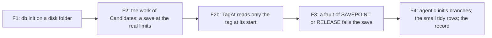

# 122 — What 121 left: four defects and gaps, and the small tidy ones

> Dated implementation record. Tests use temporary folders and synthetic data only. The owner's live `life.db` is
> never opened. Nothing in the schema or the contract of `docs/` changes, and no answer on the wire changes except
> where a defect fix says so.

## Status

- **Date / baseline:** 2026-10-17, `d407bb7` (the branch `plan-121-deep-modules`, at the close of plan 121).
- **Priority:** P2. **Effort:** M. **Risk:** LOW: each step is one defect or one gap, reproducer first.
- **Status:** IN PROGRESS on the branch `plan-121-deep-modules`.
- **Resolves:** no issue, no RFC. The owner's words (2026-10-17): "keep going, report when all phases are done",
  after the close of [plan 121](121-deep-modules-for-agents.md). This plan takes the rows of 121's "left for later"
  table that need no word of the owner and no change of the contract.

## The steps

| step | the row of 121 | what is done |
|---|---|---|
| F1 | `internal/db` `TestInitApplyFailurePreservesReplacement` fails when the temporary folder is on ext4, also before 121 | find the cause (the identity check of `removeReservedDatabasePath`); a reproducer that fails on any file system; the fix |
| F2 | `text.Candidates` builds a map with one entry for each character of a run (`runeIndex`); a save of a 16–20 MiB body takes about 3 s; no test saves a body at the real limits; no test counts the bytes the server reads at a limit | a reproducer that counts the work (not a clock); the fix with the same vectors; a save at the real limits back in the limit tests; a test that counts what the server reads |
| F2b | found in F2: `text.TagAt` turns the rest of the line into characters and scans all of it at each `#`, and the view calls it at each `#`, so the work to draw a line of many tags grows with the square of the tags | a reproducer that counts the bytes that the drawing allocates; the fix: `TagAt` reads only the tag at its start, with the same answers |
| F3 | an error of the `SAVEPOINT` statement, or of the `RELEASE` after a target that succeeded, is counted as a skipped target (`core/tx.go`) | a reproducer through the narrowest fault that can make these two statements fail; the save fails as a fault, as a failed `ROLLBACK TO` does since 121 |
| F4 | `agenticInit` is at 72.7 % (its error branches and the kept-file line); `tombstones.go` writes "Deleted N pages." with its own words; `TestNavMarksThePageTheBrowserIsOn` names `/import/prepared`; the tools of a day start with an empty line | tests of the branches; one way to say a count; the dead path out of the test; the empty line out (a markup change of white space only) |

The rows of 121's table that wait for the owner (the contract, a rule of the schema, a word of the wire), or that
are a choice and not a defect, stay in [121's closing record](121-deep-modules-for-agents.md#the-closing-record-2026-10-17).

## Done when

- [ ] Each step: its reproducer failed before the fix and passes after it; the commit message says so.
- [ ] The baseline is green after each step; `staticcheck` and `deadcode -test` (linux and windows) name nothing;
      `gofmt` is clean; `go test -count=1 -shuffle=on ./...` at the end.
- [ ] 121's "left for later" table marks each row that this plan closed, with its commit.
- [ ] The results below give each step's commits and what changed.

## Results
