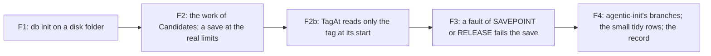

# 122 — What 121 left: four defects and gaps, and the small tidy ones

> Dated implementation record. Tests use temporary folders and synthetic data only. The owner's live `life.db` is
> never opened. Nothing in the schema or the contract of `docs/` changes, and no answer on the wire changes except
> where a defect fix says so.

## Status

- **Date / baseline:** 2026-10-17, `d407bb7` (the branch `plan-121-deep-modules`, at the close of plan 121).
- **Priority:** P2. **Effort:** M. **Risk:** LOW: each step is one defect or one gap, reproducer first.
- **Status:** IN PROGRESS on the branch `plan-121-deep-modules`.
- **Resolves:** no issue, no RFC. The owner's words (2026-10-17): "keep going, report when all phases are done",
  after the close of [plan 121](121-deep-modules-for-agents.md). This plan takes the rows of 121's "left for later"
  table that need no word of the owner and no change of the contract.

## The steps

| step | the row of 121 | what is done |
|---|---|---|
| F1 | `internal/db` `TestInitApplyFailurePreservesReplacement` fails when the temporary folder is on ext4, also before 121 | find the cause (the identity check of `removeReservedDatabasePath`); a reproducer that fails on any file system; the fix |
| F2 | `text.Candidates` builds a map with one entry for each character of a run (`runeIndex`); a save of a 16–20 MiB body takes about 3 s; no test saves a body at the real limits; no test counts the bytes the server reads at a limit | a reproducer that counts the work (not a clock); the fix with the same vectors; a save at the real limits back in the limit tests; a test that counts what the server reads |
| F2b | found in F2: `text.TagAt` turns the rest of the line into characters and scans all of it at each `#`, and the view calls it at each `#`, so the work to draw a line of many tags grows with the square of the tags | a reproducer that counts the bytes that the drawing allocates; the fix: `TagAt` reads only the tag at its start, with the same answers |
| F3 | an error of the `SAVEPOINT` statement, or of the `RELEASE` after a target that succeeded, is counted as a skipped target (`core/tx.go`) | a reproducer through the narrowest fault that can make these two statements fail; the save fails as a fault, as a failed `ROLLBACK TO` does since 121 |
| F4 | `agenticInit` is at 72.7 % (its error branches and the kept-file line); `tombstones.go` writes "Deleted N pages." with its own words; `TestNavMarksThePageTheBrowserIsOn` names `/import/prepared`; the tools of a day start with an empty line | tests of the branches; one way to say a count; the dead path out of the test; the empty line out (a markup change of white space only) |

The rows of 121's table that wait for the owner (the contract, a rule of the schema, a word of the wire), or that
are a choice and not a defect, stay in [121's closing record](121-deep-modules-for-agents.md#the-closing-record-2026-10-17).

## Done when

- [x] Each step: its reproducer failed before the fix and passes after it; the commit message says so.
- [x] The baseline is green after each step; `staticcheck` and `deadcode -test` (linux and windows) name nothing;
      `gofmt` is clean; `go test -count=1 -shuffle=on ./...` at the end.
- [x] 121's "left for later" table marks each row that this plan closed, with its commit.
- [x] The results below give each step's commits and what changed.

## Results

The commits after `2b333f8`, the commit of this page, in the order of the steps. The message of each commit gives its
checks. The reviews of F1, F2 and F2b found the items that F4 does as their review fixes (the rows "from the review
of" below). The review of F3 is open when this record is written, so the status stays IN PROGRESS until it ends.

| step | commits | what changed |
|---|---|---|
| F1 | `6eae5b4` | Init and Copy hold their reservation open until the cleanup. The cleanup compares the open file with the path, so `os.SameFile` is exact also on ext4, which gives the inode number of a removed file to the next new file. `TestAReservationHoldsItsFileUntilTheCleanup` failed at the old code on tmpfs and on ext4 |
| F2 | `0c56d30`, `0309543`, `47b436f` | `text.Candidates` does work in proportion to the run: a save of a body of 16 MiB in one run takes 0.18 to 0.21 s of CPU, not 2.44 to 2.68 s. The limit tests save a body at the real limits again. A test counts the bytes that the handler reads at the limit of 20 MiB: the limit and one byte |
| F2b | `bf12992` | `text.TagAt` reads only the tag at its start: the page of a body of 40000 tags in one line draws in about 1.5 s, not 48 to 65 s |
| F3 | `eba272f` | an error of `SAVEPOINT`, or of the `RELEASE` after a target that succeeded, fails the save. At the old code, a full disk at a `SAVEPOINT` made the save go on outside a transaction, and the page lost its links |
| F4 | `f280b07`..`a6df908` | the table below |

F4, item by item:

| item | commit | what changed |
|---|---|---|
| the branches of `agenticInit` | `f280b07` | `TestAgenticInitAtAFailureOrAKeptFile` runs each branch in-process: no path of the program (with and without `--db`), a relative `--db` with no working directory (skips on Windows), a file where the folder `.codex` must be, and two kept files with and without `--force`. `agenticInit` finds the database path before the path of the program, so the error branch of `dbPath` has a real cause. The coverage map gives `agenticInit` 100 % (it was 72.7 %) |
| one way to say a count | `85eb461` | the view's `count` is exported as `view.Count`, and tombstone-pages writes `"Deleted " + view.Count(len(ids), "page", "pages") + "."`. The api already takes the words of the JSON from the view (`view.Num`). The words are the same for 0, 1 and 2 (three rows of `TestCountSaysTheNumberAndTheFormOfItsNoun`) |
| the dead path of the nav test | `13814a7` | `/import/prepared` is now `/styleguide`: a page that exists, drawn in the shell, that no item of the sidebar marks |
| the empty line of the tools of a day | `24c953a` | a trim marker in `day.html`. The render dump of 32 pages: on each of the 6 day pages, the empty line after `
` goes; no other line changes |
| from the review of F1: the close of a success path | `bea5496` | `TestASuccessfulInitOrCopyClosesItsReservation` (Linux, `/proc/self/fd`) failed with each close removed. A failed close of the reservation after a success returns its error and keeps the complete file. That is right: the error is true, and only the open file shows that the path still names it, so a cleanup after the close is not safe. `Snapshot` returns the path with the error; the snapshot action then runs no restore check and reports the failure. A comment at each of the two returns says this |
| from the review of F1: the WAL of a cancelled Init | `63837dc` | a defect, fixed reproducer-first. A cancelled Init interrupts SQLite; the close of SQLite then cannot checkpoint and keeps `life.db-wal` and `life.db-shm`. A WAL left beside the path goes into the next database at the path that is not empty. The cleanup now removes the two when the path still names the reserved file and the file is not empty (SQLite deletes a WAL beside an empty file when it reads it), and before it removes the file, while the file holds the path. When one of them cannot go, the file stays with it. A probe of 40 deadlines, three runs: 24 of 27, 28 of 30 and 23 of 26 cancelled Inits left the two files before the fix, and none after it |
| from the review of F2: the connection after a body over the limit | `1e3939a` | the limit of a JSON or URL-encoded body moves from `form` to the handler `limitBody`, which gives `http.MaxBytesReader` the ResponseWriter of the server. The 413 has `Connection: close`, and the server closes the connection after it. `TestARefusedLargeRequestClosesTheConnection` (a real server, 1 KiB over the limit) failed at the old code: the server kept the connection open. The multipart path uses no `http.MaxBytesReader`, so it has no ResponseWriter to pass; after its 413, net/http closes the connection when more than 256 KiB are left |
| from the review of F2: the unused reader | `288ed12` | `TestRequestBufferLimits` builds one body for each case |
| from F2b: the diagram and `\#esc` | `a6df908` | the diagram of the steps names F2b. `\#esc` drawn as a tag is not a defect: the contract reads the CommonMark text, where a backslash escape is resolved before the scan (as `&#35;x` is decoded, and as `\[[x]]` still links), so `\#esc` is the tag `esc`. `text.Candidates` extracts it, and the view draws it: the two agree with the contract, also for `a\#b`, `\\#esc`, `#a\#b` and `\##x` (a probe) |

What a client sees now, where `d407bb7` was different:

| step | the change |
|---|---|
| F1 | the cleanup of a failed Init or Copy on ext4 keeps a file that took its path; at the old code it could remove it |
| F2, F2b | none: the vectors, a render dump and a differential fuzz give the same answers |
| F3 | a fault of `SAVEPOINT` or `RELEASE` in a save is a fault (500), and the page keeps its links; at the old code the target was reported as skipped, and the save went on |
| F4 | the tools of a day page have no empty line at the start; after a JSON or URL-encoded body over 20 MiB, the 413 has `Connection: close` and the server closes the connection; a failed Init leaves no WAL and no index of its file at the path |

Windows. F1's Windows behaviour is proven by a reading of the sources only. Go opens the reserved file without
`FILE_SHARE_DELETE`, so no other handle can remove or rename it while it is held. SQLite opens the file, and VACUUM
INTO writes it, beside that handle, with share modes that allow it. A `CREATE_NEW` on a file that exists gives
"already exists", not a sharing violation, while the handle is open; `TestInitReservationBlocksCompetingLazyOpen`
depends on that. No test of this plan ran on Windows; this includes the removes of the WAL and its index (`63837dc`)
and the case of `TestAgenticInitAtAFailureOrAKeptFile` that skips on Windows. A Windows run of the tests is
necessary before a release: the manual workflow `.github/workflows/windows-validation.yml`, which needs a push of
the owner.

A commit is not amended. These messages say what is not true:

| commit | the message says | the truth |
|---|---|---|
| `85eb461` | `TestTombstonePages` (`tombstones_test.go`) holds "Deleted 1 page." and "Deleted 2 pages." | the test is `TestDeletePagesAtOnce`; in `browse_test.go` it is `TestBrowseGhostsAreOldestFirstAndOfferDelete` |
| `a6df908` | the document suite reads the links of the plans | the document suite reads the current folders of `docs/` and the indexes and templates of `issues/` and `rfcs/`; no suite checks the text of the pages of `docs/plans/` |

The checks at the end, at `a6df908`, on Linux only (Debian 13, Linux 6.12.111+deb13-amd64, x86_64), with go1.27.2,
`modernc.org/sqlite` v1.60.1, `staticcheck` 2026.2.2 (v0.8.2), `deadcode` v0.52.0 and `govulncheck` v1.9.0:

- `go generate ./... && go vet ./... && go test -count=1 ./...`: pass, in 35 s.
- `go test -count=1 -shuffle=on ./...`: pass. With `-v`, 509 top-level tests run and 3 of them skip
  (`TestFilesystemWriteFailureChild` and `TestCollationHelper`, which a subprocess test starts, and
  `TestMermaidRender`, which needs `LIFELOG_MERMAID=1`). The seeds: `cmd/lifelog` 1792223630441851020,
  `internal/api` 1792223630622055517, `internal/db` 1792223631547907897, `tests` 1792223635621777411. A replay of the
  first three passes.
- `staticcheck ./...`: nothing. `deadcode -test ./...` with `GOOS=linux` and with `GOOS=windows`: nothing.
- `gofmt -l` on the 204 `.go` files in git: nothing.
- `govulncheck ./...`, in its text mode: "No vulnerabilities found."
- `LIFELOG_MERMAID=1 go test ./tests -run TestMermaidRender`: not run (no `mmdc` on this machine), and it does not
  read `docs/plans/`.
