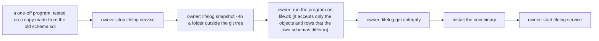

# 123 — The owner's contract decisions of 2026-10-17

> Dated implementation record. Tests use temporary folders and synthetic data only. The owner's live `life.db` is
> never opened by a test or by an agent: the owner runs the one change of the live file with `!` commands.

## Status

- **Date / baseline:** 2026-10-17, `c867e6c` (master, the merge of plans 121 and 122).
- **Priority:** P2. **Effort:** M. **Risk:** MEDIUM: one new rule in `schema.sql` and a change of the owner's live
  file, which the owner runs.
- **Status:** IN PROGRESS on the branch `plan-123-contract-decisions`.
- **Resolves:** the questions of [121's closing record](121-deep-modules-for-agents.md#the-closing-record-2026-10-17)
  and [122's list](122-what-121-left.md#results). The owner's words (2026-10-17): "1. I think so 2. Let's move it to
  schema 4. fix it 5. fix it".

## The decisions

| # | the question | the owner's word | what is done |
|---|---|---|---|
| 1 | `record` and `add-file` refuse `day=today`, while `capture` and `open-day` read it as today | "I think so" | every day field of the catalog reads the word `today` as the server's local day, through the one helper `dayNamed`; README and API.md say so; a parity row holds it on every surface |
| 2 | only Go refuses to promote a place to a person or to register it as a metric: no rule of the schema does, because a place has no typed row | "Let's move it to schema" | an issue; a trigger in `schema.sql` that lets an entity change its type only from a plain page; D20 says it; a mutant and a suite witness; the Go checks that then repeat it go (AGENTS.md), so the answer is the schema's 422 |
| 4 | the `lifelog_meta` rows `instants`, `days` and `source` still name the columns of the tasks that D23 removed | "fix it" | an issue; the rows of `schema.sql` say only what is true; the suites that read them change with them |
| 5 | [save a body](../cookbook/save-a-body.md) does not say that a fault of `SAVEPOINT`, `ROLLBACK TO` or `RELEASE` fails the save | "fix it" | an issue; the recipe and D19 say it, as the writer has done since plan 122 (F3) |

Question 3 (a score's range "5-1") waits for the owner's answer.

## The change of the live file

Decisions 2 and 4 change `schema.sql`, and the owner's `life.db` must then equal it. The order, from the owner's
earlier changes of the live file:

The new binary goes in after the program: without the trigger in the file, the binary would refuse a promotion of a
place by nothing.

## Done when

- [x] Each decision: the issue, the docs, `schema.sql` and the suites change together; the baseline is green.
- [x] The one-off program refuses a file that is not the old schema, and makes a copy of the old schema equal to the
      new one (tested in the scratchpad, never on the live file).
- [ ] The owner ran the change of the live file; the integrity check passes; the new binary serves.

## Results

The commits after `cfb7f03`, the commit of this page. The message of each commit gives its checks; each step had a
review, and its small findings are the commits named "review fixes".

| decision | commits | what changed |
|---|---|---|
| 1 | `1b76cb5`, `a02234b`, `0b5b063`, `ef243fb` | every day field of the catalog reads the word `today` as the server's local day through `dayNamed`: `record`, `add-file`, `create-person` (born, died), with `capture` and `open-day` as before. Before, `record` and `add-file` with `day=today` answered 422. The browser's labels are as before; the MCP schema of a date field takes `YYYY-MM-DD` or `today` by a pattern, and its description says so |
| 2 | `8a8c3b3`, `354d2c4`, `bce2755`, `60d35fe`, `ba195a5` | [issue 0081](../issues/0081-only-the-writer-keeps-a-place-a-place.md); the trigger `entities_promote_from_page`, the last statement of `schema.sql`: only a plain page changes its type. D20 cites it. A promotion of a typed entity to another type, and `register-metric` with the title of a person, a place or a file, answer the schema's 422 (they were 409); a promotion to the type the entity has stays 409 |
| 4 | `5c968f4` | [issue 0082](../issues/0082-the-meta-rows-name-removed-columns.md); the `lifelog_meta` rows `instants`, `days` and `source` lose the words of the removed tasks; the document suite holds that every name with an underscore in a row is a thing of the file. Two comments inside `CREATE` statements keep stale words (a place's point; the relationship kinds of people): a change of them changes the stored SQL of a table in the owner's file, so they wait for the owner |
| 5 | `de16a31`, `f4f0906` | [issue 0083](../issues/0083-a-fault-of-a-savepoint-is-not-a-skipped-target.md); [save a body](../cookbook/save-a-body.md) says that an error of `SAVEPOINT`, `ROLLBACK TO` or `RELEASE` fails the whole save, D19 gives the reason, and the suite `doc-save-contract` holds it on a full file of the DDL of `docs/` |
| (small) | `5cf6b1e`, `c2ac341`, `2f74495` | "Already recorded" links the day of the reading that stands; D11 gives a reason that is true today; the cookbook suite's seed loses a removed link kind |

The checks at `f4f0906`, on Linux: `go generate ./... && go vet ./... && go test -count=1 ./...`: pass;
`go test -count=1 -shuffle=on ./...`: pass; `staticcheck ./...`: nothing; `deadcode -test ./...` (linux and windows):
nothing; `GOOS=windows go vet ./...`: pass; `govulncheck ./...`: "No vulnerabilities found"; `gofmt -l`: nothing.
The mutants are 259, every one killed.

The change of the live file is the program `meta123-bin` in `/home/cico/.local/share/lifelog-oneoff/meta123/`, with
its source and tests beside it, outside the git tree (AGENTS.md: no migration runner in the repo). Its usage is
`meta123-bin OLD.sql NEW.sql LIFE.db [--dry-run]`; `OLD.sql` is `schema.sql` at `c867e6c` and `NEW.sql` at
`f4f0906`. It refuses a file that is not equal to a fresh file of `OLD.sql` (the schema rows, `user_version`,
`application_id`, the `lifelog_meta` rows and the seeded rows), and any difference of the two SQL files but new
triggers and new values of `lifelog_meta` rows. In one `BEGIN IMMEDIATE` transaction it creates the trigger and
sets the three rows, compares the file with a fresh file of `NEW.sql`, and runs `integrity_check` and
`foreign_key_check`. Its tests run on synthetic files only. The owner runs it with `!`; the outcome is recorded below
when the owner has run it.
