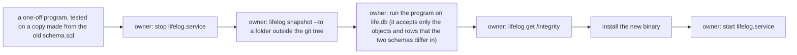

# 123 — The owner's contract decisions of 2026-10-17

> Dated implementation record. Tests use temporary folders and synthetic data only. The owner's live `life.db` is
> never opened by a test or by an agent: the owner runs the one change of the live file with `!` commands.

## Status

- **Date / baseline:** 2026-10-17, `c867e6c` (master, the merge of plans 121 and 122).
- **Priority:** P2. **Effort:** M. **Risk:** MEDIUM: one new rule in `schema.sql` and a change of the owner's live
  file, which the owner runs.
- **Status:** IN PROGRESS on the branch `plan-123-contract-decisions`.
- **Resolves:** the questions of [121's closing record](121-deep-modules-for-agents.md#the-closing-record-2026-10-17)
  and [122's list](122-what-121-left.md#results). The owner's words (2026-10-17): "1. I think so 2. Let's move it to
  schema 4. fix it 5. fix it".

## The decisions

| # | the question | the owner's word | what is done |
|---|---|---|---|
| 1 | `record` and `add-file` refuse `day=today`, while `capture` and `open-day` read it as today | "I think so" | every day field of the catalog reads the word `today` as the server's local day, through the one helper `dayNamed`; README and API.md say so; a parity row holds it on every surface |
| 2 | only Go refuses to promote a place to a person or to register it as a metric: no rule of the schema does, because a place has no typed row | "Let's move it to schema" | an issue; a trigger in `schema.sql` that lets an entity change its type only from a plain page; D20 says it; a mutant and a suite witness; the Go checks that then repeat it go (AGENTS.md), so the answer is the schema's 422 |
| 4 | the `lifelog_meta` rows `instants`, `days` and `source` still name the columns of the tasks that D23 removed | "fix it" | an issue; the rows of `schema.sql` say only what is true; the suites that read them change with them |
| 5 | [save a body](../cookbook/save-a-body.md) does not say that a fault of `SAVEPOINT`, `ROLLBACK TO` or `RELEASE` fails the save | "fix it" | an issue; the recipe and D19 say it, as the writer has done since plan 122 (F3) |

Question 3 (a score's range "5-1") waits for the owner's answer.

## The change of the live file

Decisions 2 and 4 change `schema.sql`, and the owner's `life.db` must then equal it. The order, from the owner's
earlier changes of the live file:

The new binary goes in after the program: without the trigger in the file, the binary would refuse a promotion of a
place by nothing.

## Done when

- [ ] Each decision: the issue, the docs, `schema.sql` and the suites change together; the baseline is green.
- [ ] The one-off program refuses a file that is not the old schema, and makes a copy of the old schema equal to the
      new one (tested in the scratchpad, never on the live file).
- [ ] The owner ran the change of the live file; the integrity check passes; the new binary serves.

## Results
