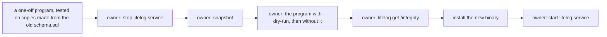

# 124 — True comments in the file: the comments inside CREATE TABLE say what is true

> Dated implementation record. Tests use temporary folders and synthetic data only. The owner's live `life.db` is
> never opened by a test or by an agent: the owner runs the one change of the live file with `!` commands.

## Status

- **Date / baseline:** 2026-10-17, `cdb7b8e` (master, after plan 123).
- **Priority:** P3. **Effort:** S. **Risk:** MEDIUM: the change of the live file rewrites the stored text of two
  tables, which SQLite allows only through `PRAGMA writable_schema`.
- **Status:** DONE (2026-10-17), merged into master and installed with the owner's change of the live file.
- **Resolves:** the two comments that [issue 0082](../issues/0082-the-meta-rows-name-removed-columns.md) left for the
  owner. The owner's words (2026-10-17): "Fix the old comments also".

## The change

| where | the stale words | why they are stale |
|---|---|---|
| the comment inside `CREATE TABLE entities` | "a place's point is optional" | a place has no point since issue 0076 (RFC 0016) |
| the comment inside `CREATE TABLE people` | "relationships between them are links (friend, family, parent-of)" | the link kinds are `wikilink`, `at` and `part-of` since issue 0077 (RFC 0017) |

SQLite stores the text of each `CREATE` statement, its comments too, in `sqlite_schema`. A fresh file from
`schema.sql` gets the new text; the owner's file keeps the old text until a program writes it. SQLite documents how to
change the stored text of a table when the change does not touch what is on disk
([ALTER TABLE, "other kinds of table schema changes"](https://sqlite.org/lang_altertable.html#otheralter)):
`PRAGMA writable_schema=ON`, an `UPDATE` of the `sql` column, a larger `schema_version`, then `integrity_check`.
A change of a comment is such a change. The program checks that, apart from the comments, the two texts are equal,
and that the parsed tables are equal (their columns, constraints, foreign keys and indexes), before it writes.

## Done when

- [x] `schema.sql` has true comments; the suites and the docs that read them stay true; the baseline is green.
- [x] The program refuses a file that is not the old schema and any change that is not a comment, and makes a copy of
      the old schema equal to the new one (tested on synthetic files only).
- [x] The owner ran the change of the live file; the integrity check passes; the new binary serves.

## Results

The commits: `786f1d7` (the two comments, and the document suite's witness that no stored text names a link kind
the registry does not have). The program `meta124-bin` (`/home/cico/.local/share/lifelog-oneoff/meta124/`) applied
plans 124 and 125 together: [plan 125](125-a-range-is-a-true-range.md#results) gives the run.
