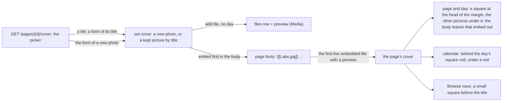

# 127 — A cover for every page: the first picture of a page, beside it, in the lists and the calendar, set from a picker

> Dated implementation record. Tests use temporary folders and synthetic data. The owner's live `life.db` is never
> opened by a test.

## Status

- **Date / baseline:** 2026-10-17, `2f568fe` (master).
- **Priority:** P2. **Effort:** M. **Risk:** LOW: the API, the views and their tests. Nothing for the schema or the
  contract: a picture stays a file of [D9](../decisions/D09-binary-files.md), and the cover is an embed of the body.
- **Status:** DONE.
- **Resolves:** no issue, no RFC. The owner's words are the incident.

## The owner's words (2026-10-17)

"I want to add support for adding a "cover" picture for every page available. The cover would be saved in the
sqlite under media." Then: "I also want to have an option to Set cover photo, and be able to select from existing
or upload new one."

The owner's answers to three questions: the cover is the first embed of the body, with no schema change (the choice
of 2026-10-15 for a person's picture, kept); it is a band above the page and a small picture in the lists; every
page has one, day pages too. Later the same day the owner moved it to the margin as a square, with the page's other
pictures under it to choose from, and asked for it behind the day in the calendar.

## The design

- **The cover.** The first live file with a preview that the body embeds, by any name of the file (`core.Cover`:
  the file, its title, and the embed as the body writes it). A day page's first photo is its cover with no action.
  A file page has none: its own picture stands for it, and `set-cover` refuses it (422).
- **One word.** "Picture" was a file's preview and a person's face. The page's picture is now its **cover**:
  `set-picture` became `set-cover` (`POST /pages/{id}/cover`, "Set cover photo"), with no alias. The catalog carries
  the new name to the CLI `do` and the MCP tool `set_cover`.
- **Drawn once.** The page and the day draw the cover as a square at the head of the margin (on a phone, before the
  sheet). The body leaves out the first
  embed of the cover's title key, and its paragraph when nothing else is in it; a later embed of the same file is
  drawn as written.
- **The lists.** A row of Pages, Places, Metrics and a category shows its cover as a 32 px square; a filed file shows
  its own picture; a person keeps the round face, its cover now.
- **The picker.** `GET /pages/{id}/cover` (the link `choose-cover` of a page and a day): the form of a new photo, then
  the kept pictures (`core.Pictures`: the live files with a preview, of any kind, newest day first, 48 a page), each a
  tile that is a form of set-cover with its title; the cover now is marked. A file page is 404, a deleted page 409.
  The page's More section leads to it ("Set cover photo", "Change cover photo"), and so does the last square under the
  cover.
- **The other pictures.** Under the cover, the other pictures the body embeds (`Page.Pictures`), five across, each a
  form of set-cover. A picture the body embeds already trades places with the cover's embed, labels kept, so a switch
  adds and loses nothing; the swap is checked (the same pictures, the new one first), else the embed goes first.
- **The calendar.** A month's and a week's `days[].picture` is the day page's cover. The month's cells are squares,
  and a day's cover is behind its cell, under a veil of the parchment that is thickest where the words are.

## The change

| what | where |
|---|---|
| `Cover`, `firstCovers`, `coverOf`, `setPictures`, `coverPage`; set-cover refuses a file page | `internal/core/cover.go` (was `picture.go`) |
| `Page.Cover`; the rows' `Picture` from the cover; `Pictures` and the one query `filesWhere` | `internal/core/pages.go`, `browse.go` |
| `set-cover` in the catalog, offered on every live page but a file; the links `cover` and `choose-cover`; the day's `cover`; the picker | `internal/api/catalog.go`, `pages.go`, `days.go`, `browse.go`, `files.go`, `serve.go` |
| `markdownCover`; the square and the other pictures, the picker, the square of a row, the calendar's cells | `internal/api/view/markdown.go`, `html/page.html`, `day.html`, `browse.html`, `month.html`, `app.css` |
| `embeddedPictures`, `picturesOf`, the swap of `showFirst`; `DayEntry.Picture` | `internal/core/cover.go`, `journal.go` |
| `lifelog cover PAGE-ID [PHOTO]` | `cmd/lifelog/main.go`, `file.go` |
| The docs | `API.md` (`cover`, `choose-cover`, `set-cover`, `cover-choice`), `README.md` |

## Done when

- [x] A plain page, a place, a metric and a day page have a cover; a file page has none; a tombstoned file and a
      file with no picture are passed over; an alias resolves (tested).
- [x] The lists give the cover as the row's picture (tested in core and through Browse).
- [x] `set-cover` is offered on every live page but a file; it refuses a file page (tested).
- [x] The page and the day draw the cover once (tested, and the test fails when the body draws it).
- [x] The picker lists the kept pictures, marks the cover, sets one from a tile and a new photo from its form, and
      refuses a file page and a deleted page (tested).
- [x] `set-cover` by a kept title gives the same body and cover on the HTTP client, the CLI and the MCP server
      (parity row).
- [x] The day view leads to the picker when its day page has no cover (tested). The owner did not find the button
      there (2026-10-17): the first version had it on the page view only.
- [x] `lifelog cover PAGE-ID PHOTO` sends a new photo, and `lifelog cover PAGE-ID --title T` takes a kept one
      (tested). The owner chose this shortcut (2026-10-17); an MCP agent still takes a kept picture only, since its
      tools carry no file.
- [x] The cover is a square at the head of the margin, first on a phone, with the other pictures under it; a press on
      one makes it the cover by trading the two embeds, and switching back gives the body it had (tested).
- [x] The month and the week give each day page's cover; the month draws it behind the day under a veil (tested;
      looked at in both schemes, on a desktop and a phone).
- [x] The first line of a day (the calendar, the recent days, on this day) leaves an embed out, and passes over a
      line of pictures alone (tested). The owner saw `2026-10-04 2026-10-17.jpg` in the calendar in place of the
      words (2026-10-17): the cover's embed went first in the body, and the first line was its title.
- [x] A new photo set as a day page's cover with no title is named for the day alone, `2026-10-04.jpg` (tested;
      the owner's word, 2026-10-17). A cover kept before keeps its name: a file's title is its handle.
