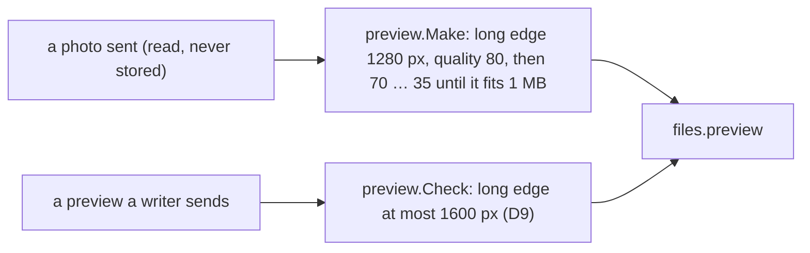

# 128 — Smaller pictures: 1280 px at quality 80, inside the contract's 1600 px and 1 MB

> Dated implementation record. Tests use temporary folders and synthetic data. The owner's live `life.db` is never
> opened by a test.

## Status

- **Date / baseline:** 2026-10-17, `29c1628` (master).
- **Priority:** P3. **Effort:** S. **Risk:** LOW: one package of the writer. Nothing for the schema or the contract.
- **Status:** DONE.
- **Resolves:** no issue, no RFC. The owner's words are the incident.

## The owner's words (2026-10-17)

"I want to achieve better and higher compression, also maybe 1600px is too much?" Of three choices (1280 px at
quality 80; 1024 px at quality 80; 1600 px at quality 75), the owner took the first.

## The design

- **The contract stays.** [D9](../decisions/D09-binary-files.md) and `files_preview` say at most 1600 px and at most
  1 MB. A writer may make less. `preview.Check` keeps the contract's 1600 px, so a preview another writer sends at
  1600 px is still taken.
- **The writer's choice.** `preview.Make` scales the long edge to 1280 px: twice the size the browser draws a picture
  in a page (about 510 px), so it is sharp on a dense screen. It encodes at quality 80 first, and lower only when the
  picture would pass 1 MB. Together about half the bytes of 1600 px at quality 85.
- **What stays as it was.** A picture kept before is not encoded again: a JPEG encoded again loses more, and its
  original may be gone. Go's standard encoder stays: a better one (mozjpeg) needs cgo, and WebP or AVIF are
  rejected by D9.

## Done when

- [x] A picture over 1280 px is scaled to 1280 px on its long edge; a smaller one keeps its size (tested).
- [x] The first quality is 80, read back from the JPEG's luminance table (tested: 6 at 80, where 85 gives 5).
- [x] `preview.Check` still takes a 1600 px preview and refuses 1601 px (tested).
