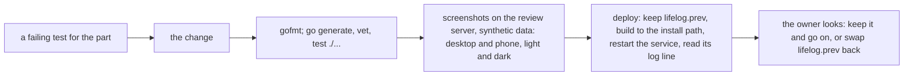
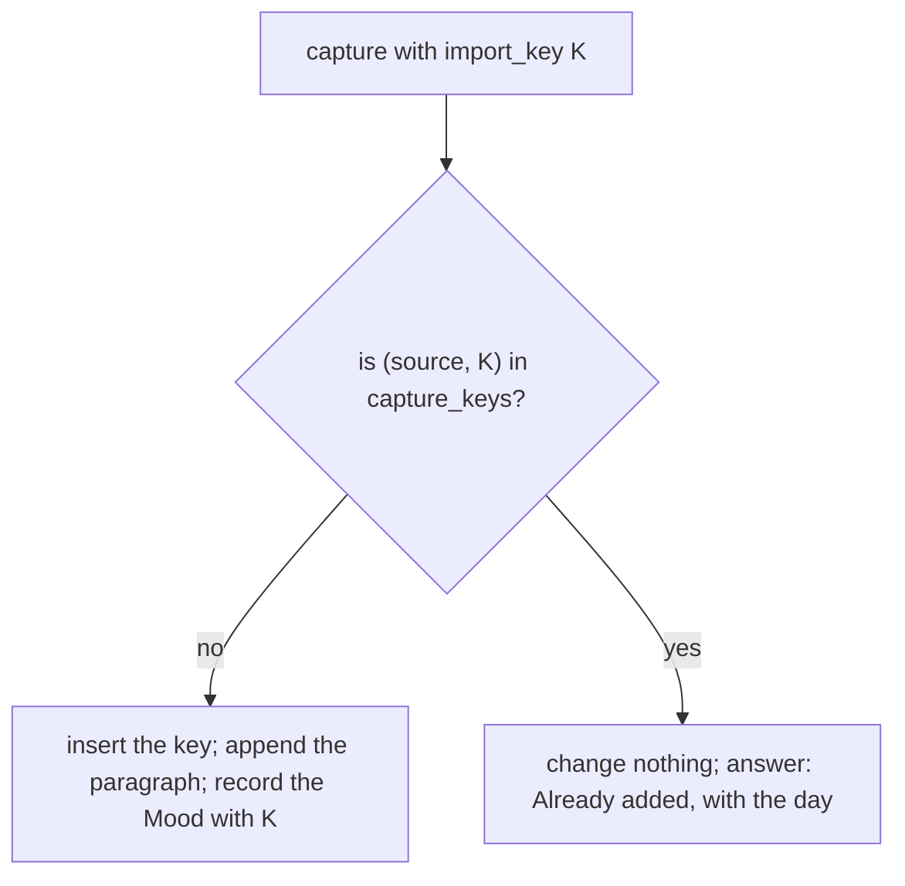

# 129 — The UX pass: plain words, quiet pages, the sentence of a mention, one Today, a capture that is safe to send again

> Dated implementation record. Tests use temporary folders and synthetic data. The owner's live `life.db` is never
> opened by a test.

## Status

- **Date / baseline:** 2026-10-17, `14083e8` (master).
- **Priority:** P2. **Effort:** L. **Risk:** MEDIUM: parts 1 to 10 change the browser's views and three API
  properties; part 11 changes the contract (a new table) and the owner's live file.
- **Status:** DONE. The code of all eleven parts is done, the live file has `capture_keys`, and the binary is deployed
  (2026-10-17, see Result).
- **Resolves:** issue [0085](../issues/0085-a-resent-capture-appends-twice.md) (part 11, with an RFC and a decision).
  The rest is the owner's word after a screenshot review (2026-10-17): "I want to do them all".

## Why

A review of 11 pages on synthetic data (desktop and phone, 2026-10-17) found three defects, six points of friction and
two larger changes:

- **Defects.** A first line shows CommonMark marks (`*Piranesi*`). A week's means have too many decimals ("60.29",
  "78.53"). A capture that a client sends again appends its paragraph twice and records a second mood.
- **Friction.** A person's page lists the days that mention the person, but not what the day says. Technical words
  are on the screen ("Entry (CommonMark)", "Search required", "FTS5 syntax", "version"). The mood buttons have no
  meaning. A page's More has five slab buttons. Every calendar cell says "3 readings". Search lists a page twice and
  has one order only.
- **Larger.** Home and the day of today show almost the same things. On this day shows no picture.

The style stays Hearthwood. No part changes a colour, a border or a shape: the owner tried a Warcraft-like framing on
2026-10-17 and it was undone.

## The owner's decisions (2026-10-17)

| question | decision |
|---|---|
| Home and Today | Home is the page of today. "Last entries" goes to its margin. |
| the double save | a durable key on every surface: an RFC, a decision and a schema change |
| the words of the mood | 1 awful, 2 bad, 3 okay, 4 good, 5 great |
| the order of a search | best match first, with a link "Newest first" |
| how to ship | one part at a time; each part goes to the live app, and the owner looks before the next part starts |

## How each part ships

- The review server is a scratch build with a synthetic database on `127.0.0.1:7788`. The live `life.db` is never
  opened.
- A commit only with the owner's word. The skills: `refactoring` and `a-philosophy-of-software-design` for parts 1 to
  10, `designing-data-intensive-applications` for part 11.

## Part 1 — A first line in plain words (defect)

`firstLine` (`internal/core/journal.go`) removes only the block marks, the embeds and `[[ ]]`.

- **`text.Plain(md string) string`** in `internal/text/plain.go`: a goldmark walk on the shape of `textRuns`
  (`internal/text/text.go`). It keeps the text of emphasis, strong, code spans and link labels. It drops images,
  embeds, raw HTML and link destinations. It decodes escapes and entities (`decode`). `[[Title]]` becomes `Title`.
- `firstLine` picks its line as now, then returns `text.Plain(line)`. The cut at 160 runes stays.
- **Snippets.** `plainSnippet` (`internal/api/view/markdown.go`) also removes the inline marks (`*`, `_`, backticks;
  `[label](url)` becomes the label) with a regular expression in `internal/text`. A snippet is a fragment, so goldmark
  must not parse it.
- **Tests:** `TestFirstLineIsPlainText` (`internal/core/journal_test.go`) gets the inline cases; a new table test in
  `internal/text/plain_test.go`; `TestASnippetIsPlainText` (`internal/api/view/markdown_test.go`) changes, because it
  holds `[link](x)` as it is today; `TestMarkShowsTheMatchedWords` stays green.

## Part 2 — A week's mean has the decimals of its readings (defect)

`weeks.go` rounds a mean to two decimals (`round2`), and `Num` prints all of them.

- In `internal/api/weeks.go`, a mean is rounded to the most decimals among the readings of that metric in the two
  weeks, at least one. So 58 and 60.29 show as "58" and "60.3"; 78.53 shows as "78.5". `Num` still prints.
- If `API.md` says "two decimals" for the mean, correct it (`TestAPIReferenceMatchesTheCode`).
- **Tests:** `TestTheWeekLooksBackOverSevenDays` (`internal/api/weeks_test.go`) gets a whole-number metric and a
  one-decimal metric, with means checked by hand. The overflow and divide-once tests stay green.

## Part 3 — A calendar cell says the mood, not "3 readings"

- `month.html`: the cell keeps the mood. The count of readings leaves the cell; the `readings` property stays in the
  JSON.
- `Store.ReadingsByDay` (`internal/core/metrics.go`) joins `entities` and leaves out the readings of a tombstoned
  metric, as `Moods` does. Today the subtraction in `calendarOf` (`internal/api/months.go`) can drift. The year uses
  the same function.
- **Tests:** `TestTheCalendarHoldsEveryDatedThing` (`internal/api/months_test.go`) expects no "1 reading" in the cell;
  `TestReadingsByDayCountsTheCurrentReadingsOfAWindow` gets a tombstoned metric.

## Part 4 — Plain labels

- **Capture:** `"label" "text=Entry"` in the `form` call of `day.html` (and of `root.html` while it is there). The
  catalog's title "Entry (CommonMark)" stays, so an MCP agent keeps the hint.
- **Search:** the field says "Words" (`"label" "q=Words"`), and no "required": the `field` template (`layout.html`)
  leaves out `<small>required</small>` in a form of one field. The FTS5 line (`root.html`) becomes a closed
  `details.more-fields` "How to search": words find the pages that have all of them; "a phrase" finds the words in
  that order; `word*` finds the words that start with it; `a OR b` finds either.
- **Facts:** the `version` row leaves `page.html`. The hidden `version` inputs stay.
- **Calendar:** the caption leaves `month.html`, and its old copy leaves `styleguide.html`.
- **Tests:** `TestEveryViewRenders` and the search tests of `internal/api/pages_test.go`; new asserts: no "required" on
  the search, the label Entry on a day, no `<dt>version</dt>`.

## Part 5 — A quiet More

The More of a page has five slab buttons (`page.html`); a metric's Links and More have four (`metrics.html`).

- Those rows are `
`. In `app.css`, `.actions.quiet :is(summary.button,a.button)` is drawn
  as `button.quiet` is (the declarations of the plan-120 rule for + Add): no slab, a border on hover, no press. Delete
  keeps the danger colour on its words. No Go change.
- **Tests:** the style page gets a quiet row as a specimen (`TestTheStylePageRunsTheRealTemplates`).

## Part 6 — The words of the mood

- A view word list (not a rule of the data): `moodWord` in `internal/api/view` (1 awful, 2 bad, 3 okay, 4 good,
  5 great), in the template functions.
- The segmented field (`layout.html`), for the field `mood`: each `<label>` has its word as `title`, and the span an
  `aria-label` such as "4, good". The legend says "Mood".
- `moodwords` (`layout.html`): one mood is "mood 4 · good"; several stay "mood 3, 4".
- **Tests:** `TestTheMoodIsAChoiceOfFive` (`internal/api/days_test.go`), the style page's asserts
  (`internal/api/styleguide_test.go`), a table test of `moodWord`.

## Part 7 — Search: each page once, and "Newest first"

- `server.search` (`internal/api/pages.go`): the words group leaves out the pages of the titles group.
- **A new optional field `order`** on the action `search` (`internal/api/catalog.go`): `best` (the default) or
  `newest`. The CLI and the MCP tools get it from the catalog. `Store.Search` (`internal/core/pages.go`) with `newest`
  orders by the day of a page: a day page's title, another page's `created_at` day; newest first; then rank, then id.
- The search view gets a link "Newest first" or "Best match" beside the heading of the words group, with the same `q`.
- **Tests:** `TestSearchListsTitlesFirst` (no page in both groups); a new core test of `newest` on days built by hand;
  `TestCanonicalSearchRankLimitAndStableTie` stays green; a row for `search order=newest` in
  `cmd/lifelog/parity_test.go`.

## Part 8 — A mention shows its sentence

A person's or a place's page lists the days that mention it, with no words (`page.html`, Backlinks).

- **`text.Mention(body string, keys []string) string`** in `internal/text`: the plain words (by `text.Plain`) of the
  first text run that holds a wikilink or a `#tag` whose `TitleKey` is in `keys`, cut to about 200 runes around the
  link. It uses the `wiki` regular expression and `TitleKey`. The keys are every retained name of the target
  (`entity_names`).
- `Store.PageByID` (`internal/core/pages.go`): for the `wikilink` edges, it reads the bodies of the sources in one
  query and sets `Edge.Context` (`internal/core/links.go`, `json:"context,omitempty"`). The day pages come newest
  first.
- `API.md` gets a row for `backlinks[].context`.
- `page.html` (Backlinks) and `metrics.html` (Mentioned in) show the day's link, then the sentence as `.snippet`.
- **Tests:** a table test of `text.Mention` (an alias, a `#tag`, a link in emphasis, two links on one line, no match);
  a core test that a person's page carries the sentence of each day; `TestEveryViewRenders` finds the sentence on
  Ana's page.

## Part 9 — On this day with its picture

- `recentDay` (`internal/api/days.go`) gets `picture`, the href of `pictureHref` (`internal/api/browse.go`), as the
  month does. `OnThisDay` reads the picture already (`setPictures`). `API.md` gets the row.
- `onthisday` (`layout.html`): an entry with a picture has the 32 px square first, as `.entry.named.covered` does.
- **Tests:** `TestTheDayAndHomeCarryOnThisDay` with a day that has a cover; the style page's fixture
  (`internal/api/assets.go`).

## Part 10 — Home is the page of today

- A browser's `GET /` (HTML) answers 303 to `/days/{today}`. The JSON root (the entry point of the API) does not
  change.
- The page of **today** gets "Last entries" in its margin (the list the root reads now, `Store.DayEntries`).
  `dayEntity` carries `recent` on today only; `API.md` gets the row.
- `root.html` loses its HTML view. Its head tools are the rail's New and Search already. Before "Owner: a snapshot"
  goes, check that the rail foot's Snapshot link opens that form.
- **Tests:** `TestTheRootIsTodayAtAGlance` becomes a test of the 303 and its Location; the refused-capture test
  (`internal/api/view_page_test.go`) moves to the day; `TestTheDayAndHomeCarryOnThisDay` keeps the day only.

## Part 11 — A capture sent again changes nothing (issue 0085, a contract change)

The path of [a change](../process.md): issue 0085, then RFC 0021, then decision D28, then `schema.sql` with its pages
and suites in one change, then the code, then the live file.

- **RFC 0021** (from `docs/rfcs/template.md`) recommends: `capture` takes an optional `import_key`. The writer keeps it
  in a new table `capture_keys(source, import_key, page_id → entities, recorded_at)`, primary key
  `(source, import_key)`, with the CHECK shape of `entities_import_key`. The Mood reading of that capture carries the
  same key on the existing index of `measurements`. A key sent again appends nothing and records nothing; the answer
  names the day ("Already added"), as `record` answers "Already recorded" (`internal/api/measurements.go`).
- **D28** records the decision. `schema.sql` gets the table, with its comment inside the CREATE. In the same change:
  the totals of `docs/schema/README.md`, the ER diagram of the entity model, `docs/cookbook/capture.md`,
  `docs/cookbook/import-a-row-once.md` (and its old sentence "A row typed on the hub itself has no key."), a mutant
  for each new CHECK in `tests/mutants_test.go`, the counts in `tests/README.md`. Issue 0085 is resolved.
- **Code.** The catalog's capture (`internal/api/catalog.go`) gets the optional field `import_key`. `Tx.Capture`
  (`internal/core/journal.go`) inserts the key first (`ON CONFLICT DO NOTHING RETURNING`) and answers "already" when
  no row comes back. The browser's capture form gets a new hidden key each time it is drawn (`crypto/rand`, through
  the form's hidden fields). The CLI and MCP get the field from the catalog.
- **Tests, first:** core: the same key twice gives one paragraph and one Mood reading; the contract suite
  (`tests/journal_test.go`): two captures with no key still append twice; API: a form sent again answers 303 to the
  day with "Already added"; a capture row with a key in `cmd/lifelog/parity_test.go`; the MCP tool has the field.
- **The live file.** A one-off program in `~/.local/share/lifelog-oneoff/capture-keys/`, on the pattern of `meta123`:
  it accepts only the new table, compares the whole schema with a new file made from `schema.sql`, and has
  `--dry-run`. The owner runs it with `!`: stop the service; a snapshot to a new folder outside the git tree; the dry
  run; the run; `lifelog --db life.db get /integrity --human`. Then the binary is installed and the owner starts the
  service.

## Tests and checks

- Each part: `gofmt -l` on the changed files; `go generate ./... && go vet ./... && go test ./...`. Parts 7, 8 and 11
  also `go test -count=1 -shuffle=on ./...`. Part 11 also `LIFELOG_MERMAID=1 go test ./tests -run TestMermaidRender`,
  `staticcheck ./...` and `govulncheck ./...`.
- Screenshots on the review server of the pages a part changes, desktop and phone, light and dark, with no console
  error.
- After each deploy: the service's log line "serving … on http://127.0.0.1:7777", and the owner's look at the live app.
  Not run on this machine: the race check (no C compiler), Windows, Firefox and Safari.

## Result

All eleven parts were done in one session on 2026-10-17, on the owner's word ("implement plan 129"), in a cloud
container. Each part was written by an agent in its own worktree, then reviewed and merged. The parts did not ship one
at a time: the container has no service and no live file, so no part was deployed.

| part | what was done, where it departs from the plan |
|---|---|
| 1 | `text.Plain` (a goldmark walk) and `text.CutInlineMarks` (for a snippet). `firstLine` passes over a line with no words (`---`, a lone image), shows the alias of `[[T\|alias]]`, and escapes a number at the start of a line, so "1986. Born" keeps its number. |
| 2 | A mean has the most decimals of the readings of the two weeks, at least 1, at most 6 (`maxDecimals`). The data of `TestTheMeanOfAWeekDividesTheSumOnce` changed, so that the test still holds a boundary case at one decimal. |
| 3 | The cell shows the mood only. `ReadingsByDay` leaves out the readings of a tombstoned metric. |
| 4 | The labels Entry and Words, "How to search", no version row, no calendar caption. A form of one field does not say "required" (`fieldView.Sole`); the browser still refuses an empty field. |
| 5 | `.actions.quiet` shares the declarations of `button.quiet`. The templates had no `quiet` class before, so they got it. |
| 6 | `moodWord` in the view. The catalog's field title is "Mood"; the description keeps "mood 1-5" for an agent. |
| 7 | `order` (`best`, `newest`) on `search`, refused with 422 when it is another word. The words group leaves out the pages of the titles group in SQL (`SearchOptions.Omit`), so the paging counts the pages that are left. `newest` takes the day of `created_at` in the zone of the store, in Go. |
| 8 | `text.Mention` takes the first block (paragraph, heading, list item), not the first run, so a link in emphasis keeps its sentence. `Edge.Context`; the bodies come in one query; the day pages come first, newest first. `links[].context` is in `API.md` too, always absent. |
| 9 | `recentDay.picture`; `dayentry` takes a `cover` flag, so the last entries keep their layout. |
| 10 | `GET /` in a browser answers 303 to today, and carries a toast's receipt with it (`redirectKeepingFeedback`). Today's margin ends with Last entries. The rail's Snapshot opens `/actions?new=snapshot`; the generic view opens a form by `?new=`. The manifest's "Add to today" opens `/days/today#capture`. |
| 11 | RFC 0021, D28, the table `capture_keys` (an `INTEGER PRIMARY KEY` and `UNIQUE (source, import_key)`, as D3 asks of a fact table; append-only by two triggers), three CHECKs and their mutants. `Tx.CaptureWithKey` reads the key first under `BEGIN IMMEDIATE`, so a resend that names another day makes no page. A key used before for a Mood `record` is a 409. Issue 0085 is resolved. |

Checks, on Linux, on the merged tree: `gofmt -l` (no output); `go generate ./... && go vet ./... && go test ./...` and
`go test -count=1 -shuffle=on ./...`: all pass except `TestHTTPAuthority/[::1]:0`, which fails because the container
has no IPv6, before and after the change. The mutants: 273 of 273 killed. Screenshots on a review server with
synthetic data (desktop and phone, light and dark, nine views): no console error.

Not run: `LIFELOG_MERMAID=1 go test ./tests -run TestMermaidRender` (no `mmdc`), `staticcheck` and `govulncheck` (not
installed), the race check, Windows.

The deploy (2026-10-17, on the owner's machine):

- **The live file.** A one-off program outside the repo, `~/.local/share/lifelog-oneoff/capture129/` (on the pattern
  of `meta123`), added `capture_keys` and its two triggers to `life.db`.
- **The binary.** Built to `~/.local/bin/lifelog` (the same file as
  `~/.local/share/lifelog-oneoff/lifelog-plan129`), with the previous binary kept as `lifelog.prev`.
  `lifelog.service` restarted at 20:48:46 CEST. Its log line: "serving /home/cico/dev/lifelogdb/life.db on
  http://127.0.0.1:7777 … (version 0.1.0, user_version 1)".
- **The check.** The owner ran `lifelog --db life.db get /integrity --human` on the live file: `ok: true`,
  `integrity_check: ["ok"]`, no `schema_drift`. The owner looked at the live app and closed the plan.
