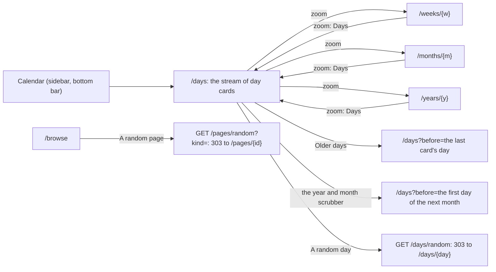

# 130 — The explore pass: Calendar opens on a stream of day cards, with zoom levels, a random day and page, and search by kind

> Dated implementation record. Tests use temporary folders and synthetic data. The owner's live `life.db` is never
> opened by a test.

## Status

- **Date / baseline:** 2026-10-17, `5e5a0d8` (master).
- **Priority:** P2. **Effort:** L. **Risk:** MEDIUM: the views, the `/days` list (its page size and its items change)
  and three new catalog actions or fields. Nothing for the schema or the contract: every read uses tables and indexes
  that exist.
- **Status:** IN REVIEW (owner).
- **Resolves:** no issue, no RFC. The owner's words are the incident.

## The owner's words (2026-10-17)

"I want to redefine and redesign the ui and ux of browser. I want you to look at the biggest and most popular note
taking software and let's find a way to explore/browse all the user pages in a cool, interesting and simple way for the
user." The decisions below come from an interview after a survey of Day One, Apple Journal, Obsidian, Logseq, Roam,
Reflect, Capacities, Notion and Bear.

## Why

The owner opens the record to explore for two jobs: **to find a known page** and **to wander and rediscover**. The lens
the owner chose is **time, as one stream**: the model is Day One's list of entries, not a folder tree or a graph.

The browser today has the parts but not the stream:

- `/days` is a plain list of 60 day pages.
- On this day is only in the margin of a day.
- Search is one flat list, with no kind and no picture.
- Nothing picks something old at random.

The style stays Hearthwood. No part changes a colour, a border or a shape (plans 096, 129; the Warcraft framing was
undone on 2026-10-17). The browser stays free of script (README, "No script"), so there is no infinite scroll and no
results while you type: page links, month jumps and the native `<datalist>` do that work.



## The owner's decisions (2026-10-17)

| question | decision |
|---|---|
| where the stream lives | Calendar opens on it (`/days`). Week, Month and Year are its zoom levels. The sidebar keeps four sections. |
| the labels of the zoom | **Days · Week · Month · Year** |
| paging | 30 cards a page, then "Older days →". A sticky year and month scrubber beside the cards; on a phone, a fold at the top. |
| what a card holds | up to 4 plain lines of the journal, the mood word, the **cover only** (no more thumbnails: a D9 preview is 100–300 KB), the places (`at` links) and the people (wikilinks to a person) as chips, "+ N pages: titles" |
| a day with no entry | a quiet marker between two cards: "· 4 quiet days ·". No streak, no "missed". |
| a day with no day page, but with a picture, a reading or a page | a slim card with no words |
| a day page in the future | not in the stream. The stream starts at today; the week and the month still show the future. |
| a birthday | a quiet chip "Birthday: Ana" on a day that already has a card. A birthday never makes a card alone. No emoji: words, or an icon that exists. |
| On this day | a strip at the top of the first page of the stream: every earlier year with a day page for today's date, the newest 10, "N years ago". The margin of a day stays as it is. |
| a random thing | "A random day" on the stream, and "A random page" in Browse. Both are catalog actions, so the CLI, the MCP server and the browser have them. |
| search | groups by kind (Days, Pages, People, Places, Files) with counts; a cover or a kind icon on each hit; kind chips; title suggestions in the sidebar's search box by a native `<datalist>` |
| how to ship | build every part, then the owner reviews all of it on the review server, then one deploy |

## Before the work starts

- **Plan 129 on the live file.** The binary at the install path was built after plan 129's last commit, and the service
  runs. Every binary of this plan contains 129 part 11, so the live file must have the table `capture_keys`. The owner
  confirms this before the deploy of this plan. Plan 129's own status is the owner's to change.
- **A cloud session has no service and no live file.** It writes the code, runs the checks and takes the screenshots on
  synthetic data. The deploy waits for the owner.
- The names of functions and lines below come from a read of `5e5a0d8`. Read the code before you rely on one.

## Conflicts with the README, and how this plan settles them

1. **`/days` changes.** The default page size goes from 60 to 30. A new field `before` (exclusive) comes first, and
   `offset` is applied after it, so "lists take `limit` and `offset`" stays true. From part 2, an `item` of `/days` is
   every day that holds something, not only a day with a day page. `API.md` and the README say so.
2. **"Days are not in Browse"** (plan 117) stays true. "A random day" is on the stream. "A random page" never picks a day
   page. Search's Days group agrees with the README: a day is "found in the Calendar and by Search".
3. **A random thing is a GET action that answers 303**, as `open-day` (`GET /days/go`) and `find` (`GET /pages`) do. It
   writes nothing, so it is a GET, not a POST. The in-process and remote clients already follow a 303
   (`rowOpenDay` in `cmd/lifelog/parity_test.go`).
4. **The title suggestions come from a resource**, as the shell's month does: the root gets a property
   `recent_titles`. The id of the datalist follows the id rule of the README (action, then field): `search-q`. This is
   not the dropped "titles after `[[`" of the body editor.

## The shared shape: the `/days` entity

The comments name the part that adds a field.

```json
{"class":["days"],"title":"Days",
 "properties":{"today":"2026-10-17","before":"2026-09-01","limit":30,"offset":0,
   "cards":[{"day":"2026-08-31","page_id":812,
             "words":"Swam at the lake.\nAna came by.",                          // 1: up to 4 plain lines
             "mood":[4],"picture":"/pages/901/preview",                           // 1: the cover
             "places":[{"title":"Lake","href":"/pages/77"}],                      // 2: at links
             "people":[{"title":"Ana","href":"/pages/12"}],                       // 2: wikilinks to a person
             "birthdays":[{"title":"Ana","href":"/pages/12"}],                    // 2
             "pages":[{"kind":"page","title":"Piranesi","href":"/pages/950"}],"more_pages":2,  // 2
             "readings":3,                                                        // 2: not the Mood
             "quiet_after":4}],                                                   // 1
   "on_this_day":[],                                                             // 4: first page only
   "years":[{"year":"2026","href":"/days?before=2027-01-01"}],                   // 3
   "months":[{"month":"2026-08","href":"/days?before=2026-09-01"}]},             // 3
 "entities":[{"rel":["item"],"href":"/days/2026-08-31","title":"2026-08-31"}],
 "links":["self","index","prev","next","days","week","month","year"],
 "actions":["open-day","random-day"]}
```

- A slim card has no `page_id` and no `words`.
- `quiet_after` is the count of empty days between this card and the next older card. The page reads `limit+1` rows
  (`readPage`), so the last card of a page has it too. The oldest card of the record has none.

## Part 1 — The stream of day cards; Calendar opens on it

- `GET /days` takes `before` (a day, `YYYY-MM-DD`, else 422; the default is tomorrow, so the future is out), `limit`
  (default 30) and `offset`. `next` is "Older days" (`before=` the last card's day). `prev` is "Newer days", or `/days`
  near the top.
- `internal/core/journal.go`: `firstLine` becomes one case of `plainLines(body, n, runes)`. The excerpt of a card is 4
  lines (plain words, as plan 129 part 1).
- New `internal/core/stream.go`: `Card`, `Store.Stream(ctx, before, limit, offset)`, `Store.NewerBefore`.
- `internal/api/days.go`: rewrite `days`. Reuse `readPage` and `paged` (`request.go`), `withMoods`, `setPictures`
  (`cover.go`) and `pictureHref`.
- View: `viewOf` maps `days` to `stream` (`view/page.go`). A new `html/stream.html`. Delete the `list` template of
  `root.html` when nothing draws it.
  - A card is an `<article aria-label="{date}">` of the parchment material (add `.day-card` to the material selector
    of `app.css`). The date is mono. The words keep their lines (`white-space: pre-line`).
  - `.quiet-gap` between cards. Tokens only.
- `view/shell.go`: the Calendar item goes to `/days`; its paths stay.
- The style page gets a card and a quiet gap.
- Core query (day pages only): `entities` by `day < :before AND is_journal AND deleted_at IS NULL ORDER BY day DESC`,
  read on `entities_day`. A page costs 4 queries (the cards, the covers, the moods, `NewerBefore`), whatever the count
  of cards.

## Part 2 — What a card holds, and slim cards

- The days of a page are every day before `before` with a live dated entity or a current reading
  (`measurement_values`): a `UNION` on `entities_day` and `measurements_day`, newest first, with the limit.
- **Every later read takes the page's days as one set** (`json_each(:days)`, as `Anniversaries` and
  `embeddedPictures` do), not a window: 30 sparse cards can span decades, and `checkCalendarWindow` refuses more than
  366 days. About 8 queries a page, none for each card.
- Refactor `DatedIn` (`core/calendar.go`) into a private `dated(cond, …)` that the month and the stream share. Give
  `Moods` and `ReadingsByDay` a form that takes a set of days.
- Chips: places from `at` links, people from wikilinks to `entity_type = 'person'`. A wikilinked place is not a chip. A
  tombstoned target is absent. Six chips, then "+N". Three page titles, then "+ N pages".
- Birthdays: `people.birth_day` whose month and day are the card's, on the days of the page only.
- Performance: check `EXPLAIN QUERY PLAN` on a temporary database, and add a timed `stream_page` to
  `internal/scaletest` (rules: `tests/README.md`, performance evidence). Change the day-set query to a step-back
  recursive CTE only if the lifetime run goes over its budget.

## Part 3 — The zoom and the scrubber

- `zoomLinks(anchor)` in `internal/api/months.go` gives the links `days`, `week`, `month` and `year` to the stream, the
  week, the month and the year. They replace the `month` and `year` links those entities have now, so no rel is twice.
  The anchor is today inside the period, else its first day; on the stream, the top card's day. On a period, `days` is
  `/days?before=` the day after the period.
- A shared `zoom` template draws `nav.kinds.chips`: **Days · Week · Month · Year**, one `aria-current`, plus Today. It
  replaces the month's row "This month, This week, The year, Every day".
- `Store.FirstDay`. Properties `years` (from the first dated year to today's year, newest first) and `months` (the 12
  months of the top card's year), each an href with `before=`.
- The scrubber is a sticky `nav.panel` in a wide column and a closed `details` in a narrow one: the browse-side and
  browse-fold pattern of `app.css`, by `@container column`. A year with nothing in it still gets a chip; its jump
  shows the next older card.

## Part 4 — On this day on top of the stream

- On the first page only (no `before`, offset 0): `on_this_day` from `h.onThisDay(ctx, today)` (`OnThisDay` in
  `core/journal.go`, `recentDay.Picture` from plan 129 part 9).
- A strip across the top: a small cover, "N years ago", the first line. No earlier year, no strip.
- A template function `yearsAgo(day, today)`, with a table test that holds 29 February.

## Part 5 — A random day and a random page

- Catalog (`internal/api/catalog.go`):
  - `random-day`, `GET /days/random`: a live day page picked at random. 404 when there is none.
  - `random-page`, `GET /pages/random`, field `kind` (a Browse kind or `all`; the default `page`): a live thing of that
    kind, never a day page, never a ghost page. 404 when the kind has none; another kind is 422.
- The mux takes `/days/random` before `/days/{day}` and `/pages/random` before `/pages/{id}`, as `/days/today` is taken
  now.
- Core `RandomDay` and `RandomThing(kind)` by `ORDER BY random() LIMIT 1`, with `browseKind` and `plainGhosts`
  (`core/browse.go`).
- The stream offers `random-day` as a quiet button in its head. Browse offers `random-page` with the current chip's
  kind as a hidden field. The rail's New stays the one loud button.

## Part 6 — Search by kind

- `search` gets an optional field `kind`: `day`, `page`, `person`, `place`, `file`; another word is 422. A metric counts
  as a page.
- New properties: `kind`, `counts` (all, and each kind, over every hit), `hits[].kind`, `hits[].picture`. Links of rel
  `kind` for the chips, with `class: [kind]`, as Browse has.
- Core (`core/pages.go`): `SearchOptions.Kind`, `Hit.Kind`, `Hit.Picture`, `Store.SearchCounts`. A search costs 4
  queries (the titles, the hits, the counts, the pictures).
- View: "Pages by title" stays first; it is the fast way to a known page. Then the hits of the page in groups, in a
  fixed order, each heading with its total and a link to its chip. With a kind, one list, paged as now. The cover takes
  the place of the kind icon; the icons are the ones that exist (`calendar`, `files`, `people`, `places`, `image`).

## Part 7 — Title suggestions in the sidebar's search

- `Store.RecentTitles(ctx, since, 200)` (`core/names.go`): the live pages, people, places and metrics made in the last
  90 days or linked from a day page of the last 90 days, the newest first. No files, no day pages.
- The root gets `recent_titles`. `shellOf` reads it; a failed read draws the rail without the datalist.
- `layout.html`: `list="search-q"` on the rail's input and on the palette's input, and one
  `<datalist id="search-q">` in `foot`.
- The README states the cost: about 8 KB on each page, and Safari matches only the start of a title. An older title is
  one search away, since the titles group matches over the whole record.

## Tests and checks

Tests live beside their packages, on real SQLite in `t.TempDir()`, with synthetic data made through the writer and
expected values checked by hand.

- **Core:** the stream is newest first and `before` is exclusive; a tombstoned day page is absent; the excerpt (a
  table test); a slim card from a file, from a reading, from a Mood alone; the chip caps and `more_pages`; a page whose
  cards span more than 366 days; a birthday chip only on a day with a card; a random pick from one live and one
  tombstoned page always gives the live one; a ghost page and a day page are never a random page; search counts by
  kind.
- **API:** `days_test.go` (the hrefs, `quiet_after`, `before=x` is 422); `paging_test.go` (the default 30); the zoom
  hrefs in `months_test.go` and `weeks_test.go`; `TestTheDayAndHomeCarryOnThisDay` gets a stream case.
- **View:** `TestEveryViewRenders` draws a card, a slim card, a gap, the zoom with one `aria-current`, the random
  buttons, the search groups and the datalist, and still finds no `<script`. `view/shell_test.go`: `/days` marks
  Calendar.
- **Parity** (`cmd/lifelog/parity_test.go`): `random-day`, `random-page kind=person` and `search kind=person` on the
  CLI, HTTP, MCP and remote MCP; the MCP tool list.
- `reference_test.go` keeps `API.md` equal to the code.
- After each part: `gofmt -l`, then `go generate ./... && go vet ./... && go test ./...`. After parts 2, 5 and 6 also
  `go test -count=1 -shuffle=on ./...`. At the end, `staticcheck ./...` and `govulncheck ./...` when they are there,
  with their versions; else say "not run".
- **Screenshots** on a review server with synthetic data that spans decades and holds slim days, birthdays and gaps:
  `/days`, `/days?before=…`, a week, a month, a year, `/browse`, `/search?q=…&kind=…`; desktop and phone, light and
  dark; no console error and no HTTP status of 400 or more. The owner reviews all of them before the deploy.

## Docs

- `API.md`: `/days` (the stream, `before`, the cards, the page size), the zoom links, `random-day`, `random-page`,
  search's `kind` and `counts`, the root's `recent_titles`.
- `README.md` decisions: Calendar opens on the stream, and the zoom; slim cards; the random actions (Browse still holds
  no day); the search groups; the datalist and its cost.
- This plan's Result, and its row in [the plans index](README.md).

## Done when

- All seven parts are in, every check above passes (or is named as not run), and the screenshots are with the owner.
- The deploy waits for the owner's word: keep the previous binary, build to the install path, restart the service,
  read its log line, and the owner looks at the live app.

## Result

All seven parts were done in one session on 2026-10-17, on the owner's word ("implement plan 130"), in a cloud
container. The container has no service and no live file, so nothing was deployed. Parts 1 to 4 are one commit: each
of them changes the same entity, `/days`.

| part | what was done, where it departs from the plan |
|---|---|
| 1 | `core.Stream` reads `limit+1` days and gives back the page and `more`, so that the last card has its `quiet_after`; the handler does not use `readPage`. The `next` and `prev` links keep `limit` when it is not 30. A `before` after today shows no future day. `plainLines` cuts each line at 160 characters. The `list` template is gone. |
| 2 | The days of a page are a `UNION` of `entities_day` and `measurements_day`: `EXPLAIN QUERY PLAN` shows a merge of the two indexes in day order, with no temporary b-tree, so `LIMIT` ends the read. The cards cost 8 queries, whatever their count: the days, the day pages, their covers, the moods, the readings, the pages and places, the people and the birthdays. `NewerBefore`, the scrubber (`FirstDay`) and On this day add their own reads. `FirstDay` reads `ORDER BY day LIMIT 1`, not `min()`, which walks every row. The places and the people are 6 chips together, then `more_chips`, a property the plan did not name. A file with a picture is shown in the page of its day, so its day has a day page with a cover and no words, not a slim card. |
| 3 | The zoom of a week is anchored on its Thursday, not its Monday, when today is not in it: ISO 8601 gives a week the year of its Thursday, and the old `month` link of a week was the Thursday's. The months of the scrubber go from December to January, as the stream goes. `yearPage` and `yearOf` had no caller left and are gone. |
| 4 | As planned. `yearsAgo` says "this year" for a day less than a year before today. |
| 5 | A random day is up to today: a future day page is a plan, not a day to rediscover. A random thing is not limited to the category of the list, only to its kind. |
| 6 | A group of the hits names its total and links to its chip ("All N"). A hit's title is the last text of its link, after the cover or the icon. |
| 7 | The titles are ordered by the later of the UTC day a thing was made and the newest day that links it. The Mood metric, which the schema makes with the file, is a recent title of a new file. |

Checks, on Linux: `gofmt -l` (no output); `go generate ./... && go vet ./... && go test ./...` after each part, and
`go test -count=1 -shuffle=on ./...` after parts 5 and 6 (and so after 2): all pass except `TestHTTPAuthority/[::1]:0`,
which fails because the container has no IPv6, before and after the change. Screenshots on a review server with
synthetic data that spans 1998 to 2026, with slim days, birthdays, gaps and a future day page: `/days`,
`/days?before=2026-08-01`, a week, a month, a year, `/browse`, `/search?q=walk` and `/search?q=walk&kind=day`, on a
desktop and a phone, light and dark (32 pictures): no console error and no HTTP status of 400 or more.
The lifetime scale run (`lifescale -profile lifetime -seed 2075 -samples 5`, metadata only, a cloud container with 4
vCPU, a virtio disk and ext4) passed its known answers; `stream_page`, a page of 30 cards from the middle of 18,262 days
with 20 readings a day, took 51 to 65 ms in its 5 samples (`search_rare`: 73 to 81 ms). The days query therefore stays
a merge of the two indexes; the step-back recursive query was not needed.

Not run: `LIFELOG_MERMAID=1 go test ./tests -run TestMermaidRender` (no `mmdc`), `staticcheck` and `govulncheck` (not
installed), the race check, Windows.

Open, for the owner:

- **The review.** The screenshots are with the owner; the owner reviews all the parts before the deploy.
- **Plan 129 on the live file.** The live file must have `capture_keys` before this binary runs on it (above).
- **The deploy.** Keep the previous binary, build to the install path, restart the service, read its log line, and
  look at the live app.
