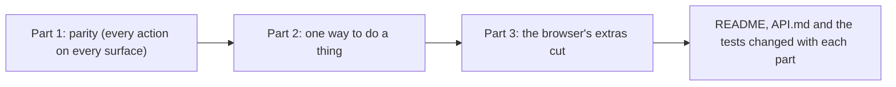

# 131 — The Pareto pass: every action on every surface, one way to do a thing, and the browser's extras cut

> Dated implementation record. Tests use temporary folders and synthetic data. The owner's live `life.db` is never
> opened by a test.

## Status

- **Date / baseline:** 2026-10-18, `c172ccd` (master).
- **Priority:** P2. **Effort:** L. **Risk:** MEDIUM. The catalog loses three actions (`tombstone`, `random-day`,
  `get_day` of MCP) and some fields. The JSON loses the properties that only a view read. The browser loses the
  views and the parts that cost the most and give the least. Nothing changes in the schema or the contract.
- **Status:** IN REVIEW (owner).
- **Resolves:** no issue, no RFC. The owner's words are the incident.

## The owner's words (2026-10-18)

"Can we analyze the current API, MCP, and HTML UI and CLI and find out areas of complexity that can be removed, or
areas of UI that can be simplified. I want to apply the paretto principle, where 20% can be used for 80% of the
features. The HTML website should give a minimal UI to do all the operations available and for it to be in par with
the CLI, MCP and API." After the analysis: "yes, create a plan and fix all of them".

## Why

The work of every day is eight actions: capture, the day, save-body, search, browse, record, add-file and a page. The
rest of the code is mostly extra views of the browser, and two to four ways to do one thing. A read of `c172ccd`
also found real gaps in parity: the browser's `/actions` page posts eleven forms to a literal `/pages/{id}/…`, the two
repairs of the owner are on that page only, an agent cannot send a photo, and the CLI's `do` cannot send a file.

## Part 1 — parity

1. **`/actions` works in a browser.** An action with a path field (`{id}`, `{day}`) is drawn as a GET form to
   `/actions` with `new=<action>` and the path fields. `GET /actions?new=<action>&<path field>=<value>` answers the
   catalog with that action's href filled in, so its form posts to a real address. Every other client is unchanged:
   with no `new`, the catalog is the templated one.
2. **The owner's repairs are on `/integrity`.** The integrity entity offers `snapshot`, `rebuild-search` and
   `resync-links` to the owner, as the root offers `snapshot`.
3. **One `Do` for every client.** `client.Do` sends a multipart form when a value names a field of the type `file`:
   the value is the path of a local file, streamed, never held in memory. `DoFiles` goes. The CLI's `do add-file
   original=photo.jpg` and the MCP tools `add_file` and `set_cover` can then send a file. The CLI's `file` and `cover`
   keep their flags and call `Do`.
4. **An MCP tool takes a file.** A file field is a string in the tool's schema: the path of a local file, which the
   MCP server reads and sends. The skill that keeps photos uses the tool, so the rows are the agent's (`agent:NAME`),
   not `cli`.
5. **`add-file` names the file by itself.** `title` is optional. With no title, a sent original gives its file name;
   with no original (an agent's `sha256`) the title is required. The CLI's own default goes.
6. **Restore can be found.** Browse lists the deleted pages (`deleted=1`, beside the ghost pages): each row opens its
   page, where Restore is.
7. **The docs say what is true.** The README loses the removed `readings` command; API.md says `set-cover`, not
   `set-picture`.

## Part 2 — one way to do a thing

| what | before | after |
|---|---|---|
| file a thing in a category | `link` with `part-of`; `file-pages`; `category` on five create actions | `file-pages`, and `category` on `create-page` only; `unlink` with `part-of` takes a thing out (the × of a badge) |
| put a reading on a day | the day's tiles, the day's form, the board's cards, the metric's page | the day's form (New's Reading opens it on the page of today) and the metric's readings |
| set a cover | the thumbnails, the picker's two forms, a link in two places | one link on the day and the page to the picker |
| go to a day | five views | the day and the stream |
| search | the rail's form, the dialog, `/search` | the dialog (the rail opens it) and `/search` |
| delete | `tombstone` and `tombstone-pages` | `tombstone-pages`, with one id or several |
| a random thing | `random-day` and `random-page` | `random-page`, with `kind=day` |
| the day of MCP | `get_day` and `open_day` | `open_day` |
| this month, this year | `/months/current`, `/years/current` | the links of the root and the shell |
| a metric's whole history | no `from`, or `all_history=1` | no `from` |
| the old lists | `/people`, `/places`, `/media`, `/files`, `/ghosts`, `/categories` answer 308 | 404 |
| the folder of a snapshot | `serve --snapshots`, `snapshot --to` | `--snapshots` for both; `deploy/lifelog-snapshot` changes with it |
| the writer of MCP | `mcp --agent`, and a `--source` that it overrode in silence | `mcp --agent`; `--source` on `mcp` is refused |
| put several things in a category on Metrics | Select, and New category | Select |

## Part 3 — the browser's extras cut

1. **The week view goes:** `/weeks/{w}`, its means, its template, its zoom chip and the day's "week N" link.
2. **A refused form answers with the error page**, which keeps what the form sent and links Back. The server no longer
   runs a GET of the form's page through its own routes; `view.Refusal` and the `form` field go. The receipts of a
   write's result stay: a short `?done=` text would lose what a write did not do. The root draws today's day for a
   browser instead of a redirect, and a metric's page no longer redirects, so a receipt never moves.
3. **The stream** loses the scrubber, the On this day strip, the quiet gaps and `before`. **The month** loses its
   items (births, places, pages) and Day by day. **Go to a day** stays on the day and the stream.
4. **Browse** loses the letter groups, the closed index, the letter bar and the folder tiles, and draws its tree once.
   **Metrics** loses `?view=list`, + New metric here, and the three forms of New metric (one form). **A metric's
   page** (`/metrics/{name}`) is its readings, with a link to its page; the page of a metric (`/pages/{id}`) is the
   page, with a link to its readings.
5. **The style page goes** (`/styleguide`).
6. **The JSON loses the properties that only a view read:** `trends`, `on_this_day`, `recent_titles`, the search's
   `counts`, and `pictures`. A day's reading tile is drawn from `readings`.

## Done when

- The baseline passes: `go generate ./... && go vet ./... && go test ./...`.
- A browser can run every catalog action from `/actions`, and a test holds it (no form posts to a `{`).
- `README.md`, `API.md` and the counts of `tests/README.md` say what is true.
- The report names every change that a deploy needs: the snapshot script at its install path, and the MCP configs
  that `lifelog agentic-init` wrote.

## Before the deploy

- `deploy/lifelog-snapshot` calls `lifelog snapshot --snapshots DIR`. Copy it to its install path in the same step as
  the binary, or the nightly snapshot fails.
- A config written by `lifelog agentic-init` does not change (`mcp --agent NAME` stays).

## The result (2026-10-18)

Every part is done, on the branch `plan-131-pareto`. Where the work went another way than the text above, this is
what was done and why:

- **The receipts of a write stay.** A `?done=` text in the address would lose what a write did not do, and anyone
  could put words in it. The server no longer moves a receipt (the root draws the day of today for a browser, and a
  metric's page is a page), so `move` and its redirect are gone.
- **`mcp --agent` stays**, and `mcp` refuses `--source`, which it used to override in silence. The MCP configs that
  `lifelog agentic-init` wrote keep working.
- **`link` does not offer `part-of`**, but the catalog's `link` still takes it when a client names it, as the schema
  allows the link. Only the offer changed.
- **A day's reading tile** is the metric and its last value of the day, with no unit and no line: both came from
  `trends`. The metric's readings have both.
- **New's Reading** opens the record form of the page of today (`/?new=record`), since a card has no + Add.
- The lines of code, without the tests: `internal/api` lost about 600, `internal/api/view` about 330,
  `internal/core` about 200, the templates about 340 and `app.css` 126 of its 878. Three actions or tools left the catalog (`tombstone`, `random-day`,
  `get_day`), and five properties left the JSON (`trends`, `on_this_day`, `recent_titles`, the search's `counts`,
  `pictures`).
