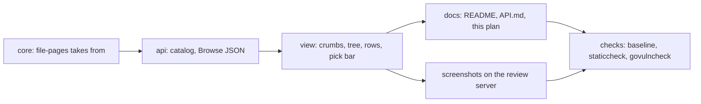

# 132 — Browse the Notion way: crumbs and a heading, a tree with +, Move on every row, and file-pages takes a thing out

> Dated implementation record. Tests use temporary folders and synthetic data. The owner's live `life.db` is never
> opened by a test.

## Status

- **Date / baseline:** 2026-10-18, `2a03d2c` (master).
- **Priority:** P2. **Effort:** M. **Risk:** LOW. There is no schema change. The catalog gains one optional field
  (`from` of `file-pages`). `unlink` offers less.
- **Status:** IN REVIEW (owner).
- **Resolves:** no issue, no RFC. The owner's words are the incident.

## The owner's words (2026-10-18)

"I want to enhance the UI and UX and navigation of the Browse tab. I want to have a clean way to navigate, move items
between categories. I want you to take inspiration from the best and most popular note taking website and redesign
the browse tab properly."

The owner then made four choices:

1. Notion is the model.
2. Inside a category, the Move flag of the pick bar is on by default.
3. A bulk unfile extends `file-pages` with `from`. It is not a new action.
4. The work runs locally. It is deployed only with the owner's word.

## Why

[Plan 117](117-one-browse-view.md) made one Browse view. The view has these gaps:

- The page gives no link to go back up from a category.
- A row does not say where it is filed.
- One row cannot move without Select and its boxes.
- Nothing takes several rows out of a category. Only a page's badge takes one thing out, one at a time.

Notion has a pattern for each gap: a tree with a + on each branch, breadcrumbs, a Move on every item and a bar for the
selection. This plan takes the pattern and keeps the rules of the repo.

## The rules this keeps

- **No script.** The browser does the work with links, forms and CSS.
- **One way to do a thing.** There is one form for a write. A link leads to it. No view draws it a second time.
- **Every action on every surface.** `file-pages` with `from` is in the catalog, so the API, the CLI, the MCP server
  and the browser all carry it. The table in the README names it.
- **Hearthwood.** This is polish inside the design. It adds no new look.
- **A rule about data is SQL.** The `part-of` rules stay in the schema. The Go code only chooses which links to remove.

## Decisions

| id | decision | why |
|---|---|---|
| D1 | `file-pages` has the optional field `from`. One of `category` and `from` is required, never both (422). With `from`, `move` is not read. | One action files and unfiles. A second action would break "one way to do a thing". `move` has no meaning when nothing is added. |
| D2 | With `from`, the `part-of` link from each id to the page titled `from` is removed. A `from` that names no page is 404. A deleted page is 409. A page that was not in `from` is not an error. The answer has `removed`, the count of links removed. | A repeated request must be safe. The count tells the client what happened. |
| D3 | `link` and `unlink` do not offer `part-of`. The API still accepts it when a client names it. A plain page offers neither. | `file-pages` is the one way. A client that names `part-of` keeps working, as in plan 131. |
| D4 | The × of a category badge posts `file-pages` with hidden `ids` (this page) and `from` (that category). | The badge uses the one action. |
| D5 | Remove from here in the pick bar is a submit button with `name=from`, `form=pick` and `formnovalidate`. | The button sends the checked rows with the same form. It needs no category in the box. |
| D6 | A row's categories come from one read of the part-of links (`Store.CategoriesFiled`), by title key. | One query for the whole page, not one for each row. |
| D7 | Move on a row is a link to `?new=file-pages&ids=<id>`. | The link opens the one pick bar with the row checked. It is not a second form. |
| D8 | The + on a tree row and New category at the foot are links to the Pages list with New page open. | A category is a page. The existing form makes it. |
| D9 | The crumbs come from the path of the category. The heading is the location. A category adds Open its page. | The reader always sees where he is, and has a link back up. |
| D10 | The category box is a datalist whose options carry the path as a label. | The reader tells two categories of the same title apart. |

## Parts

- **A. Core.** `file-pages` takes `from`, removes the links and counts them. `CategoriesFiled` reads the categories of
  a set of rows.
- **B. API.** The catalog field `from` and the property `removed`. The Browse JSON has `rows[].categories[]` and the
  `move` value. The page offers `link` and `unlink` without `part-of`.
- **C. View, templates and CSS.** The crumbs and the heading. The + and New category in the tree. The badges and Move
  on rows and tiles. The pick bar with its three buttons. The list is quiet after a write.
- **D. Docs.** README.md, API.md and this plan.
- **E. Screenshots and checks.** The screenshots come from the review server on port 7788. It uses a synthetic
  database and never the owner's `life.db`. The checks are the baseline `go generate ./... && go vet ./... && go test
  ./...`, `staticcheck ./...` and `govulncheck ./...`.

## Tests

- **core:** `TestFilePages`, `TestFilePagesRefusals`.
- **api:** `TestFileMetricsAtOnce`, `TestAPagesCategoriesAreBadges`, `TestEveryListSelectsTheSameWay`,
  `TestBrowseActions`, and the Browse page tests in `internal/api/browse_test.go`.
- **cmd/lifelog:** the parity row "file-pages with from", and `TestTheTableOfTheSurfacesIsTheCatalog`.
- **view:** `TestTheCrumbsFollowThePath`, `TestPickedAndMoveHref`.

## Done when

- The baseline passes.
- Every surface runs `file-pages` with `from`.
- The table in the README equals the catalog.
- The screenshots are reviewed on desktop and phone, in light and dark.
- The change is deployed, with the owner's word.
