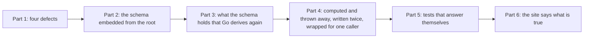

# 133 — What the code holds twice, what it holds for nothing, and four defects

> Dated implementation record. Tests use temporary folders and synthetic data. The owner's live `life.db` is never
> opened by a test.

## Status

- **Date / baseline:** 2026-10-18, `9b056bc` (master).
- **Priority:** P2. **Effort:** M. **Risk:** LOW. There is no schema change and no contract change. The catalog gains
  three optional fields that the handlers already read (`deleted` of `browse`, `limit` and `offset` of `search`), and
  `q` of `search` becomes optional. One answer changes its status: `add-file` with the title of a person, a place or
  a metric is refused by the trigger (422), not by Go (409). The build loses `go generate`.
- **Status:** TODO.
- **Resolves:** no issue, no RFC. The owner's words are the incident.

## The owner's words (2026-10-18)

"Do a thorough review of the codebase based on the guidelines and rules specified in AGENTS.md. I am also looking for
opportunities to get rid of some unused code that can be made simpler, KISS-er without too much of a loss in
functionality. I am looking in the future to introduce some sort of plugin functionality to let the user customize
it further, but that is a longer goal; I specified so you are aware of the architecture that might go in the future."

The owner then made two choices:

| question | choice |
|---|---|
| The embedded schema: a copy tool run by `go generate`, or a `go:embed` from the root of the repo? | **Embed from the root.** `tools/copyschema`, the copy, its test and the CI step go. |
| `add-file` with a typed title: the Go 409 with a link, or the trigger's 422? | **The trigger refuses.** The rule of AGENTS.md wins: a Go check that repeats a trigger is a defect. |

## Why

The tree at `9b056bc` is clean: `deadcode`, `staticcheck` and `go vet` find nothing, the baseline passes in 53 s, and
the deadline tests pass under the race detector. [Plan 126](126-the-rule-book-review.md) and
[plan 131](131-the-pareto-pass.md) cut the obvious. What is left is structural: a rule the schema holds that Go
derives again, a value computed and thrown away, a pair of functions where the API calls one and only the scale
runner the other, a build step that `go:embed` makes redundant, a public web page that describes a product that no
longer exists, and four defects found by reading.

**On plugins.** The architecture is already the seam a plugin would use: the catalog (`internal/api/catalog.go`) is
data; `mount` pairs each action with its handler; the CLI's `do`, the MCP tools and the browser's forms are drawn
from it; `core` is one `Tx` of named writes. A plugin would register an action, a handler and perhaps a view. This
plan adds no extension point (AGENTS.md forbids a speculative one). Each part keeps the catalog as the one source and
removes a place where a surface knows a rule on its own, which a plugin would otherwise have to repeat.

Parts 1, 2 and 6 touch different files and can run in parallel. Parts 3, 4 and 5 follow part 1.

## Part 1 — Four defects

Each one gets a failing test before its fix.

1. **A multipart POST without a file loses every field.** `form` in `internal/api/request.go` calls `r.ParseForm`,
   which does not read a `multipart/form-data` body. The phone's share target
   (`internal/api/view/html/manifest.webmanifest`) declares that enctype for `POST /days/today/capture`, so the
   shared text is dropped. The Preview button of the add-file form (`layout.html`) sends the multipart form to
   `/render`, which reads an empty body. Fix: the manifest's enctype is `application/x-www-form-urlencoded`; the
   Preview button carries `formenctype="application/x-www-form-urlencoded"`; `form` answers 415 for a multipart
   body instead of an empty form. The share-target test and the render test post what the manifest and the form
   declare.
2. **The catalog and two handlers disagree, so the CLI and the MCP tools lose parameters.** `browse` reads
   `deleted` (API.md says so) but its row of the catalog does not list it, and `client.fill` refuses a field the
   action does not list, so `do browse deleted=1` and the MCP tool fail, and Restore depends on that list. `search`
   reads `limit` and `offset` that its row lacks, marks `q` required while the handler serves an empty `q`, and both
   handlers bypass `fieldsOf`. Fix: add `deleted` to `browse` and `limit` and `offset` to `search`, make `q` optional,
   read both through `fieldsOf(r, act)`, delete the carve-outs for `search` in `api_test.go`, and run the two through
   the parity table. The README's table of the surfaces does not change.
3. **`lifelog cover ID --title T --preview P` drops `--preview` in silence** (`cmd/lifelog/file.go`), against the
   rule that a flag is refused, never ignored. The same file repeats the server's rule "a title or a photo". Fix:
   send `preview` whenever it is given; delete the client-side rule; `keepFile` and `setCover` build their values
   and call `doAction`.
4. **A timeout or a busy file during the full-text check is reported as index damage.** `Integrity`
   (`internal/core/integrity.go`) turns every error of the FTS5 `integrity-check` into `FullTextIndexOK=false`,
   `OK=false` and no error, so a deadline marks a snapshot's restore check failed. Fix: a cancelled context and a
   driver error that is not a constraint are returned as errors; only a corruption result is a finding. A test
   cancels the context and expects an error, not a finding.

Also: the `RowsAffected` errors ignored in `core/categories.go` and `core/links.go` (one gives a false 404), and the
unchecked `Close` of the writer in `db.go`.

## Part 2 — The schema embedded from the root

- Add `schema.go` at the root of the repo: `package lifelog`, `//go:embed docs/schema/schema.sql`, `var Schema
  string`, with a comment that says it is the one canonical DDL, read by `internal/db`.
- `internal/db/db.go` imports `lifelog` and reads `lifelog.Schema`; its `go:generate` and `go:embed` lines go.
- Delete `tools/copyschema/`, `internal/db/schema.sql`, `TestSchemaCopyIsCurrent` and the step "Verify generated
  schema" of `.github/workflows/windows-validation.yml`.
- AGENTS.md (the baseline line and the sentence on `go generate`), README.md (the build line, Checks, the Layout row
  of `tools/copyschema`, the decision "The schema is embedded") and tests/README.md change with it.
- A build on a fresh clone with no `go generate` must succeed: check it in a worktree.

## Part 3 — What the schema holds that Go derives again

- `is_journal` is a generated column of `entities`. Read it instead of the predicate: `pages.go` (`IsDayPage`),
  `browse.go` (the `LEFT JOIN entity_names lp_name` exists only for `lp_name.title = lp.day`, twice), `journal.go`
  (`p_name.title <> :day`).
- `add-file` with a person's, a place's or a metric's title: delete the `ExistsError` branch of `keepNew`
  (`core/files.go`) and let `entities_promote_from_page` refuse, as `RegisterMetric` does. API.md and the test that
  expects 409 change. `createNamed` and `rename` keep their 409: it carries the id of the existing page, a status
  SQLite cannot give.
- The day of a series is checked in `api/measurements.go` and again in `core.Series`: core keeps it, through
  `checkDay`, so the message is the one message (`InUse` too).
- The MCP tool schema's date pattern repeats the schema's day CHECK and the word `today`: keep the words of the
  description, drop the pattern. Its numeric-option validation checks the catalog's own literals at every build:
  move it to one test of the catalog and delete it from the builder.

## Part 4 — Computed and thrown away, written twice, or wrapped for one caller

**core**

- Death anniversaries: `anniversariesOn` computes births and deaths, `Years` and a sort; its one caller
  (`stream.go`) keeps `Kind == "birthday"` and reads the id and the title. Narrow it to birthdays; drop `Years`, the
  death branch, the sort and `Kind`; the tests follow.
- `linkReader` (`links_resync.go`) has one implementation and overlaps `queryer`: use `*sql.Tx`.
- Find-or-create-or-revive a page is written three times (`dayPage`, `linkTarget`, which re-queries what `lookupKey`
  returns, and the revive in `setDeleted`): one helper for the first two.
- Pass-throughs: `Store.Capture` and `Tx.Capture` (the API calls `CaptureWithKey`; the scale runner sends an empty
  key), `Store.Search` (the runner calls `SearchWith`), `Tx.AddFile` to `keep`, `tombstone` and `revive` to
  `setDeleted`, `orExists`, `firstLine`, the `NewMetric` struct with one caller.
- Repeated SQL: the preferred title by id (`pages.go`, `cover.go`) is `findPage`; the wikilink targets of a page
  (`links.go`, `links_resync.go`).
- Unexport what only core uses: `IntegrityDeadline`, `Tx.CaptureWithKey`, `Dated`, `Anniversary`; in `text`:
  `Candidates`, `AssignedVersion`. `Tx.SetBody` stays: the kit of `tests/` uses it.
- Branches that cannot happen: the nil check of `removeReservedDatabasePath`; the `json.Marshal` error of a
  `[]string` (`cover.go`, `calendar.go`, `stream.go`), checked there and discarded in `links.go`: one small helper.
- `db/readers.go` folds into `db.go`.
- `core` imports `api/siren` for three error codes: the codes move to `core`, and `siren` keeps them as aliases, so
  the writer does not depend on the API package and no client changes.

**api, view, mcp, client**

- Dead: `browseKind.fileable` is true in every row; `hitGroup.Kind` is read by no template; `--warn-soft` of
  `base.css` is used by no rule; `mcp.tool.follow` always equals `action == nil`.
- One caller: `loadPage` returns a page its caller discards (merge); the `calendar` struct of one field;
  `withMoods`; `flagValue` where `flag` does; `view.Draw`, `pageView` and `htmlOf` are one operation in three;
  `client.hasField` repeats `siren.Action.Field`; `apitest.Href` repeats `LinkByRel`; `view.Embedded` and `LinksOf`
  are one filter.
- Boilerplate: the Content-Type test for a multipart form is written five times: one `isMultipart`. `setCover`
  repeats the multipart branch of `parseFileForm`: `encodedFileForm` says `Sent=false` when neither `sha256` nor
  `mime` is sent. `pictureHref` is bypassed in `pages.go` and `browse.go`, and `/cover` is built by hand: the siren
  helpers, with a `CoverHref`.
- `record`'s "Already added" answer has no `self` and no `Result`, so a browser's second post gets a plain page where
  `capture`'s redirects with a toast: the same shape.
- `monthDay.Readings` costs a `ReadingsByDay` query that `month.html` never draws: keep it only if API.md promises
  it.
- The root links `browse` and `categories` to one address: one link (API.md changes).

**cmd, agentic, scaletest, photo**

- The usage of `file` and `cover` restates the catalog's prose, and a test exists only to keep the copy equal:
  the usage names the flags and the action; the test goes. The usage string repeated in errors comes from the
  table row.
- Global flags ignored in silence: `--url` and `--source` on `init` and `agentic-init`, `--db` with `--url`,
  `--human` on `serve` and `mcp`: `parse` refuses them.
- `agentic`: the `err2` closure catches errors that cannot happen; the import of `siren` for `WriteJSON` alone goes.
- `phototest`: `gps` is always nil; `photo_test.go` holds a second HEIF builder: one builder. The comment of
  `photo.go` that names D21 place matching is stale.
- `scaletest`: the report types and `environment` move into `tools/lifescale`; `Run` returns the manifest and the
  samples; the test that compares the constants of the profiles and the third `Run` go; the `Interpretation`
  strings restate tests/README.md, which stays the home.

## Part 5 — Tests that answer themselves, and a sleep

- `text_test.go` takes its expected tags from the production `Candidates`: hand-written lists.
- `core/browse_test.go` builds its expectation from the production `mediaKind` constant and compares SQL text:
  assert rows.
- `mcp_test.go` derives the expected tool names with the production `toolName`: write the names.
- `api/deadline_internal_test.go` paces writes with a sleep against the stall deadline: a signal where the test
  allows, else a comment on the margin. It passed under the race detector.
- Unchecked setup errors in `db_test.go`.

## Part 6 — The site says what is true

`site/index.html` was last changed on 2026-10-14, before D21 and D23. It describes tasks and reminders, a `done`
command, `snapshot --to`, a habit check-in, a place with a point, "15 strict, typed tables" (there are 10, one FTS
table and 3 views) and a week view. Rewrite those sections from the README of today; the Get started block is the
README's own lines. README.md says "synthetic personas" where there is one mixed workload.

## Considered and left alone

- The feedback-receipt store of a browser's write: a cookie would cap a result at 4 KB, and `resync-links` can pass
  it; the store is bounded, tested and private.
- `GET /days/today` beside `open-day`: the address is the manifest's, the shell's and API.md's; the action is the
  CLI's and the MCP tool's.
- `GET /previews?title=` beside `GET /pages/{id}/preview`: an embed knows only a title.
- The seven flags of the CLI's shortcuts: they wrap `add-file`, `capture` and `set-cover`, and the README names them.
- `Tx` holding its context in a field: deliberate, scoped to one `Do`.
- `requireOwner`'s writer grammar, `text.validFilename`, `preview.Check` and the integrity SQL: the contract assigns
  them to the writer, and each says so.

## Tests

- Each part: `gofmt -l`, `go vet ./...`, `go test ./...`.
- At the end: `staticcheck ./...`, `govulncheck ./...`, `go test -count=1 -shuffle=on ./...`,
  `CGO_ENABLED=1 go test -race -count=1 ./...`, and `go test ./tests` for the links of the docs.
- `TestTheTableOfTheSurfacesIsTheCatalog` and `TestParityOfTheSurfaces` stay green.

## Done when

- The four defects of part 1 have their tests and pass.
- `go build ./cmd/lifelog` on a fresh clone needs no `go generate`, and nothing in the repo names it.
- No Go predicate recomputes `is_journal`; `keepNew` has no `ExistsError`.
- Every item of parts 4 and 5 is done or recorded here as left, with the reason.
- `site/index.html` names nothing the product does not have.
- The binary is built to its install path, the service restarted, and the deploy noted in the result (the deploy
  waits for the owner when the plan is run elsewhere).
