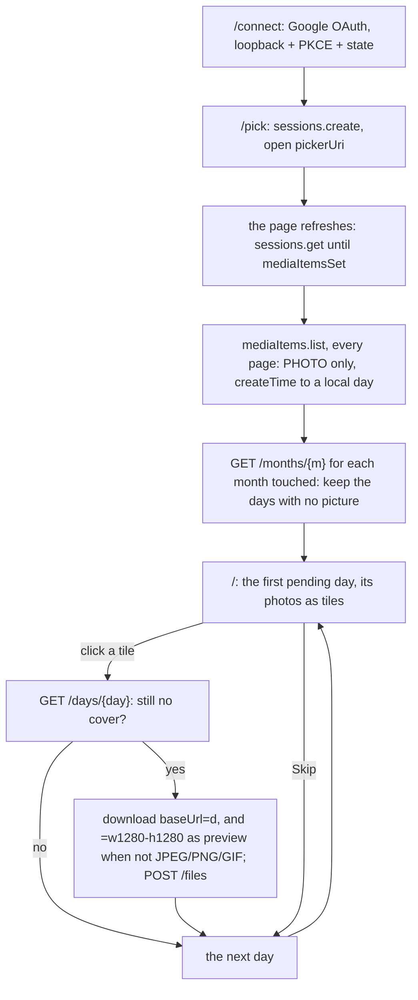

# 134 — A cover from Google Photos: an extension outside the core picks each day's cover from that day's photos

> Dated implementation record. Tests use temporary folders and synthetic data. The owner's live `life.db` is never
> opened by a test.

## Status

- **Date / baseline:** 2026-10-18, `ed046b2` (master).
- **Priority:** P3. **Effort:** M. **Risk:** LOW. The `lifelog` binary, `internal/`, the contract in `docs/` and
  `schema.sql` do not change. The extension is a new Go module in its own folder, and a client of the HTTP API.
- **Status:** READY.
- **Resolves:** no issue, no RFC. The owner's words are the incident.

## The owner's words (2026-10-18)

"I want to add an extension, but I do not want to make it part of the core. I want to be able to connect my google
photos, and to select for each day that has no cover, a photo from that day from google photos."

The owner's answers to four questions:

| question | answer |
|---|---|
| Where does it live? | Its own Go module in this repo, `extensions/googlephotos/`, with its own `go.mod`. It talks to lifelog only over the public HTTP API ([API.md](../../API.md)). It imports no `lifelog/internal/...` package. |
| Which days? | Every day that has picked photos and no cover. A day with no day page gets one. |
| How is a photo chosen? | A small local web page, day by day. One click sets the cover, then the page goes to the next day. |
| Which source? | The Google Photos **Picker API**. |

## Why the Picker API

On 2025-03-31 Google removed the scope `photoslibrary.readonly`. Since then an outside app cannot list the library by
date. It reads only the items that the owner picks in Google's own picker (2000 at most for each session), or the
items that it uploaded itself. The owner accepted these costs:

- A Google Cloud OAuth client is set up once (a Desktop client, with the owner as a test user).
- An unverified app in "Testing" status must sign in again every 7 days, because its refresh token expires then.
- The `=d` download is Google's copy of the photo without GPS, not the byte-exact original. So its `sha256` is not
  the `sha256` of the original on the phone. lifelog keeps only the preview and the hash
  ([D9](../decisions/D09-binary-files.md)), so the cover looks the same.
- The Picker API has no date filter. The owner selects the photos in Google's interface (for example, one month), and
  the extension sorts them by day.

Sources: <https://developers.google.com/photos/support/updates>,
<https://developers.google.com/photos/picker/guides/get-started-picker>,
<https://developers.google.com/photos/picker/reference/rest/v1/mediaItems>,
<https://developers.google.com/identity/protocols/oauth2/native-app>.

## What lifelog already gives

No change to lifelog is necessary:

- `GET /months/{YYYY-MM}` gives `days[].page`. `days[].picture` is absent when the day has no cover.
- `GET /days/{day}` gives `cover`, which is absent when there is none. The extension reads it again just before each
  write, because the owner can set a cover in lifelog at the same time.
- `POST /files` (`add-file`, multipart) with `original`, `day` and `title` keeps the file with that day. Send
  `preview` too when the type is not JPEG, PNG or GIF. The write creates the day page when there is none
  (`Tx.dayPage`, `internal/core/journal.go`), and it embeds the photo (`Tx.ownDay`, `internal/core/files.go`). A day
  page's first photo is its cover with no other action ([plan 127](127-a-cover-for-every-page.md)).
- The same original sent again writes nothing, because `files.sha256` is unique. So a retry is safe. When another
  file holds the title, the answer is 409 `exists` (`Tx.keepNew`).
- Auth: none on `127.0.0.1:7777`. With `--url`, send `Authorization: Bearer $LIFELOG_TOKEN`, as the CLI does.
- Provenance: `Lifelog-Source: import:google-photos`. lifelog refuses the owner-only actions to an `import:*` writer.
  The extension never needs them.

## The flow

## The module: `extensions/googlephotos/`

- The module is `lifelog-googlephotos`. It uses the Go version of the root `go.mod`.
- It uses the **standard library only**. OAuth is a token POST and a refresh POST, so `golang.org/x/oauth2` is not
  necessary.
- It makes one binary, `cmd/lifelog-gphotos`. The packages are few and deep.

| file | what |
|---|---|
| `cmd/lifelog-gphotos/main.go` | flags: `--addr 127.0.0.1:7790`; `--url http://127.0.0.1:7777` (with `$LIFELOG_TOKEN` when it is set); `--credentials PATH` (the JSON of the Desktop OAuth client from Google Cloud); `--zone` (default: the local zone). A signal context and a graceful shutdown. |
| `google/oauth.go` | The auth URL with PKCE S256 and a state. The code exchange. The refresh. The token file `os.UserConfigDir()/lifelog-gphotos/token.json`, written with mode 0600 by a temp file and a rename. The scope `https://www.googleapis.com/auth/photospicker.mediaitems.readonly` only. |
| `google/picker.go` | `CreateSession`, `GetSession`, `ListItems` (follows `nextPageToken`, `pageSize` 100), `DeleteSession`, and `Fetch(baseUrl + suffix)` with a Bearer token and a size limit of 64 MiB (lifelog's `maxPicture`). The base URL of the API can be changed for tests. |
| `lifelog/client.go` | `MonthsWithoutCover`, `DayHasCover`, and `AddCover(day, mime, original, preview)`: a multipart `POST /files` with the title `<day>.<ext>`, then `<day> 2.<ext>`, `<day> 3.<ext>` and so on after a 409 (the names of plan 127). It reads Siren JSON. On an error it reports the `code` and the message of the error entity. |
| `review/server.go` and `review/html/` | The local page (`html/template`, embedded): `/` (the status, Connect, Pick, the pending day), `/connect`, `/oauth/callback`, `/pick`, `/session` (a meta refresh while the owner picks), `/thumb/{id}` (it fetches `baseUrl=w256-h256-c` with the token, because the browser cannot send the token), `POST /choose`, `POST /skip`, `POST /done` (it deletes the session). |
| `README.md` | The one-time Google Cloud setup (a project, the Picker API enabled, a Desktop OAuth client, the owner added as a test user, the sign-in every 7 days); how to build and run it; what it keeps and what it does not keep. |

### State

- The picked items and the pending days are in memory only. After a restart the owner picks again.
- Only the OAuth token is on disk.
- A `baseUrl` is valid for 60 minutes. When the list is older than 50 minutes, the extension lists the items again
  before a fetch.
- When the session has expired, the page says "Pick again".

### Boundaries

- The server listens on a loopback address only. It refuses any other address.
- It refuses a POST from another site with 403 (`Sec-Fetch-Site`, else `Origin`, not same-origin).
- The OAuth `state` must match, or the callback is refused.
- Every response from Google and from lifelog has a size limit.
- The logs never hold a token or the bytes of a photo.
- Every fetch takes the context of its request. No goroutine outlives its request.
- A video, or an item of no type, is skipped.

## Where it is named outside its folder

- `README.md` at the root gets a short "Extensions" section. It links `extensions/googlephotos/README.md`, and says
  that an extension is a client of the HTTP API and is not built into `lifelog`.
- `docs/` does not change: the contract never names an application. `site/` does not change.

## Tests

All tests are in the extension module. They use synthetic data only. Fakes are only at the Google boundary
(`httptest`).

- **OAuth:** the PKCE challenge of a known verifier (the vector of RFC 7636, appendix B); a callback with a wrong
  state is refused; an expired token is refreshed; the token file has mode 0600 (on Linux).
- **Picker:** two pages of items are read; a video is skipped; a `createTime` near midnight UTC gets the day of a fixed
  zone (`Europe/Bucharest`).
- **Review:** a POST from another site is refused; Skip goes to the next day; the last day leads to "Done".
- **End to end:** the test builds the real `lifelog` (`go build -C ../.. -o $TMP/lifelog ./cmd/lifelog`). It runs
  `lifelog serve --db $TMP/life.db --addr 127.0.0.1:<free port>`, and uses a fake Google with synthetic JPEGs on
  fixed days. It asserts these results:
  - A day with no page gets a day page, and its `cover.title` is `<day>.jpg`.
  - A day page with text and no cover gets the cover, and its text stays.
  - A day that has a cover is never offered.
  - The same photo chosen twice writes one file.
  - When another file holds the title `<day>.jpg`, the new file is `<day> 2.jpg`.
  - The source of the file page is `import:google-photos` (read through the API or the CLI, never from SQL).

## Checks

- In `extensions/googlephotos/`: `gofmt -l .`, `go vet ./...`, `go test ./...`, `staticcheck ./...` and
  `govulncheck ./...`.
- At the root: `go vet ./... && go test ./...` stays green. The nested module is not part of `./...`.
- By hand, with the owner: connect, pick one month in Google's picker, set three covers, and see them in the calendar
  of the installed service. lifelog needs no new build and no restart.

## Done when

- [ ] `extensions/googlephotos/` builds with the standard library only, and imports nothing from `lifelog/internal`.
- [ ] The owner connects once, picks photos in Google's picker, and the page shows each day that has no cover with
      that day's photos.
- [ ] One click keeps the photo through `add-file` with its day, and the photo is then the day's cover; the page goes
      to the next day.
- [ ] A day with no day page gets one; a day with a cover is not offered and is not written.
- [ ] The tests above pass, the checks above are clean, and the root baseline is green.
- [ ] The root README links the extension's README.
- [ ] The owner set three covers from a real pick (by hand).
