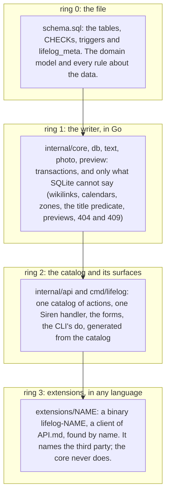
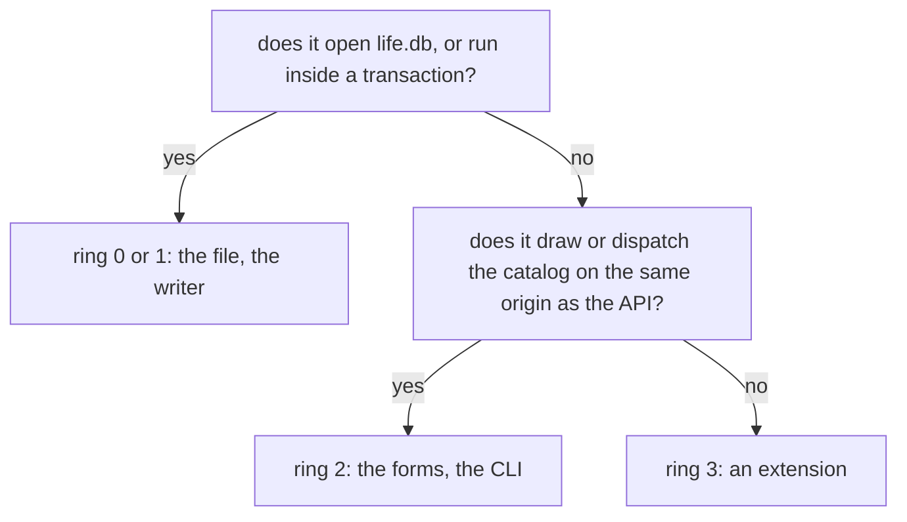
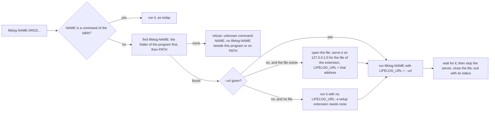

# 135 — Extensions outside the core: what names a third party is a subprocess found by name

> Dated implementation record. Tests use temporary folders and synthetic data. The owner's live `life.db` is never
> opened by a test.

## Status

- **Date / baseline:** 2026-10-19, `7637f66` (master).
- **Priority:** P2. **Effort:** L. **Risk:** MEDIUM. The contract in `docs/` and `schema.sql` do not change. The
  `lifelog` binary loses two commands (`agentic-init`, `mcp`), which come back as extensions under the same command
  lines. The README, `AGENTS.md`, the site and the parity tests change.
- **Status:** IN PROGRESS.
- **Resolves:** no issue, no RFC. The owner's words are the incident.

## The owner's words (2026-10-19)

"I would like to further modularize the application into extensions, so that we keep the core clean and minimal and
then extensions would handle most of the extending." And: "I want to keep the core and the domain model and business
logic minimal." The owner asked for the perfect version, decided case by case, and asked that the browser stay in
the core until an extension proves the model.

## The four rings

A thing lives in the innermost ring that can hold it.

The test that decides the ring:

## What moves, what stays

| what | today | after | why |
|---|---|---|---|
| `lifelog agentic-init` | `internal/agentic`, a command of `cmd/lifelog` | `extensions/agentic`, the binary `lifelog-agentic-init`, run as `lifelog agentic-init` | It names four agent frameworks whose formats churn. It opens no database. |
| `lifelog mcp` | `internal/mcp`, a command of `cmd/lifelog`, the dependency `modelcontextprotocol/go-sdk` | `extensions/mcp`, the binary `lifelog-mcp`, run as `lifelog mcp` | It is a third-party protocol with its own SDK, generated from the catalog, which is reachable over HTTP. The core's dependencies become SQLite, CommonMark and `x/text`. |
| importers | none in the core | a rule: an importer is an extension, an `import:<name>` writer of the API | The contract already says so ([imports](../contract/imports.md)). Google Photos is one ([plan 134](134-a-cover-from-google-photos.md)). |
| the browser (`internal/api/view`) | in the core | in the core | It draws the entity on the same origin as the API, with the forms that post to it and the login cookie. A renderer in front of the API would need a proxy and a second process for daily use, and the gain is small: the view adds presentation, not logic, and goldmark stays for extraction. The owner decides again after an extension proves the model. |
| `--public`, the login | in the core | in the core | A separate decision about the local proxy, with its own plan. |
| `internal/scaletest`, `tools/lifescale` | development tooling | unchanged | Not an extension question. |
| snapshots, `integrity-check`, `rebuild-search`, `resync-links` | the core | the core | They need the file. |

## The one way to run an extension: `lifelog NAME`

The rules, which `extensions/README.md` states for an author:

- **The name.** `lifelog NAME` runs `lifelog-NAME` (`lifelog-NAME.exe` on Windows) from the folder of the program
  (symbolic links resolved), else from `PATH` (`exec.LookPath`). The folder of the program comes first, so the installed
  extension wins over one on `PATH`. A program on `PATH` runs with the owner's rights, as a `git-NAME` does.
- **The line.** Before `NAME`, `lifelog` reads its global flags as today. After `NAME`, `lifelog` reads only `--db`
  and `--url` (as `--db X` or `--db=X`); every other word goes to the extension as it is, in its order. So an
  extension may have a flag of any name (`--addr`, `--title`), and the MCP configs that `agentic-init` writes stay
  `<exe> mcp --agent NAME --db FILE`. `--source` and `--human` are refused with an extension: an extension names its
  own writer and prints its own output.
- **The server.** With `--url`, `LIFELOG_URL` is that URL. Without it, when the file exists, `lifelog` opens the file
  as every command does and serves it on `127.0.0.1:0` behind the loopback authority (`api.NetworkAuthority`, as
  `serve` does) for the life of the extension, and `LIFELOG_URL` is that address. When the file does not exist,
  `lifelog` starts no server and sets no `LIFELOG_URL`: a setup extension (`agentic-init`) needs none, and a client
  extension refuses with the line that says what to run. The temporary server is the same writer as the CLI, which
  [connections](../contract/connections.md) allows beside the service.
- **The environment.** `LIFELOG_URL` (as above), `LIFELOG_EXE` (the program, symbolic links resolved), `LIFELOG_DB`
  (the file the line names, absolute, whether it exists or not), and `LIFELOG_TOKEN` as inherited. Stdin, stdout and
  stderr are inherited, so an MCP server on stdio works. The exit status of `lifelog` is the extension's.
- **Signals.** The extension is in the process group of `lifelog`, so an interrupt reaches both. `lifelog` waits for
  the extension (`exec.CommandContext` with `Cancel` sending an interrupt on Unix, the default on Windows, and
  `WaitDelay` of ten seconds), then stops the server and closes the file. No goroutine outlives the command.
- **What an extension is.** A client of [API.md](../../API.md), in any language, in its own folder under
  `extensions/` with its own module. It never imports `lifelog/internal` (a nested Go module cannot), and never opens
  `life.db`: one writer per file. It writes as `import:<name>` (an importer) or `agent:<name>` (a model), so the
  owner-only actions are refused to it by the existing rule. A page it serves listens on a loopback address only.
  It keeps its own state (a token, a cursor) in its own file under the user's configuration folder, never in
  `life.db`. In Go it uses the standard library unless a protocol needs an SDK. Its tests use synthetic data, fake
  the third party, and build the real `lifelog` for an end-to-end test, as Google Photos does.
- **No shared client library.** Google Photos wrote its Siren client in about a hundred lines; `lifelog-mcp` copies
  what it needs of `siren` and `client`. A public Go client would be a versioned surface to maintain across modules;
  a third Go extension decides whether it earns one.

## The extensions after this plan

| folder | binary | command line | writes as | needs the server |
|---|---|---|---|---|
| `extensions/googlephotos` | `lifelog-gphotos` | `lifelog gphotos [--addr A] [--credentials F] [--zone Z]` | `import:google-photos` | yes |
| `extensions/agentic` | `lifelog-agentic-init` | `lifelog agentic-init [--force]` | nothing | no: it reads `LIFELOG_EXE` and `LIFELOG_DB`, and refuses to run without them |
| `extensions/mcp` | `lifelog-mcp` | `lifelog mcp [--agent NAME]` | `agent:NAME`, default `agent:mcp` | yes: `LIFELOG_URL`, else `--url`, else `http://127.0.0.1:7777`; `--source` is refused as today |

`lifelog-gphotos` reads `LIFELOG_URL` before its `--url` flag, so `lifelog gphotos` works as the other two do.

## The invariants that keep the rings, as tests

Both are tests of `cmd/lifelog` (`boundary_test.go`), over the Go source of `internal/` and `cmd/` that is not a test:

1. **The core names no third party.** No file holds a word of the list, in any case: `google`, `apple`, `telegram`,
   `claude`, `codex`, `opencode`, `anthropic`, `openai`, `modelcontextprotocol`. The list is in the test; a new
   third party is added to it in the change that moves it out.
2. **The core dials only its own server.** Outside `internal/client`, no file holds `http.Client`,
   `http.DefaultClient`, `http.Get(`, `http.Post(`, `http.NewRequest`, `net.Dial` or `net.Dialer`. So every
   integration with the outside world is an extension by force, not by discipline.

And the existing rule that Go enforces: an extension never imports `lifelog/internal`.

## What changes where

### Step 1: the discovery, and the contract of an extension

- `cmd/lifelog/main.go`: `parse` switches to the extension mode after a first word that is no command of the table
  (only `--db` and `--url` are read after it). `runContext` runs `extension(ctx, e, name, args)` for such a word:
  the lookup, the temporary server when the file exists, the environment, the wait. The usage gets the line
  `lifelog NAME [ARGS...]   runs the extension lifelog-NAME beside this program or on PATH (extensions/README.md)`.
  The error of an unknown name says both places it looked.
- `extensions/README.md`: the contract above, the list of extensions, and how to build one. It names Google Photos as
  the worked example.
- `README.md`: the section "Extensions" says the command line `lifelog NAME` and links `extensions/README.md`.
- Tests (`cmd/lifelog/extension_test.go`): a fake extension (a Go program under `testdata/`, built by the test into a
  temporary folder beside a copy of the program's path, or found on a `PATH` the test sets) prints its arguments and
  its environment. The test holds: the words and flags after the name reach it in order, `--db` and `--url` do not;
  `--source` and `--human` are refused; `LIFELOG_URL` answers `GET /actions` while the extension runs and is gone
  after; with `--url`, `LIFELOG_URL` is that URL and no file is opened; with no file, no `LIFELOG_URL` and no error;
  the exit status is the extension's; an unknown name without a binary is refused with the two places; the folder of
  the program wins over `PATH`.

### Step 2: `agentic-init` out

- `extensions/agentic/`: `go.mod` (`lifelog-agentic`, the Go version of the root), `agentic/` (the package and its
  templates, moved as they are), `cmd/lifelog-agentic-init/main.go` (the flag `--force`; `LIFELOG_EXE` and
  `LIFELOG_DB` from the environment, refused when absent: "run it as lifelog agentic-init"; the output of today),
  `README.md` (what it writes, the build line).
- The templates say the same command lines as today (`lifelog mcp --agent NAME`, `lifelog agentic-init`), which the
  discovery keeps. A new skill `lifelog-extension` says, in one page, how to build an extension: the discovery, the
  environment, the `Lifelog-Source` header, the owner-only rule, the loopback rule, and that `GET /actions` of the
  server is the catalog. A test holds that it names the three environment variables `extensions/README.md` names.
- Deleted: `internal/agentic`, `cmd/lifelog/agentic.go`, `cmd/lifelog/agentic_test.go`, the row `agentic-init` of the
  table of commands, and `errWriter` if nothing else reads it.
- The four tests of `cmd/lifelog/agentic_test.go` keep their intent in the module: the files and the database beside
  the program; the MCP configs start the MCP server of this program (the test builds `lifelog` and `lifelog-mcp`
  into one folder and runs the config's line through the SDK's command transport, after step 3; until then it
  holds the line only); the texts name what the program has (the built `lifelog help` and `lifelog actions`, the
  tools of the built `lifelog-mcp`); a failure or a kept file.

### Step 3: the MCP server out

- `extensions/mcp/`: `go.mod` (`lifelog-mcp`, the dependency `modelcontextprotocol/go-sdk` at the root's version),
  `siren/` (the types `Entity`, `Action`, `Field`, `Link`, the error entity, `WriteJSON`, `AgentPrefix`: copied,
  with the fields the server reads), `client/` (`Remote`, `Get`, `Catalog`, `Do` with the multipart of a file field:
  copied), `mcp/` (`mcp.go`, `tools.go` and their tests, moved as they are), `cmd/lifelog-mcp/main.go` (the flags
  `--agent` and `--url`; `--source` refused with today's sentence; stdio), `README.md`.
- `cmd/lifelog`: the row `mcp` of the table, `e.stdin` if only `mcp` read it, the columns `mcp` and `mcp-remote` of
  `TestParityOfTheSurfaces` and `openMCP`, `openMCPRemote`, `mcpToolNames`. The comment of
  `internal/api/owner_test.go` names the extension's test. `go mod tidy` removes the SDK from the root.
- `README.md`: "One handler, three surfaces" says that the CLI calls the handler in-process and that the MCP server is
  the extension `lifelog-mcp`, a client over HTTP; the table "Every action on every surface" keeps its MCP column
  (its test compares strings and imports no `mcp`); the table of packages drops `internal/mcp` and `internal/agentic`
  and names the two modules; the install block builds the three binaries.
- Tests in the module: the tests of `tools` and `mcp` as they are, on a fake catalog; an end-to-end test that builds
  `lifelog` and `lifelog-mcp` into one folder, runs `lifelog mcp --agent test --db TMP/life.db` through the SDK's
  command transport, and holds: `find` is a tool and `snapshot` is not; `capture` writes a day page that
  `lifelog get /days/2031-05-20 --db TMP/life.db` reads back with the source `agent:test`; `save_body` with a stale
  version answers the error entity with `stale_version`; `add_file` sends a file by its path; `get` follows a link;
  a line with `--source` is refused. The parity rows of the core that named MCP are covered by these.

### Step 4: the invariants, the rules and the site

- `cmd/lifelog/boundary_test.go`: the two tests above.
- **The four rings in the rule books** (the owner's word, 2026-10-19). `AGENTS.md` gets, under "Go implementation",
  the diagram of the rings and the test that decides the ring, with the two invariants as the rule a change
  preserves, and the table of the repo gets the row `extensions/`. `README.md` gets, under "Decisions", the bullet
  "The four rings" with the same diagram, what lives in each ring, and the links to this plan and
  `extensions/README.md`. The diagram is drawn once in each file; the prose says only what it cannot.
- `AGENTS.md`: the rule "Every capability on every surface" names the MCP server as the extension `lifelog-mcp`,
  generated from the catalog; the section on the live database says that an extension's temporary server is the
  same writer. `README.md` line 6 and the site's install snippet name the three builds. `deploy/README.md` installs
  the three binaries beside each other.

## Costs the owner accepts

- One `go build` becomes three for a machine with MCP and `agentic-init`. The README shows the lines.
- An MCP session is two processes: `lifelog` with the temporary server, and `lifelog-mcp`.
- A `lifelog` alone, without the extensions beside it, has no `mcp` and no `agentic-init`; the error names the
  binary it looked for.
- The parity table of the core loses its MCP columns; the extension's end-to-end test holds the MCP surface.

## Checks

- At the root: `gofmt -l`, `go vet ./... && go test ./...`, `staticcheck ./...`, `govulncheck ./...`, and
  `go test -count=1 -shuffle=on ./...` for the changes to the CLI's dispatch.
- In each of `extensions/agentic`, `extensions/mcp` and `extensions/googlephotos`: `gofmt -l .`, `go vet ./...`,
  `go test ./...`, `staticcheck ./...`, `govulncheck ./...`.
- Linux is the OS tested. Windows is not tested in this plan; the lookup uses `exec.LookPath` and `filepath`, and the
  `.exe` suffix is its concern.
- By hand, with the owner: build the three binaries into the install folder, restart the service, run
  `lifelog agentic-init` in a temporary folder with a copy of nothing (a fresh `lifelog init`), and
  `lifelog mcp --agent test --db` that file with an MCP client; `lifelog gphotos` reaches the service through
  `LIFELOG_URL`.
