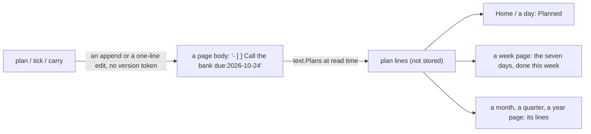
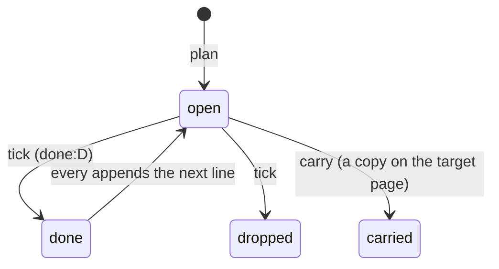

# 136 — Plan lines and period pages: the planning axis without a table

> Dated implementation record. Tests use temporary folders and synthetic data. The owner's live `life.db` is never
> opened by a test.

## Status

- **Date / baseline:** 2026-10-19, `9cde014` (master).
- **Priority:** P1. **Effort:** L. **Risk:** MEDIUM. The contract gains one page (the grammar of a plan line, with
  vectors) and two decisions; `schema.sql` gains one generated column and two CHECKs and widens four triggers, no
  new table and no new trigger; the catalog gains three actions; the browser gains a Planned block, boxes in a body
  and a week view. D23 and D15 keep "no table" and are rewritten in place.
- **Status:** TODO.
- **Resolves:** issue 0087 through RFC 0022, D29 and D30 (written in step 1). The owner's words are the incident.

## The owner's words (2026-10-19)

"Until now we focused on logging our past but now I want to do the other axis, planning, tasks, projects, timed
projects, goals and everything in between." After the research and the case for and against a table: "ok, let's go
without a separate table for now." Then three answers:

| question | answer |
|---|---|
| a `tasks` table, or a derived index table | neither, for now: read at read time; a derived table only if a measured scan is slow |
| the grammar of a line | plain words, todo.txt style: `- [ ] Call the bank on:2026-10-22 due:2026-10-24` |
| period pages (a week, a month, a quarter, a year as canonical keys like a day page) | yes, in this plan |
| a repeat phrase, computed when a line is ticked | yes, the small set |

## Why no table

Tasks were added on 2026-10-07 ([RFC 0007](../rfcs/0007-personal-tasks-and-occurrences.md): `tasks`,
`task_occurrences`, fourteen triggers, eleven actions) and cut on 2026-10-15 ([RFC 0019](../rfcs/0019-no-tasks.md),
commit `2465a13`) because the mechanism cost more than it gave. The research of 2026-10-19 (org-mode, Obsidian
Tasks, todo.txt, TaskPaper, the bullet journal; Things, Taskwarrior, JSCalendar; PARA, GTD, Linear, Basecamp;
Masicampo & Baumeister 2011, Gollwitzer & Sheeran 2006, Dai, Milkman & Riis 2014, Amabile & Kramer 2011, Buehler,
Griffin & Ross 1994) gave one shape: **a plan is a line of text in a page; the writer reads the lines and never
stores them a second time.** It keeps [D23](../decisions/D23-no-tasks.md) true as written, follows the wikilink
precedent ([D19](../decisions/D19-wikilink-save-contract.md): the body is the truth, what is read from it is derived)
and adds no table. The price, said to the owner: a rule about a line is contract text checked by the suites and the
writer, not a CHECK that refuses a write.

What stays out, recorded in [non-goals](../architecture/non-goals.md): a `tasks` table and task identity, occurrence
rows and a virtual expander, reminder clocks and delivery (ring 3, an extension), an RRULE parser.

## The shape





What the owner gets: Home (today) shows what is planned for the day from any page, each line with Done, Dropped and
Carry; a body draws real boxes; a week page shows the seven days' plan and what was done; month, quarter and year
pages hold the longer horizons (the future log, the quarterly plan, the annual review) as pages with a body and
lines; a project or an area stays a plain page filed with `part-of`, its target a plan line in its body, its
progress a reading, its updates day-page prose that links it; every action reaches the API, the CLI, the MCP tools
and the browser through the one catalog.

Two findings of the exploration that this plan fixes on the way: D23 cites an imports rule ("a checkbox in an
imported note stays text") that [imports](../contract/imports.md) does not contain; and D5 still says "task
projects". `TestTheCatalogNamesNoRemovedFeature` (`internal/api/dead_links_test.go`) forbids the words task, overdue
and due date in the catalog; it changes with RFC 0022, and the catalog uses the words plan, planned, past its day.

## Step 1 — the contract and the DDL, one commit

**Records.** Issue 0087 "a plan written as words cannot be read as a plan" (the owner's words are the incident);
RFC 0022 "plan lines and period pages" (the options: a table; a derived table; lines read at read time, the owner's
choice, with its cost after the freeze: the grammar grows by a key without a migration); D29 "a plan is a line of
a page" and D30 "a period is a page with a canonical key". Rewritten in place: D23 (keeps "no table"; the plan line
is the decision; the imports sentence goes into `imports.md`), D15 (no cadence table; a repeat is a phrase,
computed on tick; the RRULE rejection stays), D5 (day pages and period pages; "task projects" deleted), D22, the
non-goals rows on tasks and on planned appointments, the goals page, `docs/README.md`, `README.md`, `AGENTS.md`
and the decision count "D1–D28" where it is written. References R76 (Obsidian Tasks), R77 (todo.txt), R78
(org-mode repeaters).

**The contract page `docs/contract/plan-lines.md`** (linked from the contract index, the docs index, the guide
for a writer, the freeze checklist, the suite guide and `AGENTS.md`):

- A plan line is a CommonMark list item (any bullet, any depth) whose text starts with a box: `[ ]` open, `[x]`
  done, `[-]` dropped, `[>]` carried. A list item inside a block quote is quoted text; a code block has none.
- After the box: words and tokens. A token is `key:value`, no spaces, bounded by spaces or the line's ends, key one
  of `on`, `due`, `done`, `every`, `from`. Any other `key:value` is words. The **text** is the line without its box
  and tokens, spaces collapsed; it is what `tick` and `carry` compare.
- `on:`, `due:`, `done:` are `lifelog_meta.days` values. A line is planned on `on:`, else on `due:`; a line with
  neither is listed only on its own page (an imported vault's lines stay where they are).
- Each key at most once; `done:` only with `[x]`; `from:done` only with `every:`; `every:` only with a day. A line
  that breaks one is malformed: drawn with its raw text, never listed under a day, refused by `tick` with 422.
- `every:` in words: `day`, `week`, `month`, `year`; `N-days`, `N-weeks`, `N-months`, `N-years` (N ≥ 2);
  `weekday`; `monday` … `sunday`; `month-end`; `month-N` (written by the writer after a clamp, N 1..31).
- The next date: the anchor is `due:`, else `on:`; with `from:done` it is the done day. The other date keeps its
  distance. Days and weeks add N or 7N days; `weekday` and a weekday name are the next such day strictly after;
  `month` and `year` keep the day of the month and clamp to the month's last day, and a clamped line carries
  `every:month-D` with the original D (Jan 31 → Feb 28 `every:month-31` → Mar 31); `month-end` is the next
  month's last day; `year` on Feb 29 clamps to Feb 28; a result past 9999-12-31 refuses the tick.
- Vectors in two JSON blocks after the marker comments `<!-- plan-line-vectors -->` and `<!-- next-day-vectors -->`
  (the format the name-grammar suite parses), at least 40 line vectors (a fence, a quote, indented code, `* [ ]`,
  nested, every box, an unknown key, each malformed case, Unicode text) and 25 next-day vectors. A new page, so the
  `| body |` tables of titles and wikilinks stay as they are.
- The diagram `%% diagram: plan-line` (the state diagram above; the ninth diagram: `tests/diagrams_test.go` and the
  count in `tests/README.md`).

**Period pages in `schema.sql`** (one generated column, two CHECKs, no new trigger, four widened):

| change | shape |
|---|---|
| `entities.period` (generated, after `is_journal`) | `CASE WHEN key GLOB '[0-9][0-9][0-9][0-9]' THEN 'year' WHEN key GLOB '…-[0-9][0-9]' THEN 'month' WHEN key GLOB '…-q[0-9]' THEN 'quarter' WHEN key GLOB '…-w[0-9][0-9]' THEN 'week' END` on `preferred_name_key` (the folded key: `2026-W43` is `2026-w43`); Go reads `period`, never recomputes it |
| `entities_period_page` (CHECK) | `period IS NULL OR (entity_type = 'page' AND day IS NULL)`: a period's first day derives from its key |
| `entities_period_exists` (CHECK) | a month: `date(key \|\| '-01') IS key \|\| '-01'`; a quarter 1..4; a week 01..53 whose Monday (`date(year \|\| '-01-04', '-6 days', 'weekday 1', '+' \|\| (w-1)*7 \|\| ' days')`) is on or before 28 December. The file refuses `2027-W53`; the writer refuses nothing |
| `entity_names_day_insert`, `entity_names_day_update` | a period-shaped key is reserved like a date: no alias, one spelling `upper(key)` (`2026-W43`) |
| `entities_day_identity` | a period page is never renamed, never acquired through aliases, never filed |
| `links_endpoint_types` | `part-of` refuses a period page on either end; `at` stays day-only (D16) |
| `lifelog_meta` | a row `plans` with the grammar in one sentence; the `entities` comment names the four shapes; two rows in the 2075 table of the threat model |

A plain page titled `2026` or `1984` in a real file is adopted as the year page at the rebuild (before the freeze
there is no migration, [D13](../decisions/D13-migrations-and-freeze.md)); one with an alias or a `part-of` link is
refused by the triggers and renamed by the owner. RFC 0022 says so.

**Suites and mutants.** Probes executed before the docs claim them (`tests/dates_test.go`, a periods block of
`tests/journal_test.go`): `date('2026-01-04','-6 days','weekday 1')`, the week vectors (`2026-W53` ok, `2027-W53`,
`2021-W53`, `2026-W00`, `2026-W54` refused, `2020-W53` ok), `'43' - 1` inside a CHECK, a CASE/GLOB VIRTUAL column.
A `plan-lines` suite reads the two vector blocks and reproduces them through `text.Plans` and `text.Next`. Eight
mutants (273 → 281): both CHECKs, the `w` GLOB, the three widened triggers, the `part-of` clause, and `at` left
day-only. The counts in `tests/README.md` and the totals line of `docs/schema/README.md`. A cookbook page
`docs/cookbook/plan-a-project.md` (a project is a page filed in an area; its target a line; its progress a
reading; the executable SQL that fetches the bodies that hold a box).

Done when `go vet ./... && go test ./...` is green, every mutant is noticed, and the document and diagrams suites
are green.

## Step 2 — the parser `internal/text/plan.go`

```go
type Plan struct{ Line int; Box byte; Text, Raw, On, Due, Done, Every string; FromDone bool; Bad string }
func Plans(body string) []Plan                       // the goldmark AST of text.go: a ListItem not under a Blockquote; Line 1-based from the segment start
func Line(text, on, due, every string, fromDone bool) (string, error)  // "- [ ] text on:… due:… every:…"; refuses an empty text or a line break
func Next(p Plan, done string) (on, due, every string, err error)
func Tick(body string, line int, text string, box byte, done string) (newBody, appended string, err error)
func Carry(body string, line int, text, on string) (newBody, copy string, err error)
var ErrLineChanged = errors.New("the line changed")  // not a plan line, or its text differs
```

`plan_test.go` reads the vectors from the contract page, as `text_test.go` does; a fuzz seed `FuzzPlans` (no panic;
`Line` round-trips through `Plans`). Done when every vector reproduces and `-short` takes seconds. A Sonnet
sub-agent builds it from the contract page alone.

## Step 3 — the core reads and writes `internal/core/plans.go`, tests first

- `dayOfTitle` (`core/links.go`) becomes `dayOfKey`: nil for a period key, so `ensurePage` makes a period page
  with `day` NULL. `Page` gains `Period`, read from the row.
- Reads: `Planned(ctx, day)` = open lines with `on:` or `due:` on or before the day (the day view of today or a
  later day) and `PlanLines(ctx, from, through)` = the lines planned in the window and the `[x]` lines done in it
  (a week, a month; a past day shows the lines of that day, not a backlog). Both share one query:
  `SELECT e.id, n.title, e.is_journal, e.period, e.body FROM entities e JOIN entity_names n … WHERE e.deleted_at IS NULL AND instr(e.body, '[') > 0`,
  then `text.Plans` and the filters in Go. Order: day, title, line. Bounds in Go: 200 items (`more` counts the
  rest); a window of at most 366 days. Shape: `PlanItem{PageID, Title, IsDayPage, Period, text.Plan}`.
- Writes, each one `alone`, `SetBody`-like (`UPDATE … body`, then `syncWikilinks`), no version token (the capture
  precedent, [D12](../decisions/D12-no-revision-tables.md)): `Plan(title, text, on, due, every, fromDone)` →
  `ensurePage` (a day, a period or a plain page made on first write) then append `text.Line`; `Tick(id, line,
  text, outcome, done)` → `livePage`, `text.Tick` (the appended next line is in the same write); `Carry(id, line,
  text, to)` → `text.Carry` here, `ensurePage(to)`, append the copy with `on:` = the day when `to` is a day page;
  `to` = this page is 422. A line mismatch is 409 `stale_version` (the recovery is the same as a stale save; no
  new code).
- `plans_test.go`: 409 on a changed line; a repeat appends the next line with the month-end vectors; a carry across
  two pages in one write and a rollback on a bad target; a week page made on first write; `2027-W53` refused by the
  file with the constraint name; a tombstoned page is 409; a line inside a quote is not ticked.

## Step 4 — the catalog and the surfaces

| action | route | fields (required in bold) | README browser cell |
|---|---|---|---|
| `plan` "Plan" | `POST /pages/plan` | **page** (a title: a page, a day, `2026-W43`, `2026-10`, `2026-Q4`, `2026`), **text**, on (date), due (date), every (text), from_done (flag) | a day, a page, a week, a month, a year: Plan |
| `tick` "Tick" | `POST /pages/{id}/tick` | path id, **line** (number), **text**, **outcome** (options done, dropped), done (date, default today) | a plan line where it is drawn: Done, Dropped |
| `carry` "Carry" | `POST /pages/{id}/carry` | path id, **line**, **text**, **to** (a title) | a plan line where it is drawn: Carry |

`plan` takes a title, not `{id}`: Home must offer it on a day with no page yet, and `{id}` and `{day}` stay the
only path fields. Day fields go through `dayNamed` ("today"). Each returns the page entity with a Result (`line`,
`appended` / `to`); the browser's `back` returns to the view it came from. Handlers in a new `internal/api/plans.go`;
`TestTheCatalogNamesNoRemovedFeature` rewritten to guard the removed features by their routes (`/tasks`,
`/deadlines`), not by words. API.md: the three results, the `week` class, the `period` and `lines` properties.
README table rows in catalog order. The CLI shortcut `lifelog plan TEXT… [--page T] [--on D] [--due D] [--every R]`
(default page: today); `tick` and `carry` by `do`. Parity rows: plan on today makes the day page; plan on
`2026-W43` makes the week page; tick with every appends the next line; tick with a changed text is 409; carry to a
day sets `on:`; plan on `2027-W53` is the file's 422. MCP: `plan` joins the smoke list of the end-to-end test and
the tools `plan`, `tick`, `carry` are asserted present.

## Step 5 — the browser

| view | what is drawn, where |
|---|---|
| a day, Home (`day.html`) | after Journal, a section **Planned**: on today or a later day the groups "today" and "earlier"; on a past day the lines of that day and the lines done that day. A row: the words, the source page (a day in words), badges `on` and `due`, one `tick` form with two buttons (Done, Dropped: `outcome` is the button's value) and a `boxed` `carry` form (`to` prefilled with the next day). The panel head holds the `boxed` `plan` form with `page` fixed to the day. |
| the body (`view/markdown.go`) | not goldmark's TaskList (it knows two boxes): `enhancePlans(doc, source, tickHref)` walks the list items, matches the box at the item's first segment, computes the line from the segment start, and replaces the box with raw HTML: for `[ ]` a one-button `tick` form (hidden `line`, `text`, `outcome=done`), for the other boxes `<span class="box done|dropped|carried">`. `markdownCover` gains the href; `""` draws boxes without forms (a deleted page, the preview, a search snippet). |
| a week (`/weeks/{week}`, new `weeks.go` and `week.html`) | head "Week 43 of 2026", prev and next, a `week` link in the zoom; the sheet: the week page's editor and prose when the page exists, then the seven days as `dayentry` rows each with its planned and its done lines; the margin: the `plan` form fixed to the week key. The removed `weeks.go` (`git show 2465a13^:internal/api/weeks.go`) is the model for ISO weeks, not restored. |
| a month, a year | the entity gains `page_id`, `body`, `cover` and `save-body` when the period page exists, and `lines`; the editor and the prose above the calendar, the lines below; the `plan` form fixed to `2026-10` or `2026`. A year lists its four quarters as links to their pages. |
| a quarter | no calendar view: a quarter page is `/pages/{id}` with the kind "quarter page", its lines and links to its three months. A period page viewed at `/pages/{id}` shows its kind and a link to its view, as a day page does. |
| nav and CSS | "This week" beside "Today"; `.plan` rows reuse `ul.plain`, `.badge`, `.tag.open`; `.box.done` uses `--done`; a past day the muted tone; the `tick` form inline, one button. About 30 lines, no script, inside Hearthwood. |

Done when the view tests are green and the owner has looked at Home, a day, a week and a month on the review
server.

## Step 6 — measure and ship

`internal/scaletest/scale.go`: the fixture writes a plan line into every seventh day page and into one note in ten,
with the count of open lines as a known answer; the exercise adds `record(report, "planned_day", …)`; the small
workload expects eleven operations. Run `go run ./tools/lifescale -profile lifetime -seed 2075 -samples 5` and record
`planned_day` here; the reopen trigger of a derived index is a `planned_day` above the `day_view` budget. Then
`go build -o ~/.local/bin/lifelog ./cmd/lifelog`, the service restart and its log line, recorded here.

## Checks

- Every step: `gofmt`, `go vet ./... && go test ./...`; step 1 also the suites and the mutant count; step 4 also
  `cd extensions/mcp && go vet ./... && go test ./...`; before the last commit `go test -count=1 -shuffle=on ./...`,
  `staticcheck ./...` and `govulncheck ./...`.
- By hand on the review server: `lifelog plan "Call the bank" --due 2026-10-24`; Home lists it under Planned with
  Done, Dropped and Carry; Done makes the body say `[x] … done:…`; `Pay rent due:2026-11-01 every:month` ticked
  appends `due:2026-12-01`; a carry to tomorrow leaves `[>]` today and the copy tomorrow; `lifelog do plan
  page=2026-W43 text=…` shows on `/weeks/2026-W43`; `plan page=2027-W53` is 422 naming `entities_period_exists`;
  `lifelog mcp` lists `plan`, `tick` and `carry`.
- Skills: step 1 `designing-data-intensive-applications`; steps 2 to 4 `a-philosophy-of-software-design` with
  `code-complete`; step 5 `refactoring` with `a-philosophy-of-software-design`.

## Risks and the answers

| risk | answer |
|---|---|
| `[ ]` in a code block or a quote | the parser walks the AST: no list item in a code block; an item under a block quote is skipped; both are vectors |
| an imported vault's `- [ ]` lines become plan lines at once | a line with no day is listed only on its own page; the imports sentence D23 cites is written into `imports.md` |
| a line edited by hand between the read and the tick | `line` and `text` must match, else 409; the forms carry both hidden |
| a title `2026` or `1984` | a period key by shape; an existing plain page is adopted; a filed or aliased one is refused and renamed |
| week 53 of a year that has none | `entities_period_exists`, executed by the suite; the file refuses, the writer does not |
| a body with thousands of boxes, read at every Home | the `instr` prefilter and one parse per body; `planned_day` measured at lifetime scale before any index |
| drawn twice: a tick form in the body and in Planned | the line is the resource and each view draws the line, as `file-pages` is drawn on every Browse row; the README row says so |
| the oscillation of 10-07 and 10-15 | no table, no trigger about a line, three actions, one contract page: the whole cost is listed in RFC 0022, so the owner keeps it or cuts it knowingly |

## Done when

- [ ] Step 1: the records, the contract page, the DDL, the suites and the mutants, one commit, green.
- [ ] Step 2: `internal/text/plan.go` reproduces every vector.
- [ ] Step 3: the reads and the three writes, with their tests.
- [ ] Step 4: the catalog, API.md, the README table, the CLI, parity, the MCP end-to-end test.
- [ ] Step 5: the browser, looked at by the owner.
- [~] Step 6, measured: `planned_day` at lifetime scale was 854 ms (median of 3; 750 ms in an earlier run), the
  day view 0.6 ms. The reopen trigger fired, and the owner chose no table. Decision: the generated column
  `entities.has_box` with the partial index `entities_plans` (derived, disposable, one home: the body). After it:
  `planned_day` 49 ms, `plan_lines_week` 53 ms, `capture_commit` 1.18 ms (was 1.38), `save_commit` 0.63 ms (was 0.53),
  `day_view` 0.58 ms. The remaining 49 ms are the parse of 3,009 pages; it is still above the day view's budget, and a
  derived table is the next step only if that proves slow in use. Still open: the service restarted and its log line recorded here.
