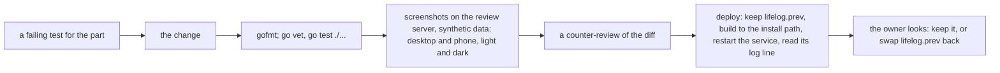
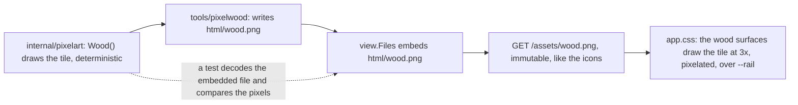
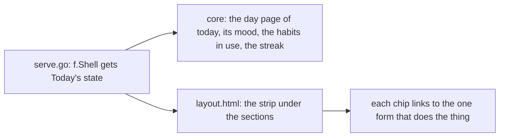

# 137 — Pixel wood and the focus pass: a drawn rail, two heading levels, a writing mode, and a Today strip

> Dated implementation record. Tests use temporary folders and synthetic data. The owner's live `life.db` is never
> opened by a test.

## Status

- **Date / baseline:** 2026-10-19, `cdc9240` (master).
- **Priority:** P2. **Effort:** M. **Risk:** LOW for parts 1 to 3 (the sheets and one embedded picture); MEDIUM for
  parts 4 and 5 (the rail reads the day of today on every page; Home gets two reads).
- **Status:** IN REVIEW (owner). Live since 2026-10-19 22:26, in the master build `c24ac92` (plans 136 to 139 in one binary); the owner looks and says what to keep.
- **Resolves:** the owner's request of 2026-10-19 (below). No issue: a look is not an incident.

## The owner's words (2026-10-19)

- "I like the UI and design of the app but I would like to explore making it even more engaging and better looking.
  My first thing is the background of the sidebar, it looks cool, as wood, but I think it can look a lot better.
  Also I would like to have some nicer headings, and design the UX and UI for ADHD engagement and focus."
- After a page of mock-ups (three rails, three heading sets, six focus items): "let's go with your recommendations,
  but let's find a better wood texture than this one, maybe pixel like? art?"
- After four pixel tiles: "plank with ends and nails look awesome. I will also want to introduce art like this around
  the other areas." Then: "W1, but without the circles in the woods, I want a clear wood."

## The decisions

| question | decision |
|---|---|
| the rail's surface | pixel-art planks: four vertical boards across the rail, each with a staggered end and two nail heads, grain lines and sparse dither, no knots; one tile pixel is three screen pixels |
| how the tile ships | one embedded PNG, `internal/api/view/html/wood.png`, 84 by 160 pixels, alpha only (shadow and warm-light pixels over a transparent ground), so the rail's own colour shows through in both schemes; drawn by a deterministic Go generator |
| the rail's sections | in a carved well (the rail's deep wood, the bevel in), the current one lit by a gold bar at its left |
| the headings | two levels: the big groups of a page in the display face with a gold rivet before them; the small groups inside them as quiet tracked labels with no stitch; the title with a short ember underline |
| focus | a writing mode: while the entry box has the focus, the rest of the page steps back |
| reward | a Today strip in the rail (entry, mood, each habit in use) with the streak of days written; a short settle when a toast lands; the chosen mood shows its word |
| the strip as a second view of Today's data | the owner's word, 2026-10-19 ("let's go with your recommendations", after the page said this item needs it) |
| the pixel art elsewhere | mock-ups first, on the review server; no code until the owner picks (part 6) |
| what stays out | badges, points, confetti, notifications ([D23](../decisions/D23-no-tasks.md): no tasks, no delivery) |

## How each part ships

- Parts 1 to 3 are one change (the sheets); parts 4 and 5 a second (Go, templates, a recipe). Part 6 is a mock-up
  page and the owner's pick, then its own plan.
- The skills: `refactoring` and `a-philosophy-of-software-design` for every part.

## Part 1 — The pixel wood

- **The generator.** `internal/pixelart` holds `Wood() *image.NRGBA`: the drawing of the session's mock-up
  (`vertical(seed=3, knots=False, ends=True)`): 84 by 160; boards 21 wide; at each board's left edge a shadow line
  (alpha .5) and a light line beside it (alpha .07), at its right a soft shadow (alpha .22); three grain lines a
  board that wander by a sine with a period of the tile's height, so the tile wraps (alpha .16, a light pixel beside
  one in twelve); sparse dither (alpha .07); one board end a board, a dark line across (alpha .55) with a light line
  under it and two nail heads (alpha .6, a light pixel above each). The random source is `math/rand/v2` with a fixed
  seed, so the output never changes between runs; a change to the drawing is a change to the file. The light is
  `#ffd696`, the shadow black. `tools/pixelwood/main.go` writes `internal/api/view/html/wood.png` with `image/png`.
- **The file.** `html/*.png` is already in the embed glob of `view.Files`. The route is `GET /assets/wood.png`,
  served like `icon-192.png` (`install`, immutable); it is listed with the icons in `public.go` for the same reason
  they are. A test in `view` decodes the embedded file and compares it pixel by pixel with `pixelart.Wood()`: the
  file is the generator's output, not an edited picture. (Bytes are not compared: the PNG encoder may change.)
- **The sheet.** `--planks` goes; the wood surfaces (the flat list at the top of `app.css`: the rail, its nav, the
  popovers, the calendar scroll) take `background-image:url(/assets/wood.png),var(--grain-ground)` at
  `background-size:252px 480px,4px 4px` with `image-rendering:pixelated`. The rail adds a shadow at its left
  (`linear-gradient(90deg,#00000040,transparent 14px)` as a token, `--rail-shade`) and a foot shade
  (`linear-gradient(180deg,transparent 60%,#00000040)`); no rule names a colour of its own, so the two shades are
  tokens of `base.css`. The header comment of `app.css` ("There is no image") is rewritten: there is one, the wood,
  and the reason it is a file (a drawn tile cannot be a gradient).
- **The carved well.** `.rail nav ul` takes `padding:4px; background:var(--rail-deep); border:1px solid
  var(--outline); box-shadow:var(--bevel-in)`; a link is `padding:8px 10px`; the current one
  `background:var(--accent-tint); box-shadow:inset 3px 0 0 var(--rail-accent)` where `--accent-tint` is a new token
  (`#f2c14e1f`). The foot takes a hairline above it (`border-block-start:1px solid var(--rail-hairline)`,
  `#f2c14e2e`). On a phone the bottom bar keeps its look: the well is inside the wide rail's rules only, so the
  899px block overrides nothing new.
- **Contrast.** `TestTheTokensHoldTheirContrast` stays as it is: the tile's shadow pixels only darken the wood under
  the rail's ink, and the nav sits on the solid deep wood of the well.

## Part 2 — Two heading levels

- **The big groups** are the headings that open a part of a page: `.panel-head :is(h2,h3)`, `.section>h2` and
  `details.metric-group>summary>:is(h2,h3)`. They take `font:400 24px/26px var(--display); letter-spacing:.02em;
  color:var(--text-strong)`, a rivet before them (`::before`: 7 by 7, `rotate:45deg`, `var(--accent-ink)` on
  parchment, `var(--accent)` on the oak of the margin) and the stitch after them at `opacity:.35`. The journal's head
  keeps its muted colour. The rules in `.sheet` and `.journal` that set these headings to 15px go: one home.
- **The small groups** are the headings inside a part: `.margin .group>h2`, `.capture>h2`, `.record>h2`, `.also>h2`.
  They take `font:700 12px/16px var(--sans); letter-spacing:.12em; text-transform:uppercase; color:var(--text-muted)`
  and no stitch (`::after{content:none}`). The field titles (`label>span`, `legend`) take the same face at
  `letter-spacing:.08em`, in `base.css` (they are ordinary HTML): a form then reads as one thing with the heading
  over it. The screenshots include the file form and the register-metric form, whose titles are long; a title that
  wraps to two lines in capitals is a finding for the counter-review.
- **The title.** `.page-head .what h1` takes `padding-block-end:6px` and an ember underline of 56 by 4
  (`background:linear-gradient(var(--primary),var(--primary)) 0 100%/56px 4px no-repeat`); `h1` grows to
  `clamp(36px, 26px + 2cqi, 46px)`.
- The mock-up of 2026-10-19 (headings 3, on the day page and on Metrics) is the picture to match.

## Part 3 — Writing mode, the settle, the mood's word

- **Writing mode.** `.column:has(.capture textarea:focus) :is(.journal,.margin,.page-head .tools,.page-head
  .sub,footer){opacity:.4}` and the box `border-color:var(--focus); box-shadow:0 0 0 4px var(--focus-halo)`
  (`#0e7f6b22`, a token). The transition of the opacity (`.25s`) is inside the sheet's
  `prefers-reduced-motion:no-preference` block, as `TestTheMotionsAreOffUnderReducedMotion` requires.
- **The settle.** A toast that opens drops 3px and settles (`@keyframes land{from{translate:0 -3px}}`, `.18s`), in
  the same motion block. Nothing loops.
- **The mood's word.** The template `field` renders each option of `mood` as `4<small>good</small>`,
  with the word from `moodWord` (its one home, Go); `aria-label` goes, the text says it. The sheet hides the
  `small` except on the checked and the hovered slab, where the slab takes `background:var(--accent-soft)`. The
  slabs keep one width: the word is absolute under the number, inside the slab's 40px, at 10px mono. The colour is
  one tint for every value: a colour that only repeats a word ([Hearthwood](096-bound-in-hearthwood.md)).

## Part 4 — The Today strip in the rail

- **What the rail knows.** `view.Shell` grows a `Today` state: `Written bool` (the day page of today has a body),
  `Mood bool` (a mood reading today), `Habits []Habit` (`Name`, `Done *bool`: nil when no reading today, else
  1 or 0) and `Streak int` (days written in a row, ending today or yesterday). The server fills it in the same place
  it sets today, with core reads: the day's entity (as the day view reads it), and the unitless metrics whose newest
  reading is within 14 days (the habits in use, [D24](../decisions/D24-habits.md): nothing else tells a habit;
  the metrics board already reads each metric's recent readings). One added read a page is the cost the owner
  accepts; the login page has no shell and reads nothing.
- **The streak** is a recipe, `docs/cookbook/streaks.md`: the count of consecutive day pages ending today or
  yesterday, over `pages` where `is_journal` (the stored column, never recomputed), bounded to the last 3660 days
  with a recursive CTE. The recipe is executed by `tests/cookbook_test.go`, with a hand-checked case (a run of 3,
  a gap, a run of 12: the answer is 3 when today is written, 12 counted from the earlier run is wrong). The strip's
  line reads "12 days in a row"; with a streak of 0 or 1 the line is not drawn.
- **The strip.** In `layout.html`, under the sections and before the foot, on the wide rail only (in More on a
  phone, before the owner's links): a wood well (`.rail-today`, the deep wood, the bevel in) with the line
  "Today · 2 of 4 done" (done over the count of entry, mood and habits), then the chips: `entry` and `mood` link to
  `/days/today#capture`; a habit links to `/?new=record&metric=NAME&value=1#record` (the form fills a field named
  in the query, `forms.go`), done ones in gold with a check, a habit recorded 0 in the rail's ink with "no". No new
  action, no second form: one way to do a thing ([plan 131](131-the-pareto-pass.md)).
- **The test.** `shell_test.go` renders the rail with a state of two done, two open and asserts the chips, their
  links and the count; and the strip absent when `Shell` has no state (an error page before the shell is built).

## Part 5 — Home: the streak and the same day in earlier years

- **The streak** goes beside "today" in the `.sub` of the day head when it is 2 or more: `12
  days in a row`. The rail and the head read the same number, filled once.
- **The same day in earlier years.** The day view's margin gets a group "On this day", after the cover: the day
  pages of this day in earlier years (`YYYY` minus 1, 2, … while a page exists, at most 5), each drawn with
  `dayentry` (its date with the year, its first line, its mood, its cover). The entity carries them as a property
  `earlier` the server fills with `DayEntries` for those exact days; nothing when none exists. The group is drawn
  on every day, not only on today: a past day has earlier years too.
- **The test.** A day view with `earlier` of two days renders the group with both; with none, no group.

## Part 6 — The pixel art elsewhere (mock-ups, then its own plan)

The owner's word: "I will also want to introduce art like this around the other areas." The next step is a mock-up
page on the review server, like the one of 2026-10-19, with the candidates below drawn as CSS overlays and small
tiles; the owner picks, and the pick becomes plan 138. No code before the pick.

| candidate | what it would be |
|---|---|
| the icons | the rail's and the kinds' icons as 16 by 16 pixel glyphs, drawn by the same generator, in place of the stroked SVG |
| the leaf | a pixel calendar leaf: a ring binding on the gold band, a torn edge under the number |
| the parchment | a one-pixel deckled edge on the sheet and the panels, in place of the straight border; the notch as a wax seal |
| the oak ground | a faint pixel grain at 3x in place of the 4px conic grain |
| the mood slabs | a five-pixel face on each slab, beside its number |
| the empty states | a small drawing where a page says "Nothing written": an inkwell, a closed book, an empty frame |
| the toast and the palette | a pixel scroll edge on the toast; a carved frame on the search dialog |

## What changes where

| path | change |
|---|---|
| `internal/pixelart/wood.go`, `_test.go` | `Wood()`, deterministic; a test that two calls are equal and the size is 84 by 160 |
| `tools/pixelwood/main.go` | writes `html/wood.png` |
| `internal/api/view/html/wood.png` | the tile |
| `internal/api/view/page.go`, `shell.go`, `shell_test.go` | the test of the embedded tile; the `Today` state; the strip's test |
| `internal/api/serve.go`, `assets.go`, `public.go` | the route of the tile; the state of today filled beside `Shell.Today` |
| `internal/api/days.go` | `earlier` on the day entity; the streak |
| `internal/core/…` | the habits in use and the streak, as reads beside the ones the day and the board use |
| `internal/api/view/html/base.css`, `app.css` | the tokens; the wood, the well, the headings, writing mode, the settle, the mood's word; the header comment |
| `internal/api/view/html/layout.html`, `day.html` | the strip; the mood's word; the streak tag; On this day |
| `docs/cookbook/streaks.md`, `docs/cookbook/README.md`, `tests/cookbook_test.go` | the recipe and its probe |
| `README.md` | the browser's section names the strip and writing mode in a line each, where it names the rail |
| `tests/README.md` | the count of diagrams, if a diagram is added to `docs/` (the recipe has none) |

## Costs the owner accepts

- One picture in a product that had none: 2.8 KB, embedded, immutable, drawn by code that is checked in.
- One more read a page: the state of today for the rail.
- Labels in capitals: a long field title in capitals is louder than before; the counter-review judges the file form.

## Checks

- `gofmt -l`, `go vet ./... && go test ./...` (the baseline, mutants included); `staticcheck ./...` and
  `govulncheck ./...` for the Go changes.
- Screenshots on the review server (`127.0.0.1:7788`, synthetic data): the day of today, a past day, Metrics,
  Browse, the file form, the register-metric form; desktop and phone; light and dark; writing mode with the box
  focused.
- A counter-review of the two diffs by a second agent, adversarial, with the real binary.
- The deploy, with `lifelog.prev` kept and the service's log line reported.

## Done when

- The rail is the pixel planks in both schemes, with the well and the gold bar; the tile's test holds.
- A day page shows two heading levels, the rivets and the underline; the screenshots match the mock-up of
  2026-10-19 (headings 3, rail W5).
- Focusing the entry box dims the rest; a toast settles once; a chosen mood shows its word.
- The rail shows the strip on every page with a shell, with working links; the streak is a recipe with its probe.
- Home shows the streak and the earlier years when they exist.
- The owner has looked at the live app and said to keep it, and has picked from the mock-ups of part 6.
