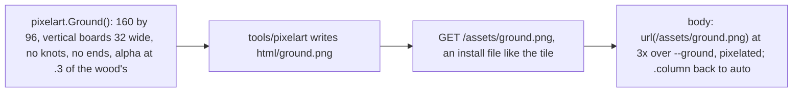
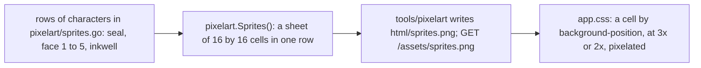

# 138 — Pixel art elsewhere: the ground, the seal, the mood faces and the empty states

> Dated implementation record. Tests use temporary folders and synthetic data. The owner's live `life.db` is never
> opened by a test.

## Status

- **Date / baseline:** 2026-10-19, `284e955` (the branch `plan-137-parts-4-5`, on `901a1a3` of master).
- **Priority:** P3. **Effort:** S. **Risk:** LOW: the sheets, two embedded pictures and one template attribute.
- **Status:** IN REVIEW (owner). Live since 2026-10-19 22:26, in the master build `c24ac92` (plans 136 to 139 in one binary); the owner looks and says what to keep.
- **Resolves:** part 6 of [plan 137](137-pixel-wood-and-the-focus-pass.md), with the owner's pick.

## The owner's words (2026-10-19)

- "I will also want to introduce art like this around the other areas."
- On the mock-ups of part 6: "it's a bit too much that border" (the pixel edge on the parchment), then "I want
  everything except the leaf on rings".

## The decisions

| question | decision |
|---|---|
| the oak ground | a faint tile of pixel boards under the page, in place of the 4px conic grain alone: the calmer set of the mock-ups (plain vertical boards, no knots, no ends, a third of the rail's strength) |
| the parchment edge | unchanged: the straight 2px edge stays; the square notch in the corner of a sheet becomes a wax seal, five by five pixels |
| the mood slabs | a five-pixel face beside each number, from a frown to a grin; the word of part 3 stays |
| empty states | a small drawing before "Nothing written" on the journal only: an inkwell, twelve by twelve pixels at two screen pixels a pixel. The margin lies on the oak, and the dark ink of a sprite would need a second drawing in the dark scheme |
| the leaf | unchanged (no rings) |
| the icons | unchanged |
| how the small drawings ship | one sprite sheet, `html/sprites.png`, drawn by `internal/pixelart` from rows of characters in the Go source, so a maintainer reads the picture in the code; the sheet reads the cells by position |

## How it ships

The flow of [plan 137](137-pixel-wood-and-the-focus-pass.md#how-each-part-ships): a failing test, the change, the
checks, the screenshots, a counter-review, the deploy by the owner.

## The ground

- `Ground()` is the wood's drawing, transposed: boards of 32, seams, grain and dither, no board ends and no
  knots, every alpha multiplied by .3. The tile is 160 by 96; at three screen pixels a pixel it is 480 by 288.
- `body` keeps `--grain-ground` as its second layer. `image-rendering:pixelated` is set on `body` for the tile and
  reset to `auto` on `.column`, so a picture in the page is drawn as a picture; the rail sets its own.
- The ground must stay quieter than the sheet: the counter-review judges the screenshots of a day, Browse and the
  stream in both schemes.

## The seal, the faces and the inkwell: one sprite sheet

- **The sheet.** Seven cells of 16 by 16 in one row: cell 0 the seal, cells 1 to 5 the faces, cell 6 the inkwell.
  Each drawing is a slice of strings in the Go source, one character a pixel: `.` empty, a letter a colour of a
  small palette in the same file (the seal's red and its light, the ink, the ink's light). The colours are the
  sheet's: a sprite is a picture, not a shade. `Sprites()` is deterministic; `tools/pixelwood` becomes
  `tools/pixelart` and writes the three files; the view's test compares each embedded file with its drawing.
- **The seal.** `.sheet::after` and `.day-card::after` (the stream's day card is the only article) draw cell 0 at 3x
  (15 by 15) where the 7px square was; the square goes. The head of a card keeps clear of it, and the print sheet
  hides it.
- **The faces.** The `field` template marks the mood's fieldset `class="segmented faces"` (`.mood` is already the badge class). In `.faces`, each slab's
  span draws its face before the number: `label:has(input[value="N"]) span::before` draws cell N at 3x. The slab
  grows to hold both (the face, a gap of 4px, the number); the word of part 3 stays under them. The face is in ink,
  so a chosen slab (accent-soft) and a plain slab show it alike.
- **The inkwell.** `.journal p.empty::before` draws cell 6 at 2x (24 by 24), before the words, at opacity .8, as an
  inline box so the words and the link keep their spaces. No other empty state draws it.
- The numbers in `app.css` copy the layout of the sheet. A test of the view reads them against the constants of
  `internal/pixelart`.
- The sprite colours are two new tokens in `base.css` (`--seal`, `--seal-light`) only if a rule needs them; the
  sheet carries its own colours, so the sheet's rules name no colour.

## What changes where

| path | change |
|---|---|
| `internal/pixelart/ground.go`, `sprites.go`, tests | the two drawings; determinism, sizes, a known pixel of each |
| `tools/pixelart/main.go` (was `tools/pixelwood`) | writes `wood.png`, `ground.png`, `sprites.png` |
| `internal/api/view/html/ground.png`, `sprites.png` | the files |
| `internal/api/view/sheets_test.go` | the comparison of each embedded picture with its drawing; the sheet's cell numbers against the constants |
| `internal/api/serve.go`, `public.go`, `assets_test.go` | the two routes, install files |
| `internal/api/view/html/app.css` | the ground, the seal, the faces, the inkwell, the print rules; the header comment counts three pictures |
| `internal/api/view/html/layout.html` | `class="segmented faces"` on the mood's fieldset |
| `README.md` | "one embedded picture" becomes three; the table rows of the packages |

## Checks

- `gofmt -l`, `go vet ./... && go test ./...`; `staticcheck ./...`, `govulncheck ./...`.
- Screenshots on the review server: a day of today, a day with nothing written and no readings, Browse, the stream,
  Metrics; desktop and phone; light and dark; a chosen mood.
- A counter-review of the diff with the real binary; the owner's deploy.

## Done when

- The ground shows faint boards in both schemes and stays quieter than the sheet.
- Every sheet has the seal; the mood slabs have their faces and still show the word when chosen; an empty journal
  draws the inkwell; the leaf and the icons are unchanged.
- The three pictures are each the output of `internal/pixelart`, checked by a test.
