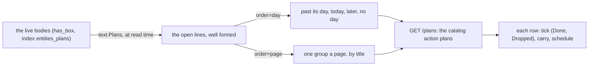
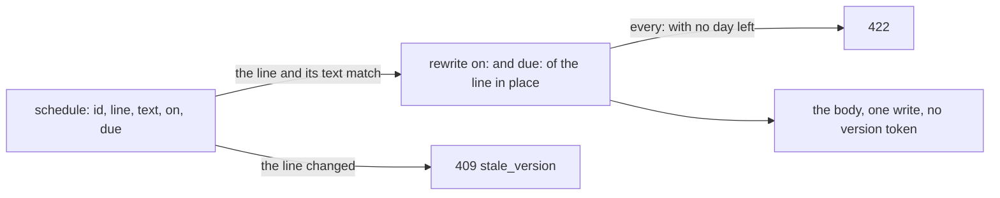

# 140 — The Plans page: every open plan line in one list, by day or by page

> Dated implementation record. Tests use temporary folders and synthetic data. The owner's live `life.db` is never
> opened by a test.

## Status

- **Date / baseline:** 2026-10-20, `78b086a` (master).
- **Priority:** P2. **Effort:** M. **Risk:** LOW: one read of the lines that already exist, one GET action, one view,
  and one write action on one line (`schedule`). No table, no column, no trigger.
- **Status:** TODO.
- **Resolves:** the owner's request of 2026-10-20 (below). Builds on [plan 136](136-plan-lines-and-period-pages.md)
  (plan lines, D29) and the reopen of `78b086a`.

## The owner's words

2026-10-20: "Can we add beside Today, This Week Calendar Metrics and browse a Todos/Tasks page, to show them in order
of due time, or on categories, or to show them all or simply manage them".

The owner's answers in the same session:

| question | answer |
|---|---|
| which lines | **every open line, with or without a day**: the dated lines first, the lines with no `on:` or `due:` after them |
| what a category is | **the page the line is in** (a project page, a week, a day). The grammar does not change |
| what "manage" means | **the actions that exist**: Done, Dropped and Carry on each row, the Plan form in the head, Reopen through the Undo of the message after a tick |
| change the dates of a line | asked next: "If we were to also update the due, or when, would that bring too much complexity?" The agent proposed one action `schedule` that rewrites `on:` and `due:` of a line in place; the owner: "sounds good" (Part 5) |
| the name | **Plans**: one word with Planned, the action `plan` and the docs |

## The shape



## The decisions taken in the plan

| question | decision |
|---|---|
| a resource or an action | a GET action of the catalog, `plans` "Plans", `GET /plans`, as `browse` and `search` are. So the CLI has `do plans`, the MCP extension has the tool `plans`, and the browser has the nav item. No shortcut command |
| the fields | `order`: `day` (the default) or `page`, with `Options`; `limit` (1–500, 200 by default) and `offset`, as every list ([API.md](../../API.md#pages-of-a-list)). Any other value is 422 |
| what is listed | the open lines (`[ ]`) of every live page, malformed lines left out (the contract: a malformed line is never listed under a day; tick refuses it, so a row could do nothing). Done, dropped and carried lines stay on their pages and their periods |
| the order `day` | by the planned day (`on:`, else `due:`), then title, then line; the lines with no day after all dated lines, by title and line. The view draws four groups: **Past its day** (planned day before today), **Today**, **Later**, **No day**. A `due:` before today on a line whose `on:` is later shows the badge `due` in the danger tone |
| the order `page` | by the title of the page, in any case, then line. The view draws one group a page, its head a link to the page (a day in words, a period by its name) |
| the bounds | `total` counts every open line; `limit` and `offset` select the rows; links `next` and `prev` as `/browse` has them. A group can break over two pages of rows; its head is drawn again on the next page |
| the contract | one sentence changes: a line with no day "is listed only on its own page" becomes "is listed on its own page and in the list of every open line, never under a day". Homes: [plan lines](../contract/plan-lines.md) (the paragraph under the token table), [imports](../contract/imports.md) step on checkboxes, [D23](../decisions/D23-no-tasks.md) first bullet. The owner's words are the incident (issue 0088). It changes no decision, so it has no RFC ([the process](../process.md), step 2) |
| the nav | "Plans" after "This week": `{"Plans", "/plans", "plans", []string{"/plans"}, "day", ""}` in `view/shell.go`. Its icon is a fifteenth glyph `plans` of the pixel sheet ([plan 139](139-pixel-icons.md)): a box of 8 by 8 with a tick |
| the words | the catalog and the view say plan, planned, past its day. Never task, to-do or overdue |

## Part 1 — the contract and the record (main session)

- `docs/issues/0088-every-open-plan-in-one-list.md` from the template: the owner's words of 2026-10-20 are the
  incident; a line with no day is visible on its own page only, so the owner cannot see what is open across the
  pages.
- Rewrite the three sentences above in place. Add no other rule.
- `docs/plans/README.md`: the row of plan 140 and the next number 141 (Part 0 of this plan, done with the commit of
  the plan).

Done when `go test ./tests` is green (the document suite reads every link).

## Part 2 — core: `OpenLines` (a Sonnet sub-agent, tests first)

In `internal/core/plans.go`, beside `Planned` and `PlanLines`:

```go
// OpenLines lists the open, well-formed lines of every live page, in the order byPage asks (false: by planned day, the
// lines with no day last; true: by title, then line). total counts them all; at most limit come back from offset.
func (s *Store) OpenLines(ctx context.Context, byPage bool, limit, offset int) (items []PlanItem, total int, err error)
```

- Reuse `planItems`. Its sort puts the day key first; make an empty day sort after every day (Planned and PlanLines
  never return an empty day, so their order does not change). For `byPage`, keep returns "" as the day key for every
  line, so the sort is by title, then line. The title compare stays the one `planItems` has; if Browse orders titles
  in any case, follow it and say so in the comment.
- `limit` 1–500 and `offset` ≥ 0, refused as `Invalid` otherwise (the bounds of `/browse`; read the existing
  helper of the list bounds, do not write a second one).
- `plans_test.go` (synthetic pages under `t.TempDir()`, through the production writer): a dated line before a line
  with no day; two lines on one day ordered by title, then line; `byPage` groups the lines of one page together and
  orders the pages by title; a done, a dropped, a carried and a malformed line are left out; a line in a tombstoned
  page is left out; a line inside a block quote is left out; `total`, `limit` and `offset` with hand-counted answers;
  limit 0 and 501 refused.

## Part 3 — the action and the API (the same sub-agent, after Part 2)

- `internal/api/catalog.go`: the row `plans` after `browse`, `Method: "GET", Path: "/plans"`, the fields `order`
  (options `day`, `page`) and the list fields `limit`, `offset` as `browse` has them. Its Description in plain words,
  with no word the dead-links test forbids.
- `internal/api/plans.go`: the handler reads its fields through `fieldsOf(r, act)`; the entity has class `plans` and
  the properties `today`, `order`, `total`, `lines[]` (the [plan line](../../API.md#plan-line) shape of
  `planLinesOf`); the links `self`, `next`, `prev`, `index`; the actions `plan` (with `page` = today) and
  `lineActions()`.
- `GET /` gains a link `plans` (`/plans`).
- `API.md`: a class `### plans` after `### browse` (the query, the orders, the properties table) and the link
  `plans` in `### root`. `reference_test.go` holds the shapes.
- `README.md`: a row of the table [every action on every surface](../../README.md#every-action-on-every-surface)
  after `browse`: `| \`plans\` | \`GET /plans\` | \`do plans\` | \`plans\` | the sidebar: Plans |`
  (`TestTheTableOfTheSurfacesIsTheCatalog`). If the README or `site/` names the nav items, add Plans there in the
  same commit.
- Tests in `internal/api/plans_test.go`: the class and the order of the rows for both orders; `order=week` and
  `limit=0` are 422; `next` and `prev` with `limit=1`; a tick posted with `back=/plans` answers 303 to `/plans`.
- Parity (`cmd/lifelog/parity_test.go`): `do plan page=Project text=Call` with no day, then `do plans` lists it
  with `title` Project. MCP (`extensions/mcp/e2e_test.go`): the tool `plans` is present and its answer lists a line
  that the test planned.

## Part 4 — the view (a Sonnet sub-agent, after Part 3)

- `viewOf["plans"] = "plans"`; a template `internal/api/view/html/plans.html`. The head: "Plans", the count
  (`total` open lines), two links "By day" and "By page" (the current one marked as the zoom links of `/days` are),
  and the boxed `plan` form with `page` prefilled with today and editable (a title, a day, a period).
- The groups as the decisions above say, each a `planlist` of `plan.html` (the rows keep Done, Dropped and the boxed
  Carry with `to` = tomorrow). With `order=page` the row does not repeat the page under its own group head: pass
  `own`, as a period page does. The back of every form is the current address with its query.
- An empty list: one line "Nothing is planned." in the tone of the other empty states ([plan 138](138-pixel-art-elsewhere.md)).
- The nav item and the glyph (`internal/pixelart/icons.go`, `tools/pixelart`, `icons.png` regenerated,
  `shell_test` reads the names). The current item is gold on `/plans`.
- CSS: the group heads reuse the heads of Planned on the day; the danger tone of a past `due` reuses `--danger`.
  No script.
- Tests: `view_forms_test` (every form of `/plans` posts to an action of the catalog), `sheets_test`, and a view
  test that the four groups appear in their order on a synthetic store.
- Screenshots on the review server (memory: `shoot.py`, the synthetic server on :7788): `/plans` by day and by page,
  at desk and phone width, light and dark. The owner looks before the deploy.

## Part 5 — `schedule`: change the dates of a line (a Sonnet sub-agent, after Part 3, tests first)



| question | decision |
|---|---|
| the action | `schedule` "Schedule", `POST /pages/{id}/schedule`. Fields: path id, **line** (number), **text**, on (date), due (date). Both date fields are sent: an empty value removes that date, a value replaces it or adds it. A date goes through `dayNamed`, so the word today is a day |
| which lines | an open line only (`[ ]`). A done, dropped or carried line, a malformed line, or a line that is not a plan line is 409 `stale_version`, as for `tick` and `carry` (the client read a line that is not there) |
| what it keeps | the bullet and the indent before the box, the box, the words, `every:` and `from:done`. The line after the box is written again by `text.Line`, so the tokens go to the end in the key order of `Line`; the words keep their order |
| the rules it can break | `every:` with neither `on:` nor `due:` left is refused by `text.Line` (422, the sentence of the contract). The writer adds no other rule |
| a repeat | nothing more: the next date of a repeat counts from `due:`, else `on:`, at the tick. So it counts from the new date |
| one way to do a thing | `carry` moves a line to another page; `save-body` edits the whole page with its version token. `schedule` is the one action that changes the dates of a line where it is. The README row says so |

- `internal/text/plan.go`: `func Schedule(body string, line int, text, on, due string) (newBody string, err error)`
  beside `Carry`, through `openLine` and `Line`. Vectors in [plan lines](../contract/plan-lines.md): a section
  "Change the dates of a line" (one paragraph: what `schedule` keeps and what it refuses) and a third JSON block after
  a marker `<!-- schedule-vectors -->`, read by `plan_test.go` and by the `plan-lines` suite of `tests/` as the other
  two blocks are: at least 12 vectors (add on, add due, replace each, remove each, remove both, remove both with
  every refused, a nested item keeps its indent, a `*` bullet, tokens in the middle of the words move to the end,
  a done line refused, a changed text refused). Count the new vectors in `tests/README.md` if it counts them.
- `internal/core/plans.go`: `Store.Schedule(ctx, source, id, line, words, on, due) (ScheduleResult, error)`, as
  `Carry` is: `livePage`, `text.Schedule`, the `UPDATE` of the body, `syncWikilinks`, in one `alone` write;
  `planError` for the answers. `ScheduleResult` has the line number and the new line.
- `internal/api`: the catalog row after `carry`; the handler in `plans.go`; `lineActions()` returns `tick`, `carry`
  and `schedule`, so every view that draws plan rows (a day, a week, a month, a year, a page, `/plans`) offers it.
  `API.md`: the action in `### plan line` and a `### result of schedule`; the lines that list "`tick` and `carry`"
  in the classes say "`tick`, `carry` and `schedule`". `README.md`: the row of the action in the table of the
  surfaces, and the sentence that names the actions of a line (`README.md:140`) names the four.
  [D23](../decisions/D23-no-tasks.md) and [D29](../decisions/D29-plan-lines.md): where they name the actions of a
  line, add `schedule` ("`schedule` changes its dates").
- The view: on an open row of `planrow` (`plan.html`), a boxed form "Dates" beside Carry, with `on` and `due`
  prefilled with the line's values and hidden `line`, `text` and `back`. The message after the write names the new
  dates. No Undo form: the old dates are in the message, and a second `schedule` puts them back.
- Tests: `plan_test.go` (the vectors); `core/plans_test.go` (409 on a changed line; 422 for every with no day, and
  the body unchanged after it; a tombstoned page 409; a line inside a quote refused); `api/plans_test.go` (the 303
  back to `/plans`; an empty `due` removes the token); parity (`do schedule`, then `do plans` shows the new day); the
  MCP tool `schedule` is present in `extensions/mcp/e2e_test.go`; `view_forms_test` (the form posts to the action).
- The Description of the catalog row says "the day it is planned for" and "the day it must be done by", as `plan`
  does.

## Part 6 — measure

`internal/scaletest/scale.go`: `exercise` records `open_plans` (`OpenLines(ctx, false, 200, 0)`) beside
`planned_day`; `scale_test.go` expects 13 operations. Run `go run ./tools/lifescale -profile lifetime -seed 2075
-samples 5` and record `open_plans` here. It is the same scan as `planned_day` plus one sort; a result above the
`day_view` budget is the reopen trigger of a derived index (non-goals), not a reason to cut the page.

## Checks

- Every part: `gofmt`, `go vet ./... && go test ./...`. Part 1 also `go test ./tests`. Part 3 also
  `cd extensions/mcp && go vet ./... && go test ./...`. Before the last commit: `go test -count=1 -shuffle=on ./...`,
  `staticcheck ./...`, `govulncheck ./...`.
- By hand on the review server: plan "Call the bank" on a project page with no day, "Pay rent due:" yesterday, and
  one line on today; `/plans` shows Past its day, Today, No day in that order; By page groups them under their pages;
  Done on a row answers back to `/plans` with the Undo message, and Undo puts the row back; Dates on a row with
  due set to next week moves it from Past its day to Later, and an empty due on a repeating line with no on is
  refused with its sentence.
- Skills: Parts 2, 3 and 5 `a-philosophy-of-software-design` + `code-complete`; Part 4 `refactoring` +
  `a-philosophy-of-software-design`. Every report ends with the Skills line.

## Done when

`/plans` lists every open line by day and by page on the four surfaces (`do plans`, the MCP tool `plans`, the
browser, `GET /plans`); `schedule` changes the dates of an open line on the four surfaces, with its vectors on the
contract page; the contract sentence is rewritten in its three homes; the baseline, the static checks, the
MCP tests and the shuffled run are green; `open_plans` is recorded; the owner has seen the screenshots. The deploy
waits for the owner's word.
