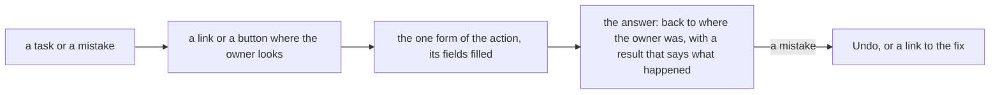

# 141 — The access pass: every task has a way in, every mistake has a way out

> Dated implementation record. Tests use temporary folders and synthetic data. The owner's live `life.db` is never
> opened by a test.

## Status

- **Date / baseline:** 2026-10-20, `39d37fc` (master).
- **Priority:** P2. **Effort:** L. **Risk:** LOW to MEDIUM: links, labels, view changes and words; one new action
  (`edit-person`), two new fields on `promote`, and one new catalog field (`Hint`). No table, no column, no trigger.
- **Status:** IN REVIEW (owner). Built on 2026-10-20 and 21, on master; the deploy waits for the owner's word.
- **Resolves:** the owner's request of 2026-10-20 (below), after `39d37fc` (New metric easy to find, a page made a
  metric).

## The owner's words

2026-10-20: "in the ui i cant find how to add a new metric type. i tried to add one but it was created as a page.
make it easier and more user friendly", then "i want to be able to create also from the metrics page" (done in
`39d37fc`), then "can we find any more access issues like this or operations that can be made more convenient and
more ux friendly?"

Two read-only audits followed: a map of every action to the place that draws it, and a walkthrough of ten daily tasks
on a synthetic server, desktop and phone. The owner's answers:

| question | answer |
|---|---|
| which groups | **all six**: readings, people and places, plan lines, words and errors, recovery, phone |
| a person's name and dates after creation | **yes**: an action edits them (Part 2) |
| a short browser summary of an action | **yes**: a catalog field beside the API description (Part 4) |

## The rules every part keeps

- **One way to do a thing** (AGENTS.md): one action, one form, drawn where its resource is. A link may lead to that
  form (`?new=<action>&<field>=<value>` opens it with the fields filled). No second copy of a form, no alias action.
  A form drawn once per row (tick on each plan line) is one form.
- **Every capability on every surface**: a new action or field is in the catalog, so the CLI, the MCP tools and the
  forms carry it; a new action adds its row to the README table of the surfaces.
- **A rule about the data is a CHECK or a trigger**: no Go check repeats one. Words of a refusal may change; the
  refusal stays in the file.

## Part 1 — Readings

1. **The metric of Add a reading** (Home, a day): the select lists every live metric, not only the ones read in the
   last 60 days, by name. With no metric named,
   the first option is an empty "Pick a metric", so the browser makes the owner choose. A metric named in the query
   (`?new=record&metric=X`) is always selected; an unknown name is refused by `record` as now, never replaced by
   the first option.
2. **Back to the day**: the record form on Home and on a day sends `back` (the day), as the form of a metric's page
   does. A tick of a habit chip in the rail goes back to the page it was sent from.
3. **A reading made by mistake**: Correct opens with the current value filled. A retraction does not draw Correct.
   The reading's page says "Wrong day or wrong metric? Retract it, then add it again." with a link to the record form
   with the metric and the value filled.
4. **The folded fields**: `import_key` is filled with a new key and hidden, as in the capture form (a double click is
   then safe). The titles of `taken_at` and `tz` say what to type in plain words, with an example.
5. **Habits**: for a metric with no unit, the value field's placeholder is "1 done, 0 not done". A metric's page with
   no unit says in one sentence that a habit shows in Today after its first reading and leaves it 14 days after its
   last. The reading tiles of a day show the unit, as the cards of /metrics do. "and N more this day" links to the
   metric.

## Part 2 — People and places

1. **The [[Name]] trap**: New person (or New place) with the title of a plain page is refused with 409 today, and the
   fields typed are lost. The answer links to that page's "Make it a person or a place" form, with the kind and the
   fields filled.
2. **`promote` takes `birth_day` and `death_day`** (optional, a person only), as `create-person` does, so the trap path
   keeps the birthday.
3. **The new action `edit-person`** (`POST /pages/{id}/person`): sets `name`, `birth_day` and `death_day` of a person.
   A field left out stays; an empty value removes a date. The schema's CHECKs refuse a bad date and a death before a
   birth. Drawn on a person's page under More as "Edit name and dates", with the current values filled. CLI `do
   edit-person`, MCP tool `edit_person`, README table row, API.md.
4. **Where, on a day**: the Where section of a day is always drawn. It links to the day page's link form with
   `kind=at`, under the words "I was at a place"; the `to` field offers the titles of the places. Each place listed has
   a × that sends `unlink` for that place, in place of the free-text Remove form.
5. **The words of a person**: the title field of create-person is "Name in [[links]]", with placeholders
   `Sam (barber)` and `Samuel Ortiz` for the full name.

## Part 3 — Plan lines

1. **Dates as chips**: in a rendered body (the journal of a day, a page), the tokens `on:`, `due:`, `every:` and
   `done:` of a plan line are drawn as the chips the plan rows already use, not as raw text. The stored text does
   not change.
2. **The result of a tick of a repeating line** names the day of the next one ("The next one is on Tue 27 Oct."), not
   its line number.
3. **A repeat with no date**: the plan form on a day fills `on` with that day. The refusal of a repeat with neither
   date says "a repeat needs a day: on (Planned for) or due (Must be done by)" (the words of the form and the names of the fields, for every surface)

## Part 4 — Words and errors

1. **A browser summary**: a catalog field `Hint`: one or two plain sentences for the form; the view draws `Hint` when
   it is set, else the Description. `Description` stays the API text (`/actions`, the CLI, the MCP tools). Each action
   whose description holds API words (status codes, field names, doc paths) gets a hint: plan, tick, carry, schedule,
   record, correct, retract, tombstone-pages, rename, add-file, capture, link, unlink, file-pages, set-cover,
   promote, edit-person. Carry and Schedule each say in one line how they differ ("Move it to another page or day",
   "Change its dates here").
2. **Refusals in plain words**: a refusal from SQLite loses the driver's prefix and its error code number; the
   constraint's name stays, as the one reference to the rule. Messages of the core that name an action by its API name
   use the button's words (revive → Restore, add-file → New file, register-metric → New metric), and the error view
   links to the form when the error names one.

## Part 5 — Recovery

1. **After a delete**: the result of `tombstone-pages` of one page has an Undo (`revive`), as a tick has; of several,
   a link to the deleted list. Each Browse kind shows its count of deleted things, not only Pages.
2. **New category**: the words of the form say that a page becomes a category when something is filed in it, and the
   link leads to the Select bar with the words "Check what goes in it, then type its name".
3. **A search with no hit** links to "Make a page titled ‘q’" (the New page form with the title filled).

## Part 6 — Phone

1. The Today strip (entry, mood, habits) is drawn at the head of Home and of today's day on a narrow screen, not only
   in the More sheet. The More sheet has an opaque background.
2. Home does not open scrolled past the date on a narrow screen (the autofocus of the entry).

## Part 7 — Small words

- New file: the file field first; its label says that the picture is kept and the original stays where it is.
- Browse: the heading names the kind (People, Places, Media) where it says Everything today.
- Search: "Rows on a page" and "Rows skipped" are folded under More fields.
- The result of file-pages names the pages ("Put Weight in Body"), not a count, when there are few.
- New › Reading has its own icon, not the icon of Metric.

## Tests

Each part adds tests beside its packages (AGENTS.md, tests that earn confidence): the HTML of the view where the link
or the field is drawn, the persisted state after the write, and the refusal with its status. `edit-person` gets the
parity tests of a new action (CLI, HTTP, the MCP end-to-end test of `extensions/mcp`) and the owner-only check does
not apply (it is not an owner action).

## What was built, and what was not

- Parts 1 to 7 are built, by Sonnet sub-agents in worktrees, reviewed and merged one part at a time.
- **Not built:** the Restore link on the refusal "the category X is deleted" (Part 5). It needs a typed error; the
  Deleted row of the Browse tree is the way back meanwhile.
- **The Deleted row of the tree** counts the deleted things of every kind, as its list does, and says so ("Deleted,
  every kind"); a count for each kind was not built.
- **Autofocus:** the entry of a day has no autofocus on any screen. The app has no script, and a narrow-screen-only
  autofocus needs one. The owner decides.
- **Found on the way, not built:** New page with the title of a period (`2026-W43`) is refused by
  `entities_period_page` (a period page has no day); a period page is made by a write to it (plan, save-body).

## The adversarial review (Fable 5.1)

No blocker. Fixed:

| finding | fix |
|---|---|
| a habit chip kept the open form in its `back`, so the answer opened the form again and each hop nested a `back` | `view.ReturnHere`: the page without the asked form, its values and its back |
| a metric named in `?new=record&metric=` that does not exist was dropped in silence | a query value that is not an option is added to the options, so `record` refuses it with its 404 |
| the 409 of New person offered to promote a period page or a category, and their pages offered Make it a metric; the schema refuses both | `core.promotable` reads the stored columns (`is_journal`, `period`) and the part-of links; the page link uses the same test |
| the Deleted row counted every kind under each kind | its words say "every kind" |
| the day read the metric registry twice | read once, and given to the record action and the units |
| the sentence of file-pages read whole pages for three titles | `Store.Titles` reads the names only |
| `edit-person` with no field answered 200 | 422, as `schedule` with no date |

## Done when

- Every item above is done, or its row here says why not.
- `go vet ./... && go test ./...` is green; `go test -count=1 -shuffle=on ./...` is green; staticcheck is clean;
  `extensions/mcp` passes its own checks.
- Screenshots of each changed view, desktop and phone, light and dark, on a synthetic server.
- An adversarial review by a second model finds no blocker.
- The deploy waits for the owner's word.
