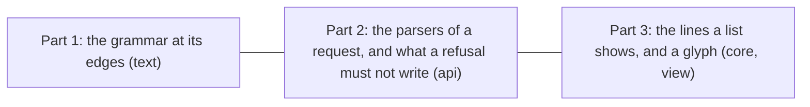

# 142 — The fall-back pass: the parsers at their edges, and what a refusal must not write

> Dated implementation record. Tests use temporary folders and synthetic data. The owner's live `life.db` is never
> opened by a test.

## Status

- **Date / baseline:** 2026-10-22, `1b3d78e` (master).
- **Priority:** P2. **Effort:** M. **Risk:** LOW. There is no schema change and no contract change. Three answers
  change: a `number` field written as a hexadecimal number or with an underscore (`0x1p1`, `1_000`) is refused
  (422), a `--origin` with an upper-case letter in its scheme or host is refused at start, and the list of every open
  line leaves out a line with only a box. Nothing else that a client sees changes.
- **Status:** IN REVIEW (owner).
- **Resolves:** no issue, no RFC. The owner's words are the incident.

## The owner's words (2026-10-22)

"Let's find areas of improvements in the code, in the architecture and in the tests. Let's enhance the testing suite
with more cases and edge-cases so that we have a better "fall-back" in case of introduced bugs."

## Why

The tree at `1b3d78e` is clean: `go vet`, `staticcheck` and `deadcode` find nothing, and the coverage map
([tests/README.md](../../tests/README.md#the-coverage-map)) shows that what the tests do not reach is, almost
everywhere, the `return err` of a failed SQL call. So the pass did not read for style. It ran the parsers and the
writes on inputs at their edges, and compared what came back with what the docs and the catalog say. The table
holds what it found. Each row is held by a test in this plan, so that a change that brings the fault back fails a
test.

| # | what the probe found | where | part |
|---|---|---|---|
| 1 | `number` reads a field by Go's float syntax: `1_000` is 1000, `0x1p1` is 2, `Inf` and `NaN` parse. `NaN` is refused by `checkValue` and `Inf` by `measurements_value_finite`, but `1_000` and `0x1p1` are kept in silence, as a reading and as a mood. | `internal/api/request.go` | 2 |
| 2 | A capture with a `NaN` mood writes nothing: the entry is appended before the Mood reading, and the transaction rolls back. True today; no test holds it. | `internal/core/journal.go` | 2 |
| 3 | `OpenLines` lists a line with only a box (`- [ ]`). The Plans page draws it, and no action can take it: a tick, a carry and a schedule of an empty text are refused ([plan lines](../contract/plan-lines.md)). | `internal/core/plans.go` | 3 |
| 4 | `CheckOrigin` accepts `http://App.Example`. A browser sends its origin in lower case, so that origin never matches, and every request from it is refused with no word to the owner. The standard library keeps the origin as typed too. | `internal/api/public.go` | 2 |
| 5 | The Monday of an ISO week is computed twice: `weekOf` and the week case of `periodWindow`. | `internal/api/weeks.go`, `internal/api/plans.go` | 2 |
| 6 | No plan write runs on a body with CRLF line ends through the store or the API. The grammar has one such test. | `internal/core`, `internal/api` | 3 |
| 7 | The edges of the grammar that the probes ran are not pinned: an ordered list item, two blanks after the bullet or the box, a tab after the box, a no-break space before a token, blanks at the end of a line, a lazy continuation line, the month clamp and its `month-31` on the way back, the distance of `due` and `on`, a count of more than nine digits, a date at the year 9999, a token key in upper case. | `internal/text/plan_test.go` | 1 |
| 8 | `boxHTML`, the glyph of a closed line, is drawn by no test. | `internal/api/view/plans.go` | 3 |

The three parts touch different packages and run in parallel.

## Part 1 — The grammar at its edges (`internal/text`)

Add to `plan_test.go`, beside the vector tests:

- A table test of `Plans` on the bodies of row 7, each with the fields that come back (box, text, tokens, `Bad`), and
  for the open ones the body after `Tick`, `Schedule` and `Carry`. The expected strings are written by hand. Cases
  with their expected results: `1. [ ] ordered` is a plan line; `- [ ]\ttabbed` is not; `-  [ ] two` and `- [ ]  two`
  are, and `Schedule` writes the second with one blank; `a  on:2026-01-01` is a text with no token; a blank at
  the end of the line stays after a tick and goes after a schedule; a lazy continuation line keeps its words and a
  tick writes `done:` on the first line; `on:2026-01-31 every:month` ticks to `on:2026-02-28 every:month-31` and a
  reopen gives the original back; `due:2026-01-10 on:2026-01-12 every:week` ticks to `on:2026-01-19 due:2026-01-17`;
  `every:9999999999-days` and `on:9999-12-31 every:day` are refused by range on a tick and accepted by a schedule;
  `ON:2026-01-01` is a word, in `Plans` and in `Line`.
- `TestEveryWriteOnARandomBodyChangesItsLineOnly`: a seeded generator (`rand.New(rand.NewSource(142))`) writes 400 bodies
  from a small alphabet of lines: open lines with and without `on`, `due`, `every` and `from:done`, done and dropped
  lines, plain text, a quote, a fenced block, a nested item, blank lines, and the three line ends (LF, CRLF, CR).
  For every open, well-formed line with a text: `Tick` then `Reopen` (with the appended line added as the contract
  says) gives the body back byte for byte; `Schedule` changes that line only (every other line is equal, by
  `lineStarts`); `Carry` changes one byte. On a failure the test prints the seed, the body and the line.
- Add the bodies of the table to the seeds of `FuzzPlans`.

## Part 2 — The parsers of a request, and what a refusal must not write (`internal/api`)

- **`number` reads a decimal number.** In `request.go`, `number` accepts the digits, one point, an optional sign and
  an optional exponent (`70`, `-0.5`, `.5`, `4.`, `1e3`, `1.5E-2`), and nothing else: `NaN`, `Inf`, `Infinity`,
  a hexadecimal number (`0x1p-2`), an underscore (`1_000`), a blank at either end and a comma are refused with the
  message of today, `%s %q is not a number`. A value whose magnitude does not fit a float64 (`1.8e308`) stays
  refused. `request_internal_test.go` holds the table. API.md gets one sentence under its types if the types are
  described there: a `number` is written in decimal.
- **A refusal writes nothing, end to end** (`api_test`, through `apitest.Fresh`): `record` with `NaN`, `Inf` and
  `1_000` is 422 and the measurements table does not change; `capture` with a mood of `NaN` and of `Inf` is 422, the
  day page is not made, and no entry and no reading is written; a mood of `3` is written. These refusals come from the
  parser, before the core runs. Row 2, the rollback of the entry, is held through the API by a capture whose
  `import_key` was used for a Mood reading before: the core appends the entry, then `Record` refuses (409, D28), and
  the test finds no day page, no entry and no key. The state is read as `scalar` reads it in
  `TestARequestWithoutARequiredFieldIsRefusedAndWritesNothing`. `checkValue` of the core keeps its NaN branch: the
  writer's rule stands on its own, for the suites and for a writer that is not this API.
- **`form` on a JSON body**, a table in `request_internal_test.go` with the answers of today: a number is its JSON
  text (`1`, `1e+21`), a boolean is `true` (and `flag` then refuses it, 0 or 1), an array and an object are their
  JSON, `null` is absent, a duplicate key keeps the last value, a second object after the first is refused, an array
  or a scalar at the top is refused.
- **`lineNumber`**, a table: `1`, `1.0` and `1e0` are 1 (as today); `0`, `-1`, `1.5`, `NaN`, `Inf`, `2147483648`
  and `x` are refused.
- **`CheckOrigin` refuses an upper-case letter** in the scheme or the host, with a message that says a browser sends
  its origin in lower case. `public_test.go` adds the case to its table of origins; `cmd/lifelog` has a test of the
  `--origin` flag (`TestPublicOptionsRefusals`): add the case there if the table is there.
- **One home for the Monday of a week.** The week case of `periodWindow` calls `weekOf`; the formula and `jan4` go
  from `plans.go`. `TestPeriodWindowIsTheFirstAndTheLastDayOfAPeriod` holds.

## Part 3 — The lines a list shows, and a glyph (`internal/core`, `internal/api/view`)

- **`OpenLines` leaves out a line with no text.** `openStore` in `plans_test.go` gets a page whose body holds
  `- [ ]` and `- [ ] on:2026-10-21` (a box with tokens and no words). `TestOpenLinesLeavesOutWhatCannotBeTicked`
  fails until the keep of `OpenLines` adds `p.Text != ""`. `Planned` and `PlanLines` need no change: a line with no
  text has no day. The totals of the other OpenLines tests do not change (the new page holds no line they count).
- **A plan write on a CRLF body through the store** (`plans_test.go`): a page whose body is
  `Week\r\n\r\n- [ ] a on:2026-10-20\r\n- [ ] b\r\n`; `Tick` of line 3, `Schedule` of line 4, `Carry` of line 4 to a
  day, and `Plan` of a new line on the page. Every untouched byte stays, each result reads back through `text.Plans`
  with its fields, and the revision advances once a write.
- The test of the CRLF body found that a line added to such a body gets `\n\n`, so two blank lines in a CRLF
  reader: [issue 0089](../issues/0089-a-plan-line-added-to-a-crlf-body-gets-two-blank-lines.md). The test pins the
  body as the writer gives it today, and changes with the fix.
- **The same through the API** (`plans_test.go` of `api_test`): one tick of a line of a CRLF body answers the page,
  and the body kept its `\r\n`.
- **The glyph of a closed line** (`view`): a view test draws a day whose lines hold a done, a dropped and a carried
  line, and finds one `role="img"` box with the class and the label of each, and no form of tick for them.

## Tests

Every new test states its expectation in its name and asserts the persisted state, not only the status.
`go test ./internal/text ./internal/api/... ./internal/core` for the focused feedback, then the baseline.

## Done when

- `gofmt -l` is empty; `go vet ./... && go test ./...` passes; `staticcheck ./...` finds nothing;
  `go test -count=1 -shuffle=on ./internal/text ./internal/api/... ./internal/core` passes.
- The rows of the table above each name a test that fails when its fix is reverted (rows 1, 3, 4, 5) or when the
  behavior it pins changes (rows 2, 6, 7, 8).
- API.md still matches the code (`TestAPIReferenceMatchesTheCode`).
