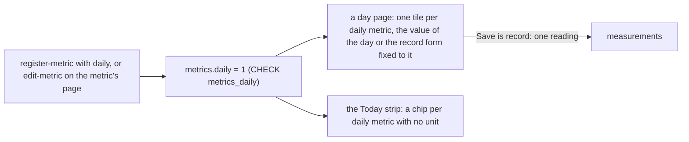

# 143 — Daily metrics: a mark on a metric, and its box on every day page

> Dated implementation record. Tests use temporary folders and synthetic data. The owner's live `life.db` is never
> opened by a test.

## Status

- **Date / baseline:** 2026-10-23, `543ba89` (master).
- **Priority:** P1. **Effort:** M. **Risk:** MEDIUM: one new column (`metrics.daily`), one new field of
  `register-metric`, one new action (`edit-metric`), a change of the Readings section of a day, and the Today strip
  reads the column in place of a 14-day window. The live file needs the column before the new binary runs.
- **Status:** IN PROGRESS.
- **Resolves:** [issue 0090](../issues/0090-the-writer-guesses-which-metrics-are-daily.md) through
  [RFC 0023](../rfcs/0023-a-daily-mark-on-a-metric.md) and [D31](../decisions/D31-daily-metrics.md).

## The owner's words (2026-10-23)

"Some metrics should be logged daily. I want to be able to configure metrics to show if they should be tracked daily
(like habits, or sleep, or mood) and provide an easy way to input all of them in the daily note."

Asked how the day page takes the values, the owner chose **one Save per metric**: the one `record` action, drawn once
per daily metric on the day, with its metric and day filled. Not a new action that writes several readings.

## What is true at the baseline

- `metrics` holds `id`, `entity_type` and `unit` and nothing else. Nothing marks a metric as asked for on every day.
- The writer guesses: the Today strip shows as a habit any metric with no unit that has a reading in the last 14 days
  (`internal/core/today.go`, `HabitDays`). Sleep (unit `h`) and Mood (`1-5`) never qualify. A habit the owner did not
  record for 14 days leaves the strip when the prompt is most needed.
- The Readings section of a day draws the tiles of the readings made that day and one "Add a reading" form.
- [RFC 0018](../rfcs/0018-no-habit-periods.md) cut the habit periods, `check-in` and the 14-day strips on 2026-10-15.
  This change is smaller than what was cut: one column, one flag, one small action, and no new write path.

## The decisions

| question | answer |
|---|---|
| where the mark lives | a column `metrics.daily` (0 or 1), the metric's own, as `unit` is ([D27](../decisions/D27-a-metric-is-a-page.md)). It cannot be derived from the readings, so it is stored |
| why not a category page named Daily | a name in Go that the file cannot see; [RFC 0001](../rfcs/0001-metric-categories.md) rejected a stored habit category; categories are the owner's pages |
| how it is set | `register-metric` takes the optional flag `daily`; the new action `edit-metric` (`POST /pages/{id}/metric`, field `daily`) changes it later, as `edit-person` changes a person |
| who may set it | any writer, as `edit-person`: an agent may be asked "track my sleep daily". `register-metric` stays owner-only |
| where the input is | the Readings section of a day: one tile per daily metric, with the value of the day or the `record` form fixed to that metric and that day; then the other metrics read that day, as now; "Add a reading" stays below for any metric |
| which days | every day page, Home included: a past day can be filled in |
| the Today strip | its habit chips are the daily metrics with no unit; `HabitDays` and the 14-day sentence are deleted |
| the box of a habit | a daily metric with no unit gets `value` as two radios, Done (1) and Not done (0); any other daily metric gets a number box with its unit as the placeholder |
| the seed of Mood | unchanged (`daily = 0`): the owner marks the metrics they want; the capture form already asks for a mood |

## Part 0 — The contract

The path of [the process](../process.md), in one commit.

1. **Issue 0090**: the guess of the writer, Sleep and Mood never prompted, a lapsed habit gone from the strip. Reproduce
   on a fresh file: register `Sleep` with unit `h`, record one reading, open Home: no prompt for it.
2. **RFC 0023**: option A keeps the guess; option B is a category page named Daily (rejected); option C is
   `metrics.daily` (recommended, additive). It makes `HabitDays` and the 14-day sentence redundant.
3. **D31**: a daily metric is one the writer asks for a reading of on every day; a day with no reading still says
   nothing ([D24](../decisions/D24-habits.md)). It cites `metrics_daily`. D24 and D7 link it in one sentence each.
4. **`schema.sql`**: inside `CREATE TABLE metrics`, as the last column before the `FOREIGN KEY` line, so that the live
   file's `ALTER TABLE ... ADD COLUMN` can give the same text:
   `daily INTEGER NOT NULL DEFAULT 0 CONSTRAINT metrics_daily CHECK (daily IN (0, 1))`, with its comment. No new
   table, view or trigger: the totals line and the ER diagrams do not change.
5. **Pages**: [day view](../cookbook/day-view.md) gains the block "the readings asked for on this day" (the daily
   metrics left-joined to the values of the day, in name order); the schema page's row of `metrics`,
   [product concepts](../architecture/product-concepts.md) and [building a writer](../guides/building-a-writer.md) say
   it in one line each; `tests/README.md` counts 292 mutants.
6. **Suites**: `facts` gains "metrics.daily takes only 0 or 1" and "a metric's daily mark may change"; `mutants` gains
   `nocheck("metrics_daily")` with the first as its witness; `cookbook` runs the new block.

## Part 1 — The writer: the mark

1. `register-metric` takes `flagField("daily", ...)`, optional, so the form draws a checkbox; `core.NewMetric` carries
   it and `RegisterMetric` writes it in both branches. An existing metric is returned as it is.
2. The new action `edit-metric`: `POST /pages/{id}/metric`, fields `id` (path) and `daily` (flag; absent is 0, as an
   unticked checkbox sends nothing). Handler beside `editPerson`; `Store.EditMetric` updates the one column and
   advances the page as `EditPerson` does. A page that is not a live metric is refused as `edit-person` refuses a
   page that is not a person.
3. `core.Page` gains `Metric` (unit, daily) beside `Person`; `pageActions` offers `edit-metric` on a metric's page, and
   the page draws it under More, boxed. `core.Metric` gains `Daily`.
4. The readings page of a metric loses the 14-day sentence and `habit_days`; it says "Asked for on every day" for a
   daily metric and links the page's form. API.md follows (`TestAPIReferenceMatchesTheCode`).
5. README: the row of `edit-metric` in the table of the surfaces; one sentence in the New metric decision. API.md: the
   action line beside `edit-person`, `daily` in the property tables.
6. Tests: the hint list; parity rows (`register-metric` with `daily`, `edit-metric` to 0 and back, a non-metric page
   refused, the mark read back); core tests of the insert and the update; the readings page words; one assertion of
   `extensions/mcp` that `edit_metric` is a tool.

## Part 2 — The day: one tile per daily metric

1. `Store.DailyMetrics` reads the live daily metrics in name order (the SQL of the cookbook block). The day view carries
   `daily` (the names) and the units of every daily metric with a unit.
2. `ReadingTiles` lists the daily metrics first, in name order, each with the last reading of the day when there is
   one; then the other metrics read that day, in order of first reading.
3. A daily tile with no reading draws the `record` form with `metric`, `day` and `import_key` fixed (hidden), `taken_at`
   and `tz` hidden, the button Save, `back` to the day, and the id `tile-<name>`. A metric with no unit gets `value`
   as the radios Done and Not done through a new form option `options` (`value=0,1`) and the words of a 0/1 value; a
   metric with a unit gets a number box with the unit as its placeholder.
4. The empty state is drawn only when there is no tile. "Add a reading" stays at the foot of the section. On a narrow
   screen a tile's form is one row.
5. Tests: the tiles of a day with a daily `Sleep` and a daily `Meditate`; a save from a tile returns to the tile and the
   tile then shows the value with Correct; a non-daily metric read that day follows the daily ones; a past day draws
   the same tiles.

## Part 3 — The Today strip

1. `Habits` selects the live metrics with `daily = 1` and no unit, with the last value of today; the 14-day window and
   `HabitDays` go.
2. The tests of the strip follow: a daily count with no reading for 60 days is a chip; a metric with no unit read
   yesterday but not daily is not.

## Part 4 — Ship

The owner's file predates the column. A one-off program, `plan143-bin OLD.sql NEW.sql LIFE.db [--dry-run]`, adds the
column and makes the stored text of `metrics` equal to the DDL, and refuses any other difference. Rehearsed on a
synthetic file. The owner runs each line: stop the service, snapshot to a new folder outside the git tree, dry run,
run, integrity check with the staged binary, install, start, and the log line is reported. Then the owner marks the
metrics they want daily.

## Done when

- `gofmt -l` is empty; `go vet ./... && go test ./...` passes at the root and in `extensions/mcp` and
  `extensions/agentic`; `staticcheck ./...` and `govulncheck ./...` are run and reported.
- Issue 0090, RFC 0023 and D31 are in their indexes; `schema.sql` has `metrics.daily` with `metrics_daily`; the suites
  count 292 mutants and are green.
- `edit-metric` is on every surface, with its README row; `register-metric` takes `daily`.
- Every day page draws one tile per daily metric with the value of the day or the record form fixed to it; the Today
  strip's chips are the daily metrics with no unit; `HabitDays` is gone.
- The live file holds the column, the binary is installed and the service restarted, with its log line reported.
