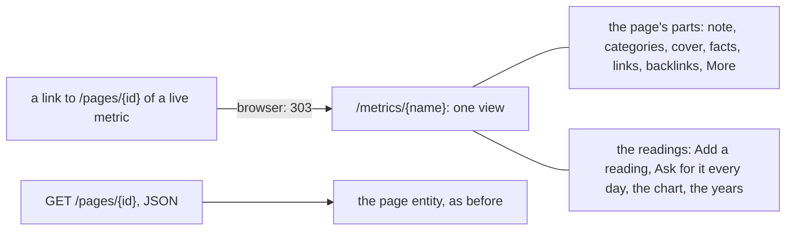

# 144 — One view for a metric: the readings and the page in one place, at /metrics/{name}

> Dated implementation record. Tests use temporary folders and synthetic data. The owner's live `life.db` is never
> opened by a test.

## Status

- **Date / baseline:** 2026-10-23, `07380db` (master).
- **Priority:** P1. **Effort:** M. **Risk:** LOW to MEDIUM: a browser change and one wider answer of the API. No
  table, no column, no trigger, no new action. The series answer of a metric grows with its page's properties, links
  and actions; a browser request of a live metric's page is redirected to its series.
- **Status:** IN PROGRESS.
- **Resolves:** the owner's words of 2026-10-23 (below). No issue: the file is right ([D27](../decisions/D27-a-metric-is-a-page.md)); the browser drew it twice.

## The owner's words (2026-10-23)

On `/metrics/Mood`, sent to `/pages/1?new=edit-metric` to mark the metric daily: "I don't like that I have the metric
page and also this /pages/1?new=edit-metric. Can't we get rid of the pages for metrics?"

## What is true at the baseline

- A metric is a page ([D27](../decisions/D27-a-metric-is-a-page.md)): one id, its title is the name, its body its
  note. The file does not change in this plan.
- The browser draws a metric twice ([plan 131](131-the-pareto-pass.md), part 3): the readings at `/metrics/{name}`
  (the head with the latest reading, Add a reading, the chart, the years) and the page at `/pages/{id}` (the note
  with Edit, the categories, the cover, the facts, the links and backlinks, and More: rename, Ask for it every day,
  typed links, file it, delete). Each links the other.
- The mark of [plan 143](143-daily-metrics.md) is set under More on the page; the readings link that form.

## The decision

One view per metric, at `/metrics/{name}`: the page's parts and the readings together. A browser request of a live
metric's page (`GET /pages/{id}`, HTML) is answered with a redirect to its series, with the query kept, so every link
to the page (a wikilink, a search hit, a backlink, a category's Filed here) lands on the one view. The JSON answers do
not change their routes: `GET /pages/{id}` still answers the page to the CLI and the MCP tools, and `GET
/metrics/{name}` answers the series, which now also carries the page. A tombstoned metric keeps its page (the series
lists live metrics only), so Restore stays where it is.

## Part 1 — The series carries the page

1. `seriesEntity` (internal/api/measurements.go) reads the metric's page through the existing page entity builder
   (`pageEntity`) and merges it in: every property of the page that the series does not set (`id`, `entity_type`,
   `title`, `body`, `version`, `created_at`, `is_day_page`, `links`, `backlinks`, `cover`, …; the page's `metric`
   object is left out, since the series has `unit` and `daily`), every link of the page but `self` and `series`, and
   every action of the page (save-body, plan, tick, carry, schedule, rename, edit-metric, set-cover, link, unlink,
   file-pages, tombstone-pages). The series keeps its class, its `self`, `all-readings` and the record action; its
   `page` link goes. One entity, one home for each fact.
2. The browser's `GET /pages/{id}` of a live metric answers `redirect{SeriesHref(title) + the query}` (the `redirect`
   type of serve.go) when the request wants HTML; JSON is unchanged. A tombstoned metric is not redirected.
3. API.md: the series section says that the answer carries the page's properties, links and actions (one sentence and
   the rows `TestAPIReferenceMatchesTheCode` asks for); the page section says that a browser request of a live
   metric's page is a redirect to its series. README: the decision "The readings of a metric" is rewritten in place
   (one view), the New metric bullet says where the mark is set, and the browser column of the surfaces table says
   "a metric: Ask for it every day" for `edit-metric`.

## Part 2 — The one template

1. page.html is split into named parts that the page and the metric both draw: the sheet (preview, the empty state,
   the body editor, the body, Filed here) and the margin (cover, facts, links, backlinks, More). The `page` template
   composes them as today; nothing a page shows changes.
2. The `metric` template (metrics.html) draws: the head (kind, title, the categories with Add, Every metric, the
   latest reading); the sheet: the note with Edit and the body, then Add a reading, then the chart and the years; the
   margin: cover, facts, links, backlinks, More (Plan a line here, Rename, Delete; a metric starts no typed link).
   Delete returns to the page, which a deleted metric keeps, with Restore. A redirect of a request that carries a
   feedback receipt moves the receipt to the address it lands on, so a toast survives it. "Ask for it every day"
   is one open form beside Add a reading (the checkbox and Save), not boxed and not under More: it is the metric's own
   setting, drawn where the owner looks. The sentences and links of plan 143 that pointed to the page go.
3. `?new=<action>` on `/metrics/{name}` opens that form, as on a page, so `?new=edit-metric` carried by the redirect
   still lands on the open form.

## Part 3 — Tests

- A browser `GET /pages/{id}` of a live metric is 303 to `/metrics/{name}` with the query kept; JSON is 200 with the
  page; a tombstoned metric's page is 200 HTML with Restore.
- The HTML of `/metrics/{name}` draws every action its page offered, each once (count the forms by href), the body
  editor, the categories, a backlink, and the open form of the mark; a Save of the mark returns to the series; a Save
  of the body returns to the series.
- `TestEveryActionOpensInABrowser`, the hints test, the parity rows and `TestAPIReferenceMatchesTheCode` stay green;
  the existing tests of `/pages/{id}` for a metric follow the redirect or ask for JSON.

## Done when

- `gofmt -l` is empty; `go vet ./... && go test ./...` passes at the root and in `extensions/mcp` and
  `extensions/agentic`; `staticcheck ./...` is clean.
- A metric has one view in the browser; a link to its page lands there; the mark is set there without a second page.
- API.md and README say so; the plan's status is set; the binary is installed and the service restarted on the
  owner's word, with its log line reported.
