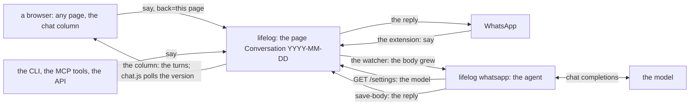
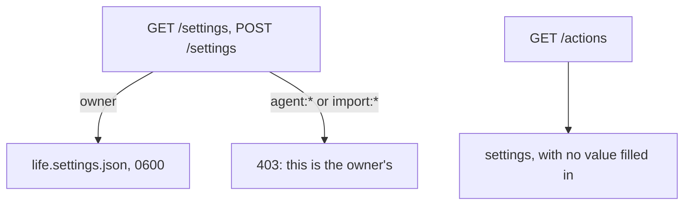

# 146 — Settings and the chat column: the model set in the app, and today's conversation on every page

> Dated implementation record. Tests use temporary folders and synthetic data. The owner's live `life.db` is never
> opened by a test; no test calls a model or WhatsApp.

## Status

- **Date / baseline:** 2026-10-28, `2d7315f` (master), after [plan 145](145-whatsapp.md).
- **Priority:** P1. **Effort:** L. **Risk:** MEDIUM. Nothing for the schema or the contract: the settings are a file
  of the application beside `life.db`, and the conversation of a day is a plain page, as plan 145 made it. The
  catalog gains two actions (`say`, `settings`), the API two resources (`/days/{day}/conversation`, `/settings`), the
  browser a column on every page, a Settings page and its first script since [plan 116](116-strip-to-the-core.md).
  The core still calls no model: the agent of plan 145 answers.
- **Status:** IN REVIEW (owner). Built in `a04e6a3` (the core and the extension) and `7757184` (the browser); the
  counter-review's findings are fixed in the commit after them: the model could read the key back through its
  `get` tool, since the extension sent no source on a read (the source goes on every request again, and the
  settings are read by a second client of the owner's); the first turn of a day said on another surface was
  adopted and never answered (an adopted page with the owner's turn last is answered, and a turn said before
  midnight is answered on its day); the conversation view waited and never updated (the one script serves it too);
  a turn is now read from its marker line to the next, so the owner's two paragraphs stay one turn and a marker
  inside a code fence forges nothing; `say` is for today, and the entity of another day offers it not; a
  conversation page keeps its title (`rename` and `promote` are not offered, and refused); the key input takes no
  autofill; the README's row and the site say what is true. The install and the restart wait for the owner.
- **Resolves:** the owner's words of 2026-10-28 (below). No issue.

## The owner's words (2026-10-28)

"We should be able to configure the OpenAI API directly from the lifelogdb app; we should have a settings page where we
can do such configurations, and also let's bring back the right chat sidebar functionality." Asked who answers the
chat: the agent extension, not the core. Asked where the settings live: an app settings file through an owner-only
action, not `life.db`. Asked what the chat looks like: the sidebar plus the page.

## The decisions

| question | decision |
|---|---|
| where the settings live | `<db>.settings.json` beside the database (`life.db` → `life.settings.json`), mode 0600, written through a temporary file. Not in `life.db`: the key is a secret, and a snapshot copies the database. Not in the contract: it is the application's, so the README records it and `docs/` says nothing. |
| what they are | `model_url` (the base URL of a server that speaks the OpenAI chat-completions protocol, ending in `/v1`), `model` (the model id), `model_key` (a bearer credential, optional). Nothing else now: a setting is added when a feature needs it. |
| the action | `settings`, `POST /settings`, owner-only: refused to an `agent:*` or `import:*` writer, never an MCP tool, on the CLI as `lifelog do settings model_url=… model=… model_key=…`, in the browser the Settings page. `GET /settings` is the resource, owner-only too: the first owner-only read that is not an action. |
| the key in the catalog | `GET /actions` offers `settings` with no value filled in: the catalog is readable by any writer. Only `GET /settings`, the owner's, fills the values, the key included, so the owner's form sends the key back as it is. A field of the type `password` is drawn as one. |
| who answers | the agent of plan 145 (`lifelog whatsapp`), which watches today's conversation page. The core calls no model (the four rings, [plan 135](135-extensions-outside-the-core.md); RFC 0015 stays). |
| the owner's turn | the action `say`, `POST /days/{day}/say`: `text` is appended to the page `Conversation YYYY-MM-DD` as the paragraph `**Owner** (HH.MM): text`, and the page is made on the first turn of the day (the category `Conversations`, the first line `[[YYYY-MM-DD]]`). On every surface. The core owns the convention now; the extension follows it through `say`. |
| the conversation read | `GET /days/{day}/conversation`: the turns of the day, parsed from the page's body, with the page's properties, links and actions when the page exists (as the series carries a metric's page, [plan 144](144-one-view-for-a-metric.md)), and `say`. A browser's `GET /pages/{id}` of a live conversation page is a 303 to it, so there is one view of a conversation. |
| the column | a right column on every page with the shell: today's turns and the composer (`say`, with `back` the page the owner is on). A Chat button opens and closes it, a popover, with no script; on a phone it is a sheet. The composer works with no script: the form posts, the page comes back with the owner's paragraph, and the reply shows on the next load. |
| the one script | `/assets/chat.js`: while the last turn of the column is the owner's, it asks `GET /days/today/conversation` every 3 seconds for the page's `version`, and on a change fetches the current page and swaps the column's content. It keeps the column's open state in `localStorage`. It is the one script of the app, and every form works without it (README). |
| the extension | reads the settings from `GET /settings` at each turn, with the owner's token and no `Lifelog-Source` (a read writes nothing; the source names the writer of rows). Its environment variables `LIFELOG_MODEL_URL`, `LIFELOG_MODEL` and `LIFELOG_MODEL_KEY` go, and the unit's `EnvironmentFile` with them. The owner's paragraph goes through `say`. |

## The design

## Part 1 — The core: the settings, `say`, the conversation

1. **The settings file.** `core.Store` gains `SettingsPath string`: `cmd/lifelog` sets it beside the database for
   `serve`, the in-process client and the temporary server of an extension (`extension.go`): the path of the
   database with `.db` cut and `.settings.json` added. `internal/core/settings.go`: `Settings{ModelURL, Model,
   ModelKey string}`, `ReadSettings` (a missing file is empty settings), `WriteSettings` (JSON, mode 0600, a
   temporary file then a rename, as `db` writes a snapshot). An empty `SettingsPath` (a test store with no path)
   refuses both with an error that says so.
2. **The catalog.** `settings`: `POST /settings`, `Owner: true`, fields `model_url` (text, "Model server, the base
   URL ending in /v1"), `model` (text, "Model id"), `model_key` (`password`, "Model key, when the server needs one").
   None is required: an empty field clears the setting. The answer is the settings entity (below) with a `result`
   sentence. `say`: `POST /days/{day}/say`, fields `day` (path, date; `today` allowed as every day field), `text`
   (textarea, required, "To the agent"); `Hint`: "Write to the agent. It answers here when it runs." The answer is the
   conversation entity of the day, with a `result` of the sync shape (what `save-body` answers). `say` is not the
   owner's: the WhatsApp extension relays the owner's words with it, and an MCP tool `say` exists.
3. **The field type `password`.** API.md's types gain it: a text that the catalog never fills in. `GET /actions`
   leaves the value of every field of `settings` empty; `GET /settings` fills them. `TestEveryActionOpensInABrowser`
   opens `settings` on `/settings` (the action is drawn where its resource is).
4. **The resources.** `GET /settings`, class `settings`, owner-only (`requireOwner` on the source, as the owner's
   actions): properties `model_url`, `model`, `model_key` (absent when empty), the action `settings` with the values
   filled, the link `index`. `GET /days/{day}/conversation`, class `conversation` (and `page` when the page exists):
   properties `day`, `turns[]` (`who`: `owner` or `lifelog`; `at`: `HH.MM`; `text`; `tools[]`: the tool lines of a
   `lifelog` turn, as written), and the page's properties when it exists (`id`, `title`, `body`, `version`, …, as
   the series carries them); the page's links but `self`; the page's actions; the action `say` with `day` filled; the
   link `index`. A day with no page has `turns` empty and `say` only. A browser's `GET /pages/{id}` of a live
   conversation page is a 303 to `/days/{day}/conversation` with the query kept; JSON is unchanged.
5. **The convention, in one file** (`internal/api/conversation.go`): `ConversationTitle(day)`, the category
   `Conversations`, the first line, the owner's paragraph, the parse of the turns. A turn is a paragraph (blank lines
   around it) whose first line starts with `**Owner** (HH.MM): ` or `**lifelog** (HH.MM): `; the lines that start
   with ``- ` `` before a `lifelog` paragraph are its tool lines; any other paragraph is a turn of `who` `text`
   (an edit by the owner, the first line), shown as it is. API.md states the format under the conversation class:
   it is what an agent writes, in any language. The time is the server's local time (`Store.Zone`).
6. **API.md and the README.** API.md: the two classes, the two actions in the catalog section's list, the type
   `password`, the owner-only line names `/settings` and `settings`. README: the surfaces table gains `say` (API,
   `do say`, `say`, "every page: the chat column; a day: Chat") and `settings` (API, `do settings`, never a tool,
   "Settings"); the owner-only decision names `settings`; a decision "The settings file" (where, what, why not
   `life.db`); a decision "The conversation of a day" (the convention, `say`, the agent answers, the column, the one
   script); the quick-start block gets `lifelog do settings model_url=http://HOST/v1 model=ID`.
7. **Tests.** `settings`: the file is made with mode 0600 and read back; an empty field clears; `GET /settings` and
   `POST /settings` are 403 to `agent:x` and `import:x`; `GET /actions` carries no value for `model_key`;
   `lifelog do settings` and `lifelog get /settings` on the CLI. `say`: the first turn makes the page with the
   category and the first line, the paragraph has the stamp of the server's clock, a second turn appends, `today`
   works, an empty `text` is 422 and writes nothing, the answer is the conversation entity with `turns`. The parse:
   a hand-written body with an owner turn, a lifelog turn with two tool lines, a free paragraph, and CRLF endings,
   gives the expected turns. The redirect of a conversation page in a browser; JSON unchanged.
   `TestTheTableOfTheSurfacesIsTheCatalog` and `TestParityOfTheSurfaces` cover the two actions.

## Part 2 — The browser: the Settings page, the conversation view, the column

1. **Settings.** `/settings` draws the three fields in one form, Save the one loud button, the key as a password
   input with its value; a save is 303 to `/settings` with the toast. The rail's owner line gets Settings beside
   Snapshot.
2. **The conversation view.** `/days/{day}/conversation` draws the day's turns as a thread (the owner's on one side,
   the agent's on the other, the tool lines small, the text as rendered markdown as a body is) and the composer
   (`say`) at the end, with the page's margin (Edit the body, the categories, the links) when the page exists. A day
   with no turns says that the agent answers here when it runs. The rail's sections gain Chat, to today's
   conversation. The view is the full size of the column (below), and the column is not drawn on it.
3. **The column.** `layout.html`: on every page with the shell but the conversation view, a right column `#chat`:
   today's turns (the shell reads today's conversation page, as it reads the clock for the strip) and the composer,
   a form of `say` with `back` the current path. A Chat button (bottom right, the rail on a phone) toggles it: a
   popover, closed by Close, Escape or a tap outside, with no script, as the More sheet. When the last turn is the
   owner's, a line "…" waits under it. Under 900 px the column is a sheet over the page. The styles follow the
   materials (parchment on dark oak, wood for the bar); no colour outside the tokens; the contrast test holds.
4. **The script.** `/assets/chat.js`, served as the icons are, loaded by the layout with `defer`. It does three things
   and nothing else: when the column's last turn is the owner's, it asks `GET /days/today/conversation` (JSON) every
   3 seconds and, when `version` differs from the one the column carries (`data-version`), fetches the current page
   (`location.href`, `Accept: text/html`) and swaps `#chat`'s content; it submits the composer with `fetch` and
   swaps the column from the answer, so the page does not reload (the form still posts without it); it keeps the
   open state in `localStorage` and reopens the column on load. No framework, no build step, under 80 lines.
5. **Tests.** The Settings page draws the form with the values and the password type; the conversation view draws the
   turns and the composer; a day page draws the column with today's turns and a `say` form whose `back` is the day;
   the conversation view draws no column; the Chat and Settings links; `chat.js` is served; the contrast test and
   the hints test stay green; the parity rows.

## Part 3 — The extension follows the core

1. The settings from `GET /settings` at each turn (the owner's token; no source header on a read): with no
   `model_url` or `model`, the turn's reply is one line, "No model is set: open Settings in lifelog" (and the log
   says it), and the agent keeps running. The environment variables go; the README, the unit and `deploy/` change
   (a reference copy `deploy/lifelog-whatsapp.service` and its row, as the other units have).
2. The owner's paragraph goes through `say` (`day` today, `text`); the page is read through
   `GET /days/{day}/conversation` (its `id`, `version`, `body`), so the extension holds no title and no category of
   its own. The reply and the tool lines stay as they are: the format is now API.md's.
3. The client sends `Lifelog-Source` on a write only.
4. Tests: the agent tests on the fake catalog gain `say`, `/settings` and `/days/{day}/conversation`; the e2e sets
   the model with `lifelog do settings --db F` before the run and finds the key in no output.

## Done when

- `gofmt -l` is empty; `go vet ./... && go test ./...` passes at the root and in `extensions/whatsapp`;
  `staticcheck ./...` is clean; the contrast test holds.
- The owner sets the model on `/settings`, writes in the column on a day page, and the reply appears in the column
  within seconds while `lifelog whatsapp` runs, and on the phone too.
- API.md, the README and the extension's README say so; the plan's status is set; the binaries are installed and
  the service restarted on the owner's word, with the log line reported.
