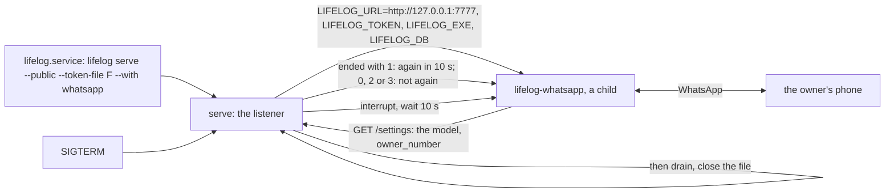

# 147 — serve --with: the server runs an extension beside itself, so the agent and the API are one unit

> Dated implementation record. Tests use temporary folders, synthetic data and a fake extension; no test calls a
> model or WhatsApp. The owner's live `life.db` is never opened by a test.

## Status

- **Date / baseline:** 2026-10-28, `9cc622c` (master), after [plan 146](146-settings-and-the-chat-column.md).
- **Priority:** P1. **Effort:** M. **Risk:** MEDIUM. Nothing for the schema or the contract. `lifelog serve` gains a
  flag and a child process; the contract of an extension gains the run by `serve`; the settings gain the owner's
  number; the WhatsApp extension loses its `--owner` flag. The core still names no third party and dials nothing:
  the name of the extension is a word of the unit's line.
- **Status:** IN REVIEW (owner). Built in `e81a097`; the counter-review's findings are fixed in the commit after
  it: the child's address was always the IPv4 loopback (now the listener's own host, the loopback for one on every
  interface); `--with NAME` twice ran two children on one session (refused); the lines say the real delay, a kill
  on the stop and an end by a signal; the extension's wait for the number says each state once and again when it
  changes, and the start time is taken before the wait; the deploy page names `lifelog-whatsapp` among the programs
  to build, and the reference unit uses `KillMode=mixed`. The e2e holds the start under `serve --with whatsapp`, the
  exit 2 of an unpaired child and the stop with 0, not an answered `say`: that needs a paired session, which no test
  has. Not run: Windows, where a stop gives the child no interrupt and kills it after 10 seconds.
- **Resolves:** the owner's words of 2026-10-28 (below). No issue.

## The owner's words (2026-10-28)

After the pairing of the agent's number: "I wonder if we can have WhatsApp support while the main app is running
rather than having a second service running." Asked how: `serve --with whatsapp`, the number in Settings.

## The decisions

| question | decision |
|---|---|
| where the agent runs | as a child of `lifelog serve`: `lifelog serve --with NAME` runs the program `lifelog-NAME`, found as `lifelog NAME` finds it (beside the program first, then `PATH`), after the listener is up, with the API's own address and token, and keeps it running. The core never imports it: it starts a process and waits for it, as `lifelog NAME` does. |
| the environment of the child | `LIFELOG_URL` is the listener's own address on the loopback (`http://127.0.0.1:PORT`; a listener on every interface is reached on the loopback too), `LIFELOG_TOKEN` the token of a `--public` listener, `LIFELOG_EXE` and `LIFELOG_DB` as for any extension. stdin is empty (`/dev/null`); stdout and stderr are the server's, so the lines go to the journal. No arguments: an extension that `serve` runs configures itself from the settings. `--with` and `--tls-cert` together are refused for now: the child would have to trust the certificate. |
| when the child ends | exit 0: it ended by its own choice, and is not started again. Exit 2 or 3: the owner must act first (not paired, logged out, replaced, banned, outdated: the codes of [plan 145](145-whatsapp.md)); the line says so, and it is not started again until `serve` restarts. Any other end (1, a signal, a crash): started again after 10 seconds, with the line. The rule is the contract's, for any extension `serve` runs. |
| the stop | on an interrupt or SIGTERM, `serve` interrupts the child first and waits for it (10 seconds at most, then a kill), then drains its own requests and closes the file: the child may still write while it ends. |
| the owner's number | a setting, `owner_number`: the digits of the owner's phone number with the country code, the one number the agent on the phone answers. On the Settings page, in `lifelog do settings`, in `GET /settings`. The extension reads it before it connects; with none set it says so once in its log, looks again every 30 seconds, and connects when it is set, so the owner sets it on the page with no restart. `--owner` goes. `--terminal` needs no number. |
| one unit | `deploy/lifelog.service` shows `--with whatsapp` as a commented line, and `deploy/lifelog-whatsapp.service` goes, with its row. |

## The design

## Part 1 — The core: `serve --with`

1. `cmd/lifelog/main.go`: the `serve` row gains `--with NAME` (repeatable; `opts.serve.with []string`); the usage says
   what it does in one line. `prepareServe` finds each program with `findExtension` before anything opens (an unknown
   name refuses the command with `life.db` untouched) and refuses `--with` with `--tls-cert`.
2. `cmd/lifelog/serve.go`: after the line "serving …", `serve` starts each child (`cmd/lifelog/with.go`): the path,
   no arguments, `extensionEnv` with the loopback URL of the listener and `LIFELOG_TOKEN` when public, stdin
   `/dev/null`, stdout and stderr the server's. One goroutine per child, owned by `serve`: it runs the process, and
   on its end applies the rule (0, 2, 3: a line, stop; else a line, 10 seconds, again; `ctx` ends the wait). A
   package variable `restartDelay` holds the 10 seconds so a test shortens it. On `ctx` done, `serve` cancels the
   children (an interrupt, `WaitDelay` 10 seconds, as `extension` does), waits for every goroutine, then drains the
   server (`serveHTTP` gets a context that ends after the children ended). The lines: `lifelog: with NAME: started
   (pid N)`, `lifelog: with NAME: ended with status S: not started again (the owner acts first)`, `lifelog: with
   NAME: ended with status S, started again in 10 s`, `lifelog: with NAME: ended`.
3. `internal/core/settings.go`: `OwnerNumber string` (`owner_number`), digits only when set (a value that is not
   digits is 422 from the action). The catalog's `settings` gains the field `owner_number` (text, "Your phone number:
   digits with the country code; the agent on the phone answers this number alone"); the Settings page draws it;
   API.md's `settings` class and the README decision gain it.
4. Records: `extensions/README.md` gains the section "Run by serve" (the environment, stdin, the exit-code rule,
   the stop) and the row of `extensions/whatsapp` changes its command line; `README.md`: the `serve` decision gains
   `--with`, the quick-start block gets `lifelog serve --public --token-file ~/life/token --with whatsapp` beside the
   serve lines, the settings decision names `owner_number`; `deploy/lifelog.service` gets the commented line and
   `deploy/lifelog-whatsapp.service` and its row go.
5. Tests (`cmd/lifelog/with_test.go`, with the fake extension the extension tests build): the child gets
   `LIFELOG_URL` of the listener (it answers the child's `GET /` with 200) and `LIFELOG_TOKEN` when public, and an
   empty stdin; a child that exits 1 is started again after `restartDelay` (set short), and the line is logged; a
   child that exits 2 or 3 is not started again; a child that exits 0 is not; two `--with` run two children; an
   unknown name refuses before the listener opens; `--with` with `--tls-cert` is refused; on SIGTERM the child is
   interrupted and awaited before the drain (a child that writes `POST /days/today/capture` while it ends gets
   200, the subprocess tests of serve show how); `settings` with an `owner_number` that is not digits is 422.

## Part 2 — The extension follows

1. `--owner` goes. The number comes from `GET /settings` (`owner_number`) through the settings client, read before
   the connection; with none, one log line "no owner number: set it in Settings", a look every 30 seconds, and the
   connection when it is set. `--terminal` takes no number: the terminal's sender is the word `terminal`, and the
   agent answers it.
2. The README: the run by `serve --with whatsapp` is the way; the lines by hand stay for a try; no unit of its own.
3. Tests: the agent on the fake API with no `owner_number`, then with one (the wait is driven by the test's tick);
   the e2e runs `lifelog whatsapp --terminal` with no `--owner` and `lifelog serve --with whatsapp --db F` against
   the real binaries, both built: the child starts, its log line appears, a `say` through the API is answered on
   the page (the fake model), and SIGTERM ends both with exit 0.

## Done when

- `gofmt -l` is empty; `go vet ./... && go test ./...` passes at the root and in `extensions/whatsapp`;
  `staticcheck ./...` is clean.
- The owner's unit runs `lifelog serve --public --addr 127.0.0.1:7777 --token-file … --with whatsapp`, the journal
  shows the child's start, and a message from the owner's phone is answered; the plan's status is set.
