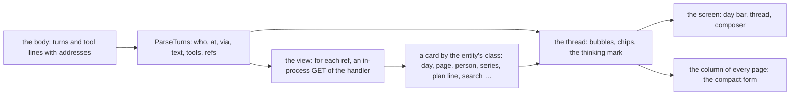

# 148 — The chat screen: the conversation as a chat, with a card for each thing the agent touched

> Dated implementation record. Tests use temporary folders and synthetic data; no test calls a model or WhatsApp.
> The owner's live `life.db` is never opened by a test.

## Status

- **Date / baseline:** 2026-10-28, `87a7133` (master), after [plan 147](147-serve-with-an-extension.md).
- **Priority:** P1. **Effort:** L. **Risk:** LOW to MEDIUM. The browser's conversation view and its column change;
  the conversation entity gains two derived properties of a turn (`via`, `refs`); the owner's paragraph of `say`
  gains the writer's name when a relay wrote it. No table, no action, no route; the core still calls no model.
- **Status:** IN REVIEW (owner). Built in `cbc25ad` (via and refs) and `127d11d` (the screen and the cards); the
  counter-review's findings are fixed in the commit after them: the card fetch carried the page's own source, so a
  tool line on the page could make the owner's browser run an owner-only read (the fetch carries `agent:card` now,
  which the owner-only rule refuses: a plain link); the `⋯` menu was clipped by the screen, so Edit and Delete were
  out of reach (a popover now, closed by Close, Escape or a tap outside, with the page's Links and Backlinks in it);
  a relay's name with a colon broke the marker (`via` takes a colon); the composer lost its focus after Enter; an
  address beyond the newest 36 drew nothing (its link now); the extension's e2e holds the relay part. The contrast
  test needed no new pair: the new classes use the aliases of the materials. Screenshots on a synthetic database:
  the screen, the menu and the menu with Edit open, on the desktop and the phone. Live since 2026-10-28 19:20 (the
  binary installed, the service restarted with its agent, the previous binary kept as `lifelog.prev`).
- **Resolves:** the owner's words of 2026-10-28 (below). No issue.

## The owner's words (2026-10-28)

"I don't like the Chat page, it looks like a page, not like a modern agentic chat UI." On the mock-up: "Sounds
good. I want the chat UI to also reference pages or metrics or people or days with a nice card view or something;
also the chat UI can show small bits of UI based on the Siren response."

## The decisions

| question | decision |
|---|---|
| the screen | the conversation view is one screen, not a page: a thin day bar (Chat, the day, chips of the last days, a `⋯` menu with the page's own actions), a thread that fills the height and starts at its newest turn, a composer pinned at the bottom. The rail stays. No page header, no categories row, no margin. The mock-up of 2026-10-28 is the picture ([the file](148-the-chat-screen.mockup.html)). |
| the grammar | the owner's turns on parchment at the right, the agent's in the wood well at the left, each with who and the time; a turn relayed by an extension says so ("You · via whatsapp"); the tool calls as chips above the agent's bubble; a three-dot mark while the agent answers; Enter sends and Shift+Enter breaks a line (the form still posts with no script). |
| the cards | each address an agent's tool line names (`→ [href](href)`) is a thing of the database: the view resolves it by an in-process request to its own handler and draws a card by the entity's class, as the browser draws a value by its type. A card is a link to the thing. At most six cards a turn; an address that answers an error draws a plain link. |
| the card by class | `day` and `day-page`: the leaf (the month, the number), the mood, the first two lines of the journal, the reading tiles; `page`, `person`, `place`, `file`: the kind's icon, the title, the first line of the body, the cover as a small square when there is one; `series` (a metric): the name, the latest reading with its unit and day, the line of recent readings the Metrics board draws; `plan line`: the line with its box and dates; `measurement`: the value, the unit and the day; `search`: the count and the first three hits as rows; `conversation`: the day and the count of turns. Anything else: the title and the class. |
| the chips in the words | a `[[wikilink]]` in a turn's words is drawn as a chip (a bordered link with the title), by CSS on the link the markdown gives; no lookup of its kind. |
| the column | the column of every page draws the same thread template, so it gets the cards in their compact size (one line each) and the thinking mark; its composer gets Enter to send. |
| the API | the conversation entity's `turns[]` gain `via` (the writer that relayed the turn, absent when none) and `refs[]` (the addresses of the tool lines, in order, unique; absent when none), both derived from the body by the parse. `say` writes the owner's paragraph as `**Owner** (HH.MM, via NAME): text` when the writer is an `agent:*` or `import:*` source (NAME without its prefix); the marker's part `, via NAME` is optional in the parse. API.md states both. |

## The design

## Part 1 — The core: `via` and `refs`

1. `internal/api/conversation.go`: the marker regexp takes an optional `, via NAME` inside the brackets
   (`**Owner** (14.37, via whatsapp): `); `Turn` gains `Via string` (`via`, omitempty) and `Refs []string`
   (`refs`, omitempty): the hrefs of the turn's tool lines, read from `→ [href](href)` or `→ href`, in order,
   unique, paths only (a value that does not start with `/` is not a ref). `ownerParagraph` takes the source: an
   `agent:*` or `import:*` writer gives `, via NAME` with the prefix cut; any other writer gives the marker as today.
2. API.md: the conversation class's property table (`turns[].via`, `turns[].refs`) and the format of the page (the
   optional part of the marker; the agent's tool line names the address of what it touched, as `- \`name\` →
   [href](href)`, and the browser draws it as a card).
3. Tests: hand-written vectors for the marker with and without `via`, the refs of a turn with two tool lines and
   an error line, a ref that is not a path; `say` as `agent:x` writes `via x`, as `cli` writes none; the entity
   carries `via` and `refs`; `TestAPIReferenceMatchesTheCode`.

## Part 2 — The browser: the screen and the cards

1. **The screen.** `conversation.html` becomes the chat screen of the mock-up: the day bar (the title Chat, the day
   in words, chips of the last three days with the page, Today marked; a `⋯` menu, a `
`, with the page's
   actions: Edit the page, Plan a line, the categories, Delete, and the link to the day view); the thread
   (`.thread`, a reversed flex column so it starts at its end with no script, the turns inside a `72ch` measure);
   the composer pinned (`say`, the textarea growing to 40 vh, the Say button, the hint line). The page's parts the
   margin drew are under `⋯` or gone (the facts); `page-margin` is not drawn. The screen takes the height of the
   viewport in the shell (`.column` of the shell gets no padding on this view, the screen is a grid of three rows).
2. **The grammar.** The `thread` template: a turn has `.meta` (who: You, lifelog; `via` as "· via NAME"; the time),
   the chips of the tool lines (`.tools`, name and the words after it), the bubble (`.bubble`, the words as markdown,
   wikilinks as chips by CSS), the cards (below). A date separator above the first turn. The waiting line becomes
   the three-dot mark (`.thinking`, animated, still under reduced motion).
3. **The cards.** `internal/api/cards.go`: for each ref of a turn, an in-process `GET` of the href with
   `Accept: application/vnd.siren+json` through the server's own handler (`h.mux` with a recorder; the request
   carries the source and the authority of the page's request, so a public listener's guard holds), decoded as a
   Siren entity, at most six a turn, each href once a view; a non-2xx answer gives a card of the plain link. The
   view draws `card` by the class, with the parts the plan's table names, reusing the existing components (the leaf,
   the reading tile, the row, the kind icon, `sparkLine`). A card is an `<a class="card card-KIND">`.
4. **The column** draws the same `thread` template with `.compact` on `#chat`: a card is one line (the icon, the
   title, one value); the thinking mark; the composer gets the keyboard rule.
5. **The script** (`chat.js`): Enter in a `.chat-form` textarea submits, Shift+Enter inserts a line; after a swap the
   thread stays at its end. Still under 80 lines, still optional.
6. **README**: the decision "The conversation of a day" gains the screen and the cards in two sentences; the
   surfaces table is unchanged.
7. **Tests.** The screen: the day bar with the chips and Today marked, the `⋯` menu with Edit and Delete, no
   `page-margin`, no categories row, the thread's turns in order with `via`, the composer with `back` the screen;
   the cards: a turn whose tool lines name a day, a page, a person, a metric's series, a plan line and a search draws
   one card each with the named parts, in that order, and an address that is a 404 draws the plain link; six refs
   at most; the column draws the compact cards; the hints test, the contrast test (the new classes in both themes),
   `TestEveryActionOpensInABrowser`, the parity rows stay green. Screenshots (desktop and phone, light and dark)
   before the status is set.

## Done when

- `gofmt -l` is empty; `go vet ./... && go test ./...` passes at the root and in `extensions/whatsapp`;
  `staticcheck ./...` is clean; the contrast test holds.
- The Chat section is the screen of the mock-up, with a card for each thing the agent touched, on the desktop and
  on the phone; the column shows the compact cards; the plan's status is set and the binary is installed and the
  service restarted on the owner's word.
