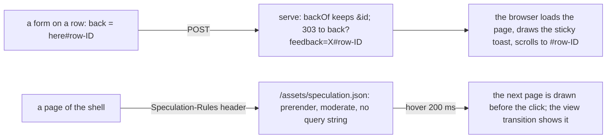

# 149 — The browser on the current platform: HTML and CSS in place of a library

> Dated implementation record. Tests use temporary folders and synthetic data. The owner's live `life.db` is never
> opened by a test.

## Status

- **Date / baseline:** 2026-10-28, `f59554d` (master), after [plan 148](148-the-chat-screen.md).
- **Priority:** P2. **Effort:** M. **Risk:** LOW. The browser's sheets and templates change; one sentence of
  [API.md](../../API.md) (the field `back` may carry an id fragment); two response headers and one asset route.
  No table, no action, no MCP tool; the one script does not change.
- **Status:** IN REVIEW (owner). Parts A, B and C are on master: `c0bd381` (a write returns to its row), `90db28b`
  (fields grow, one form open at a time, `enterkeyhint`, `<search>`, the alert's focus), `b807157` (the anchored
  menus), `98ca42e` (a plan row's group), merged in `7e936c1`; `5483aef` folds the turn's time into `At` after the
  stamp became `HH:MM` (`e401109`). Part D is on master in `479ba6e`, merged in `a991504`: the
  `Speculation-Rules` header and its rules file, `Vary: Accept`, the rail and the phone's bars held still across a
  navigation, the stable scrollbar gutter, `overscroll-behavior` on the sheets. The counter-review's findings are fixed in the
  commit after them: the rule that excluded a query string, `/*\?*`, has the search `*`, which an empty search
  matches, so it excluded every address and nothing was prerendered (the rule is `/*\?*=*` now, probed with a
  URLPattern implementation: a Go test cannot run one); the sticky toast covered the pick bar on a list after a
  delete-many (it sticks only on a page opened at a row, `:root:has(:target)`); the body editor had fallen from its
  twelve rows to the base minimum (its details is `.body-editor`, twelve lines least); the New menu resets the
  popover's inset as the chat menu does; the view test renders a week, which draws a body and the plan rows. Noted,
  unverified: Chromium prerenders only on a secure context, so on a plain-HTTP origin the header is accepted and does
  nothing. Part E is not built. The screenshots of Parts A and C are not taken yet: the review server needs the
  owner's hand (the session may not run `lifelog serve`). The deploy waits for the owner's word.
- **Resolves:** the owner's words of 2026-10-28 (below). No issue.

## The owner's words (2026-10-28)

"I am thinking if it's worth to implement htmx or at least htmz or something minimal to bring more interactivity to
the app and enhance its UI/UX." The answer was no: both undo the one-script rule of 2026-10-14
([plan 108](108-the-browser-made-current.md), [plan 146](146-settings-and-the-chat-column.md)), and `chat.js` already
does the in-place swap for the one place that needed it. Then: "Let's then try to enhance using the latest html and
css features. Do a thorough research."

The research ran two ways: an inventory of what the browser uses and where it rubs (every template, both sheets,
`serve.go`, the tests that pin the HTML), and the platform's state as of October 2026 from primary data (web.dev
Baseline 2025 and 2026, the web-features explorer, MDN browser-compat-data). The browser already uses most of the
platform: popover, invoker commands, `closedby`, `@layer`, container queries, `light-dark()`, `:has()`,
`@starting-style`, cross-document view transitions, `base-select`, `::details-content`, a scroll-driven animation,
`field-sizing` on two boxes. What remains is a short list of real frictions, each with a native fix.

## The decisions

| question | decision |
|---|---|
| the floor | plan 108's: the current Chromium, Firefox and Safari; a Baseline feature is used plainly, a Chromium-only one as an enhancement inside `@supports`. |
| a write's return | the owner (2026-10-28): the field `back` may carry an id fragment (`/plans#row-7-3`), so a write returns to its row. The toast sticks to the top of the column, still in flow, so it stays in view after the browser scrolls to the row. |
| prerender | the owner (2026-10-28): the previous and next page are prerendered on hover by a `Speculation-Rules` response header (Chromium only; Firefox has none, Safari has it behind a flag). Zero script, no element on the page; no URL with a query string, so no receipt is consumed and no form is opened ahead. |
| the menus | the owner (2026-10-28): the New menu and the chat screen's `⋯` hang from their buttons by anchor positioning (Baseline since January 2026); built, then reviewed by screenshots, not a mock-up first. The centred box stays as the fallback. |
| not taken | `popover="hint"` and `interestfor` (not Baseline), `hidden="until-found"` (a `details` opens on find by itself), an animated `details` (`calc-size`, Chromium only), `text-box-trim` (108: it moves the leaf's number), `@scope`, style queries, `sibling-index()`, `if()`, `corner-shape`, typed `attr()` (no rule needs them, or not Baseline), `content-visibility: auto` (the lists are not slow), a `<meter>` on the Today strip (a design change: mock-up first, another plan), a habit chip that posts in one step (a second drawing of the `record` form; the owner's word). |

## The frictions found, and the feature that fixes each

| friction (where) | fix | status (October 2026) |
|---|---|---|
| Every write redirects to the top of the page: a Done on `/plans` (200 rows) or a tick in a body loses the place; `backOf` refuses `#`. | `back` keeps an id-shaped fragment; rows carry ids; the 303 goes to `back?feedback=X#row-…`. The browser scrolls there, and the fragment is the focus start. | HTML, always |
| The toast at the top is out of view once the page scrolls to the row. | `position: sticky` on the open toast. | widely available |
| The body editor's textarea is a fixed `rows` 12 to 40; the chat column's box has no `field-sizing`. | `field-sizing: content` on every textarea, a min from its class and a max in `vh`; `rows` stays as the fallback. | Baseline 2026-06 (Chrome 123, Safari 26.2, Firefox 152) |
| A page's More row (link, unlink, plan, rename, …) and a plan row's Carry and Schedule can all be open at once. | `
`: one form open per row. | Baseline 2024-09 |
| The New menu is centred on the screen; the `⋯` menu is fixed at a corner. | anchor positioning: `anchor-name`, `position-anchor`, `position-area`, `position-try-fallbacks`. | Baseline 2026-01 (Chrome 125, Firefox 147, Safari 26) |
| The sidebar and the phone bars cross-fade with the page on every navigation. | `view-transition-name` on the rail and the bars: they hold still, the column fades. | Chromium and Safari 18.2; Firefox skips the transition |
| The scrollbar comes and goes between pages, so the column jumps sideways in the cross-fade. | `scrollbar-gutter: stable` on `html`. | widely available |
| Scrolling inside the More sheet or the chat column scrolls the page behind it. | `overscroll-behavior: contain` on the sheets. | widely available |
| Prev, next and the day arrows are full navigations. | prerender on hover by the `Speculation-Rules` header. | Chromium 121; Firefox none; Safari 26.2 behind a flag |
| One URL answers HTML or Siren by `Accept` with no `Vary`. | `Vary: Accept` on every entity answer. | HTTP |
| The chat composer's phone keyboard says "return"; a chat turn's `<time>` has no `datetime`; the search forms are plain `<form>`s; the error page's alert is never focused. | `enterkeyhint="send"`; `datetime`; `<search>`; `tabindex="-1" autofocus` on the alert. | widely available |
| The sticky pick bar and the sticky toast have no edge when stuck. | `@container scroll-state(stuck: top)` draws the drop shadow. Enhancement. | Chromium 133 only |

## The design

## Part A — Writes return to the row

1. `internal/api/serve.go` `backOf`: keep a fragment that matches `#[A-Za-z0-9_-]{1,64}` after the path and the
   query; any other `#` still drops the value. The comment says why: a fragment is never sent to the server; it
   only names where the page opens. `feedback.put` keeps the fragment when it appends `?feedback=` (the order is
   `?query#fragment`); a test holds it.
2. Row ids, unique on every page (`TestEveryViewRenders` refuses a repeated id):
   - `plan.html` `planrow`: `<li id="row-PAGE-LINE">` (the page id and the line: `/plans?order=page` draws many
     pages' lines on one page), and every `back` in the row (tick, Carry, Schedule, Reopen) is `Here#row-PAGE-LINE`.
   - `view/markdown.go` tick buttons: the button gets `id="box-N"` (its form already has `tick-N`), and its `back`
     ends in `#box-N`.
   - Readings, categories and Browse follow the same pattern in a later plan.
3. `app.css` the toast: `position:sticky; inset-block-start:0` while open, under the fixed top bar on a phone as
   the pick bar does. The comment of the toast says why.
4. Docs: [API.md](../../API.md) (the sentence on `back`: a path on this server, with an id fragment that names where
   the page opens); [README](../../README.md): the paragraph on `back`, and the ids a template generates (the
   `datalist`'s, the tick form's, and a row's a write returns to).
5. Tests: `TestBackOf` (`/plans#row-1-3` kept; `/plans#`, `/plans#a b`, `/#<script>` dropped);
   `TestABrowserFormReturnsToThePageThatSentIt` with a fragment case, the Location `path?feedback=…#row`; a view
   test that the plan rows carry the ids their `back` names.

## Part B — Fields and semantics (all Baseline)

1. `base.css` textarea: `field-sizing:content` with a `max-block-size` (60vh; 45vh on a phone, already there). The
   minimum stays per class as today (typed `attr(rows)` is not Baseline). `rows` stays on the server as the fallback
   for an engine without `field-sizing`. The rules of the capture and the chat screen fold into the base rule; the
   chat column's box gets the same.
2. The More row of a page and a plan row's Carry and Schedule: `name` on the `boxed` details of one row, so one
   form is open at a time. `boxed` takes an optional name.
3. `enterkeyhint="send"` on the two chat textareas. `datetime` on a chat turn's `<time>`.
4. `<search>` around the palette form and the root search form.
5. The error page: `tabindex="-1" autofocus` on the alert, so a reader hears it first (the base sheet already styles
   `[role=alert]:focus`).
6. Tests: the sheets test adds the textarea rule; the shell test the `<search>`; a chat view test the `enterkeyhint`;
   the forms test the `name` on the boxed details of a row.

## Part C — Anchored menus, reviewed by screenshots

1. `app.css`: `anchor-name` on the rail's New button; the open menu takes `position-anchor`, `position-area:
   block-end span-inline-end`, `position-try-fallbacks: flip-block, flip-inline`, a small margin and no dim backdrop,
   inside `@supports (position-area: block-end)`; the centred box with its backdrop stays for an engine without. On
   a phone the menu stays centred (the New button is in the top bar).
2. The chat screen's `⋯`: the same from its button; the fixed `inset` stays as the fallback.
3. Review: the review server on a synthetic database and the screenshot script, desktop and phone, light and dark,
   menu open and closed, the fallback once with anchor positioning disabled. The owner looks at the shots before the
   deploy.

## Part D — Navigation

1. `serve.go`: every HTML answer of the shell (not the login, not a Siren answer) carries
   `Speculation-Rules: "/assets/speculation.json"`. `GET /assets/speculation.json` is served as the icons are, as
   `application/speculationrules+json`, `public, max-age=3600`. The rules: prerender, `eagerness: moderate`, where
   the href matches `/*` and not `/*?*`, not `/assets/*`, not a link with `target` or `download`, and not a GET that
   redirects or changes state (list them at implementation: the random day, and Log out if it is a GET).
   `chat.js` runs in a prerendered page too: it polls only while the three dots are drawn and guards `showPopover`;
   its comment says so, no change.
2. `serve.go`: `Vary: Accept` on every entity answer.
3. `app.css`: `view-transition-name` on the rail and the phone bars; `scrollbar-gutter: stable` on `html`;
   `overscroll-behavior: contain` on the More sheet, the chat column and the `⋯` menu.
4. Tests: the header on a shell page, absent on the login and on a Siren answer; the rules route's content type and
   that its body parses; `Vary: Accept`; the one-script tests still hold; the asset test's cache values.

## Part E — Enhancement (Chromium only)

`container-type: scroll-state` on the pick bar and the toast, and on a child of each
`@container scroll-state(stuck: top)` draws the stuck edge, inside `@supports (container-type: scroll-state)`. Ten
lines; dropped if the shots show nothing worth it.

## What changes where

| path | change |
|---|---|
| `internal/api/serve.go`, `feedback.go` | `backOf` keeps an id fragment; `put` keeps it; the header; `Vary`; the rules route |
| `internal/api/view/html/plan.html`, `view/markdown.go` | row and box ids; `back` with the fragment |
| `internal/api/view/html/layout.html`, `page.html`, `conversation.html`, `root.html` | `boxed` with `name`; `enterkeyhint`; `datetime`; `<search>`; the alert's focus |
| `internal/api/view/html/base.css`, `app.css` | the textarea; the sticky toast; the anchored menus; the transition names; the gutter; `overscroll-behavior`; the stuck edge |
| `internal/api/view/html/speculation.json` | the rules, embedded |
| `API.md`, `README.md` | `back`; the ids; the one-script paragraph names the header; the stylesheet paragraph names anchor positioning |
| the tests named in each part | |

## Checks

- `gofmt`; `go vet ./... && go test ./...` at the root.
- Screenshots on the review server for Parts A and C: desktop and phone, light and dark, the fallback once.
- In Chromium with Playwright: a Done on a long `/plans` lands on the row with the toast in view; Escape closes the
  toast (it opens by the `open` attribute, and whether that path has a close watcher is to be seen: if Escape does
  not close it, the result records it; there is no fix without script); a hover on a day arrow shows the prerender in
  the browser's speculative loads panel.
- Firefox and Safari are not on this machine (plan 108's note stands): the result says which engine was checked.

## Done when

- A write from a plan row or a tick in a body returns to its row, with the toast in view; `back` with any other `#`
  is ignored as before, and a JSON client never follows it.
- Every textarea grows with its text up to a maximum; the body editor's `rows` still sets the height where
  `field-sizing` is unknown.
- One action form is open at a time in a page's More row and in a plan row.
- The New menu and the `⋯` menu hang from their buttons on a wide screen; the centred box returns when anchor
  positioning is off.
- A page of the shell carries the `Speculation-Rules` header and `Vary: Accept`; the login and a Siren answer carry
  no rules; a URL with a query string is never prerendered.
- The rail holds still across a navigation in Chromium; the column no longer jumps with the scrollbar.
- A page carries at most one `script` element, `chat.js` is unchanged, and every form works with no script.
- The README and API.md say the above; the baseline passes; the screenshots were looked at by the owner.
