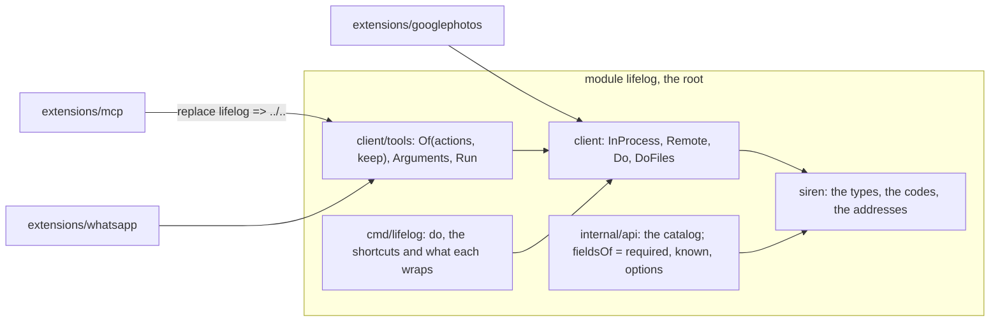

# 150 — One code set, one catalog: the duplication between the surfaces goes

> Dated implementation record. Tests use temporary folders and synthetic data. The owner's live `life.db` is never
> opened by a test, and no test calls a model or WhatsApp.

## Status

- **Date / baseline:** 2026-10-29, `bc46b76` (master), after [plan 149](149-the-browser-on-the-current-platform.md).
- **Priority:** P1. **Effort:** L. **Risk:** MEDIUM. `schema.sql` does not change (`via` is an action field, not a
  column). The import paths of two packages change in many files; the API gains two refusals (an unknown field, a
  value outside a field's options); `say` becomes the owner's. Another session commits to master in parallel: the
  plan runs on the branch `plan-150`, one commit a part, rebased before the merge.
- **Status:** TODO.
- **Resolves:** the owner's three decisions of 2026-10-28 (below). It supersedes the paragraph "No shared client
  library" of [plan 135](135-extensions-outside-the-core.md), a dated record that stays as written.

## The owner's words (2026-10-28)

"Let's find out capabilities inconsistencies between interfaces. I want to have as much as possible one single
point of truth that is used across interfaces. I want to remove duplication." Asked, the owner decided:

1. **One shared Go code set, no copies.** WhatsApp is the "third Go extension" of plan 135.
2. **The server refuses an unknown field.** The catalog is the one list of an action's fields on every surface,
   the server included.
3. **`say` is the owner's.** No agent speaks as the owner.

## What the review found

The catalog (`internal/api/catalog.go`) is the one list of the actions, their routes and their fields, and the
CLI's `do`, the MCP tools and the browser's `form` helper read it. The duplication is around it.

| finding | where |
|---|---|
| The Siren types and the client are copied by hand: core, `extensions/mcp`, `extensions/whatsapp` (a copy of the copy), and a fourth hand-written client in `extensions/googlephotos` that hard-codes `POST /files`, its fields and the code `exists`. The tool builder is copied from mcp into whatsapp. No test keeps a copy equal. | `extensions/*/siren`, `extensions/*/client`, `extensions/whatsapp/agent/tools.go`, `extensions/googlephotos/lifelog/client.go` |
| The server leaves rules to the clients: `fieldsOf` checks `Required` only; the client's `fill` is the one place that refuses an unknown field. The multipart reader keeps its own field list and drops an unknown name unread; `set-cover` shares it and reads five fields its row does not list. Static options are checked by hand in four handlers. | `internal/api/request.go`, `internal/api/files.go:281`, `pages.go:291`, `plans.go:241`, `browse.go:143-162` |
| Hand-written lists drifted: the catalog marks six owner-only actions (`settings` since `a04e6a3`), five are named in AGENTS.md, two READMEs, the agentic template and three tests. `extensions/agentic` fails today on `TestTheAgentsTextsNameWhatTheProgramHas`. The 17 error codes are listed by hand in API.md, `codeOf` and `alertOf` with no test between them; two codes have no alert words. CI does not run `extensions/whatsapp`. | AGENTS.md, API.md, `extensions/mcp/README.md`, `extensions/agentic/agentic/templates/AGENTS.md`, `.github/workflows/baseline.yml` |
| Surfaces that bypass the catalog: the CLI's `day` and `snapshot` drop extra arguments in silence; the README table test does not check that a shortcut wraps its action; the browser draws tick, unlink's ×, file-pages' × and the Undo of a revive by hand, `lineHref` builds `/pages/{id}/tick` from a literal, and one field list is typed in six templates; MCP offers `say` and the WhatsApp agent hides it by its name; the parity table has no row for ten actions. | `cmd/lifelog/main.go`, `cmd/lifelog/surfaces_test.go`, `internal/api/view`, `cmd/lifelog/parity_test.go` |

## The decisions

| question | decision |
|---|---|
| where the shared code lives | `internal/api/siren` moves to `siren/` and `internal/client` to `client/`: public packages of the root module `lifelog`, not a nested module. The root's `go vet ./... && go test ./...` covers them; no new `go.mod`. An extension writes `require lifelog v0.0.0` and `replace lifelog => ../..`. Go still refuses `lifelog/internal` to it. |
| the tool builder | `client/tools`: `Of(actions, keep)`, `Name`, `Run`, `Arguments`. `Of` never makes an Owner action a tool, whatever `keep` says; `keep` narrows further (WhatsApp: no file field). Plan 121 moved this into mcp when it had one consumer; three consumers bring it back, shared. The MCP `instructions` stay in `extensions/mcp`. |
| Google Photos has the bytes in memory | `client.DoFiles(ctx, a, values, files map[string]client.File)` takes readers; `Do` (paths) calls it. No temporary file: the owner's photo never touches the disk, and the multipart writer stays one. |
| the unknown-field rule | `fieldsOf` refuses a name the action does not list (422 `invalid`). One named list of the browser's own names stays allowed: `back`, `feedback`, `new`; on a GET, when `new` names a catalog action, that action's fields pass too (the opener `?new=X&field=v` lands on `/browse`); a `new` that names no action is 422. The multipart reader takes the action's row and refuses an unknown part name before it reads the part. The client's own check goes: one refusal, on the server, for every surface. |
| the options rule | a non-empty value outside a field's static `Options` (the spec's) is 422. `withOptions` changes only the instantiated action, so `metric` and `category` are not checked here. Four hand checks and `flag`'s error go. |
| a rule of the data or of the request | both checks are about the request's shape (which names it uses, which words the catalog lists for a field): the API's, not the data's. A CHECK holds the data's rules; `mood` 1-5 is both, and the CHECK stays the rule of the row. |
| `say` the owner's | `Owner: true`, plus an optional field `via` (the relay's name, the grammar of a writer). The stamp of `say` reads `via`; `capture` keeps its stamp from the source. The relay sends `say` as the owner (no `Lifelog-Source`, the owner's token, which it holds for `/settings` already) with `via=whatsapp`. Weighed and refused: a mark that hides `say` from tools but leaves it writable (a loop stays possible); a relay exception in `requireOwner` (two owner rules, and the core would name a relay); the relay writing the turn with `save-body` (the format leaves the core). |
| the owner-only lists | deleted everywhere. The texts point to the `owner` mark of `lifelog actions`; the tests compute the set from the real catalog. |

## The parts

One part, one commit, each buildable and tested with the root baseline and, where it touches one, each extension's
`go vet ./... && go test ./...` in its folder. Parts 1 to 3 are structural moves with no change of behavior.

| part | what changes | files |
|---|---|---|
| 1. `siren` and `client` are public packages of the root module | `git mv internal/api/siren siren`, `git mv internal/client client`; every import path; `client.Error.Code()`; the dial exemption of the boundary test names `client/` and its scan reads `siren/` and `client/` too; stale comments (`cmd/lifelog/main.go:1`, `internal/api/authority.go:73`); README Layout rows; AGENTS.md rings and "supporting packages under `internal/`" with the two exceptions | `siren/`, `client/`, `internal/api/**`, `cmd/lifelog/*`, `cmd/lifelog/boundary_test.go`, README.md, AGENTS.md |
| 2. mcp and whatsapp import the shared packages; `client/tools` is the one tool builder | `client/tools/tools.go` from `extensions/mcp/mcp/tools.go` without `instructions`, with `keep`; the two `go.mod` gain `require lifelog v0.0.0` and `replace lifelog => ../..`; the copies `siren/` and `client/` of both extensions go; their client tests move to `client/`; whatsapp's `tools.go` keeps `takesFile` and the predicate; CI runs whatsapp | `client/tools/`, `extensions/mcp/**`, `extensions/whatsapp/**`, `.github/workflows/baseline.yml`, `extensions/README.md`, the two extension READMEs, README Layout |
| 3. Google Photos on the shared client; `DoFiles` takes readers | `client.File{Name, Open}`, `client.Bytes`, `DoFiles`; `Do` calls it; the test `TestDoFilesStreamsAReaderAsTheFilePart` first; `extensions/googlephotos/lifelog/client.go` wraps `*client.Client`, reads with `siren.MonthHref`/`DayHref`, writes with the catalog's `add-file`, retries on `siren.CodeExists` | `client/client.go`, `client/client_test.go`, `extensions/googlephotos/**`, `.github/workflows/baseline.yml` |
| 4. the error codes have one home and one test | `siren.Codes()` held true by a parse of `siren.go`; a test that each code is in API.md "Errors" and each code there is a constant, and `codeOf` answers `internal` only for a status API.md does not name; `alertOf` gets words for `snapshot_refused` and `restore_check_failed`, the codes whose message is the words in a named list; AGENTS.md names the test | `siren/siren.go`, `siren/codes_test.go`, `internal/api/codes_internal_test.go`, `internal/api/view/page.go`, `internal/api/view/page_test.go`, AGENTS.md |
| 5. the hand-written owner-only lists go | the texts point to the `owner` mark of `lifelog actions`; the agentic e2e test drops the sentence check and asserts no owner tool name appears; the mcp tests derive the set from the catalog (the e2e from the real `lifelog actions`); the fake catalog becomes small and synthetic; `owner_test.go` iterates by the mark | AGENTS.md, API.md, `internal/api/serve.go`, `internal/api/owner_test.go`, `extensions/mcp/README.md`, `extensions/mcp/mcp/*_test.go`, `extensions/mcp/e2e_test.go`, `extensions/agentic/agentic/templates/AGENTS.md`, `extensions/agentic/e2e_test.go` |
| 6. the server refuses an unknown field and a value outside the static options | tests first (`TestAnUnknownFieldIsRefused`, `TestAValueOutsideTheStaticOptionsIsRefused`, `TestAMultipartPartWithAnUnknownNameIsRefusedBeforeItIsRead`, `TestSetCoverTakesOnlyItsOwnFields`, two parity rows); `fieldsOf` = required + known + options with `browserFields`; `flag` returns a bool; the multipart reader takes the row and refuses an unknown name before it reads it, `fileTextFields` goes; the hand checks of `kind`, `order`, `media` go; the client's "has no field" loop goes; API.md "The entity", README, AGENTS.md "Refused, never ignored" | `internal/api/request.go`, `internal/api/files.go`, `pages.go`, `plans.go`, `browse.go`, `client/client.go`, `cmd/lifelog/parity_test.go`, API.md, README.md, AGENTS.md |
| 7. `say` is the owner's; `via` names the relay | tests first (`TestSayIsTheOwnersAndViaNamesTheRelay`, the parity row's agent branch, the whatsapp agent's request); `say` `Owner: true` with `opt("via")`; the stamp of `say` reads `via`, checked with the writer grammar; the whatsapp relay sends `say` with the owner's client and `via=whatsapp`, and its name check goes; README table (MCP: none), API.md, the whatsapp README | `internal/api/catalog.go`, `internal/api/conversation.go`, `internal/api/conversation_test.go`, `cmd/lifelog/parity_test.go`, `extensions/whatsapp/agent/*`, `extensions/whatsapp/cmd/lifelog-whatsapp/main.go`, README.md, API.md, `extensions/whatsapp/README.md` |
| 8. the CLI shortcuts refuse what they do not read; the table names what each wraps | `command.wraps`; the run functions call `doAction` with it; `day`, `snapshot`, `actions` refuse an extra argument with the synopsis; `surfaces_test.go` asserts each listed shortcut wraps that action and every `wraps` is listed; AGENTS.md "a flag or an argument" | `cmd/lifelog/main.go`, `cmd/lifelog/file.go`, `cmd/lifelog/main_test.go`, `cmd/lifelog/surfaces_test.go`, AGENTS.md |
| 9. the browser's hand-drawn forms go through `form`; every action href comes from the entity | `lineHref` reads the entity's own action; the `tick` result carries `href` and the `tombstone-pages` result `revive`, so the Undo forms read them (API.md result rows); a `form` option `buttons` draws the listed options of a field as submit buttons (tick); unlink's × and file-pages' × are `form` with fixed values and an `aria` option; `more *` folds every optional field | `internal/api/view/plans.go`, `view/results.go`, `view/forms.go`, `view/markdown.go`, `view/html/*.html`, `internal/api/plans.go`, `internal/api/tombstones.go`, API.md, the view tests |
| 10. the parity rows that are missing | create-page, create-person, tombstone-pages then revive, link and unlink, correct and retract, integrity-check, snapshot (the agent's refusal through the CLI shortcut) | `cmd/lifelog/parity_test.go` |

## Done criteria

- No Go source under `extensions/` defines a Siren type, a client transport or a tool builder; `grep -rn
  "lifelog-mcp/siren\|lifelog-whatsapp/siren\|lifelog-mcp/client\|lifelog-whatsapp/client" extensions` prints
  nothing; `extensions/googlephotos/lifelog/client.go` holds no route literal.
- The root `go vet ./... && go test ./...` passes; each of `extensions/mcp`, `extensions/agentic`,
  `extensions/googlephotos`, `extensions/whatsapp` passes `go vet ./... && go test ./...` in its folder;
  `baseline.yml` runs all four.
- An unknown field is 422 on the API, the CLI, the browser and the MCP server; a multipart part with an unknown name
  is 422; `set-cover` with `dry_run` is 422; a value outside a field's static options is 422; no hand check of
  `kind`, `order`, `media` or "must be 0 or 1" remains in `internal/api`.
- `say` is `Owner: true`; an agent's `say` is 403; the relay's turn reads `**Owner** (HH:MM, via whatsapp): `;
  `say` is not an MCP tool; the WhatsApp agent hides no action by name.
- No hand-written owner-only list remains (`grep -rn "register_metric\|rebuild_search" --include=*.md
  --include=*_test.go . | grep -v docs/plans` prints nothing).
- Every error code is in `siren.Codes()`, API.md, `codeOf` and `alertOf` or its named list, held by tests.
- Every shortcut row of the README names a command whose `wraps` is that action; `day`, `snapshot` and `actions`
  refuse an extra argument.
- No action href in `internal/api/view` is built from a path literal.
- Before the merge: `go test -count=1 -shuffle=on ./...`; `staticcheck ./...` and `govulncheck ./...` with their
  versions reported, or reported as not run; `CGO_ENABLED=1 go test -race -count=1 -timeout 40m ./...` for the pipe
  of `DoFiles`.
- After the merge, on the owner's word: the binary and `lifelog-whatsapp` built and installed, the service restarted,
  its log line read; one phone message confirms `**Owner** (HH:MM, via whatsapp): `.

## Left out, with the reason

- The WhatsApp agent's copy of the conversation turn format: it is the documented contract of API.md, which an
  agent in any language implements.
- The hand list of commands in `site/`: the public page is documentation, not an interface, and no test reads it.
- The README table's browser column: free text, checked only to be non-empty.
- MCP resources: none exist; the catalog lists actions only.
