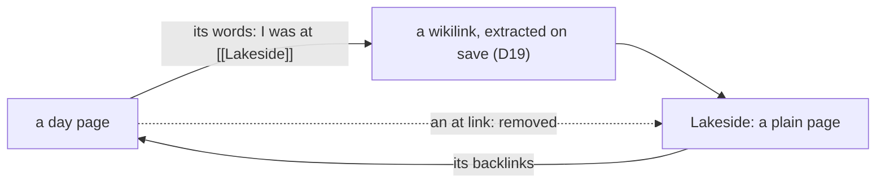

# 151 — No places: the type `place` and the link kind `at` go; a place is a plain page

> Dated implementation record. Tests use temporary folders and synthetic data. The owner's live `life.db` is never
> opened by a test.

## Status

- **Date / baseline:** 2026-10-29, `577fde7` (master) plus the commit of [issue 0091](../issues/0091-places-cost-more-than-they-give.md)
  and [RFC 0024](../rfcs/0024-no-places.md).
- **Priority:** P2. **Effort:** M. **Risk:** MEDIUM: a cut of one entity type, one link kind and three actions
  across the schema, the contract, the writer, the browser and the suites; the live file is converted by a one-off
  program before the new binary runs (Part 4, local).
- **Status:** IN REVIEW (owner). Parts 0 to 3 built on 2026-10-29 on branch plan-151 and counter-reviewed; live since 2026-10-29 15:02 (Part 4, shipped). The live run: snapshot to `/home/cico/life/snapshots/2026-10-29-plan-151`, dry run, run; 55 places (25 tombstoned) became pages (1717 to 1772), 19 `at` links became a last paragraph of their day (no day named its place already), `schema_version` 195 to 196; the new binary's `/integrity` ok with no drift; installed and the service restarted.
- **Resolves:** [issue 0091](../issues/0091-places-cost-more-than-they-give.md) through
  [RFC 0024](../rfcs/0024-no-places.md), which rewrites [D16](../decisions/D16-places.md) and
  [D21](../decisions/D21-location-history.md) in place.

## The owner's words (2026-10-29)

Of the Where box of a day ("No place on this day. I was at a place"): "I have this, which I don't really use it that
much, I am wondering if we should scrap the places." Shown the counts of the live file (thirty places, twenty-one
linked by nothing, five linked from a day page): "cut them, write the issue and the proposal", then "go ahead".

## What is true at the baseline

- `entities_entity_type` admits five types; `place` has no typed row (a person has `people`, a metric `metrics`, a
  file `files`). `link_kinds` has three rows: `wikilink`, `at` (`page` → `place`, from a day page only, held by the
  `at` clause of `links_endpoint_types`) and `part-of`. The sentence of `entities_promote_from_page` says it holds the
  type of a place, which no foreign key holds ([issue 0081](../issues/0081-only-the-writer-keeps-a-place-a-place.md)).
- The writer offers `create-place` (`POST /places`), `link` and `unlink` (`POST /pages/{id}/links`, `/unlink`, whose
  only kind is `at`: a wikilink comes from the body, a `part-of` from `file-pages`), and `promote` with `to` in
  `person, place`. Browse has a Places list with its count and a `place` kind; `search` and `random` take `place`;
  a day's card carries place chips; the day view draws Where; the New menu offers Place; the calendar's dated rows
  carry the places of a day.
- The docs: D16, D21, D8 (five types, three kinds), D20 (a person or a place), the recipes where-was-i,
  person-or-place, everything-about and day-view, the `at` check of the integrity checks, row 20 of the 2075 table,
  the link map and the ER diagrams, the surfaces table of the README, API.md, the site.
- The suites: `named` (34 lines name a place), `links`, `journal`; 293 mutants, of which these name a place or `at`:
  `links` "an at link may start at a plain page", "at accepts any endpoint", "an unknown endpoint id passes as a place
  with foreign_keys=OFF"; `named` "a place may be promoted", "entities_promote_from_page refuses an update that keeps
  the type"; `journal` "cookbook/where-was-i lists the places of a tombstoned day", "cookbook/where-was-i says I was at
  a tombstoned place", "an at link may start at a period page"; `diagrams` "the link map invents an edge".

## The decisions

| question | answer |
|---|---|
| what a place becomes | a plain page: same id, title, aliases, text and backlinks ([RFC 0024](../rfcs/0024-no-places.md), option C) |
| where "I was at" goes | the words of the day page, `I was at [[Lakeside]]`; the days at a place are the backlinks of its page ([days that name](../cookbook/days-that-name.md)) |
| `link` and `unlink` | removed whole: `at` was the only kind they took. `Tx.link` and `Tx.unlink` stay for the wikilink sync and `file-pages` |
| `promote` | keeps `person` alone: the field `to` goes, the action is "Make it a person", `name`, `birth_day` and `death_day` stay optional |
| `entities_promote_from_page` | stays, with its comment rewritten: the foreign key of a typed row refuses the same write, but the trigger's sentence names the rule |
| D16 | rewritten in place as "No places: a place is a plain page, and where a day was is the words of the day page"; its number stays, since `schema.sql` and the docs cite it |
| D21 | keeps "no location"; the answer to "where was I" is the day's words, not an `at` link |
| the Browse list | no Places list and no `place` kind; the thirty pages are listed with the pages |
| the icon `places` | removed from `internal/pixelart` with its drawing; the sprite is regenerated as `tools/pixelart` says |
| the live file | Part 4, run locally by the owner with a one-off program, after the code is merged and before the new binary is installed |

## Part 0 — The contract

The path of [the process](../process.md), in one commit. The issue and the proposal exist; this part is the decision
and the change of the DDL and the pages.

1. **`schema.sql`**: in `entities_entity_type`, `('page','person','metric','file')`; the comment of `entities` no
   longer names a place or says "a place has no typed row (D21)". In `link_kinds`, the `wikilink` row admits
   `page,person,metric,file` on both sides, the `at` row goes, and the comment's example of a comma list is
   `('person,metric')`. In `links`, the comment says "wiki backlinks and what is filed where", and the `at` sentence
   goes. In `links_endpoint_types`, the statement `RAISE(ABORT, 'an at link starts at a day page (D16)')` with its
   `WHERE NEW.kind = 'at'` goes, and the comment above it says two rules (a category is a plain page, a day page is
   never filed), not three; the comment of the period-page statements loses "an at link still starts at a day page
   only". The `part-of` statements stay, and the registry's own `to_types` check stays as it is. In
   `entities_promote_from_page`, the comment says that the foreign key of a typed row also refuses the write and the
   trigger keeps the sentence; the `RAISE` says "a person, a metric or a file keeps its type". The `schema` row of
   `lifelog_meta` says "the journal (one page per day), wiki, people, health metrics and the files...".
2. **D16** rewritten from its template: the decision, why (issue 0091: five of thirty used; a type with nothing behind
   it), alternatives (keep the kind for the difference between naming and being at: rejected, the owner's words say
   it), the cost accepted (a day that names a place it was not at reads the same as one it was at), sources
   (executed: `named`, `links`). **D21**: the `at` link is no longer the answer; the day's words are. **D8**: four
   linkable types, two kinds. **D20**: "A person is a page". The decision index rows of D16 and D21 change.
3. **Pages**: delete [where was I](../cookbook/where-was-i.md) and its row of the cookbook index; rewrite
   [a person or a place](../cookbook/person-or-place.md) and [everything about](../cookbook/everything-about.md)
   for a person (rename the files to `person.md` and keep `everything-about.md`; every link to them follows);
   [days that name](../cookbook/days-that-name.md) loses its `at` sentence; [the day view](../cookbook/day-view.md)
   loses its `at` block; [integrity checks](../contract/integrity-checks.md) loses the `at` row of its orphan check
   and the sentence that cites D16; the [threat model](../contract/threat-model.md) loses row 20 of the 2075 table,
   and rows 21 to 26 become 20 to 25, since the `document` suite wants the rows numbered 1 to n without a gap;
   [link rules](../architecture/link-rules.md), the [entity model](../architecture/entity-model.md), the
   [page lifecycle](../architecture/page-lifecycle.md), the [product concepts](../architecture/product-concepts.md),
   the location row of the [non-goals](../architecture/non-goals.md), [imports](../contract/imports.md),
   [titles and wikilinks](../contract/titles-and-wikilinks.md) and [building a writer](../guides/building-a-writer.md)
   say the new truth in the lines that name a place; the totals line of [the schema page](../schema/README.md)
   stays at 42 triggers (no trigger goes). The diagrams: the link map has two edges; `Named (person, metric, file)`.
4. **Suites**: the `named` suite is about a person (its "a place needs no detail row", "two Sams" with a place, and
   the cookbook runs of person-or-place and everything-about change with the recipes); the `links` and `journal`
   suites lose their `at` cases; the mutants named above go (the count in `tests/README.md` follows); the `document`
   suite holds (every link resolves, the `lifelog_meta` rows and the stored texts name only what the file has: the
   `schema` row and the comments must not say "place" or "at"); the `diagrams` suite holds (the link map equals
   `link_kinds`). The 2075 test of `document` reads the threat model's table: keep its parser happy.

## Part 1 — The writer: the core and the API

1. `internal/core`: delete `CreatePlace` (both), `PlaceTitles`, the `place` branches of `Promote` (`typ` is then
   `person` alone: `promote to person` is the only valid value, and the action has no `to`), `Store.Link` and
   `Store.Unlink` and their handlers; `browseKinds` and `searchKinds` lose `place`; the calendar's dated rows and
   the stream's chips lose the place rows (`calendar.go`, `stream.go`: a card's chips are the people); the
   `at` clause of the orphan check in `integrity.go` goes with the contract's; the comments that say "a person, a
   place or a file" say "a person or a file". `Promotable`/`Plain` comments follow.
2. `internal/api`: the catalog loses `create-place`, `link` and `unlink`; `promote` loses `to`, and its Title is
   "Make it a person", its Hint "Make this page a person. Its text and links stay."; `serve.go` drops the three
   handlers; `pages.go` drops the place options of the day page (`PlaceTitles`), the `at` branch of the links
   filter, `createPlace` and the place of `offerPromote`; `searchKindTitles` loses Places; `days.go` drops
   `create-place` from the day's actions, the `places` link of the root, the `Places` chips (`cardChip` stays for
   people and birthdays) and the `unlink` action of a day; `browse.go` drops the `place` kind, `Place` of the counts
   and the place of `namedRows` (people only). Every `alertOf`, hint and sentence that names a place follows.
3. The MCP tools and the forms follow the catalog: nothing to write; the end-to-end test of `extensions/mcp` runs
   in its folder. The words of the agent's instructions (`extensions/mcp/mcp/tools.go`,
   `extensions/whatsapp/agent/instructions.go`) say "people and health readings".

## Part 2 — The browser

1. `day.html`: the Where section goes. `shell.go`: the New menu loses Place. `cards.go`, `search.go`, `page.go`:
   the `place` kind and its icon go; `page.go` drops `Places` of the day parts and its `at` case; `browse.go` (view)
   and `browse.html`: no Places chip, no place words of `Mentions`. `forms.go` and `hand_forms_test.go`: the × of a
   place goes with `unlink`; the × of a category stays.
2. `internal/pixelart/icons.go`: `places` leaves `IconNames` and its drawing; then `go run ./tools/pixelart` from
   the repository root writes the icon sheet again (a test of `internal/api/view` compares each sheet with its
   drawing), in the same commit, and `icons_test.go` follows. The site
   ([site/index.html](../../site/index.html)): "the people in them", "People" card, "each person" (it names only
   what the README names).
3. Screenshots of a day and of Browse before and after, with the synthetic review server
   (`tests/README.md`, the UI review tooling), to see that the day's margin closes up and Browse has no Places.

## Part 3 — The README and API.md

1. README: the surfaces table loses `create-place`, `link` and `unlink`; the `promote` row says "Make it a person";
   the sentences that name places (the product sentence, Browse, the day's margin, search, the kind chips) change;
   `TestTheTableOfTheSurfacesIsTheCatalog` holds. The heading "page, person, place, file" of API.md becomes
   "page, person, file", and every anchor `#page-person-place-file` follows; the `places` link, `cards[].places[]`,
   `counts.place`, the kinds of `browse`, `search`, `random` and `rows[].kind`, the `at` of `view[].what`, the
   `create-place`, `link` and `unlink` sections and `entity_type` go or change.
2. The plans index: this plan's row, status IN REVIEW (owner) when the parts are merged.

## Part 4 — The live file (local; not for a cloud session)

The owner's file holds thirty places and the `at` links of five. It follows by a one-off program in the pattern of
plan 143: `~/.local/share/lifelog-oneoff/plan151/` holds `generic.go` (plan 143's state reader, comparer, text
rewriter and checks, unchanged), `change.go` (the change), `main_test.go`, `OLD.sql` (`schema.sql` at master, equal
to plan 143's NEW.sql) and `NEW.sql` (`schema.sql` at the commit of Part 0), and the binary `plan151-bin OLD.sql
NEW.sql LIFE.db [--dry-run]`. It makes a fresh file from each SQL in a temporary folder, accepts only the exact
difference of plan 151 (three table texts, two trigger texts, the schema row, the `at` row gone and the wikilink
row's types), accepts the live file only when equal to the fresh OLD file, and runs one `BEGIN IMMEDIATE`
transaction, in this order, which the triggers force:

1. The survey: the places, and each `at` link with its day page and place. A tombstoned day page or place among
   them stops the program before any write: the owner decides those by hand.
2. For each `at` link whose day page has no wikilink row to the place: `I was at [[Title]]`, with the note after a
   comma, appended as a last paragraph by the statement `capture` appends an entry with, and the wikilink row the
   save contract derives from it ([D19](../decisions/D19-wikilink-save-contract.md)), with the link's own `source`.
   A day that names the place already gets nothing. `entities_touch` advances the day's revision for the line.
3. `DELETE FROM links WHERE kind = 'at'` (each row is an edit of its day page: `links_touch_delete` advances the
   revision once per link, as `unlink` did), then `DELETE FROM link_kinds WHERE kind = 'at'` (RESTRICT allows it
   once unreferenced). This comes before any type change: `entities_endpoint_types` refuses place to page while an
   `at` row ends at the place.
4. `link_kinds_structure_fixed` dropped, the wikilink row's types set to NEW's, the trigger made again.
5. `entities_promote_from_page` dropped (its WHEN fires on place to page), `UPDATE entities SET entity_type =
   'page' WHERE entity_type = 'place'` (`entities_touch` advances each place's revision: a type change is an edit),
   the trigger made again with NEW's text; `links_endpoint_types` dropped and made again with NEW's text.
6. The stored texts of `entities`, `links` and `link_kinds` set to NEW's through `PRAGMA writable_schema` (shapes
   equal; the one change outside a comment is the CHECK, which every row satisfies once no place is left), and the
   `schema` row of `lifelog_meta` set to NEW's. The writer's drift check folds white space and keeps comments, so
   the texts are made byte-equal.
7. The counts (no place, no `at`, pages plus thirty), the rows of `link_kinds` against NEW's seed, the whole state
   against the fresh NEW file, `PRAGMA integrity_check` and `foreign_key_check`, and a trial write (a place refused
   by `entities_entity_type`, an `at` link refused as not registered, a wikilink between pages accepted, a person
   kept by D20) rolled back; then COMMIT, or ROLLBACK on `--dry-run`; after COMMIT the file is opened again and
   checked again.

Rehearsed on 2026-10-29 on a copy of a synthetic file made by the master binary (two places, three `at` links, one
without a wikilink): dry run, run, a second run refused as made already; then the branch binary's `/integrity` was
ok with no schema drift, and `resync-links` changed nothing. `go test` of the program covers the written line, the
revisions, the types, the kinds and the tombstone refusal.

The owner runs it with `!`: stop the service, `mkdir -p /home/cico/life/snapshots/2026-MM-DD-plan-151`, snapshot
there, dry run, run, `get /integrity --human` with the staged new binary, install the staged binary (`cp` to
`lifelog.new`, `mv -f`), start, read the `serving` line of `journalctl -o short-iso`. The counts before and after
(places, `at` rows, the days that got a line) go in the status line below.

## Tests

- `tests/`: the suites of Part 0; `go test ./tests` green, mutants included.
- `internal/core`: a promote to anything but a person is refused by the writer with a 422 before SQL, and a person's
  promote still works; the calendar's dated rows and the stream's chips carry people only; the orphan check has no
  `at` row (`integrity_rules_test.go`); `people_places_test.go` of `internal/api` becomes `people_test.go`.
- `cmd/lifelog`: `surfaces_test.go` and `parity_test.go` lose the `link`/`unlink`/`create-place` cases and keep
  parity for `promote`; `boundary_test.go` holds.
- `extensions/mcp`: the end-to-end test lists no `create_place`, `link` or `unlink` tool.
- The baseline: `gofmt`, `go vet ./... && go test ./...` at the root and in each extension; `staticcheck ./...` and
  `govulncheck ./...`; `go test -count=1 -shuffle=on ./...`.

## Done when

1. `schema.sql` admits four entity types and two link kinds; D16, D21, D8 and D20 say the new truth; every page of
   `docs/` that named a place or an `at` link is rewritten or deleted; `go test ./tests` is green.
2. The catalog has no `create-place`, `link` or `unlink`; `promote` has no `to`; Browse, search and random take no
   `place`; a day draws no Where and no place chips; the sprite has no `places` icon; the README's table and API.md
   agree with the catalog; the site names no place.
3. The baseline and the static checks pass at the root and in each extension.
4. Part 4 ran on the live file: the counts are recorded here, the service serves the new binary, and the issue
   closes as resolved.
