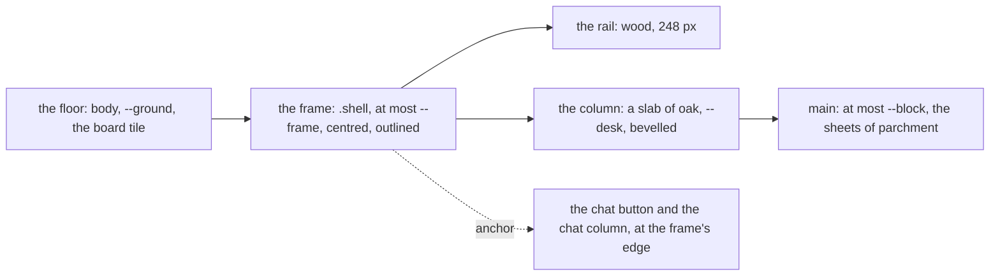

# 152 — The frame: the app centred in a slab of oak on the floor

> Dated implementation record. Tests use temporary folders and synthetic data. The owner's live `life.db` is never
> opened by a test.

## Status

- **Date / baseline:** 2026-10-29, `49d2006` (master), after [plan 151](151-no-places.md).
- **Priority:** P2. **Effort:** S. **Risk:** LOW. Nothing for the schema, the contract, the catalog or the API: two
  stylesheets, one token, one test and one paragraph of the README. The browser stays in ring 2.
- **Status:** PLANNED. The mock-up the owner approved (2026-10-29) is a private artifact of the session that wrote this
  plan: the light theme of it, with the oak slab, the outline and no moving ground, is the target.
- **Resolves:** the owner's words of 2026-10-29 (below). No issue.

## The owner's words (2026-10-29)

"On some pages everything is aligned left, then on chat the sidebar is on the left and the chat centred. I feel the
structure is not consistent across pages. Maybe centre the entire app and give it a fixed width?" Shown three ways,
the owner chose the frame: the rail and the column travel together, centred, at a fixed width. Shown the frame over
the floor's boards: "the app should have a background different from the background image, it shouldn't be 100%
transparent." Shown the slab in the light theme: "exactly like that I want." A moving ground (firelight on the
floor) was shown and set aside: "for now let's skip the animated background."

## What is true at the baseline

The shell is a grid of the rail (`--rail-width`, 248 px) and the column, as wide as the screen. The column is
transparent: the floor's board tile and the grain of `body` show through it, and its `main` has a cap of 1200 px with
no auto margin, so a page hugs the rail and bare floor shows at its right on a screen wider than about 1550 px. The
chat screen drops that cap and centres its thread and its composer at 72ch. The login's bare shell centres its column
at 34rem. Three horizontal rules, which is what the owner saw.

Two parts of a wide screen are fixed to the viewport, not to the shell: the button `.chat-open` at the bottom right,
and the chat column `.chat:popover-open` at the right edge (26rem wide), for which the column pads its end. The
toast and the pick bar are sticky inside the column, and the palette dialog is centred on the viewport: none of
those moves.

## The decisions

| question | decision |
|---|---|
| the frame | the shell is at most `--frame` wide and centred: `--block:1200px` (the cap of `main` and of the footer, named once) and `--frame:calc(var(--rail-width) + var(--block) + 2 * var(--space-8))`, 1512 px. Under 900 px the shell is a block as today, and the frame does not apply. |
| the slab | the column is a slab of oak laid on the floor: `background-color:var(--desk)`, the 4 px grain, `box-shadow:var(--bevel-up)`. The shell has a 2 px outline at its two sides (`border-inline:2px solid var(--outline)`); the rail's own right border stays as the seam between wood and oak. |
| the token | `--desk:light-dark(#e6d4a4, #211408)` in the `:root` block of `base.css`, after `--ground`. The floor keeps `--ground` and the board tile; nothing written sits on bare floor any more. Contrast of the page's text on the slab, light: page-ink 9.2, page-strong 11.7, page-muted 4.7, accent 5.2, link-page 6.0; dark: 9.2, 13.2, 8.6, 10.7, 8.5. |
| the fixed parts | `.chat-open` and `.chat:popover-open` sit at the frame's edge, not the screen's. The rule is the inset `max(0px, calc((100vw - var(--frame)) / 2))` (plus `--space-4` for the button); behind `@supports (anchor-name:--a)` the shell is the anchor (`anchor-name:--shell`) and the two take `inset-inline-end:anchor(--shell end)`, which is exact when a scrollbar takes part of `100vw`. The column's padding at the end when the chat is open does not change: the popover covers the same 26rem of the column. |
| the login | the bare shell's column (34rem, centred) is a slab too, with the outline at its sides: one look for every page. |
| the phone | under 900 px the slab stays (the column is the page) and the outline goes (`border-inline:0`): the floor never shows there. |
| print | the print rule drops the slab, the bevel and the outline, as it drops the rail and the floor today. |
| the chat screen | nothing changes: its day bar, thread and composer run the column's width inside the frame, and the 72ch thread is a reading measure, as the journal's 62ch is. |
| a moving ground | not in this plan. The owner saw firelight on the floor and set it aside; the floor at the frame's sides is where it would go, and a later plan may add it behind `prefers-reduced-motion:no-preference`. |

## The design

## Part 1 — The sheets

1. `base.css`: `--block` and `--frame` beside `--rail-width`; `--desk` after `--ground`. Keep the comment of the
   token block true: the materials gain the slab (oak for the page) and the floor (the boards under it).
2. `app.css`, the shell block: the frame and the outline on `.shell`; the slab on `.column`; `main` and the footer
   read `--block`. The bare shell: the column's outline. The chat parts: the inset from the frame, with the anchor
   behind `@supports`. The phone block: `border-inline:0` on the shell. The print rule: the slab and the outline go.
   Logical properties only (`TestTheSheetsUseLogicalProperties`), and the layout asks the column, not the screen,
   where it already does.
3. Nothing in the templates: the shell's markup is unchanged.

## Part 2 — The tests and the README

1. `TestTheTokensHoldTheirContrast`: the text pairs on `ground` (page-ink, page-strong, page-muted, accent,
   link-page) and the focus mark on `ground` become pairs on `desk`: that is where the words are now. No pair on
   `ground` remains, for nothing is written on it.
2. A new test in `sheets_test.go`, `TestTheShellIsAFrame`: `app.css` caps `.shell` at `var(--frame)` and centres it,
   fills `.column` with `var(--desk)`, places `.chat-open` and `.chat:popover-open` from `var(--frame)`, and the print
   rule drops the slab. The test reads the sheet as the other sheet tests do.
3. The README's paragraph on the look ("the page is dark oak, the sidebar and the phone's bars are wood"): the page is
   a slab of oak on a floor of boards, centred in a frame of 1512 px on a wide screen. One sentence; no new command,
   so `site/` does not change.

## Tests

- `go test ./internal/api/view -run 'TestTheTokensHoldTheirContrast|TestTheShellIsAFrame|TestTheSheets'` while editing;
  the baseline `go vet ./... && go test ./...` before completion.
- Pictures, by the local session at the counter-review: the day page, Browse and the chat screen at 1920 and 1440,
  light and dark, and the phone, through the review server on a synthetic file; the chat column open at 1920, so the
  popover meets the frame's edge. Report the Chromium that drew them.

## Done when

1. On a 1920 px screen every page with the shell is one centred frame of 1512 px, the rail and the column together,
   the floor's boards at both sides, the column a bevelled slab of oak with the outline at its sides; at 1440 px and
   below the frame fills the screen and nothing else differs from today; under 900 px nothing differs from today
   except the slab's colour.
2. The chat button and the open chat column sit at the frame's right edge on a wide screen.
3. The token test holds the page's text against the slab; the new test holds the frame; the baseline is green; the
   README's sentence is true.
