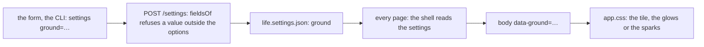

# 153 — The ground in Settings: four floors under the frame, two of them moving

> Dated implementation record. Tests use temporary folders and synthetic data. The owner's live `life.db` is never
> opened by a test.

## Status

- **Date / baseline:** 2026-10-29, `983a342` (master), after [plan 152](152-the-frame.md).
- **Priority:** P2. **Effort:** M. **Risk:** LOW. Nothing for the schema or the contract: a setting is a key of the
  application's file beside `life.db` ([plan 146](146-settings-and-the-chat-column.md)). The catalog's action
  `settings` gains one field; the browser's shell reads it; one picture is drawn; the sheets gain the four grounds.
- **Status:** PLANNED. The mock-up the owner chose from (2026-10-29) is a private artifact of the session that wrote
  this plan; of its nine grounds the owner kept four: plain oak, boards, firelight, embers.
- **Resolves:** the owner's words of 2026-10-29 (below). No issue.

## The owner's words (2026-10-29)

"Now let's add in settings some choices and generate also some backgrounds for the app, some static, some animated."
Shown nine grounds: "sounds good. Skip flagstones, woven rug, linen, snowfall and fireflies."

## What is true at the baseline

The floor is the body's background: the board tile (`ground.png`, drawn by `internal/pixelart`, 160 by 96, alpha
shading over `--ground`) over the 4 px grain, and the frame of plan 152 lies on it. The settings are four strings of
`core.Settings`, read from the file on each request and written through the owner-only action `settings`, whose
fields the catalog lists; a value outside a field's options is refused by `fieldsOf` for every surface. The shell of
a page (`view.Shell`) is built in `serve.go` with today and its zone, and the layout opens `<body>` with no
attribute. The pictures are embedded, served immutable, and a test holds each file equal to its drawing.

## The decisions

| question | decision |
|---|---|
| the setting | `ground`, a string of `core.Settings` (`json:"ground,omitempty"`), one of `boards`, `oak`, `firelight`, `embers`; empty is `boards`, the floor of today. |
| the field | the action `settings` gains the field `ground` with those four options, in that order, titled "Ground". The browser draws it as the catalog's generic select; the CLI line is `lifelog do settings ground=embers`; the MCP has no `settings` tool (owner-only, as before). A value outside the options is 422 by `fieldsOf`, so Go checks nothing. |
| the resource | `GET /settings` carries `ground` among its properties and fills the action's value; the entity's property is the stored string, empty when unset. |
| the shell | `view.Shell` gains `Ground string`, read from the settings in `serve.go` where the shell is built, normalised there: empty is `boards`. The layout opens `<body data-ground="{{.Shell.Ground}}">` on a page with the shell and a bare `<body>` without one (the login has the floor of today). A read of the settings file fails the page as any read does. |
| the floor | `app.css` draws the ground from the attribute. `boards`, and no attribute, is today's rule. `oak` drops the tile: the grain alone. `firelight` keeps the boards and adds two warm glows low on the floor, `body::before` and `body::after`, fixed over the viewport under the frame (`z-index:-1`), breathing on cycles of 7 and 11 seconds (`opacity` .55 to 1, `scale` 1 to 1.07). `embers` keeps the boards and adds one picture, `embers.png`, on the same two pseudo-elements at two speeds: the tile slides up by its own height on a loop (`background-position`, `steps()` so the sparks move by whole pixels), the second layer slower and fainter. |
| the picture | `pixelart.Embers()`: a tile of 96 by 96, transparent, with about twelve sparks of 1 or 2 pixels in gold (`#f2c14e`) and ember (`#ff8c2e`), placed by a seeded generator so the drawing is deterministic; it wraps at its edges. `tools/pixelart` writes it beside the other pictures; it is served at `/assets/embers.png` as the others are, public, immutable; `TestThePicturesAreTheDrawings` holds it. |
| motion | every `animation:` of the two moving grounds is inside `@media (prefers-reduced-motion:no-preference)`; outside it the glows and the sparks stand still (the first frame). `TestTheMotionsAreOffUnderReducedMotion` gains `animation:` in its list of tokens, so the rule is held for every animation of the sheets. |
| the mock-up's thumbnails | not built: the Settings form draws the catalog's select, one way to draw a field. The owner sees the floor on the next page after a save. |
| the README and API.md | the settings paragraph of the README names `ground` and its four values; the look paragraph says the floor is the owner's choice; API.md's property table of `GET /settings` gains the row. The surfaces table does not change: `settings` is one action. `site/` does not change. |

## The design

## Part 1 — The core, the catalog, the resource

1. `internal/core/settings.go`: `Ground string` on `Settings`, with its comment: the floor of the browser, one of the
   four values, empty is boards.
2. `internal/api/catalog.go`: the field on the row `settings` (name `ground`, title "Ground", the four options), and
   one sentence of the description.
3. `internal/api/settings.go`: `ground` in the entity's properties and the action's values; `ground` in the map of
   `saveSettings`.
4. `internal/api/settings_test.go`: a save of `ground=embers` is read back; a save of `ground=flagstones` is 422 on
   the API and refused by the CLI's `do` with the same reason; an empty `ground` clears it; the entity of
   `GET /settings` carries it.

## Part 2 — The picture and the sheets

1. `internal/pixelart/embers.go`: `Embers()`, with a test in the package's style (deterministic, wraps, the sparks are
   the only opaque pixels, their colours the two named). `tools/pixelart/main.go` writes `embers.png`.
2. `internal/api/serve.go` and `public.go`: the route and the public entry for `/assets/embers.png`, as the other
   pictures have. `internal/api/assets_test.go` lists it where the others are listed.
3. `internal/api/view/html/app.css`: the four grounds, in the ground block after the frame, with their comment.
   Logical properties; the pseudo-elements fixed, `inset:0`, `pointer-events:none`, under the frame.
4. `internal/api/view/sheets_test.go`: `TestThePicturesAreTheDrawings` gains `embers.png`;
   `TestTheMotionsAreOffUnderReducedMotion` gains the token `animation:`; a new `TestTheGroundIsTheOwnersChoice` holds
   that `app.css` has a rule for each of the four values of `data-ground` and that the moving ones animate only
   inside the motion block.

## Part 3 — The shell and the docs

1. `internal/api/view/shell.go`: `Ground string` on `Shell`, with its comment. `internal/api/serve.go`, where the
   shell is built: read the settings, normalise, set it. `layout.html`: the `body` attribute on a page with the shell.
2. `internal/api/view_shell_test.go` (or beside it): a page with the shell carries `data-ground="boards"` when nothing
   is set and `data-ground="embers"` after a save; the login carries no attribute.
3. `README.md` (the settings paragraph and the look paragraph) and `API.md` (the property table of `GET /settings`).

## Tests

- `go test ./internal/api/... ./internal/pixelart ./internal/core` while editing; the baseline `go vet ./... && go
  test ./...` before completion; `staticcheck ./...`.
- Pictures, by the local session at the counter-review: a day page at 1920, light and dark, on each of the four
  grounds, and the Settings page with the select; the embers and the firelight as two frames a few seconds apart.

## Done when

1. `lifelog do settings ground=embers` writes the file, `GET /settings` reads it back, `ground=flagstones` is 422 on
   every surface, and `lifelog actions` lists the field with its four options.
2. Every page with the shell draws the chosen floor; the two moving grounds stand still under reduced motion; the
   login keeps the boards.
3. `embers.png` equals its drawing; the baseline and the static checks are green; the README and API.md say the new
   truth.
