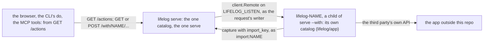
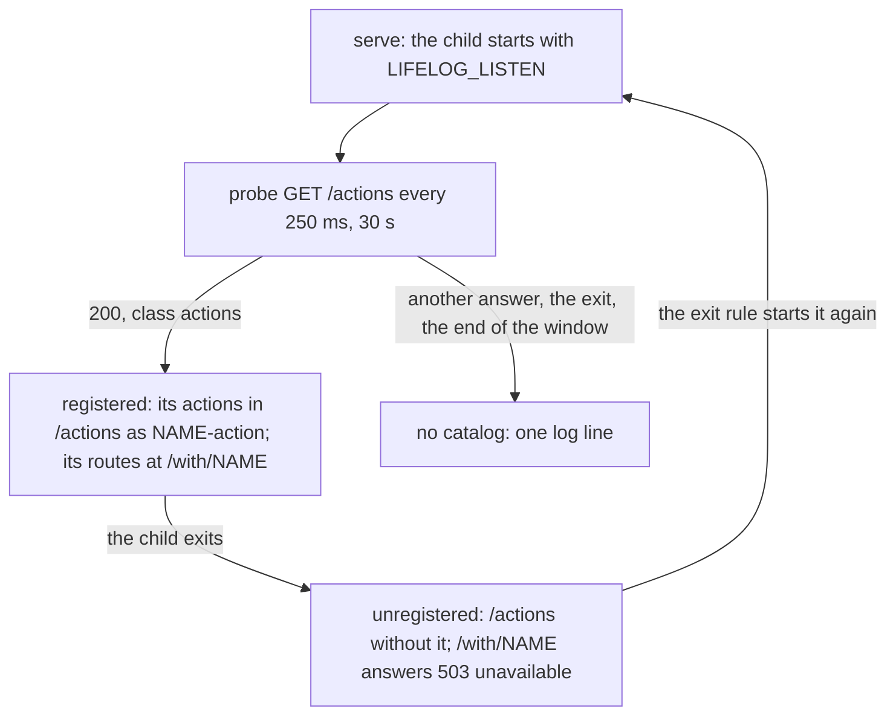

# 154 — Connected apps through the catalog: no plan lines, and an extension may serve a catalog the core aggregates

> Dated implementation record. Tests use temporary folders and synthetic data. The owner's live `life.db` is never
> opened by a test.

## Status

- **Date / baseline:** 2026-10-29, `860e9b3` (master) plus the commit of [issue 0092](../issues/0092-plan-lines-cost-more-than-they-give.md)
  and [RFC 0025](../rfcs/0025-no-plan-lines-and-connected-apps.md).
- **Priority:** P1. **Effort:** L. **Risk:** MEDIUM: a cut of four actions, a resource, a parser, a generated column
  and an index across the schema, the contract, the writer, the browser and the suites; then a new mechanism of the
  server (a child's catalog aggregated into the one catalog) that touches the boundary rule of the rings; the live
  file is converted by a one-off program before the new binary runs (Part 4, local).
- **Status:** IN REVIEW (owner). Parts 0 to 3 built on 2026-10-29 on master, each part by a sub-agent in a worktree
  and reviewed before its merge; the baseline, `staticcheck`, `govulncheck`, a shuffled run and the race detector on
  the end-to-end tests of the handshake pass; the mermaid render check was not run (`mmdc` is not installed). Part 4
  shipped 2026-10-29: snapshot to `/home/cico/life/snapshots/2026-10-29-plan-154`, the service stopped, the one-off
  (`~/.local/share/lifelog-oneoff/plan154/`, `OLD.sql` = `schema.sql` at `cda8c4d`, `NEW.sql` = `schema.sql` at
  `06bd6d2`) run after its dry run: 2143 rows and 12 bodies with a box unchanged, `entities_plans` and `has_box`
  dropped, the stored text of `entities` set, `schema_version` 198 to 199, equal to NEW, the checks ok; then
  `~/.local/bin/lifelog` built from `563dc34`, the service started 19:47:08 (`serving ... on http://127.0.0.1:7777`,
  the WhatsApp child beside it). One thing differs from the plan as written: `create-page` of a period key stored
  today as the page's day and was refused by `entities_period_page`; Part 1 made it store no day, as D30 requires, so
  the period views can offer it. The by-hand run of the server with the test app was not done; the end-to-end test
  holds the same assertions on the real `lifelog serve --with`.
- **Resolves:** [issue 0092](../issues/0092-plan-lines-cost-more-than-they-give.md) through
  [RFC 0025](../rfcs/0025-no-plan-lines-and-connected-apps.md), which rewrites [D29](../decisions/D29-plan-lines.md),
  [D23](../decisions/D23-no-tasks.md), [D15](../decisions/D15-recurrence.md) and [D30](../decisions/D30-period-pages.md)
  in place.

## The owner's words (2026-10-29)

"I am thinking of removing again the todo and tasks functionalities of the app and in exchange to create an agnostic
adapter that I can build integrations upon it. For my first integration, I am thinking of integrating ticktick."
Asked what the adapter is: "I don't want to hold any ticktick specific code in lifelogdb, we should make it agnostic
the integration. Through this integration that is agnostic the agent or the app or the siren api will be able to
communicate with it." Then: "I want in lifelogdb to aggregate all the 'apps' functionalities through an extremely
agnostic interface, and create my own integration in a simple modular way." Chosen: done tasks become day entries,
plus two-way; plan lines go and period pages stay; on demand and under `serve --with`; this plan ends at the
mechanism, the TickTick connector is a separate repo and a separate plan; the package is `lifelog/app`.

## What is true at the baseline

- A plan is a line of a page ([D29](../decisions/D29-plan-lines.md)): the grammar and its vectors are
  [plan lines](../contract/plan-lines.md); the file has the generated column `entities.has_box` and the partial index
  `entities_plans`; the writer has the parser `internal/text/plan.go`, the store `internal/core/plans.go`, the
  handlers `internal/api/plans.go`, the actions `plan`, `tick`, `carry`, `schedule` and the resource `plans`; the
  browser has the Plans page, a box glyph and a tick form in every body, a plan block on a day, a week, a month, a
  year and a period page; the CLI has `lifelog plan`; the suites `plan-lines` and `plan-lines-index`, four mutants,
  two diagrams, two JSON vector blocks; [D15](../decisions/D15-recurrence.md) is about the `every:` token.
- `lifelog serve --with NAME` ([plan 147](147-serve-with-an-extension.md)) runs `lifelog-NAME` as a child with
  `LIFELOG_URL`, `LIFELOG_EXE`, `LIFELOG_DB` and the token of a public listener, restarts it by the exit rule, and
  reads nothing from it. The WhatsApp agent is the one child. An extension is a client of [API.md](../../API.md);
  nothing lets it offer an action.
- The catalog is one static list (`internal/api/catalog.go`); `GET /actions` lists it; the CLI's `do`, the MCP tools
  (`client/tools`) and the browser's forms are generated from it. The boundary tests of `cmd/lifelog` hold that the
  core names no third party and that only `client` dials.
- The browser draws an entity of a class without a template with `generic` (`layout.html`): class, title, links,
  properties, entities, and every action as a form.

## The decisions

| question | answer |
|---|---|
| what a plan becomes | nothing in the file: a plan lives in the owner's task manager. A `- [ ]` line already written stays as prose |
| what comes back | an entry of the day: the app writes `capture` with `import_key` as `import:NAME`, so a second run writes nothing ([imports](../contract/imports.md)) |
| the agnostic interface | the Siren catalog. A child of `serve --with` may serve its own `GET /actions` and entities on the loopback address the server gives it (`LIFELOG_LISTEN`); the server aggregates it |
| the names | the app's action `add-task` is `NAME-add-task` in the merged catalog, at `/with/NAME/...`; the MCP tool is `NAME_add_task`; a collision with the static catalog or another app refuses the whole catalog with a log line |
| the request | the server re-issues it to the child through `client`, as the request's writer (`Lifelog-Source`), with the fields the catalog names and nothing else: no cookie, no bearer token. An owner-only action of the app (`owner: true`) is refused to an `agent:*` or `import:*` writer by the server, and the child is never called |
| the answer | the child's entity with its hrefs prefixed by `/with/NAME` and its action names by `NAME-`; a href with a scheme or a host is dropped. It returns through the one `serve`, so the browser gets its redirect and its toast, and an error is an error entity |
| the errors | `unavailable` (503, `Retry-After`): the app is not running; `upstream` (502): the app answered something that is not an entity; a child's own error entity passes with its status; a slow child is the 504 `timeout` of the request's 30 s. No retries on any method |
| the handshake | before each start the server picks a free loopback port and sets `LIFELOG_LISTEN=127.0.0.1:PORT`; after the start it probes `GET /actions` every 250 ms for 30 s; a 200 of class `actions` registers the app; any other answer, the child's exit or the end of the window stops the probe with one log line; every exit unregisters the app; a restart reads the catalog again |
| the browser | an entity under `/with/` is drawn by `generic`; the rail gains one entry per connected app, titled by the app's home page (`GET /`), else its name |
| the limits | the in-process CLI and the temporary server of `lifelog NAME` have no children: `lifelog do NAME-…` works with `--url` of a running `serve`, and an agent reaches the apps with `lifelog mcp --url`. An action with a `file` field is refused in this version |
| `lifelog/app` | a public package beside `siren` and `client`, tiny: `Listen` (reads `LIFELOG_LISTEN`, refuses an unset value with the line to run, refuses a non-loopback address, drains on the context's end), `Catalog` (a handler from a home, a list of actions and one handler per action; `GET /actions` and `GET /`; panics at build when an action has no handler), `Fail` (an error entity), `StateDir` (`os.UserConfigDir()/lifelog-NAME`), `ExitOwnerActs = 2`. No poll loop and no capture helper: a ticker is five lines, and `client.Do` with `capture` is the one way |
| the boundary rule | `TestTheCoreDialsOnlyItsServer` gains one named exception: `client.Remote(` may appear in `cmd/lifelog/main.go`, `internal/api/apitest/apitest.go`, `cmd/lifelog/with.go` and `internal/api/with.go`, with the reason; `thirdParties` gains `ticktick` now, so the core never gains the word |
| D29 | rewritten in place as "No plan lines: a plan lives outside the file, in the owner's task manager; what was done comes back as an entry"; its number stays (the decisions are D01..Dn without a gap) |
| D23, D15, D30, D22 | D23 keeps "no tasks table" and loses the plan line; D15 keeps "no recurrence table", a repeat lives in the task manager, a birthday is a query over `people.birth_day`; D30 is a plain page with a key, made with `create-page`; D22 loses its plan sentence |
| the period views | a week keeps its seven days and its page; a month its calendar and its page; a year its months, its quarters and its page. Where a period has no page, the view offers `create-page` with the title filled, the one action that makes a page |
| the live file | Part 4, run locally by the owner with a one-off program after the probe of Part 2 passed, before the new binary is installed |

## Part 1 — The surfaces of plans go (the parser and the schema stay, so the `plan-lines` suite still passes)

1. `internal/api/catalog.go`: the rows `plan`, `tick`, `carry`, `schedule` and `plans` go; `internal/api/serve.go`
   loses their handlers; `internal/api/plans.go` goes (what `weeks.go`, `months.go`, `years.go` still need of
   `periodWindow` moves beside its one caller, else goes).
2. `days.go`, `weeks.go`, `months.go`, `years.go`, `pages.go`: the `planned` and `lines` properties and the plan
   actions go. Where a period has no page, the entity offers `action("create-page", nil, map[string]any{"title": key})`;
   the quarters of a year link to `/actions?new=create-page&title=2026-Q4`.
3. The views: `view/plans.go`, `html/plan.html`, `html/plans.html` go; the plan blocks of `day.html`, `page.html`,
   `week.html`, `month.html`, `year.html`, `conversation.html` go; `markdown.go` loses `enhancePlans`, `boxGlyph`,
   `tokenChip`, `inline` and the `tickHref, back` parameters of `markdownCover`; `cards.go` loses `planCard` and the
   kind `plan`; `results.go` loses the plan toasts and `datesWords`; `page.go` loses the funcs `inline` and `box`;
   `shell.go` loses the rail entry Plans; `app.css` loses the plan and box rules; the icon `plans` goes from
   `internal/pixelart` and the sheet is regenerated with `tools/pixelart`, as [plan 151](151-no-places.md) did.
4. The CLI: `lifelog plan` and `planFlags` go from `cmd/lifelog/main.go`; `plan_command_test.go` goes; the plan rows
   of `parity_test.go` go.
5. The tests follow: `plans_test.go`, `plans_page_test.go`, `plans_internal_test.go`, `view/plans_glyph_test.go` go;
   the period tests are renamed by what remains (`TestAWeekListsItsSevenDaysAndItsPage`,
   `TestAMonthAndAYearShowTheirPages`, `TestCreatePageMakesAPeriodPageAndRefusesAPeriodThatDoesNotExist`:
   `entities_period_exists`, 422); `people_test.go` makes its period page with `create-page`; the incidental `- [ ]`
   bodies of other tests become plain lines; `extensions/mcp/e2e_test.go` loses its plan calls.
6. The docs in the same step: `README.md` (the intro, the Plan lines section, the chat card, five rows of the table of
   the surfaces, the count of the glyphs), `API.md` (the `plans` resource, `planned[]` and `lines[]`, the plan line and
   the result of plan), `site/index.html` (the card "Plans, as words").

## Part 2 — The parser, the writer and the schema go (the contract path)

1. `docs/schema/schema.sql`: the column `has_box` and the index `entities_plans` go; "a plan or" goes from the comment
   of `entities`.
2. `internal/text/plan.go`, `internal/core/plans.go` and their tests go; `internal/scaletest/scale.go` loses the
   manifest `plan_lines`, its fixtures and its probes.
3. The suites: `tests/plan_lines_test.go` goes with its two rows of `suites_test.go`; `diagrams_test.go` loses two
   diagrams; the mutants of `plan-lines` and `plan-lines-index` go; `tests/README.md` says eight diagrams, 284 broken
   copies, and loses the rows and the sentence of the two JSON blocks.
4. **The probe.** In `tests/evolution_test.go`: a fresh table with a VIRTUAL generated column and a partial index whose
   WHERE names it; `ALTER TABLE ... DROP COLUMN` is refused while the index exists; after `DROP INDEX` the column is
   dropped and the rows stay, and a select of the column errors. The one-off of Part 4 is written after this passes.
5. The docs: `docs/contract/plan-lines.md` and `docs/cookbook/plan-a-project.md` go; D29, D23, D15, D30, D22 are
   rewritten as the decisions table says, with their rows in the decision index; `docs/README.md`,
   `contract/README.md`, `contract/imports.md`, `schema/README.md`, `architecture/goals-and-principles.md`,
   `architecture/non-goals.md`, `guides/building-a-writer.md`, `process.md`, `research/references.md` and
   `AGENTS.md` say the new truth. The dated records stay.

## Part 3 — The mechanism

1. **The codes.** `siren`: `CodeUnavailable` (503) and `CodeUpstream` (502) in `Codes()`; `API.md`: their rows;
   `view/page.go`: their first words in `alertOf` ("Not done. The app is not running."; "Not done."); `codeOf` answers
   `upstream` for 502, and 503 keeps `busy` as its general code. `TestEveryErrorCodeIsInTheContractAndTheStatusTable`
   and `TestAnErrorCodePicksItsWords` hold the three places.
2. **`client.As`.** `func (c *Client) As(source string) *Client`: a copy that shares the transport and writes as
   `source`, so one app has one transport. A test on both transports.
3. **`lifelog/app`.** The package of the decisions table, with its tests: `Listen` refuses an unset or a non-loopback
   address; `Catalog` serves `/actions` and each action, panics on an action without a handler; `Fail` writes an
   error entity. The walk of `boundary_test.go` gains `app`. The README's layout table gains its row.
4. **`internal/api/with.go`.** `Apps` (a registry under a mutex: `Set`, `Remove`, `Names`), `api.NewWith` for
   `serve` (`New` stays for the in-process CLI and the temporary server); the merged `actions`; the route
   `/with/{app}/{rest...}` for every method: 404 for an unknown app, 503 `unavailable` for a registered app without a
   live address, the match of the method and the path against the app's templated hrefs, `requireOwner` for an
   owner-only action, `fieldsOf` with a spec built from the action (an unknown field, a missing required field, a
   value outside the options: 422 from the server, one rule for every surface), `c.As(source(r)).Do` or `Get` under a
   30 s timeout, the rewrite of the answer, the mapping of the errors. The view: `generic` for a path under
   `/with/`; `Shell.Apps`, a rail group `apps`. Unit tests on an `httptest` child built from `app.Catalog`, registered
   without a process: the merged catalog, the prefixing, the owner refusal, the 422, the 503 after `Remove`, the
   rewrite of the hrefs, the HTML with a form that posts to `/with/NAME/...`.
5. **The handshake.** `cmd/lifelog/with.go`: the free port and `LIFELOG_LISTEN` before each start; the probe after
   it (`probeFor`, 30 s, shortened by a test as `restartDelay` is), owned by the supervisor and joined before the
   child is done; `Apps.Set` and `Apps.Remove` with their log lines; `serve` uses `api.NewWith`.
   `cmd/lifelog/testdata/withapp/main.go`: a test app on `lifelog/app` (home class `testapp`, title "Test app",
   property `count`; `add-item` with a required `text`, `reset` owner-only, `stop` that answers then exits 0;
   `GET /items/{id}`). `cmd/lifelog/with_app_test.go` through the real `lifelog serve --with testapp`: the merged
   catalog; `do testapp-add-item text=hi --url` and its rewritten `self`; the owner refusal of `testapp-reset` to
   `agent:x`; the HTML of `/with/testapp/` with its form and the rail link; after `testapp-stop` the action gone,
   `/with/testapp/` 503, `/with/nosuch/` 404; an unknown field 422. `boundary_test.go`: the named exception for
   `client.Remote(` and `ticktick` among the third parties. `client/tools/tools_test.go`: `testapp-add-item` is
   `testapp_add_item`.
6. **The docs of the mechanism.** `extensions/README.md`: the section "A catalog of its own" (`LIFELOG_LISTEN`,
   `GET /actions`, `GET /`, loopback only, the owner mark, the prefixing, the codes, the exit rule, what an app
   writes back and how, where its credentials live and the `lifelog NAME login` step). `API.md`: the `/with/{name}`
   routes, the merged `actions`, the codes, the limits. `README.md`: the decision "Connected apps through the
   catalog", the paragraph under the table of the surfaces (the table lists the core alone), the `--with` paragraph.
   `AGENTS.md`: the four rings (ring 3 may serve a catalog that ring 2 aggregates) and the boundary rule.

## Part 4 — The live file (local, the owner's word before it runs)

With the service running the old binary and a snapshot taken: a one-off program in the pattern of
[plan 151](151-no-places.md), `OLD.sql` the `schema.sql` at the baseline and `NEW.sql` the one of Part 2, on a dry run
first; it accepts the file only when its schema equals a fresh OLD file; `BEGIN IMMEDIATE`; `DROP INDEX
entities_plans`; `ALTER TABLE entities DROP COLUMN has_box`; the stored text of `entities` set to NEW's; the whole
schema compared with a fresh NEW file; `PRAGMA integrity_check` and `foreign_key_check`; COMMIT. No row changes. Then
the new binary is installed, the service restarted, its log line read, and `/integrity` shows no drift.

## Tests

- `go test ./internal/api/... ./internal/core ./internal/text ./cmd/lifelog ./tests` while editing; the baseline
  `go vet ./... && go test ./...` after every part; `go vet ./... && go test ./...` in `extensions/mcp`;
  `staticcheck ./...` and `govulncheck ./...` once the Go changes are in; `go test -count=1 -shuffle=on ./...` and the
  race check for the handshake; `LIFELOG_MERMAID=1 go test ./tests -run TestMermaidRender` after Part 2.
- By hand after Part 3: `./lifelog serve --with testapp --db $TMP/life.db` with the test app beside the binary;
  `./lifelog actions --url` lists `testapp-add-item`; `./lifelog do testapp-add-item text=hi --url` answers; the
  browser shows the rail entry and the form; the child stopped, the page says "The app is not running".
- Windows: the handshake is an environment variable and a loopback address; validate there before a release, or say
  it was not.

## Done when

1. The catalog has no `plan`, `tick`, `carry`, `schedule` or `plans`; no body draws a box; `schema.sql` has no
   `has_box` and no `entities_plans`; the suites and the docs say so; the probe passes.
2. A child of `serve --with` that serves a catalog has its actions in `GET /actions`, its forms in the browser, its
   tools in the MCP over `--url`, its owner-only actions refused to an agent, and answers 503 when it is down; the
   end-to-end test holds it on the real server.
3. The protocol is written where a connector in any language finds it, and `lifelog/app` builds the test app.
4. The baseline and the static checks are green; the live file is converted and the service restarted on the new
   binary (Part 4).
