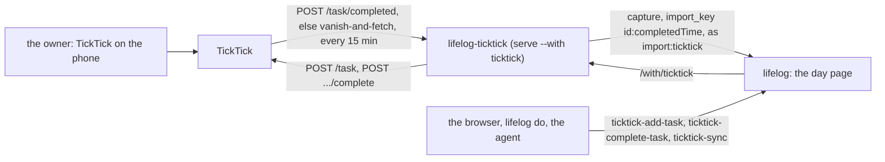

# 155 — TickTick: the first connected app, in this repo

> Dated implementation record. Tests use temporary folders and synthetic data. The owner's live `life.db` is never
> opened by a test, and no test calls TickTick: a fake stands for it.

## Status

- **Date / baseline:** 2026-10-29, `054138b` (master), after [plan 154](154-connected-apps-through-the-catalog.md).
- **Priority:** P1. **Effort:** M. **Risk:** LOW for the file and the core: nothing of them changes. The risk is in the
  third party's API, which no test reaches; the owner tests the live login and the first sync.
- **Status:** IN REVIEW (owner). Built 2026-10-29 on master by a sub-agent in a worktree and reviewed before the merge;
  in `extensions/ticktick`: `go mod tidy -diff` empty, `go vet`, `go test ./...` (the end-to-end test on the real
  `lifelog serve --with ticktick` and a fake TickTick, both ways of finding the done tasks) and `staticcheck` pass; at
  the root `go vet ./...` and the tests of `cmd/lifelog` and `tests` pass. The owner builds `lifelog-ticktick` beside the
  installed `lifelog` (the Tests section). Three things differ from the plan as written: a `Poller` type owns the clients, the
  state and the one lock (the plan's `Sync` had no home for a mutex); `Task.Done()` and `Due()` take no argument;
  `GET /tasks/{id}` is an outer route around `app.Catalog`, which has no hook for a route that is not an action. Two
  limits are in the extension's README: the Open API lists no Inbox project, so the home and the vanish-and-fetch way
  do not see Inbox tasks (`/task/completed` does), and that way misses a task created and done between two polls.
  Live (the owner, 2026-10-29): the login succeeded, with the address of the redirect pasted on the terminal (the
  program runs on a server; `04927cc`). The first sync wrote 0: a probe with the owner's token (counts only) showed
  that the live `POST /task/completed` answers an empty list to every `startDate` and `endDate` in every form, and the
  whole list to an empty body; `completedTime` has the form the client parses, with the zone `Europe/Bucharest`. The
  client now asks with an empty body and the connector keeps the tasks since its cursor (`e157f2c`, `c4b20cd`). The
  rest of the live steps (the sync, the unit) are the owner's.
- **Resolves:** the owner's word of 2026-10-29 (below). No issue: the schema and the contract do not change.

## The owner's words (2026-10-29)

Plan 154 ended with "the TickTick connector is a separate repo". Then: "Let's have this as a mono-repo and ticktick is
the first official one supported by us." So the connector is `extensions/ticktick` in this repo, an extension of ring 3
(it names the third party; the core does not: `ticktick` is in the list of the boundary test), and the first connected
app the project supports.

## What is true at the baseline

- A connected app is an extension run under `lifelog serve --with NAME` that serves a Siren catalog on `LIFELOG_LISTEN`
  ([the contract of an extension](../../extensions/README.md#a-catalog-of-its-own), [API.md](../../API.md#connected-apps)).
  The server merges its actions as `NAME-action` at `/with/NAME`; the CLI's `do`, the MCP tools and the browser carry
  them. `lifelog/app` is the Go package a connected app serves with; `cmd/lifelog/testdata/withapp/main.go` is the
  example. `client.Remote` with `siren.ImportPrefix+"ticktick"` writes as `import:ticktick`.
- `capture` (`POST /days/{day}/capture`) takes `text`, `mood` and `import_key`; a resend with the same key answers
  "Already added" and writes nothing ([imports](../contract/imports.md)). An `import:*` writer's entry starts
  `(HH:MM, via ticktick)`.
- An extension keeps its state in `os.UserConfigDir()/lifelog-NAME/`; a child that cannot go on until the owner acts
  exits 2 (`app.ExitOwnerActs`), and `serve` does not start it again.
- TickTick's Open API, as its reference describes it (not verified against the live service by a test): OAuth2 with
  the authorize URL `https://ticktick.com/oauth/authorize` (`client_id`, `scope`, `state`, `redirect_uri`,
  `response_type=code`), the token URL `https://ticktick.com/oauth/token` (form body `code`, `grant_type=authorization_code`,
  `scope`, `redirect_uri`; `client_id` and `client_secret` as HTTP Basic); scopes `tasks:read tasks:write`; the base
  `https://api.ticktick.com/open/v1`; `GET /project` (the lists), `GET /project/{id}/data` (a list with its undone
  tasks), `GET /project/{p}/task/{id}`, `POST /task` (create: `title`, `projectId`, optional `content`, `dueDate`,
  `isAllDay`, `timeZone`), `POST /project/{p}/task/{id}/complete`, and on recent servers `POST /task/completed`
  (`projectIds`, `startDate`, `endDate`: the tasks completed in the range). A task has `id`, `projectId`, `title`,
  `content`, `status` (0 open, 2 done), `completedTime`, `dueDate`, `startDate`, `timeZone`, `isAllDay`, `priority`,
  `tags`, `items`.

## The decisions

| question | answer |
|---|---|
| where | `extensions/ticktick`: module `lifelog-ticktick`, binary `cmd/lifelog-ticktick`, packages `ticktick` (the API client, OAuth2 by hand over `net/http`) and `connector` (the sync and the catalog). Standard library, `lifelog/siren`, `lifelog/client`, `lifelog/app`. Never `lifelog/internal`. |
| the name | `lifelog ticktick ...`; the program `lifelog-ticktick`; the writer `import:ticktick`; the actions `ticktick-add-task`, `ticktick-complete-task`, `ticktick-sync` in the merged catalog; the state folder `lifelog-ticktick`. |
| what comes back | each completed task is one `capture` on the day of its `completedTime` in the task's `timeZone` (else the connector's local zone), text `Done: TITLE` (the list's name after a middle dot when the list is not the Inbox: `Done: Pay rent · Home`), `import_key` = the task's `id` plus `:` plus `completedTime`, so a repeat completed twice is two entries and a resend writes nothing. Nothing else of a task enters the file: the file is the log of what was done. |
| how it finds them | two ways, one chosen at run time: `POST /task/completed` with `startDate` = the cursor, when the server answers it; else the vanish-and-fetch way: the connector keeps the set of open task ids it saw, and a task that is no longer in its list's data is fetched by id: `status` 2 is done (its `completedTime` names the day), a 404 is a deleted task (nothing). The cursor (an instant) and the seen set live in `state.json` of the state folder; the cursor moves to the newest `completedTime` seen minus one day of overlap (idempotence makes the overlap free). |
| when | under `serve --with ticktick`: a poll every 15 minutes (`poll` in `config.json`, a duration string) and one at the start; on demand: `lifelog ticktick sync` does one poll and prints the count. No two polls at once. |
| two-way | the catalog of the app: `GET /` home (class `ticktick`, title "TickTick", the lists with their open tasks of today and overdue as embedded entities, each with its `complete-task` action; properties `lists`, `open`, `overdue`), `add-task` (`POST /tasks`: `title` required, `list` optional with `options` = the names of the lists read at the start, `due` optional date `YYYY-MM-DD`, `notes` optional textarea), `complete-task` (`POST /tasks/{id}/complete`, path field `id`), `sync` (`POST /sync`: one poll now; answers the home with the count written), `GET /tasks/{id}`. None is owner-only: the agent may add and complete a task, which is the point. |
| login | `lifelog ticktick login`: asks `client_id` and `client_secret` on the terminal (or reads `--client-id`, `--client-secret`), opens a loopback redirect server on `127.0.0.1:PORT` (the owner registers `http://127.0.0.1:PORT/callback` with a fixed PORT, 8765, in the TickTick developer console; `--port` changes it), prints the authorize URL, exchanges the code, writes `token.json` (0600) in the state folder. No browser is opened by the program: it prints the URL. |
| the token | long-lived; on a 401 from TickTick the connector logs `login again: lifelog ticktick login` and exits 2 under `--with` (the owner acts first); `sync` on demand prints the same line and exits 2. No refresh flow in this version: the reference shows none. |
| the API base | `api` in `config.json`, default `https://api.ticktick.com/open/v1`; the authorize and token URLs likewise. A test points them at a fake. The region variant (Dida365) is a config value, not code. |
| refusals | the connector refuses what it does not take: an unknown argument, an unknown field (the server does that before it), a `due` that is not a date (422 through `app.Error`), a list name that is not a list (422), a task id TickTick does not know (404 with TickTick's own code `not_found`). A TickTick error becomes `app.Error{Status: 502, Code: "upstream", Msg: "TickTick answered STATUS"}` without TickTick's body (it may hold the owner's words). |
| no catalog without a token | with no `token.json`, the connector under `--with` serves no catalog: it logs the login line and exits 2 at once. |
| docs | `extensions/ticktick/README.md` (the setup in the developer console, the login, the sync, the catalog, the build line, a diagram); `extensions/README.md` names it as the first connected app; `README.md` build line, extensions list and the layout row; `site/index.html` changes only if the README's card list it mirrors changes (check). The core changes nothing: no table row of the surfaces. |

## Part 1 — The API client (`extensions/ticktick/ticktick`)

1. `Client{Base string; Token string; HTTP *http.Client}` with `Projects(ctx)`, `ProjectData(ctx, id)`, `Task(ctx, project, id)`,
   `Create(ctx, Task)`, `Complete(ctx, project, id)`, `Completed(ctx, from, to time.Time, projects []string)` (returns
   `ErrNoCompletedEndpoint` on 404 or 405). Types `Project{ID, Name}`, `Task{ID, ProjectID, Title, Content, Status,
   CompletedTime, DueDate, StartDate, TimeZone, IsAllDay}`; `Task.Done() (time.Time, bool)` parses `completedTime`
   (`2006-01-02T15:04:05.000-0700`) in `TimeZone`. A non-2xx answer is `*StatusError{Status}` (the body is not kept).
   10 s timeout per call.
2. `OAuth{ClientID, ClientSecret, AuthorizeURL, TokenURL, RedirectURI}` with `AuthorizeLink(state)` and
   `Exchange(ctx, code) (token string, err)`.
3. Tests on an `httptest` fake of every call, including the 404 of `Completed` and a 401.

## Part 2 — The connector (`extensions/ticktick/connector`)

1. `State{Cursor time.Time; Seen map[string]string}` (task id to project id) in `state.json`; `Config{API, AuthorizeURL,
   TokenURL, Poll}` in `config.json` with defaults written at the first login; `token.json`. `Dir()` is
   `app.StateDir("ticktick")`.
2. `Sync(ctx, tt *ticktick.Client, lf *client.Client, st *State, now time.Time) (written int, err error)`: the two ways,
   the mapping to `capture` (`day` of `completedTime` in the zone; `text`; `import_key`), the count of entries that
   were not "Already added". A page refused by lifelog is an error with the task's id, never its words.
3. `Catalog(tt, lists) http.Handler` on `app.Catalog`: the home, `add-task`, `complete-task`, `sync`, `GET /tasks/{id}`.
   `sync` runs `Sync` under the one mutex the timer uses.
4. `Serve(ctx, ...)`: `app.Listen` plus the ticker; one `Sync` at the start; exit 2 on a 401.
5. Tests: a fake TickTick (`httptest`) and an in-process lifelog (`client.InProcess` is not available to an extension:
   use the real `lifelog` binary as the other extensions do, or an `httptest` fake of `capture` for the unit tests of
   the mapping; the end-to-end test uses the real one).

## Part 3 — The command (`cmd/lifelog-ticktick`), the end-to-end test and the docs

1. `lifelog-ticktick login [--client-id --client-secret --port]`, `lifelog-ticktick sync`, `lifelog-ticktick` with no
   argument under `--with` (`LIFELOG_LISTEN` set) serves; with no argument and no `LIFELOG_LISTEN` it prints the
   usage and exits 2. `--url` as the other extensions take it; `LIFELOG_URL` otherwise; no URL refuses with the line to
   run. Exit codes as the WhatsApp agent: 1 an error, 2 the owner acts first.
2. `extensions/ticktick/e2e_test.go` (skipped under `-short`): builds the real `lifelog` and `lifelog-ticktick` into one
   folder, starts a fake TickTick with two lists and three tasks, writes a `config.json` that points at the fake and a
   `token.json`, with `XDG_CONFIG_HOME` in a temporary folder; runs `lifelog serve --db F --addr 127.0.0.1:0 --with
   ticktick`; waits for `with ticktick: a catalog of 3 actions`; asserts: the completed task of the fake is a capture
   on its day with `(HH:MM, via ticktick) Done: ...` in the day's body; `ticktick-sync` a second time writes nothing
   (the day's body is unchanged); `lifelog do ticktick-add-task title=Milk list=Home --url` creates the task in the
   fake with the right `projectId`; `ticktick-complete-task` on it completes it in the fake, and the next sync writes
   its `Done:` entry; `GET /with/ticktick/` as a browser shows "TickTick" and the open tasks; a fake that answers 401
   makes the child exit 2 and the server log `not started again`. A second run of the e2e against the vanish-and-fetch
   way: the fake without `/task/completed`.
3. The docs of the decisions table. `README.md`: the build line `go build -C extensions/ticktick -o ../../lifelog-ticktick
   ./cmd/lifelog-ticktick`, the extensions list entry, the layout row. `extensions/README.md`: the list of the
   extensions names `ticktick` as the first connected app; `deploy/lifelog.service` comment names `--with ticktick`.

## Tests

- `go vet ./... && go test ./...` in `extensions/ticktick` (the e2e builds the real `lifelog`); the root baseline is
  unchanged (the root does not build an extension); `staticcheck ./...` in the folder; `go mod tidy -diff`.
- The owner, live: register the app in the TickTick developer console with the redirect `http://127.0.0.1:8765/callback`,
  `lifelog ticktick login`, `lifelog ticktick sync --url http://127.0.0.1:7777` once, then `--with ticktick` in the
  service unit with `ReadWritePaths` for `~/.config/lifelog-ticktick`.

## Done when

1. `lifelog serve --with ticktick` lists `ticktick-add-task`, `ticktick-complete-task` and `ticktick-sync` in
   `GET /actions`; the agent adds and completes a task through them; a task completed in TickTick is an entry of its day
   within one poll, once.
2. The end-to-end test holds all of it on the real `lifelog` and a fake TickTick, both ways of finding the done tasks.
3. The core is unchanged: `git diff --stat master -- internal cmd app client siren docs tests` is empty but for the
   README and the extensions contract.
