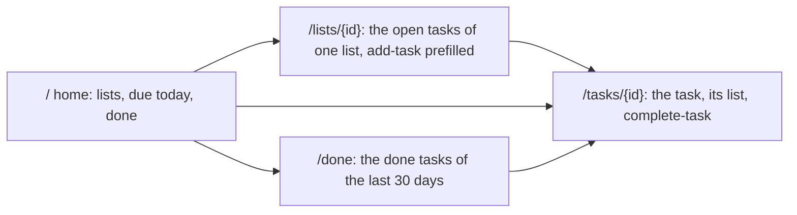

# 156 — Browse the tasks of TickTick inside lifelog, through the catalog

> Dated implementation record. Tests use temporary folders and synthetic data. The owner's live `life.db` is never
> opened by a test, and no test calls TickTick: a fake stands for it.

## Status

- **Date / baseline:** 2026-10-29, `b3d0a89` (master), after [plan 155](155-ticktick-the-first-connected-app.md).
- **Priority:** P2. **Effort:** S. **Risk:** LOW: nothing of the file or the core changes; the connector serves more resources.
- **Status:** IN REVIEW (owner). Built 2026-10-29 on master (`9f1c584`) by a sub-agent in a worktree, reviewed before the
  merge. Checks in `extensions/ticktick`: `gofmt -l .` printed nothing; `go vet ./... && go test ./...` passed (the
  end-to-end test on the real `lifelog serve --with ticktick` included); `go mod tidy -diff` empty; `staticcheck ./...`
  clean; `govulncheck ./...` found no vulnerability. In the root: `go test ./cmd/lifelog -run With` passed. Two small
  choices: the helper that answers a GET route is `respond`, because `write` is the name of the capture sender in
  `sync.go`; the task page links its list only when the list is one that TickTick reported (the Inbox has no page).
  Live 2026-10-30: the owner rebuilt `~/.local/bin/lifelog-ticktick` and restarted the service at 12:55:26; the log says
  `with ticktick: a catalog of 3 actions on 127.0.0.1:41639`, and the first poll wrote 0 entries.

## Context

The owner (2026-10-29) asks: "Can we make an interface directly in lifelog to navigate the tasks from ticktick
directly in app? The app should use the agnostic api." Plan 154 gives the mechanism: a connected app serves a Siren
catalog, lifelog forwards `/with/NAME/...` and draws any answer with the `generic` template
(`internal/api/view/html/layout.html` (the `generic` template): title, links, properties, embedded entities as links, every action as
a form). Plan 155 gives `lifelog-ticktick` with a home (`/`), `GET /tasks/{id}` and three actions.

Today the browser at `/with/ticktick/` shows counts and the tasks due today or before, nothing else. To navigate,
the connector must serve the graph: home → lists → tasks → one task, and the done tasks. **Nothing in the core
changes**: ring 2 already draws and forwards any entity, the CLI reads it with `lifelog get /with/ticktick/... --url`,
and the MCP reaches it through the same catalog. The core still names no third party.



## Part 0: the record

`docs/plans/156-browse-the-tasks-through-the-catalog.md` (index `docs/plans/README.md`: next number 157), commit,
push. No issue and no RFC: the file and the contract do not change; it is a change of an extension.

## Part 1: the connector serves the graph (`extensions/ticktick/connector/catalog.go`)

- **Home** (`homeEntity`, line 189): keep `open`, `overdue`, `written`. Embed one link per list, class `list`, href
  `/lists/{id}`, title the list name, with its open count in the title (`Home · 4`). Keep the tasks due today or
  before as embedded class `task` links. Add the link rel `done` → `/done`, title "Done". Keep `add-task` and `sync`.
  The Inbox stays as it is today (TickTick's `/project` does not list it, so its tasks are not read; say so in the
  README).
- **`GET /lists/{id}`**: new route beside `GET /tasks/{id}` (the `mux` at line 65; a shared `write(w, e, err)` helper
  replaces the inline switch, used by both routes). Class `list`, title the list name, properties `open`, `overdue`;
  embedded class `task` links to `/tasks/{id}` in TickTick's order, title `TITLE · due YYYY-MM-DD` when due; links
  `self`, `index` (`/`). Action `add-task` with the field `list` carrying `Value: name` (the generic form prefills a
  field's `value`). An unknown list id → 404 `not_found`.
- **`GET /done`**: class `done`, title "Done", the tasks of `Completed(ctx)` with `completedTime` in the last 30 days,
  newest first; embedded links title `YYYY-MM-DD · TITLE · LIST`, href `/tasks/{id}`; property `count`. A server
  without the call (`ErrNoCompletedEndpoint`) → an empty list with the property `note: "the server has no list of done
  tasks"`. The day comes from `Task.Done()` in the task's zone, as `sync.go` computes it (reuse `entryOf`'s day, do not
  compute it a second way).
- **Task** (`taskEntity`, line 158): add the link rel `list` → `/lists/{projectId}`, title the list name, when the
  task has a list. `find` (line 128) keeps working for a done task: `Completed` is the second place it looks when
  the lists do not have the id, so `/tasks/{id}` of a done task answers with `done: true` and no `complete-task`.
- `listName`, `remember`, `upstream` stay. No new TickTick call: `ticktick.go` has `Projects`, `ProjectData`,
  `Task`, `Completed`.

## Part 2: tests (`extensions/ticktick/connector/catalog_test.go`, the fakes in `fakes_test.go`)

- The home embeds one `list` link per list with its count in the title, and the `done` link.
- `GET /lists/{id}` lists the open tasks of that list only, prefills `list` in `add-task`, 404 on an unknown id.
- `GET /done` lists the done tasks of the window newest first and skips an older one; the empty answer when the fake
  has no `/task/completed`.
- A task links its list; a done task found through `Completed` has no `complete-task`.
- `e2e_test.go`: one read through the real `lifelog serve --with ticktick`: `GET /with/ticktick/lists/ID` as
  `Accept: text/html` is 200, holds the task titles as links to `/with/ticktick/tasks/...` and a form posting to
  `/with/ticktick/tasks` with the list filled (proves the generic view is enough, no core change).
- In `extensions/ticktick`: `gofmt`, `go vet ./... && go test ./...`. The root baseline does not build it, so the root
  is untouched; run `go test ./cmd/lifelog -run With` once to be sure nothing of the handshake moved.

## Part 3: docs

- `extensions/ticktick/README.md`: a section "Browse the tasks" with the diagram above; the rows `GET /lists/{id}`,
  `GET /done`, `GET /tasks/{id}`; how to reach them: the rail link "TickTick" in the browser, `lifelog get
  /with/ticktick/ --url http://127.0.0.1:7777` on the CLI, the MCP through the same server; the Inbox limit.
- Plan 156 status line. Nothing in `README.md`, `API.md` or `docs/`: the core does not change.

## Part 4: live (the owner runs it with `!`)

```
go build -C extensions/ticktick -o ~/.local/bin/lifelog-ticktick ./cmd/lifelog-ticktick
sudo systemctl restart lifelog
journalctl -u lifelog -n 5     # with ticktick: a catalog of 3 actions on 127.0.0.1:PORT
```

Then open the rail link "TickTick", one list, one task; complete one task from its page and see the Done entry
after `ticktick-sync`.

## Decided by default

- No core change. If the browsing needs something the generic view lacks (a count beside an embedded link, a
  property drawn as a table), that is a change of ring 2 for every app, proposed separately with the owner's word.
- Due-today tasks stay on the home; the lists are the way to the rest. No "all open tasks" page: the lists are it.
- 30 days for `/done`, the same window as the first sync.
- Implementation by one Sonnet sub-agent in a worktree from master (`refactoring` + `a-philosophy-of-software-design`),
  the main session reviews and runs the checks in `extensions/ticktick`.
- The open `at` field of `capture` (plan 155) stays open; this plan does not touch it.
