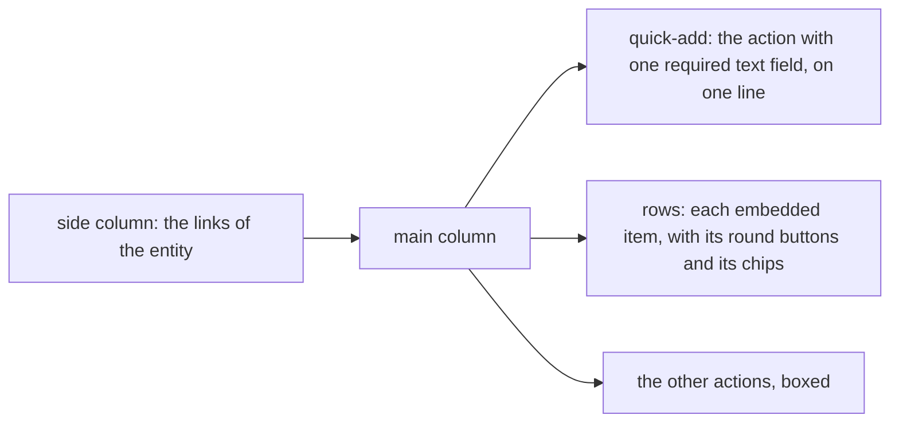

# 157 — A task manager's feel, through the catalog

> Dated implementation record. Tests use temporary folders and synthetic data. The owner's live `life.db` is never
> opened by a test, and no test calls TickTick: a fake stands for it.

## Status

- **Date / baseline:** 2026-10-30, `875fc5d` (master), after [plan 156](156-browse-the-tasks-through-the-catalog.md).
- **Priority:** P2. **Effort:** M. **Risk:** LOW for the file: nothing of `schema.sql` changes. MEDIUM for the
  browser: the generic view changes for every connected app and for every core page that it draws.
- **Status:** PLANNED, approved by the owner 2026-10-30 ("implement all"). Not started.

## Context

The owner (2026-10-30) asked how the pages of TickTick in lifelog can feel more like TickTick while they keep the
rules. The answer (approved): copy how a task manager works, not how it looks. The pages keep the Hearthwood look. The
core never says "task": every rule of the view reads the shape of a Siren answer, never a name of an app. The owner
also asked whether WhatsApp can add tasks. It can (the agent's tools come from the merged catalog), but the agent
reads the catalog once at its start, so an app that registers later is not in its tools.

## Part A: the core (ring 2, for every app)

- **`siren.Link` may carry `properties` and `actions`** (an extension of Siren, for an embedded link only: a short
  form of an embedded representation that keeps its `href`). `Entities` stays `[]Link`. API.md, the entity section,
  says it.
- **`inNamespace`** (`internal/api/with.go`) rewrites the actions of each embedded link as it rewrites the actions of
  the entity: a path gets `/with/NAME`, a name gets `NAME-`, an action that is not a path is dropped.
- **The generic view** (`internal/api/view/html/layout.html`, `app.css`), three rules on the shape only:
  1. **Quick-add.** The first action of the entity whose required fields are exactly one field of type `text` is
     drawn at the top of the main column as one line: that field, the button, and the other fields folded under
     "More fields". It is not drawn a second time under Actions.
  2. **Rows.** Each embedded link is a row. An action of the row that has no field but its path fields is a round
     button before the title (its title is the button's accessible name). Another action of the row is boxed after it.
     The scalar properties of the row are chips after the title. A row with no properties and no actions stays as
     today, with its rel badge.
  3. **Two panes.** On a wide screen the links of the entity, except `self`, are a side column, and the link of the
     page the browser is on is marked current. On a narrow screen they stay in the header, as today.
- Tests: view tests with synthetic entities for each rule; an `inNamespace` test for the embedded actions; the test
  app of `cmd/lifelog/testdata/withapp` embeds an item with a no-field action, and `with_app_test.go` posts its row's
  form through `/with/testapp/...`.
- Docs: `API.md` (the embedded link), `extensions/README.md` ("What the app serves": how the browser draws an app's
  page, so an author of a connector knows the three rules).

## Part B: the connector (`extensions/ticktick`, after Part A is on master)

- `ticktick.Task` gains `priority` (0 none, 1 low, 3 medium, 5 high).
- **Every embedded task is a row**: href `/tasks/{id}`, title, properties `due` (YYYY-MM-DD), `priority` (`high`,
  `medium`, `low`, absent for none) and `list` on the pages that mix lists; the action `complete-task` (no field) on an
  open task. Open tasks are sorted by due day (none last), then by priority (high first), then in TickTick's order.
- **One Complete.** The row's round button is the one Complete form of the browser (one way to do a thing). The page of
  a task does not draw it again: it links to its list. `ticktick-complete-task` of the catalog does not change.
- **The side column on every page**: Today (`/`), Next 7 days (`/next7`), each list, Done. Only the home reads every
  list, so only the home gives each list its open count.
- **The home is Today**: the rows of the tasks due today or before, and `add-task` with `due` filled with today. Its
  title stays TickTick (the rail). No `/today`: it would draw the home a second time.
- **`GET /next7`**: the open tasks due from today to today + 6, across lists, with `list` and `due` chips.
- **A list**: its rows, the quick-add of `add-task` with the list filled, and the link "Done in this list" to
  `GET /lists/{id}/done` (the done tasks of the list in the last 30 days, newest first).
- Tests in `connector/` and one end-to-end read: the page of a list has a round button that posts to
  `/with/ticktick/tasks/{id}/complete`. README: the routes and what the browser draws.

## Part C: WhatsApp reads the catalog at each turn (`extensions/whatsapp`)

- The agent reads `GET /actions` at the start of each turn, as it reads Settings, and builds its tools from it. A read
  that fails keeps the tools of the last turn and writes one line in the log. `say` and `save-body` are checked at the
  start only. A test: an action added to the fake catalog between two turns is a tool of the second turn.

## Order and checks

1. Parts A and C, in parallel, each by a Sonnet sub-agent in a worktree from master; the main session reviews and
   merges. 2. Part B on top of A. 3. Screenshots of the test app and the main session's review.
- Root: `go vet ./... && go test ./...`, `staticcheck`, `govulncheck`, `-shuffle=on`. Each extension touched:
  `go vet ./... && go test ./...` and `go mod tidy -diff` in its folder (`extensions/mcp` too, since `siren` changes).
- Live (the owner, with `!`): rebuild `~/.local/bin/lifelog`, `~/.local/bin/lifelog-ticktick` and
  `~/.local/bin/lifelog-whatsapp`, restart the service, read its log.

## Decided by default

- The round button is the one Complete of the browser; the task page links to its list (the rule "one way to do a
  thing"). The owner may ask for the button on the task page too.
- No new icon in the pixel-art sheet: the round button is drawn by CSS with the tokens of `app.css`.
- Skills: Part A `a-philosophy-of-software-design` + `code-complete`; Parts B and C `refactoring` +
  `a-philosophy-of-software-design`.
