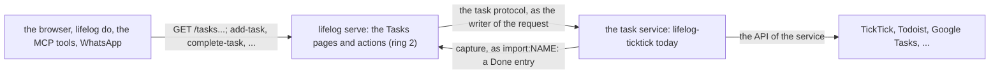

# 158 — One task service behind Tasks

> Dated implementation record. Tests use temporary folders and synthetic data. The owner's live `life.db` is never
> opened by a test, and no test calls a task service: a fake stands for it.

## Status

- **Date / baseline:** 2026-10-30, `53fcdd1` (master), after [plan 157](157-a-task-manager-feel-through-the-catalog.md).
- **Priority:** P2. **Effort:** L. **Risk:** LOW for the file: nothing of `schema.sql` changes, and the file keeps no
  task ([D23](../decisions/D23-no-tasks.md)). MEDIUM for ring 2: a new section, six actions while a task service runs,
  and a new role in the handshake.
- **Status:** IN REVIEW (owner). The owner approved the plan on 2026-10-30. Built 2026-10-30 on master by two
  sub-agents in worktrees, each reviewed before the merge: Part A `9b24aad` and `6846ccd` (an error of the task service
  says "the task service", never the name of the child), Part B `f4a0b09` and `bbfbc40` (the edit form sends every
  field, so the day that a task has already keeps its due with its time; a test held the fault first). Checks: root
  `go vet ./... && go test ./...` and `go test -count=1 -shuffle=on ./...` passed, `staticcheck ./...` (2026.2.2)
  clean, `govulncheck ./...` no vulnerabilities, `CGO_ENABLED=1 go test -race -count=1 ./cmd/lifelog -run
  'Task|With'` passed (the sub-agent's run); in `extensions/ticktick`: `go vet`, `go test -count=1 -shuffle=on ./...`
  (the end-to-end test ran the real `serve --with ticktick`), `go mod tidy -diff` and `staticcheck` clean; in
  `extensions/whatsapp` and `extensions/mcp`: `go vet` and `go test -count=1 -shuffle=on ./...` passed. Not done:
  screenshots, and the live check of reopen and of a cleared due day or notes against the real TickTick, which no
  test can reach. Linux only.
  Counter-review 2026-10-30 (Opus; Fable was at its usage limit), five findings, all fixed: `538cc45` (two lists of
  one name get unique names, and a list id given twice refuses the service; new tests prove that a refused write
  never calls the service and that Tasks and its six actions go when the service ends), `282e78d` (an edit sends back
  the whole task as TickTick gave it, so the priority, the tags, the reminders and the completion time stay; a new due
  day moves the start day too; the zone is a real zone name, never "Local"; no message to a client names the task
  manager) and `19102d4` (the values of TickTick pass byte for byte, so a number over 2^53 does not change). Checks
  on master `19102d4`, after plan 159 Part A: root `go vet ./... && go test ./...` and `go test -count=1
  -shuffle=on ./...` passed, `staticcheck ./...` clean, `govulncheck ./...` no vulnerabilities, `CGO_ENABLED=1 go test
  -race -count=1 ./cmd/lifelog -run 'Task|With'` passed; in `extensions/ticktick`, `extensions/whatsapp` and
  `extensions/mcp`: `go vet`, `go test -count=1 -shuffle=on ./...`, `go mod tidy -diff` and `staticcheck` clean.

## Context

The owner (2026-10-30): "I don't want in sidebar to have ticktick entry, but I want to have tasks, and a common
denominator pair of features that can adapt to most of the task management services. The app will never know if
it's ticktick or todoist or google tasks. Only one integration type will be active at one time."

The owner's answers (2026-10-30):
- **lifelog builds the pages.** The provider is a small data adapter.
- **The common set** is the lists, Today, Next 7 days, Done, add, complete, **edit, reopen and delete**. There is no
  priority, because Google Tasks has none.
- **No Tasks entry** in the rail while no task service runs.

Today (plans 155 to 157) the TickTick connector builds every page, and lifelog draws them under `/with/ticktick` with
the rail entry "TickTick" and the actions `ticktick-*`. After this plan, lifelog owns a Tasks section at `/tasks`
with the actions `add-task` and the others. One child of `serve --with` says in its handshake that it is the task
service, and it answers a small fixed protocol. The core never names the service. A Todoist or Google Tasks
adapter is the same protocol, about ten routes.

D23 holds: the file keeps no task. lifelog shows the tasks of the app the owner plans in. `docs/` does not change.



## The task protocol (the provider serves it on LIFELOG_LISTEN)

The home is `extensions/README.md`, in a new section "A task service". All answers are Siren JSON. Data is in
`properties`.

| route | answer |
|---|---|
| `GET /actions` | class `actions` **and `tasks`**: this marks the task service. The actions are the six writes below. |
| `GET /lists` | `properties.lists`: `[{id, name}]` in the order of the service. The default list may be absent. |
| `GET /open[?list=ID]` | `properties.tasks`: the open tasks, in the order of the service. |
| `GET /done?since=YYYY-MM-DD[&list=ID]` | `properties.tasks`: the tasks done on that day or later. |
| `GET /tasks/{id}` | class `task`, `properties` = one task. An unknown id is 404 `not_found`. |
| `POST /tasks` | fields `title` (required), `list` (an id; absent means the default list), `due` (a day), `notes`. Answer: the task. |
| `POST /tasks/{id}` | edit: `title`, `notes`, `due`. A field that is not sent stays as it is. An empty `due` or `notes` clears it. |
| `POST /tasks/{id}/complete`, `/reopen`, `/delete` | Answer: the task (delete: the task as it was). |
| `POST /sync` | Read the done tasks and write a Done entry for each, once. Answer: `properties.written`. |

A task is `{id, title, list, notes?, due?, done, done_day?, done_at?}`:
- `list` is the list id, or `""` for the default list.
- `due` and `done_day` are days (YYYY-MM-DD) in the zone of the task.
- `done_at` is an RFC 3339 instant.

An error is the error entity, as for any app. The service writes its Done entries as today (`capture` with
`import_key`, as `import:NAME`). That part does not change.

## Part 0: the record

- Write `docs/plans/158-one-task-service-behind-tasks.md`. The index `docs/plans/README.md` then says that the next
  number is 159.
- Commit and push.
- There is no issue and no RFC, because the file and `docs/` do not change.

## Part A: the core (ring 2)

**The registry** (`internal/api/with.go`, `cmd/lifelog/with.go`):
- If the catalog of a child has the class `tasks`, `probeCatalog` reads `GET /lists`. It then calls a new
  `Apps.SetTasks(name, base, lists)`, not `Set`.
- A task service is not an app. It has no `/with/NAME`, no rail link and no `NAME-*` actions.
- The service is refused with one log line in these cases:
  - Another task service runs ("a task service runs already: NAME"). This is the one-at-a-time rule.
  - Its catalog does not have one of the six writes ("the task service has no action POST /tasks/{id}/reopen").
- `Remove` clears the role.
- `client.Remote` stays in `with.go`. The boundary test does not change.

**The routes and pages** (a new file, `internal/api/tasks.go`):
- The page code moves from `extensions/ticktick/connector/catalog.go` into this file:
  - `links` for the side column, `taskRow`, the Today and Next 7 days filters, the overdue count, and the done
    window of 30 days.
  - `sortOpen` stays, but it sorts by due day only. A task with no due day goes last. Tasks with the same day keep
    the order of the service.
- "Today" is the day in the owner's zone, from the clock that the core uses now. It is not `time.Local` of the
  service.

| route | page |
|---|---|
| `GET /tasks` | Today: the tasks due today or before, across the lists. It has quick-add `add-task` with `due` = today, and `sync-tasks`. |
| `GET /tasks/week` | Next 7 days, today to today + 6. |
| `GET /tasks/lists/{id}` | The open tasks of one list. It has `add-task` with `list` filled, and the link "Done in this list". |
| `GET /tasks/lists/{id}/done`, `GET /tasks/done` | The tasks done in the last 30 days, newest first. |
| `GET /tasks/items/{id}` | One task. It has the `edit-task` form, with the current values filled, and `delete-task`. |

- Rows:
  - An open row has the round button Complete (`complete-task`, no field).
  - A done row has the round button Reopen (`reopen-task`, no field).
  - The chips are `due`, `list` (only on a page that mixes lists) and `done`.
- Tasks are under `/tasks/items/`, so a task id can never be the same as `week`, `done` or `lists`.
- If no task service runs, every `/tasks` route is 503 `unavailable` ("no task service runs").

**The actions** are in `GET /actions` only while a task service runs. This is the rule of the app actions now, so the
README table, which reads a server with no child, does not get them. They follow the catalog rules:
`fieldsOf`, refused fields, and 422.

| action | route | fields | marks |
|---|---|---|---|
| `add-task` | `POST /tasks` | `title` (required), `list` (the names from `/lists`), `due` (date), `notes` (textarea) | |
| `edit-task` | `POST /tasks/items/{id}` | `id` (path), `title`, `notes`, `due` | |
| `complete-task` | `POST /tasks/items/{id}/complete` | `id` (path) | |
| `reopen-task` | `POST /tasks/items/{id}/reopen` | `id` (path) | |
| `delete-task` | `POST /tasks/items/{id}/delete` | `id` (path) | `owner`, `danger` |
| `sync-tasks` | `POST /tasks/sync` | none | |

- The core maps a list name to its id before it forwards `add-task`. A list that is not known is refused by
  `options` (422).
- The core sends only the fields that the request names, as `appFields` does. That is what makes "not sent stays as
  it is" work for `edit-task`.
- The forwarding reuses `forwardError`, `source(r)` and the timeout of 30 seconds.
- `Apps.Set` also refuses an app action whose name with the prefix is one of these six names.

**The view** (`internal/api/view`):
- `htmlOf` (`page.go:269`) and `QuickAdd` (`rows.go:19`) now read the prefixes `/with/` and `/tasks` through one
  helper, `drawnByShape(path)`.
- The rail gets `Shell.Tasks bool`. When it is true, the entry `{"Tasks", "/tasks", "tasks", []string{"/tasks"},
  "day"}` comes after Browse. A phone shows it in the More sheet with the day sections.
- `internal/pixelart/icons.go` gets a new 10×10 glyph `tasks`, a check box in the style of the others. `app.css`
  gets its position.

**The example service** (`cmd/lifelog/testdata/taskservice/main.go`):
- It serves the whole protocol in memory, from `lifelog/app`, and is the example for an author.
- `cmd/lifelog/tasks_test.go` runs it on the real `serve --with` and checks these points:
  - The rail has Tasks and has no app link.
  - `GET /actions` has the six actions and nothing that starts with `taskservice-`.
  - Today, the week, a list, Done and a task page give the right rows, in the right order. The expected values are
    written by hand.
  - Complete, reopen, edit (one field sent, the others stay) and delete change the fake.
  - An agent writer gets 403 on `delete-task`, and the fake does not change.
  - A second task service is refused, and the log says so.
  - With no service, `/tasks` is 503, the rail has no Tasks, and the catalog has no task action.
  - `/with/taskservice` is 404.
- `internal/api/tasks_internal_test.go` holds the sort and the day window. It uses fixed days.

**Docs:**
- `API.md`: a section "Tasks" with the routes, the actions, the 503, and "the actions exist while a task service runs".
- `extensions/README.md`: the section "A task service", with the protocol, the handshake marker, the six writes,
  the refusals and the one-at-a-time rule. The quick-add rule now says "under `/with/NAME` or `/tasks`".
- `README.md`: one paragraph under the table "Every action on every surface" that names the six task actions and
  links API.md.
- `AGENTS.md`: the box of ring 3 adds "or it is the one task service, which ring 2 draws under /tasks (plan 158)".

## Part B: the TickTick connector becomes a task service

- `extensions/ticktick/connector/catalog.go` is replaced by `service.go`, which serves the protocol and no pages:
  - The catalog has the class `tasks`.
  - `/open` reads each list, as `allOpen` does now.
  - `/done` filters `Completed` by `since`. It uses the zone rule of `entryOf` for `done_day`, so the day is not
    computed a second way.
  - `find` stays.
  - A server without `/task/completed` gives an empty `/done`.
- `extensions/ticktick/ticktick/ticktick.go`:
  - Delete `Priority` and `PriorityWord`, because no code reads them now.
  - Add `Update(ctx, t)` (`POST /open/v1/task/{id}`) and `Delete(ctx, project, id)`
    (`DELETE /open/v1/project/{p}/task/{id}`).
  - Reopen is `Update` with status 0.
- The tests change with the code: the fakes in `fakes_test.go` and `catalog_test.go`, which becomes
  `service_test.go`.
- `e2e_test.go` runs the real `serve --with ticktick` and reads `GET /tasks` and a list page as HTML. It checks these
  points:
  - The pages have the rows and the round form `/tasks/items/ID/complete`. A post gives 303, and the task is done in
    the fake.
  - The HTML of these pages does not have the word "TickTick", and `/with/ticktick` is 404.
- `extensions/ticktick/README.md`: the section "Browse the tasks" becomes "The task service". It covers the
  protocol, a link to the contract and the Inbox limit.
- WhatsApp and MCP: no code change. The tools follow the catalog, so `ticktick-add-task` becomes `add-task`. A
  README that names `ticktick-*` is fixed.

## Part C: live (the owner runs it with `!`)

```
go build -o ~/.local/bin/lifelog ./cmd/lifelog
go build -C extensions/ticktick -o ~/.local/bin/lifelog-ticktick ./cmd/lifelog-ticktick
sudo systemctl restart lifelog
journalctl -u lifelog -n 5     # with ticktick: the task service, N lists, on 127.0.0.1:PORT
```

The unit keeps `--with ticktick`. Then:
1. Open Tasks in the rail.
2. Complete a task, then reopen it.
3. Edit the due day of one task.

The owner's first reopen and edit are the live check of two TickTick calls that are not tested on the live API.

## Decided by default

- `delete-task` is owner-only and danger. An agent cannot destroy a record in the service, and lifelog cannot give it
  back.
- Complete and Reopen are only the round buttons of the rows. Edit and Delete are on the task page. This follows
  "one way to do a thing".
- There is no move to another list. Microsoft To Do cannot do it.
- The list names are read once, when the service registers. A new list needs a restart of the service, as today.
- A connected app that does not say `tasks` stays as it is under `/with/NAME`.
- The work is done by two Sonnet sub-agents in worktrees from master:
  - Part A uses `a-philosophy-of-software-design` and `code-complete`.
  - Part B uses `refactoring` and `a-philosophy-of-software-design`, and starts after Part A is merged.
- The main session reviews, merges around the owner's three uncommitted files and runs the checks. Then a Fable
  counter-review.
- The `at` field of `capture` stays open.

## Verification

- Root: `gofmt`, `go vet ./... && go test ./...`, `go test -count=1 -shuffle=on ./...`, `staticcheck ./...` and
  `govulncheck ./...`.
- `extensions/ticktick`, `extensions/whatsapp` and `extensions/mcp`: `go vet ./... && go test -shuffle=on ./...`,
  `go mod tidy -diff` and `staticcheck`.
- The race detector on `cmd/lifelog -run Task` (the registry has a new role).
- All checks run on Linux only. The report says so.
