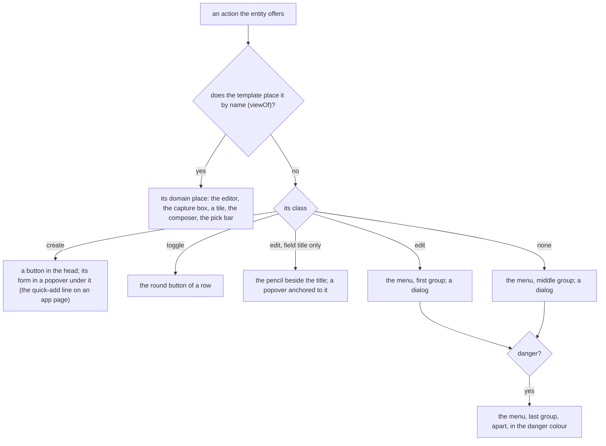
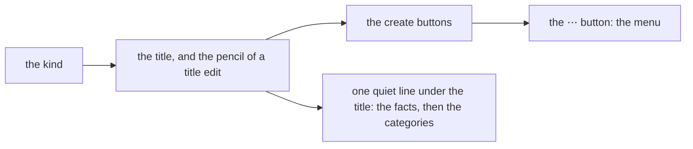

# 159 — The class of an action: the browser places an action by what it does, not by where Siren lists it

> Dated implementation record. Tests use temporary folders and synthetic data. The owner's live `life.db` is never
> opened by a test.

## Status

- **Date / baseline:** 2026-10-30, `5046b38` (master), after [plan 157](157-a-task-manager-feel-through-the-catalog.md).
- **Priority:** P2. **Effort:** L. **Risk:** LOW for the file: nothing of `schema.sql` changes. MEDIUM for the
  browser: the head of every page, the More section and the Facts change, and many view tests pin the old HTML.
- **Status:** BUILT, not seen in a browser and not live. B2 is on master (`d1fc733`, `1124bdf`). Part A is on master (`2474e75`, by a Sonnet sub-agent; `016adb5`, the review: `edit-task`
  of the task service of plan 158 is `edit`, and `reopen-task` is `toggle` as `complete-task` is). The owner
  picked the four elements of the mock-up and the order of B1, B2 and C (2026-10-30). Not live: the service runs the binary of
  before.
- **Counter-review:** the review ran on Opus, because the Fable limit was reached. It found six fixes, and they are
  on master: a non-modal menu dialog was drawn off the screen; the pencil and create popovers were never bottom
  sheets on a phone; the focus of a danger dialog started on the danger button; the `@supports` guard did not check
  `anchor-scope`; the classes of the TickTick connector were dead data (the core catalog of the task protocol is the one
  home); an app action with two classes passed. Open for the owner: the focus return to the ⋯ button after a dialog
  closes (it needs script), and the nits. The nits are: `railOwns` is always false; `_ = http.StatusOK`; the
  every-action-once test has no `/with` and no `/tasks`; no test of the `lead` refusal; a `
` inside a
  ``; `aria-haspopup="menu"` without `role=menu`; loose fits of some classes, such as `file-pages`; `?new=` is kept
  in `back`. The CSS was not rendered in a browser.
- **Resolves:** the owner's words of 2026-10-30 (below). No issue: the API change is additive, and no rule of the data
  changes.

## The owner's words (2026-10-30)

"While the UI/UX looks nice, it looks and feels like an old'ish app and some structure is weird due to the fact that we
base it upon siren. I still want the siren to be the single point of truth." Two levers were offered: the structure
(the templates read more of Siren) and the feel (light-DOM web components). The owner chose the first alone: "Let's do
just Level 1 for now, let's fully research again about Siren and look at other projects and let's fully develop a
plan to fully leverage siren."

## What is wrong today

The browser lays out the parts of the Siren message, not the owner's tasks. The properties are a Facts list in the
margin. The links are side lists. Every action that a template does not place by name is a `
` fold, and the
folds stand one under the other: the More section of a page (rename, edit-person, edit-metric, promote, delete), the
Actions section of the generic view, and the header tools of Browse and Metrics. A fold that opens pushes the page
down. The templates choose the actions by name: 43 calls of `.Action "NAME"`, and `page.html` names five actions in
one condition to decide whether More is drawn. A new action of the catalog is on no page until a template names it.

The cause is in the API, not in the templates alone. A Siren action says how to send it (`method`, `href`, `type`,
`fields`), and this API adds `owner` and `danger`. Nothing says what the action **does** to the resource. So a
template can only list the actions, or name them one by one.

## What the research found

Siren has a member for this, and the API does not use it. The [Siren spec](https://github.com/kevinswiber/siren)
says of an action's `class`: "Describes the nature of an action based on the current representation. Possible values
are implementation-dependent and should be documented. MUST be an array of strings. Optional." A field has a `class`
with the same words. The author of Siren calls this the place for a client "to key 'style' off of class values"
([issue 21](https://github.com/kevinswiber/siren/issues/21)) and says a `class` that carries such information "is
totally valid" ([issue 96](https://github.com/kevinswiber/siren/issues/96)).

| project | what it says about an action's role | lesson for this plan |
|---|---|---|
| [RESTyard HypermediaUI](https://github.com/RESTyard/HypermediaUI) (a generic Siren client) | an action class `destructive` gives a confirm dialog; an action that may not run is left out | a class drives one rule of the client; absent means not legal |
| [D2L Brightspace](https://github.com/Brightspace/d2l-hypermedia-constants) (Siren at scale, web components) | toggle actions (`ToggleFlagged`, `ToggleRead`); the state is an entity class (`selected`, `subscribed`); the presence of an action is the permission | a toggle is an action that flips one state; the current state is in the representation |
| [HAL-FORMS](https://github.com/mamund/hal-forms/blob/master/index.asciidoc) | the template named `default` is the main one; a field has `prompt`, `placeholder`, `readOnly`, `regex`, `min`, `max`, `options`; every hint "MAY be ignored" | a hint never makes a form fail when a client ignores it |
| [Ion](https://ionspec.org/) | forms are links with a rel: `create-form`, `edit-form`, `query-form`; a field has `placeholder`, `visible`, `secret` | create, edit and query are the three common intents |
| [UBER](https://github.com/uber-hypermedia/specification/blob/master/uber-hypermedia.asciidoc), [ALPS](https://datatracker.ietf.org/doc/html/draft-amundsen-richardson-foster-alps-07) | `safe`, `idempotent`, `unsafe` (from the method) | a class never says what the method says already |
| [Ketting](https://github.com/badgateway/ketting) (a generic client) | it drops Siren `class` on actions and fields | design every class so a client that drops it still works |
| [htmx, Hypermedia Systems](https://hypermedia.systems/more-htmx-patterns/) | `hx-confirm` on a destructive action; edit in place rather than in a modal; one form around a table for a bulk action | the dialog of a danger action is the confirm step |

Four pitfalls shape the vocabulary below:

1. **Meaning, not looks.** A class says what the action does (`create`), never how to draw it (`primary`, `red`,
   `sidebar`). Each client decides the look ([issue 38](https://github.com/kevinswiber/siren/issues/38)).
2. **Nothing twice.** The method says safe or unsafe. `danger` and `owner` exist as members. A class does not repeat
   them.
3. **Document each value.** The spec asks for it. API.md lists the values, and a test holds the list equal to the
   code.
4. **A field hint is not a rule of the data.** A `pattern`, `min` or `max` in a form repeats a CHECK of `schema.sql`,
   which AGENTS.md calls a defect (issue 0068). The file refuses; the form only helps.

## The decisions

| question | decision |
|---|---|
| the member | the Siren `class` of an action (`[]string`, `omitempty`). It is standard Siren, not an extension. |
| the values | three: `create`, `edit`, `toggle` (the table below). No action has more than one. An action with none is the default: the browser draws it in the ⋯ menu. |
| `danger` and `owner` | they stay booleans. The CLI, the MCP tools and the extensions read them, and a class would hold them twice. |
| the look | the Hearthwood look does not change: the colours, the corners, the wood and the pixel art stay. Only where an action is drawn changes. |
| where a template names an action | only where the action has a place in the domain: the body editor (`save-body`), the capture box, a reading tile, the composer, the search box, the pick bar. The table of the views (`viewOf`) lists these names for each template. Every other action is drawn by its class. |
| every action once | each action that an entity offers is drawn once on its page: in its domain place, or by its class. A test holds this for every class of entity. |
| the field hint | the field member `placeholder` (the name of HAL-FORMS and Ion) moves the nine example texts from the templates into the catalog (Part C). No `pattern`, `min` or `max`. |
| the mock-up | the owner (2026-10-30) picked all four elements of the [mock-up](https://claude.ai/artifact/Nn1caAhm7DBmJbuq9QyZXb): the ⋯ menu with its dialogs, the meta line, the pencil of the title, the create buttons in the head. |
| a create form | the owner: an anchored popover under its button, as the pencil's form and the New menu of the rail. A form of the ⋯ menu is a dialog, since the menu closes when an item is picked. |
| the steps | the owner: Part B ships in two steps, B1 (the menu, every action once) and B2 (the head), with screenshots between them. Part C runs beside B1. |
| a toggle in the head | none. The one core `toggle`, `revive`, has its place in the alert of a deleted page. The class places an action on a row only. |
| the day | the day keeps its own head. Every action it offers has a place of its own (the capture box, the tiles, the editor, the cover link), so its menu is empty and is not drawn. |

## The vocabulary

| class | what the action does | the browser draws it | core actions | task actions (core catalog) |
|---|---|---|---|---|
| `create` | it makes a new thing, and the answer is that thing or its list | a button in the head of the page, which opens its form in a popover anchored to it. On an app page, the first `create` action with one required text field is the quick-add line instead. | `create-page`, `create-person`, `add-file`, `register-metric`, `record`, `capture`, `snapshot` | `add-task` |
| `edit` | it changes this resource's own properties | the first group of the ⋯ menu, each in a dialog. An `edit` whose one field is `title` is a ✎ beside the title, with its form in a popover anchored to it. | `rename`, `edit-person`, `edit-metric`, `correct`, `save-body`, `set-cover`, `settings`, `file-pages`, `promote` | — |
| `toggle` | it flips one state of this resource: no field, or one field of two options | on a row, the round button (with no field). A page has no toggle in its head: `revive` has its place in the alert of a deleted page. | `revive` | `complete-task` |
| none | anything else | the ⋯ menu, middle group | `say`, `search`, `find`, `browse`, `open-day`, `random-page`, `integrity-check`, `rebuild-search`, `resync-links` | — |

`tombstone-pages` and `retract` have no class: they are `danger`, which puts them last in the ⋯ menu, apart, in the
danger colour. Their dialog says what they do; it is the confirm step. A GET action keeps its own drawing where a
template places it (the search box, the random button).

## The head of a page

Every view but the day gets one head, drawn by one template:

- **The facts move into the head.** The Facts section of the margin goes. Its values become one quiet line under the
  title: for a person the full name and the dates, for a file the type and the short SHA-256, then `created 3 Oct
  2026`. On the generic view, the scalar properties are this line; an object property stays a panel.
- **The ⋯ menu** is a popover anchored to its button (anchor positioning, as the New menu of
  [plan 149](149-the-browser-on-the-current-platform.md)). Each item is a button with `commandfor` and
  `command="show-modal"`, which opens a `<dialog closedby="any">` that holds the form. There is no script. On a phone the
  menu is a sheet from the bottom, as the More sheet of the rail. The owner's actions carry the `owner` mark. A page
  whose menu is empty draws no ⋯ button.
- **The pencil and the create buttons** each open a popover anchored under the button (`popovertarget`), which holds the
  form. The button stays in view. A popover keeps its typed text when it closes and opens again.
- **The ⋯ button needs the menu before the page is drawn.** The head comes before the body, so the view cannot learn
  from the body which actions it placed. The table of the views says it: `viewOf` maps a class to its template **and**
  to the names that template places itself. The menu draws the other actions. The test "every action once" catches a
  template that draws a name the table does not list, or does not draw a name it lists.
- **A form asked by its link** (`?new=rename`, the forms that a link of the rail or a list opens) is drawn as an open
  dialog (`<dialog open>`, not modal) at the top of the column, with Close, wherever the form lives otherwise: HTML
  cannot open a popover or a modal dialog with no script. A refused form still answers with the error page, which
  keeps the text sent.
- **The day keeps its own head**: its date, its steps and the Today strip. Each action it offers has its own place.
- **`/actions` stays as it is.** It is the catalog, so it lists every action boxed. The head does not apply there.

## Part 0: the mock-up (done)

The [mock-up](https://claude.ai/artifact/Nn1caAhm7DBmJbuq9QyZXb) has seven boards, in the Hearthwood tokens: a person
before and after, the Delete dialog, the pencil, a phone in dark with the menu as a sheet, People in Browse, and a
TickTick list. The owner picked all four elements (2026-10-30).

## Part A: the class in the contract (ring 2, done)

- `siren.Action.Class` and `siren.ActionClasses()`; `spec.Class`, copied by `base()`; the classes of the vocabulary;
  `knownClasses` in `inNamespace` and `specOfApp` drops a class that is not in the list.
- The quick-add is the first `create` action with one required text field and no path field. A round button is a
  `toggle` action of a row with no field. Any other row action is boxed.
- The task service of plan 158: `add-task` is `create`, `edit-task` is `edit`, `complete-task` and `reopen-task` are
  `toggle`, in the core rows and in `extensions/ticktick`.
- API.md has "Action classes"; `extensions/README.md` says the rules read the class. Tests in
  `internal/api/class_internal_test.go`.

## Part B1: the menu and every action once (ring 2, the view)

- `viewOf` becomes a table of `{template, places []string}`: the actions each template draws by name. `view.Menu()` is
  the actions of the entity that are not placed and not `create`: the `edit` actions first, then the others, then the
  `danger` actions. A `toggle` that no template places goes to the menu too.
- One template `menu` (in `layout.html`): the ⋯ button, the anchored popover with its three groups, and one `<dialog>`
  for each item with the form inside. `page.html`, the measurement, `metrics.html` (the series and the board),
  `browse.html`, the period pages, the integrity page and `generic` (with `/with/` and `/tasks`) draw it in their head.
  The ⋯ menu of the conversation (plan 148) keeps its links and backlinks, and its actions come from this template.
- The `create` actions stay where they are drawn today (the boxed tools of the head with the `lead` option, the
  quick-add), through one template `creates`, which B2 changes. Rename goes to the menu in B1 and to the pencil in B2.
- An asked form (`?new=NAME`) is an open dialog at the top of the column.
- Each form carries `data-action="NAME"`, so a test counts the forms of an action on a page.
- The hard-coded lists go: the condition and the More section of `page.html`, and the Actions section of `generic`.
- `app.css`: the menu (anchored, a sheet under 900 px), the dialog of a form, the danger group. The tokens of the design
  system only: no new colour.
- Tests:
  - `TestEveryActionOfAnEntityIsDrawnOnce`, in `internal/api`: for every class of entity that a browser draws, built
    through the real writer with synthetic data (a page, a person, a file, a metric and its series, a measurement, a
    deleted page, Browse, Metrics, a week, the integrity page, a page of the test app and of `/tasks` with a fake
    service), the HTML has exactly one form or one opening link for each action that the JSON of the same address
    offers.
  - The menu: a `danger` action is last and apart; an owner action has the owner mark; an empty menu draws no button;
    `?new=NAME` draws an open dialog with the form filled.
  - The tests that pin `<details class="action"` change with the drawing, and say so in the commit message:
    `view_forms_test.go`, `view_page_test.go` (`TestTheMoreRowOfAPageOpensOneFormAtATime` becomes a test of the menu),
    `actions_page_test.go`, `snapshot_test.go`, `measurements_test.go`, `periods_test.go`, `view_strip_test.go`,
    `view/forms_test.go`, `view/rows_test.go`, `cmd/lifelog/with_app_test.go`, `extensions/ticktick/e2e_test.go`.
- README: the column "browser" of [every action on every surface](../../README.md#every-action-on-every-surface) names
  the menu where an action moves to it. The section of the browser says the menu.
- Screenshots after B1 (the owner allows the review server, or runs it with `!`).
- Done: `8c865ad` (a Sonnet sub-agent; reviewed, every check passed again in the main session). What the build found:
  `create` actions go through `Creates()`, so the Metrics board now has an Add a reading button (the board offers
  `record`, and the test of every action once found that no form drew it); "Make it a metric" is a link, not an
  action, so it moved from the old More section to the margin; `/actions` has its own template, `catalog`; the day and
  the pages of `/tasks` are not in the test of every action once (the day draws one `record` form for each metric, and
  the fake task service of the tests answers 500), and a test of their own covers each. Not seen in a browser yet: the
  anchoring of the menu, the bottom sheet, and whether the menu closes when a dialog opens.

## Part B2: the head (ring 2, the view; after B1 is on master)

- One template `page-head`: the kind, the title with its pencil, the meta line, the categories, the create buttons and
  the menu of B1. The pages of B1 call it; the day does not.
- **The meta line** takes the place of the Facts section of `page-margin`, and of the Properties panel of `generic` for
  its scalar values.
- **The pencil**: an `edit` action whose one field that is not a path field is `title` (today `rename`) is a pencil
  beside the title, with its form in a popover anchored under it. It leaves the menu.
- **The create buttons**: the template `creates` draws each `create` action that no template places as a button in the
  head, with its form in a popover anchored under it. The `lead` option of the form helper goes. On a page drawn by
  shape, the quick-add stays the one line; another `create` action is a button.
- Tests: a title edit is the pencil and is not in the menu; a `create` action is a button with a popover; the meta line
  of a person, a file and a generic entity; the Facts section is gone.
- README: the browser column names the pencil and the head.
- Screenshots after B2.
- Done: `d1fc733` (a Sonnet sub-agent) and `1124bdf` (the review: `anchor-scope` keeps the anchor name `--pop` inside
  each button and its popover; a popover is in the top layer, so with no scope each would hang from the last button of
  that name). What the build found: a view adds its own parts to the head (crumbs, steps, links) through the template
  function `slot`; the Metrics board offers `register-metric` first, so New metric is its primary button; the mermaid
  diagram of `extensions/README.md` still says "the other actions, boxed" (the menu now). Not seen in a browser yet.

## Part C: the placeholder of a field in the catalog (ring 2, beside B1)

- `siren.Field` gets `Placeholder string` with `json:"placeholder,omitempty"`: the words that a client may show in an
  empty field, an example of a value or a short prompt; a client may ignore it. It is an extension of Siren, named as
  in HAL-FORMS and Ion. Done: `5f76120` (a Sonnet sub-agent) and `57016f9` (the review: "Pick a metric" is a prompt,
  not an example, so the MCP tool says Placeholder; `promote` `name` has none). The two forms that know a metric's
  unit set its words with `Prompt`.
- The nine texts of the templates move to their fields in the catalog: `create-person` `name` and `title`, `capture`
  `text`, `record` `metric`, `file-pages` `category` (two copies in `layout.html` today, one field in the catalog),
  `register-metric` `name`, `note` and `unit`, `edit-person` `name`. The `placeholder` option of the form helper goes.
- The MCP extension puts a placeholder in the description of the tool's field as an example. `lifelog actions` shows it
  after the field.
- Docs: API.md, the field member. Tests: a field of the catalog with a placeholder draws it; the form helper has no
  `placeholder` option; the MCP tool's field describes the example.
- C touches `catalog.go`, `siren`, `forms.go` (the option), the templates' `placeholder` arguments and `extensions/mcp`.
  B1 touches the templates around the forms. The two merge by hand where a template line holds both.

## Order and checks

1. B1 and C, in parallel, each by a Sonnet sub-agent in a worktree from master; the main session reviews and merges
   C first (it is small), then B1. Screenshots.
2. B2 on top of B1. Screenshots.
3. A Fable counter-review of the merged diff of B1, B2 and C.

- Root: `go vet ./... && go test ./...`, `go test -count=1 -shuffle=on ./...`, `staticcheck ./...`, `govulncheck ./...`.
- In `extensions/mcp`, `extensions/ticktick` and `extensions/whatsapp`: `go vet ./... && go test ./...` and
  `go mod tidy -diff`.
- Live (the owner, with `!`): rebuild `~/.local/bin/lifelog` (the class of a task action comes from its own catalog of
  the task protocol, so the connector sends none), restart the service, read its log.

## Not taken

| idea | why not |
|---|---|
| web components (Level 2: swap a region after a write, live search, `[[` completion) | the owner's word: Level 1 first. The one-script rule stays. |
| `danger` and `owner` as classes | the CLI, the MCP tools and the extensions read the booleans; a class would hold them twice |
| look words (`primary`, `secondary`, `rare`) | a class says what the action does; the browser chooses the look. The ⋯ menu is the default, so no class says "rare". |
| `pattern`, `min` and `max` on a field | a rule about the data is a CHECK of `schema.sql`; a form hint would repeat it (issue 0068), and a pattern differs between RE2 and the browser |
| field value objects `{title, value, selected}` (the Siren schema) | `options` works; a value that may be a list broke clients |
| a `profile` link or an ALPS document | API.md documents the classes; there is one family of clients |
| state classes on a row (`done`, `selected`) | no app needs one yet; the first connector that does adds it with its rule |
| a class `disabled` | an action that is not legal is not offered (API.md) |
| the forms as links with a rel (`create-form`, `edit-form`, Ion, RFC 6861) | the class says the same thing inside the action that Siren already has |

## Decided by default

- `capture` and `record` are `create`, but the day draws them in their domain places (the capture box, the tiles).
- `reopen-task` is `toggle`, as `complete-task` is: it flips the same state.
- `set-cover` is placed by the link `choose-cover` (the picker), which the table lists for the page and the day.
- `file-pages` is `edit`: its domain places are the category badges and the pick bar, so it never reaches the menu.
- Skills: Part A `a-philosophy-of-software-design` + `code-complete`; Parts B1, B2 and C `refactoring` +
  `a-philosophy-of-software-design`.
