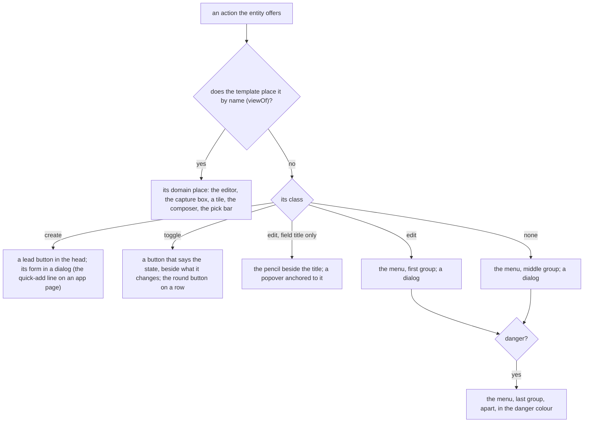
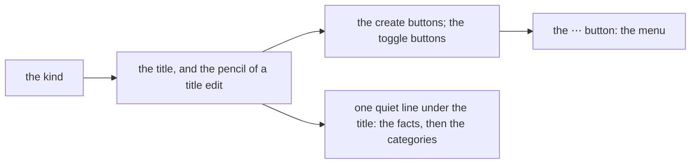

# 159 — The class of an action: the browser places an action by what it does, not by where Siren lists it

> Dated implementation record. Tests use temporary folders and synthetic data. The owner's live `life.db` is never
> opened by a test.

## Status

- **Date / baseline:** 2026-10-30, `5046b38` (master), after [plan 157](157-a-task-manager-feel-through-the-catalog.md).
- **Priority:** P2. **Effort:** L. **Risk:** LOW for the file: nothing of `schema.sql` changes. MEDIUM for the
  browser: the head of every page, the More section and the Facts change, and many view tests pin the old HTML.
- **Status:** PLANNED. A mock-up comes first (Part 0). The owner picks each element, and only then does the build
  start.
- **Resolves:** the owner's words of 2026-10-30 (below). No issue: the API change is additive, and no rule of the data
  changes.

## The owner's words (2026-10-30)

"While the UI/UX looks nice, it looks and feels like an old'ish app and some structure is weird due to the fact that we
base it upon siren. I still want the siren to be the single point of truth." Two levers were offered: the structure
(the templates read more of Siren) and the feel (light-DOM web components). The owner chose the first alone: "Let's do
just Level 1 for now, let's fully research again about Siren and look at other projects and let's fully develop a
plan to fully leverage siren."

## What is wrong today

The browser lays out the parts of the Siren message, not the owner's tasks. The properties are a Facts list in the
margin. The links are side lists. Every action that a template does not place by name is a `
` fold, and the
folds stand one under the other: the More section of a page (rename, edit-person, edit-metric, promote, delete), the
Actions section of the generic view, and the header tools of Browse and Metrics. A fold that opens pushes the page
down. The templates choose the actions by name: 43 calls of `.Action "NAME"`, and `page.html` names five actions in
one condition to decide whether More is drawn. A new action of the catalog is on no page until a template names it.

The cause is in the API, not in the templates alone. A Siren action says how to send it (`method`, `href`, `type`,
`fields`), and this API adds `owner` and `danger`. Nothing says what the action **does** to the resource. So a
template can only list the actions, or name them one by one.

## What the research found

Siren has a member for this, and the API does not use it. The [Siren spec](https://github.com/kevinswiber/siren)
says of an action's `class`: "Describes the nature of an action based on the current representation. Possible values
are implementation-dependent and should be documented. MUST be an array of strings. Optional." A field has a `class`
with the same words. The author of Siren calls this the place for a client "to key 'style' off of class values"
([issue 21](https://github.com/kevinswiber/siren/issues/21)) and says a `class` that carries such information "is
totally valid" ([issue 96](https://github.com/kevinswiber/siren/issues/96)).

| project | what it says about an action's role | lesson for this plan |
|---|---|---|
| [RESTyard HypermediaUI](https://github.com/RESTyard/HypermediaUI) (a generic Siren client) | an action class `destructive` gives a confirm dialog; an action that may not run is left out | a class drives one rule of the client; absent means not legal |
| [D2L Brightspace](https://github.com/Brightspace/d2l-hypermedia-constants) (Siren at scale, web components) | toggle actions (`ToggleFlagged`, `ToggleRead`); the state is an entity class (`selected`, `subscribed`); the presence of an action is the permission | a toggle is an action that flips one state; the current state is in the representation |
| [HAL-FORMS](https://github.com/mamund/hal-forms/blob/master/index.asciidoc) | the template named `default` is the main one; a field has `prompt`, `placeholder`, `readOnly`, `regex`, `min`, `max`, `options`; every hint "MAY be ignored" | a hint never makes a form fail when a client ignores it |
| [Ion](https://ionspec.org/) | forms are links with a rel: `create-form`, `edit-form`, `query-form`; a field has `placeholder`, `visible`, `secret` | create, edit and query are the three common intents |
| [UBER](https://github.com/uber-hypermedia/specification/blob/master/uber-hypermedia.asciidoc), [ALPS](https://datatracker.ietf.org/doc/html/draft-amundsen-richardson-foster-alps-07) | `safe`, `idempotent`, `unsafe` (from the method) | a class never says what the method says already |
| [Ketting](https://github.com/badgateway/ketting) (a generic client) | it drops Siren `class` on actions and fields | design every class so a client that drops it still works |
| [htmx, Hypermedia Systems](https://hypermedia.systems/more-htmx-patterns/) | `hx-confirm` on a destructive action; edit in place rather than in a modal; one form around a table for a bulk action | the dialog of a danger action is the confirm step |

Four pitfalls shape the vocabulary below:

1. **Meaning, not looks.** A class says what the action does (`create`), never how to draw it (`primary`, `red`,
   `sidebar`). Each client decides the look ([issue 38](https://github.com/kevinswiber/siren/issues/38)).
2. **Nothing twice.** The method says safe or unsafe. `danger` and `owner` exist as members. A class does not repeat
   them.
3. **Document each value.** The spec asks for it. API.md lists the values, and a test holds the list equal to the
   code.
4. **A field hint is not a rule of the data.** A `pattern`, `min` or `max` in a form repeats a CHECK of `schema.sql`,
   which AGENTS.md calls a defect (issue 0068). The file refuses; the form only helps.

## The decisions

| question | decision |
|---|---|
| the member | the Siren `class` of an action (`[]string`, `omitempty`). It is standard Siren, not an extension. |
| the values | three: `create`, `edit`, `toggle` (the table below). No action has more than one. An action with none is the default: the browser draws it in the ⋯ menu. |
| `danger` and `owner` | they stay booleans. The CLI, the MCP tools and the extensions read them, and a class would hold them twice. |
| the look | the Hearthwood look does not change: the colours, the corners, the wood and the pixel art stay. Only where an action is drawn changes. |
| where a template names an action | only where the action has a place in the domain: the body editor (`save-body`), the capture box, a reading tile, the composer, the search box, the pick bar. The table of the views (`viewOf`) lists these names for each template. Every other action is drawn by its class. |
| every action once | each action that an entity offers is drawn once on its page: in its domain place, or by its class. A test holds this for every class of entity. |
| the field hint | the field member `placeholder` (the name of HAL-FORMS and Ion) moves the nine example texts from the templates into the catalog (Part C). No `pattern`, `min` or `max`. |
| the mock-up | Part 0 comes first, as with plans 137 and 152: a mock-up artifact of a page, a list and an app page, light and dark, wide and phone. The owner picks before the build. |

## The vocabulary

| class | what the action does | the browser draws it | core actions | an app (TickTick) |
|---|---|---|---|---|
| `create` | it makes a new thing, and the answer is that thing or its list | a lead button in the head of the page, which opens its form in a dialog. On an app page, the first `create` action with one required text field is the quick-add line instead. | `create-page`, `create-person`, `add-file`, `register-metric`, `record`, `capture`, `snapshot` | `add-task` |
| `edit` | it changes this resource's own properties | the first group of the ⋯ menu, each in a dialog. An `edit` whose one field is `title` is a ✎ beside the title, with its form in a popover anchored to it. | `rename`, `edit-person`, `edit-metric`, `correct`, `save-body`, `set-cover`, `settings`, `file-pages`, `promote` | — |
| `toggle` | it flips one state of this resource: no field, or one field of two options | a button that says the current state, beside the thing it changes. With one field, it sends the option that is not the current value. On a row, the round button. | `revive` | `complete-task` |
| none | anything else | the ⋯ menu, middle group | `say`, `search`, `find`, `browse`, `open-day`, `random-page`, `integrity-check`, `rebuild-search`, `resync-links` | — |

`tombstone-pages` and `retract` have no class: they are `danger`, which puts them last in the ⋯ menu, apart, in the
danger colour. Their dialog says what they do; it is the confirm step. A GET action keeps its own drawing where a
template places it (the search box, the random button).

## The head of a page

Every view gets one head, drawn by one template:

- **The facts move into the head.** The Facts section of the margin goes. Its values become one quiet line under the
  title: the kind, `created 3 Oct 2026`, and for a person the full name and the dates, for a file the type and the
  short SHA-256. On the generic view, the scalar properties are this line, as chips; an object property stays a
  panel.
- **The ⋯ menu** is a popover anchored to its button (anchor positioning, as the New menu of
  [plan 149](149-the-browser-on-the-current-platform.md)). Each item is a button with `commandfor` and
  `command="show-modal"`, which opens a `<dialog closedby="any">` that holds the form. There is no script. On a phone the
  menu is a sheet from the bottom, as the More sheet of the rail. The owner's actions carry the `owner` mark.
- **The ⋯ button needs the menu before the page is drawn.** The head comes before the body, so the view cannot learn
  from the body which actions it placed. The table of the views says it: `viewOf` maps a class to its template **and**
  to the names that template places itself. The menu draws the other actions. The test "every action once" catches a
  template that draws a name the table does not list, or does not draw a name it lists.
- **A form asked by its link** (`?new=rename`, the forms that a link of the rail or a list opens) is drawn as an open
  dialog (`<dialog open>`, not modal), in the place of the toast, with Close. A refused form still answers with the
  error page, which keeps the text sent.
- **The More section, the Actions section and the boxed header tools go.** The page, the measurement, Browse, Metrics,
  the period pages, the integrity page and the generic view all use the one head. The ⋯ menu of the conversation
  (plan 148) holds its links and backlinks as today, and its actions come from the same menu template.
- **`/actions` stays as it is.** It is the catalog, so it lists every action boxed. The head does not apply there.

## Part 0: the mock-up (main session, before any code)

One artifact page, Hearthwood light and dark, wide and phone: a page (a person with categories, links and the ⋯ menu
open), a dialog of `rename` and of `tombstone-pages`, a Browse list with its create buttons, and a TickTick list with
the quick-add and the round buttons. The owner picks each element: the facts line, the ⋯ menu, the dialog, the pencil
of the title, the create buttons. A screenshot of the real pages before the change goes beside it, from the review
server, when the owner allows it to run.

## Part A: the class in the contract (ring 2)

- `siren.Action` gets `Class []string` with `json:"class,omitempty"`. `siren.Field` does not get a class: no rule needs
  one.
- `spec` in `internal/api/catalog.go` gets `Class`; `base()` copies it. Each action of the table above gets its class.
- `siren` gets one exported list of the values, `ActionClasses()`, as `siren.Codes()` is the one list of the error
  codes.
- `inNamespace` (`internal/api/with.go`) keeps the classes of an app's actions, on the entity and on its embedded
  links. A class that is not in the list is dropped, so an app cannot make the browser draw something unknown.
- `extensions/ticktick`: `add-task` is `create`, `complete-task` is `toggle`.
- **The quick-add rule and the round-button rule read the class.** The quick-add is the first `create` action with one
  required text field and no path field. A round button is a `toggle` action of a row. A no-field action with no class
  on a row is boxed, as an action with fields is. The rule of the shape alone goes: one rule for the core and the apps.
- Docs: `API.md`, the entity section: the action member `class`, and a new section "Action classes" with the table of
  the values (the what, not the look; the look is the browser's). `extensions/README.md`, "How the browser draws a page
  of an app": the three rules read the class.
- Tests:
  - `TestEveryActionClassIsInTheContract`: the list in `siren` equals the table of API.md.
  - A catalog test: every class of the catalog is in the list, and no action has two.
  - An `inNamespace` test: a known class passes, an unknown class is dropped.
  - The tests of the quick-add and the round button (`internal/api/view/rows_test.go`) change with the rule, and say so in
    the commit message.

## Part B: the head and the menu (ring 2, the view)

- `viewOf` becomes a table of `{template, places []string}`. `view.Placed(name)` reports a name of the table. `view.Menu()`
  is the actions of the entity that are not placed, not `create`, not `toggle` and not a title edit. The order is the
  `edit` actions, then the others, then the `danger` actions.
- One template `page-head` (in `layout.html`): the kind, the title with its pencil, the facts line, the categories, the
  create buttons, the toggle buttons, the ⋯ button and the menu with its dialogs. `day.html`, `page.html`,
  `metrics.html`, `browse.html`, the period pages and `generic` call it. The day keeps its date head and its steps.
- Each form carries `data-action="NAME"`, so a test counts the forms of an action on a page.
- The hard-coded lists go: the condition and the More section of `page.html` (lines 62 to 68), the boxed header tools
  of `browse.html` and `metrics.html`, the Actions section of `generic`, and the `lead` option of the form helper (the
  head draws `create` as the lead).
- `app.css`: the head, the facts line, the menu (anchored, a sheet on a phone), the dialog of a form, the danger group.
  The tokens of the design system only: no new colour.
- Tests:
  - `TestEveryActionOfAnEntityIsDrawnOnce`, in `internal/api`: for every class of entity, built through the real
    writer with synthetic data, the HTML has exactly one form (or one link that opens it) for each action that the
    JSON of the same address offers.
  - The head: a `create` action is a lead button with a dialog; a title edit is the pencil; a `danger` action is last
    in the menu; an owner action has the owner mark; `?new=NAME` draws an open dialog.
  - The tests that pin `<details class="action"` change with the drawing, and say so in the commit message:
    `view_forms_test.go`, `view_page_test.go` (`TestTheMoreRowOfAPageOpensOneFormAtATime` becomes a test of the menu),
    `actions_page_test.go`, `snapshot_test.go`, `measurements_test.go`, `periods_test.go`, `view_strip_test.go`,
    `view/forms_test.go`, `view/rows_test.go`, `cmd/lifelog/with_app_test.go`, `extensions/ticktick/e2e_test.go`.
- README: the column "browser" of [every action on every surface](../../README.md#every-action-on-every-surface) names the
  new places (the ⋯ menu, the pencil, the head). The section of the browser says the head and the menu.

## Part C: the placeholder of a field in the catalog (ring 2)

- `siren.Field` gets `Placeholder string` with `json:"placeholder,omitempty"`: an example of a value, which a client may
  show in an empty field and may ignore. It is an extension of Siren, named as in HAL-FORMS and Ion.
- The nine texts of the templates move to their fields in the catalog: `create-person` `name` and `title`,
  `capture` `text`, `record` `metric`, `file-pages` `category` (two copies in `layout.html` today, one field in the catalog), `register-metric` `name`, `note`
  and `unit`, `edit-person` `name`. The `placeholder` option of the form helper goes.
- The MCP extension puts a placeholder in the description of the tool's field as an example. `lifelog actions` shows it
  after the field.
- Docs: API.md, the field member. Tests: a field of the catalog with a placeholder draws it; the form helper has no
  `placeholder` option.

## Order and checks

1. Part 0, the mock-up. The owner picks.
2. Part A, then Parts B and C, each by a Sonnet sub-agent in a worktree from master; the main session reviews and
   merges. B and C touch different files and run in parallel.
3. Screenshots on the review server (wide, phone, light, dark) of a day, a page, a person, a file, a metric, a
   measurement, Browse, Metrics, a week, the integrity page and the TickTick test app.
4. A Fable counter-review of the merged diff.

- Root: `go vet ./... && go test ./...`, `go test -count=1 -shuffle=on ./...`, `staticcheck ./...`, `govulncheck ./...`.
- In `extensions/mcp`, `extensions/ticktick` and `extensions/whatsapp` (the `siren` package changes): `go vet ./... &&
  go test ./...` and `go mod tidy -diff`.
- Live (the owner, with `!`): rebuild `~/.local/bin/lifelog` and `~/.local/bin/lifelog-ticktick`, restart the
  service, read its log.

## Not taken

| idea | why not |
|---|---|
| web components (Level 2: swap a region after a write, live search, `[[` completion) | the owner's word: Level 1 first. The one-script rule stays. |
| `danger` and `owner` as classes | the CLI, the MCP tools and the extensions read the booleans; a class would hold them twice |
| look words (`primary`, `secondary`, `rare`) | a class says what the action does; the browser chooses the look. The ⋯ menu is the default, so no class says "rare". |
| `pattern`, `min` and `max` on a field | a rule about the data is a CHECK of `schema.sql`; a form hint would repeat it (issue 0068), and a pattern differs between RE2 and the browser |
| field value objects `{title, value, selected}` (the Siren schema) | `options` works; a value that may be a list broke clients |
| a `profile` link or an ALPS document | API.md documents the classes; there is one family of clients |
| state classes on a row (`done`, `selected`) | no app needs one yet; the first connector that does adds it with its rule |
| a class `disabled` | an action that is not legal is not offered (API.md) |
| the forms as links with a rel (`create-form`, `edit-form`, Ion, RFC 6861) | the class says the same thing inside the action that Siren already has |

## Decided by default

- `capture` and `record` are `create`, but the day draws them in their domain places (the capture box, the tiles), so
  the day's head has no create button of its own. The owner may ask for one.
- `set-cover` is placed by the link `choose-cover` (the picker), which the table lists for the page and the day.
- `file-pages` is `edit`: its domain places are the category badges and the pick bar, so it never reaches the menu.
- Skills: Part A `a-philosophy-of-software-design` + `code-complete`; Parts B and C `refactoring` +
  `a-philosophy-of-software-design`.
