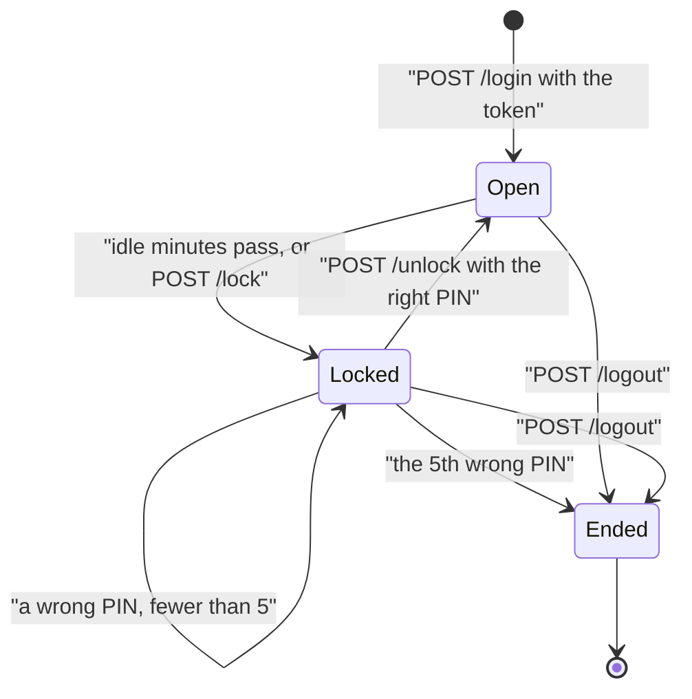
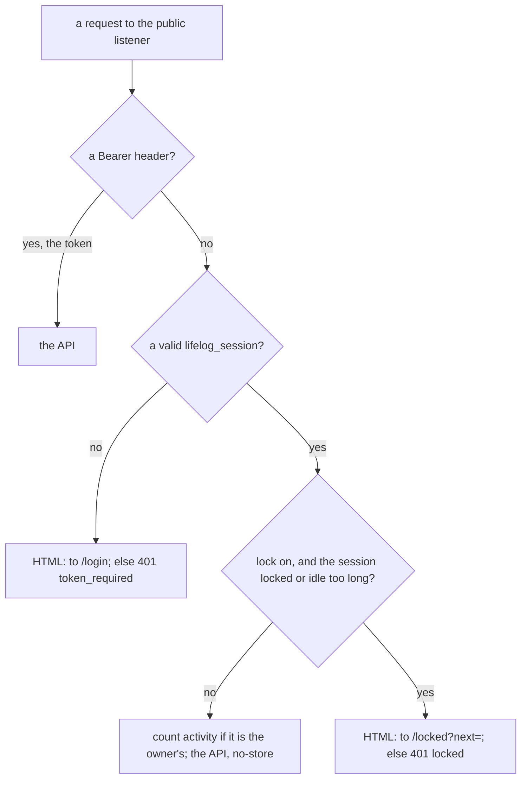

# 160 — The lock: a journal left open closes itself

> Dated implementation record. Tests use temporary folders and synthetic data. The owner's live `life.db` is never
> opened by a test.

## Status

- **Date / baseline:** 2026-10-30, `ff0f1c7` (master).
- **Priority:** P2. **Effort:** M. **Risk:** LOW for the file: nothing of `schema.sql` changes. MEDIUM for ring 2:
  the browser's cookie changes, so every browser logs in with the token once more.
- **Status:** BUILT 2026-10-30, not yet live. Part A `6d43b9e` (the session cookie, the routes, the settings) and its
  review `107a48e` (a lock kept giving back the wrong-PIN tries; a settings read error counted as a wrong PIN; tests
  held both faults first); Part B `6f665f3` (the Lock button in the foot of the rail, access key l; `lock.js`; the
  lock page; `new-password` on the form's password fields). Checks on the merge with master: `go vet ./... && go
  test ./...`, `go test -count=1 -shuffle=on ./internal/... ./cmd/...`, `staticcheck ./...` (2026.2.2) clean,
  `govulncheck ./...` no vulnerabilities, `CGO_ENABLED=1 go test -race` on the lock tests of `internal/api`; in
  `extensions/mcp`, `whatsapp` and `ticktick`: `go vet` and `go test -count=1 ./...` passed. Chromium (Playwright,
  Linux, a synthetic file): 23 checks passed, with fake time for the idle lock, two tabs, typing that keeps a tab
  open, Back after a lock, Alt+L on a wide screen, the More sheet on a phone. Not known: whether the prerender of the
  speculation rules still works under `no-store` (headless Chromium did not prerender, with or without it); a real
  saved login in the settings form (only the attribute was checked). Linux only.

## Context

The owner (2026-10-30): "I want to make some sort of lock mechanism that can be activated, so that if I leave my
journal open, it would close so it won't be seen by prying eyes."

The owner's answers (2026-10-30):
- **A server lock**, not a veil. A locked browser gets the lock screen and nothing of the database. Back and the
  developer tools show nothing.
- **A short PIN unlocks.** The owner sets it in Settings. After 5 wrong PINs the browser must log in with the token.
- **Two triggers:** some idle minutes, and a Lock button. A hidden tab does not lock.

The danger is a person at the owner's own device: a laptop on a desk, a phone in another hand. The lock is not a
defence against a person who has the token, or against the network (the token and TLS hold that).

Today (`internal/api/public.go`) `POST /login` sets the cookie `lifelog_token`, and its value is the token itself, for
one year. The server cannot tell one browser from another, and it cannot lock one. A local listener (no `--public`)
has no login, so it has no lock: the lock is a part of the public listener, as the login is. The live service runs
`--public` on `127.0.0.1:7777` behind the proxy, so every browser of the owner goes through it.

## The decision

### A session in the cookie

`POST /login` with the token sets the cookie `lifelog_session`. Its value is a random id (16 bytes from
`crypto/rand`) and an HMAC-SHA256 of the id, keyed by a key that the server derives from the token. The server
checks the HMAC; it stores no list of sessions on disk. A new token file ends every session, as it does today.

The cookie `lifelog_token` is no longer a credential: it would open a locked browser. A request with it only is sent
to `/login`, and the login clears it. The `Authorization: Bearer` header does not change. A program (the CLI, the MCP
server, an extension) never locks.

The server keeps the state of each session in memory: the last activity, locked or not, and the count of wrong PINs.
A session with a valid HMAC and no state (after a restart of the server) is **locked** when the lock is on. A restart
of the service therefore locks every browser, and the PIN opens it again.

An ended session goes to a list in memory, and its cookie is cleared. After a restart the list is empty, so a copied
cookie of an ended session gets 5 more tries. That is acceptable: the person must copy an HttpOnly cookie first, and
the log shows each wrong PIN.

### What a locked session gets

- A `GET` that wants HTML is sent to `/locked`. The page is like `/login`: no sidebar, nothing of the database. It
  has the PIN field, a Log out button and the page to go back to (`?next=`, a path on this origin only).
- Any other request is 401 with a new error code `locked`. The new code adds the three things together: its code in
  `siren`, its line in [API.md](../../API.md) and its first words in the view (`alertOf`).
- The install files stay open, as today.

### Activity and the idle minutes

The server counts as activity only what the owner does:
- a navigation (`Sec-Fetch-Mode: navigate`) that is not a prefetch or a prerender (no `Sec-Purpose` header), and a
  form post;
- `POST /awake`, which the page script sends when the owner types, clicks or scrolls, at most once in 30 seconds.

The poll of `chat.js` and the prerender of the speculation rules are not activity. A session locks when the idle time
is more than the setting plus one minute. The extra minute covers the 30 seconds of the script.

The server alone cannot clear the screen. One small script, `/assets/lock.js`, is on every page of the shell when the
lock is on:
- It keeps the time of the last input, shared by every tab of the origin (`localStorage`, only a number). Typing in a
  long note keeps the session open.
- When the idle time ends, it sends `POST /lock` and replaces the page with `/locked?next=…`. Every other tab sees the
  shared time and does the same.
- When a tab comes back (`visibilitychange`, `pageshow` from the back-forward cache), it checks the time at once. A
  phone that slept for an hour shows the lock screen, not the journal.
- In a prerender (`document.prerendering`) it does nothing until the page is shown.

Without the script the server still refuses after the idle time, but the old page stays on the screen. The README
says this.

Pages of a session carry `Cache-Control: no-store`, so Back after a lock gets them from the server, which sends
`/locked`. The plan's tests check that the prerender of the speculation rules still works with `no-store`. If it does
not, the report says so, and the owner decides.

A text that is not saved is lost when the screen locks. The script does not keep it: a draft in the browser's storage
is a copy that prying eyes can read.

### The PIN and the minutes are settings

Two new fields of the action `settings` (owner-only, never an MCP tool):
- `lock_after`: `off`, `5`, `10`, `15`, `30` or `60` minutes. `off` is the default. The catalog lists the options.
- `lock_pin`: 4 to 8 digits, type `password`. The settings file keeps only a salted hash
  (`crypto/pbkdf2`, SHA-256, from the standard library). The form never shows the PIN; an empty field keeps the
  stored PIN. `lock_after` other than `off` with no PIN stored and none sent is 422.

A 4-digit PIN has few values, so the hash protects little if the file is read. The limit of 5 tries protects the
PIN. The settings file is mode 0600 beside `life.db`, which holds everything anyway.

The public listener reads the two settings at each request, from the same file, so a change is live at once.

### The Lock button

When the lock is on, the rail of the shell has a Lock button: a form that posts to `/lock`, with `accesskey="l"`
(the owner's rule of native HTML: the browser's own key, no script). `/lock`, `/unlock`, `/locked` and `/awake` are
routes of the public listener, beside `/login` and `/logout`, and they are not actions of the catalog: they are about
one browser, not about the data. The README says this beside the login. The public listener tells the shell that the
lock is on through the request, in one place; the view draws the button from a link of the entity.

## The work

1. `internal/api/public.go` (or a new `lock.go` beside it): the session cookie, its HMAC, the state in memory under a
   mutex, the routes `/lock`, `/unlock`, `/locked`, `/awake`, the rules of activity, `no-store`. The `lifelog_token`
   cookie stops being a credential.
2. `internal/core/settings.go` and `internal/api/settings.go`: `lock_after` and the PIN hash; the catalog's two
   fields; the 422.
3. `internal/api/view`: `locked.html` (from `login.html`), the Lock button in the rail, `lock.js`.
4. `README.md`: the paragraph of the browser login, and the lock beside it. `API.md`: the code `locked`. `site/` only if
   it shows the login.

## Tests

- A session: login sets `lifelog_session`, never the token; a forged or changed HMAC is refused; an old
  `lifelog_token` cookie is sent to `/login`; a new token ends old sessions.
- The lock: with a fixed clock, a session locks after the minutes plus one; the poll of `chat.js`, a prerender
  (`Sec-Purpose`) and a fetch do not keep it open; a navigation and `POST /awake` do. `POST /lock` locks at once.
- A locked session: an HTML `GET` goes to `/locked?next=`; an API request is 401 `locked`; the page `/locked` holds
  no text of the database (a synthetic page title must not be in it); `next` to another origin is refused.
- Unlock: the right PIN opens and goes to `next`; 5 wrong PINs end the session and clear the cookie; a restart (a new
  handler on the same settings) finds the session locked.
- Bearer requests never lock. With `lock_after` `off`, nothing locks and the rail has no Lock button.
- Settings: `lock_pin` of letters, 3 or 9 digits is 422; the file has no PIN in clear; `GET /settings` shows no hash;
  an agent is refused, as for every field of `settings`.
- The cross-origin guard holds for `/lock`, `/unlock` and `/awake`.
- `lock.js` has no unit test harness in the repo: the shared time and the replace are checked by hand in a browser,
  with screenshots, and the report says so.

## Shipping

The owner's browsers log in once with the token after the change. Then the owner sets the PIN and the minutes in
Settings. Install: `go build -o ~/.local/bin/lifelog ./cmd/lifelog`, restart the service, and report its log line.
