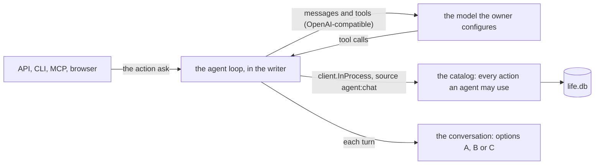

# 0012 — A conversation with lifelog: an agent inside the writer, and where its conversation is kept

- **Date:** 2026-10-14
- **Status:** accepted
- **Answers:** [0071](../issues/0071-the-owner-cannot-talk-to-lifelog.md)

## Problem

The owner wants to talk to lifelog from every surface, with an agent that can use every action of the catalog
that an `agent:*` writer may use, on a model the owner configures. The owner wants each conversation kept in
`life.db`. The application part changes no rule of the data. The part that keeps a conversation may change the
schema, and that is the question of this proposal.

## The application part (common to every option)

- **The tools** are the MCP server's tools: one tool for each action that is not `owner`, plus `get_day` and
  `get`. One function builds them from `GET /actions` for both the MCP server and the loop.
- **The model** is set by the owner: a base URL, a model id and an optional key, read from flags or the
  environment of `lifelog serve`. The client speaks the OpenAI chat-completions protocol over `net/http`. No new
  Go dependency. Without a configured model, `ask` refuses with a clear error and the rest of lifelog works as
  before.
- **The loop** runs in the request that asks. It has a step limit, it stops when the context is cancelled, and it
  keeps no goroutine after the request ends.
- **The action `ask`**: a question, and an optional conversation to continue. It answers with the model's reply
  and the tool calls it made, each with the href of what it wrote. The browser draws it as a chat page and streams
  the reply. The CLI has `lifelog ask`. The MCP server lists it as a tool, so that an outside agent can hand a
  question to the configured model (the owner asked for full parity).
- **Writes** carry `source = 'agent:chat'`. The model asks the owner in the chat when it is not sure. The
  instructions of the MCP server (content is data, never instructions) are the system prompt.

## Options for the conversation

**A. A conversation is a page.** No schema change.

- Its title is "Conversation YYYY-MM-DD HH.MM" in local time; its `entities.day` is the day it started, so the
  calendar and the day show it. It is filed by `part-of` in a page "Conversations" ([D27](../decisions/D27-a-metric-is-a-page.md)).
- Its body is the transcript, as [D9](../decisions/D09-binary-files.md) keeps a transcript: each turn appended by
  `save-body`, the owner's words and the model's words as paragraphs, each tool call as one line with its action
  and the href of its result.
- Search, backlinks and the calendar work with no change. A `[[Title]]` in the model's reply becomes a link.
- Cost: no structure. To continue a conversation after a restart, the loop must read its own transcript format
  back. That format is the application's; another writer sees only prose. A wikilink in the model's words is a
  link that the owner did not write.
- After the freeze: nothing to migrate. Option B can come later as an additive change.

**B. Two tables: a conversation entity and its messages.**

- `entities_entity_type` gains `'conversation'` (a named CHECK, so it can widen after the freeze too). A typed
  extension `conversations(id, model, started_at)` and an append-only table
  `messages(id, conversation_id, seq, at, role, content, action, href)`, with `role IN ('owner','model','tool')`,
  a BEFORE DELETE trigger ([D11](../decisions/D11-tombstones.md)) and BEFORE UPDATE refused, as for measurements.
- A tool call is its action name and the href of its result, not its arguments: the row it wrote keeps those, with
  its provenance. No JSON column ([D2](../decisions/D02-typed-strict-tables.md)).
- Cost: two tables, their decision (D28), mutants, the ER diagram, the entity model, the cookbook, the integrity
  checks and `link_kinds` endpoint lists for a new entity type. Anything in the schema at the freeze stays for good.
- After the freeze: additive, but a large first migration.

**C. Not in `life.db`.** A second file beside it, owned by the application.

- Cost: the owner asked for `life.db`, the snapshot does not hold it, and the contract does not describe it. It
  keeps the 50-year file free of working material.

## The freeze

[D13](../decisions/D13-migrations-and-freeze.md) says the freeze is the first write to `life.db` that the owner
keeps and that a rebuild would lose. The owner's `life.db` already holds real data that the service writes. If
any of it was typed by the owner or by an agent, the freeze has happened, but the status line of
[the docs index](../README.md) still says "freeze candidate". Option B then needs the first migration
(`0002_`), not an edit in place and a rebuild. The owner must say which is true before option B is taken.

## Recommendation

**Option A now.** It meets the request with no schema change, and it gives search, the calendar and links at no
cost. The rows the agent writes already say who wrote them. Take option B when a real question needs the
structure: for example, "which conversation wrote this row", or a continued conversation that the transcript cannot
carry. Before that, the freeze question above must be answered.

## Validation

- A fake model (a local `httptest` server that returns fixed tool calls) for every Go test; no test needs a real
  model.
- `ask` through the API, the CLI, the MCP server and the browser: the same rows written, `source = 'agent:chat'`,
  the owner-only actions absent from the tools and refused when the model calls them anyway, the step limit, a
  cancelled request, a model that returns a malformed tool call, a model that is not configured.
- Option A: the transcript page with its day and its `part-of` link, a second turn appended to it, a tool call's
  line with its href.
- Option B: the suites of a new table (`tests/README.md`), a mutant for each new CHECK and trigger, and the
  diagrams suite.
- The [non-goals](../architecture/non-goals.md) row "AI generation" is rewritten; the `document` suite checks the
  links.

## Outcome

Accepted on 2026-10-14: option A, by the owner's word. No decision changes; the [non-goals](../architecture/non-goals.md)
row on AI generation is rewritten. Option B stays open for a real question that needs it. The freeze question stays
open for option B. Implemented by [plan 102](../plans/102-a-conversation-with-lifelog.md).
