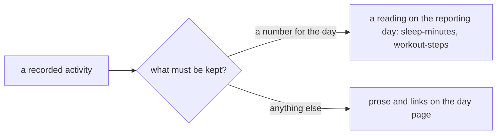

# 0013 — No sessions: a recorded activity is a reading or prose

- **Date:** 2026-10-15
- **Status:** accepted
- **Answers:** [0073](../issues/0073-sessions-cost-more-than-they-give.md), and it closes
  [0020](../issues/0020-imported-sessions-need-time-and-measurement-scope.md)

## Problem

The `sessions` table, the scope of a reading and the owner action `relocate-reading` exist for an import of Fit and
Google Health sessions. That import was removed with the import process (RFC 0011). No row uses them. They are a large
part of the schema, the contract and the writer, and anything still in the schema at the freeze stays for good.

## Options

**A. Keep sessions.** No work now. The cost stays, and after the freeze it stays for good.

**B. Keep sessions and cut the time evidence** to a day and two optional UTC instants. The scope rules, the
relocation and the series scope stay. Most of the cost stays.

**C. Remove sessions.**

- Removed from [schema.sql](../schema/schema.sql): the table `sessions`, its indexes and triggers;
  `measurements.session_id`, the index `measurements_session`, the triggers `measurements_supersede_scope` and
  `measurements_session_live`; the `lifelog_meta` row `measurement_scope`; the session words of the rows `source` and
  `edit_revisions`; the session-kind case of the ghost cleanup.
- Removed pages: the contract pages on session time and measurement scope,
  the cookbook recipe on recorded sessions. [D22](../decisions/D22-events.md) keeps periods only.
- Removed from the writer: the session resources and actions, `relocate-reading`, the series scope, sessions on the
  calendar, the day and the month. The owner-only actions become `register-metric` and `snapshot`.
- Not additive, so it is possible only before the freeze. No data moves: the owner's file has no session row.
- Lost: the start and end clock of one sleep or workout as structure, and two summaries of one metric on one day kept
  apart. A different metric per kind of total, or prose, holds these.

## Recommendation

Option C, as the owner decided on 2026-10-15. It makes `relocate-reading` and the measurement scope redundant, and
the evidence for sessions (issue 0020) does not describe an import that will run.

## Validation

The suites change with the docs: the `sessions` suite and the session mutants go; the counts in `tests/README.md`
change. `go generate ./... && go vet ./... && go test ./...` passes. The catalog has no session resource, no
`relocate-reading`, and no `session_id` field. No new SQLite behaviour is claimed.

## Outcome

Accepted 2026-10-15, option C, as the owner decided. It rewrites [D22](../decisions/D22-events.md) and
[D7](../decisions/D07-measurements.md) in place.
