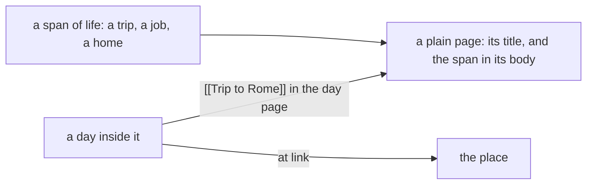

# 0014 — No recorded periods: a span is a plain page

- **Date:** 2026-10-15
- **Status:** accepted
- **Answers:** [0074](../issues/0074-periods-cost-more-than-they-give.md)

## Problem

The entity type `period`, the `periods` table and its boundary grammar answer day-membership questions the owner
does not ask. The owner records where they were on the day page. Anything still in the schema at the freeze stays
for good.

## Options

**A. Keep periods.** No work now; the cost stays for good after the freeze.

**B. Keep the type, drop the grammar:** two exact days. The type, its table, its promotion and the calendar stay.

**C. Remove periods.**

- Removed from [schema.sql](../schema/schema.sql): `period` from `entities_entity_type`; the table `periods` and its
  triggers; `period` from the endpoint types of `wikilink`; the word in the `schema` row and in comments.
- Removed pages: the boundary profile contract and the cookbook recipe on recorded periods. [D22](../decisions/D22-events.md)
  becomes "no recorded spans, sessions or events".
- Removed from the writer: `create-period`, `edit-period`, `promote-period`, `/periods`, the periods of the calendar,
  the month, the week and Home, and the membership code.
- Not additive, so it is possible only before the freeze. The 3 periods of `life.db` become plain pages: same id,
  title, aliases, links and day; the boundaries are written at the top of the body, so no word is lost.
- Lost: a span as structure, and the definite, possible or incomparable answer for a day.

## Recommendation

Option C, as the owner decided on 2026-10-15.

## Validation

The suites change with the docs: the `recorded-periods` suite and the period mutants go; the counts in
`tests/README.md` change. `go generate ./... && go vet ./... && go test ./...` passes. The catalog has no period
action and no `/periods`. No new SQLite behaviour is claimed.

## Outcome

Accepted 2026-10-15, option C, as the owner decided. It rewrites [D22](../decisions/D22-events.md) in place.
