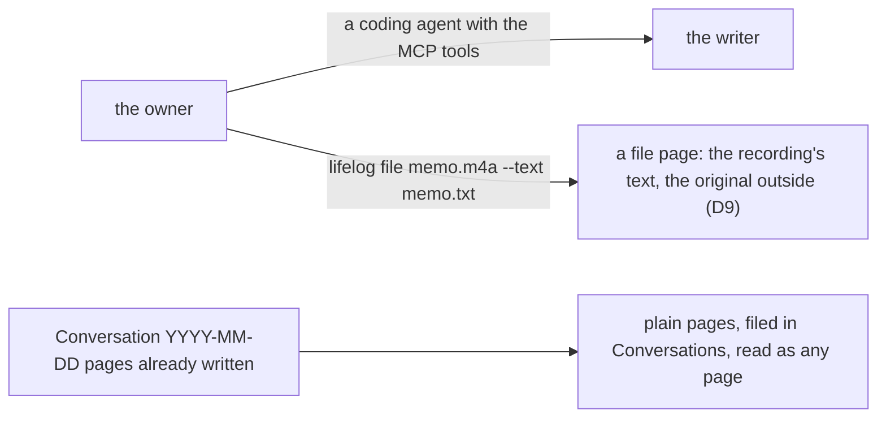

# 0015 — No conversation inside the writer: the owner talks to lifelog through a coding agent

- **Date:** 2026-10-15
- **Status:** accepted
- **Answers:** [0075](../issues/0075-the-conversation-costs-more-than-it-gives.md); closes
  [0071](../issues/0071-the-owner-cannot-talk-to-lifelog.md) and
  [0072](../issues/0072-a-conversation-reads-as-a-page.md) the other way

## Problem

The writer holds a model loop, a transcript format, a chat page and sidebar, and a transcriber client, each
depending on an endpoint outside the binary. The owner wants a simpler and more reliable writer and does not use the
conversation enough to keep it.

## Options

**A. Keep the conversation.** No work now; the two endpoints stay the parts of the writer it does not control.

**B. Keep `ask` on the API alone, with no browser face.** A capability on one surface only is a defect
([AGENTS.md](../../AGENTS.md)).

**C. Remove the conversation and the voice note.**

- Removed from the writer: `ask` (`POST /conversations`), `/conversations` and `/conversations/{id}`, the chat
  page and the chat sidebar, the portraits, `capture`'s `audio` field and the CLI's `--audio`, the packages
  `internal/chat` and `internal/speech`, the environment `LIFELOG_MODEL_*` and `LIFELOG_TRANSCRIBE_*`.
- Nothing in the schema changes: a conversation was pages filed by `part-of` in `Conversations`, and they stay
  so, as plain pages. The recording was never stored.
- Lost: a question answered in words from inside the writer; a voice memo transcribed on capture.

## Recommendation

Option C, as the owner decided on 2026-10-15.

## Validation

`go generate ./... && go vet ./... && go test ./...` passes. The catalog has no `ask` and `capture` has no file
field; the MCP tool list has no `ask`; the sidebar has no Chat. No suite of `tests/` changes: the schema is the same.

## Outcome

Accepted 2026-10-15, option C, as the owner decided. No decision changes. [RFC 0012](0012-a-conversation-with-lifelog.md)
is reversed; the [non-goals](../architecture/non-goals.md) gain a row.
